# DSH Plugin Insight 

按 DSH 使用场景查找插件与相关工具，了解用途、使用条件和核查结果。

[推荐尝试](data/views/columns/RECOMMENDED.md) · [最近发布](data/views/columns/LATEST.md) · [下载热门](data/views/columns/HOT.md) · [按场景查找](data/views/categories/INDEX.md)

## [推荐尝试](data/views/columns/RECOMMENDED.md)

> 看看插件能解决什么问题，以及试用前需要确认什么。

- **[Answer me with HTML](data/plugins/qingyuna--answer-me-with-html/INSIGHT.md)** ｜ 将Agent撰写的扩展Markdown转换为含图表的单文件HTML页面，并提供可选视频输出。

    **推荐理由**：需要交付协议解释或多维比较页面的Agent用户可用已核实短稿试生成单文件HTML。相比手写HTML，源码支持将布局和图坐标交给CLI，作者节时结果尚未在当前任务复现。若图形误导、渲染反复失败或纠错慢于Markdown，应关闭自动附页并退回原草稿。

    **试用条件**：需要在协议或方案比较中交付单页材料的用户，可先选一份已有答案的短稿试渲染，并逐个核对图形关系与原文。若组件错误、图形误导或纠错时间超过直接Markdown，停止自动附页并回到原草稿；敏感文件不因可内联就自动加入输出。视频仅在明确请求且成本可接受时另试。 依据 [Q09](data/plugins/qingyuna--answer-me-with-html/INSIGHT.md#research-q09)。

    [查看完整分析](data/plugins/qingyuna--answer-me-with-html/INSIGHT.md)

- **[no-ai-style](data/plugins/01ngvi-qingyi--no-ai-style/INSIGHT.md)** ｜ 提供英中日写作审阅、润色和起草Skill，附DSH模式插入按钮与离线词法/锚点检查。

    **推荐理由**：适合保留原文、由作者复核的写作流程试用；flags/锚点相同不等语义或原创认证，真实证据需独立核。

    **试用条件**：作者留原文并逐命题复核的可控范围试用，先audit再授权编辑。详见[Q05](data/plugins/01ngvi-qingyi--no-ai-style/INSIGHT.md#research-q05)。

    [查看完整分析](data/plugins/01ngvi-qingyi--no-ai-style/INSIGHT.md)

- **[dsh-plugin-veriscope](data/plugins/4444wjt--dsh-plugin-veriscope/INSIGHT.md)** ｜ 重放VeriScope归档或对已有逐条评分做三态阈值门禁，保存输入/策略绑定回执并重查当前有效性。

    **推荐理由**：已有可信逐条分数与显式策略可试用，先用builtin和独立状态备份；PASS限输入范围，replay需固定环境且发布另负责。

    **试用条件**：可信逐条分数可试用builtin，原replay固定环境，PASS不直接授权发布。详见[Q06](data/plugins/4444wjt--dsh-plugin-veriscope/INSIGHT.md#research-q06)。

    [查看完整分析](data/plugins/4444wjt--dsh-plugin-veriscope/INSIGHT.md)

## [最近发布](data/views/columns/LATEST.md)

> 查看最近发布的版本，了解用途和使用条件。

- [feiyu-memory](data/plugins/airpineapplea--feiyu-memory/INSIGHT.md) · 为个人陪伴保存事件日记，以摘要、近期提示和主动召回延续叙事记忆。 · 
- [DSH Dream Skin](data/plugins/revolutionla--dsh-dream-skin/INSIGHT.md) · 原生 Web 主题、壁纸和主题包定制，配 Host 状态文件支持跨浏览器 origin 保存。 · 
- [dsh-meme](data/plugins/yyh-001--dsh-meme/INSIGHT.md) · 在 DSH 中检索和发送表情图，并用视觉模型收录图片、维护多图库与元数据。 · 

## [下载热门](data/views/columns/HOT.md)

> 从近期下载较多的插件中，寻找适合自己任务的工具。

- [billion-context](data/plugins/ranxianglei--billion-context/INSIGHT.md) · 为长会话提供模型驱动的增量分层压缩、原文恢复、上下文搜索及多客户端代理/原生通道。 · 
- [REA](data/plugins/morluto--rea/INSIGHT.md) · 通过 CLI 与 MCP 统一提供应用工件、JavaScript/Electron 和多种后端的分析操作，返回带来源、推断性质与限制的证据。 · 
- [DSH Market](data/plugins/dsh-market--dsh-market/INSIGHT.md) · 在DSH内浏览社区插件，管理安装、更新、分组、备份与诊断。 · 

## 按场景查找

| 分类 | 用途 | 数量 |
| --- | --- | ---: |
| [个人效率](data/views/categories/PERSONAL-PRODUCTIVITY.md) | 输入、会话、快捷操作与个人工作体验 | 231 |
| [办公与运营](data/views/categories/OFFICE-OPERATIONS.md) | 工作记录、日程、团队用量与日常运营 | 30 |
| [研究与知识](data/views/categories/RESEARCH-KNOWLEDGE.md) | 信息检索、网页读取、笔记与长期知识 | 86 |
| [软件交付](data/views/categories/SOFTWARE-DELIVERY.md) | 代码开发、任务编排、调试与交付流程 | 216 |
| [内容生产](data/views/categories/CONTENT-CREATION.md) | 写作、语音、图片与视频内容生产 | 43 |
| [客户服务](data/views/categories/CUSTOMER-SERVICE.md) | 客户沟通、服务响应与支持流程 | 1 |
| [基础设施](data/views/categories/INFRASTRUCTURE.md) | 模型接入、认证、运行环境与系统支撑 | 123 |
| [其他](data/views/categories/OTHER.md) | 其他尚未归入上述场景的插件 | 3 |

[浏览全部分类](data/views/categories/INDEX.md)

## 研究出处

- [awesome-dsh-plugin/awesome-dsh-plugin](https://github.com/awesome-dsh-plugin/awesome-dsh-plugin)
- [0xsline/awesome-deepseek-harness](https://github.com/0xsline/awesome-deepseek-harness)

## LICENSE

[CC0-1.0](LICENSE)

## 更新时间

2026-10-29
