# DSH Plugin Insight 

按 DSH 使用场景查找插件与相关工具，了解用途、使用条件和核查结果。

[推荐尝试](data/views/columns/RECOMMENDED.md) · [最近发布](data/views/columns/LATEST.md) · [下载热门](data/views/columns/HOT.md) · [按场景查找](data/views/categories/INDEX.md)

## [推荐尝试](data/views/columns/RECOMMENDED.md)

> 看看插件能解决什么问题，以及试用前需要确认什么。

- **[no-ai-style](data/plugins/01ngvi-qingyi--no-ai-style/INSIGHT.md)** ｜ 提供英中日写作审阅、润色和起草Skill，附DSH模式插入按钮与离线词法/锚点检查。

    **推荐理由**：适合保留原文、由作者复核的写作流程试用；flags/锚点相同不等语义或原创认证，真实证据需独立核。

    **试用条件**：作者留原文并逐命题复核的可控范围试用，先audit再授权编辑。详见[Q05](data/plugins/01ngvi-qingyi--no-ai-style/INSIGHT.md#research-q05)。

    [查看完整分析](data/plugins/01ngvi-qingyi--no-ai-style/INSIGHT.md)

- **[dsh-plugin-veriscope](data/plugins/4444wjt--dsh-plugin-veriscope/INSIGHT.md)** ｜ 重放VeriScope归档或对已有逐条评分做三态阈值门禁，保存输入/策略绑定回执并重查当前有效性。

    **推荐理由**：已有可信逐条分数与显式策略可试用，先用builtin和独立状态备份；PASS限输入范围，replay需固定环境且发布另负责。

    **试用条件**：可信逐条分数可试用builtin，原replay固定环境，PASS不直接授权发布。详见[Q06](data/plugins/4444wjt--dsh-plugin-veriscope/INSIGHT.md#research-q06)。

    [查看完整分析](data/plugins/4444wjt--dsh-plugin-veriscope/INSIGHT.md)

- **[dsh-markdown-live](data/plugins/9426haruka--dsh-markdown-live/INSIGHT.md)** ｜ 在 DSH 输入框实时着色/成形 Markdown，并让已发送用户文本复用宿主 Markdown 渲染器。

    **推荐理由**：Markdown重度用户可在固定样本上试用其显示层增强，前提是先验证发送字节、IME和撤销不变。

    **试用条件**：经常写 Markdown 且能接受表格/图片限制的 DSH Desktop 用户可在非关键草稿试用；先复制带中英混排、列表、链接和代码围栏的固定样本，校验发送前后字节与撤销。依赖无障碍输入、超长文档或宿主版本频繁升级的人应先观察。 详见[Q09](data/plugins/9426haruka--dsh-markdown-live/INSIGHT.md#research-q09)。

    [查看完整分析](data/plugins/9426haruka--dsh-markdown-live/INSIGHT.md)

## [最近发布](data/views/columns/LATEST.md)

> 查看最近发布的版本，了解用途和使用条件。

- [DSH Preset Plus](data/plugins/rain-kl--dsh-preset-plus/INSIGHT.md) · 提供可编辑的 system、user、assistant 预设条目、导入导出和请求预填充。 · 
- [dsh-harness-chat-control](data/plugins/1985899182--dsh-harness-chat-control/INSIGHT.md) · 在 DSH Desktop 中引用回答并创建侧边追问会话。 · 
- [DSH Codex UI](data/plugins/michengai--dsh-codex-ui/INSIGHT.md) · 为 DSH 提供输入历史、设置皮肤、主题和侧栏等界面增强。 · 

## [下载热门](data/views/columns/HOT.md)

> 从近期下载较多的插件中，寻找适合自己任务的工具。

- [billion-context](data/plugins/ranxianglei--billion-context/INSIGHT.md) · 为长会话提供分层上下文压缩、按需恢复和搜索，并通过代理或原生集成接入多个客户端。 · 
- [REA](data/plugins/morluto--rea/INSIGHT.md) · 通过命令行和 MCP 提供应用与二进制逆向分析工具。 · 
- [DSH Market](data/plugins/dsh-market--dsh-market/INSIGHT.md) · 在 DeepSeek Harness 中浏览社区插件，并管理安装、更新和配置。 · 

## 按场景查找

| 分类 | 用途 | 数量 |
| --- | --- | ---: |
| [个人效率](data/views/categories/PERSONAL-PRODUCTIVITY.md) | 输入、会话、快捷操作与个人工作体验 | 242 |
| [办公与运营](data/views/categories/OFFICE-OPERATIONS.md) | 工作记录、日程、团队用量与日常运营 | 32 |
| [研究与知识](data/views/categories/RESEARCH-KNOWLEDGE.md) | 信息检索、网页读取、笔记与长期知识 | 91 |
| [软件交付](data/views/categories/SOFTWARE-DELIVERY.md) | 代码开发、任务编排、调试与交付流程 | 232 |
| [内容生产](data/views/categories/CONTENT-CREATION.md) | 写作、语音、图片与视频内容生产 | 46 |
| [客户服务](data/views/categories/CUSTOMER-SERVICE.md) | 客户沟通、服务响应与支持流程 | 1 |
| [基础设施](data/views/categories/INFRASTRUCTURE.md) | 模型接入、认证、运行环境与系统支撑 | 123 |
| [其他](data/views/categories/OTHER.md) | 其他尚未归入上述场景的插件 | 3 |

[浏览全部分类](data/views/categories/INDEX.md)

## 研究出处

- [awesome-dsh-plugin/awesome-dsh-plugin](https://github.com/awesome-dsh-plugin/awesome-dsh-plugin)
- [0xsline/awesome-deepseek-harness](https://github.com/0xsline/awesome-deepseek-harness)

## LICENSE

[CC0-1.0](LICENSE)

## 更新时间

2026-11-02
