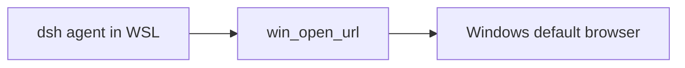

# dsh-wsl-browser

[返回分类](../../views/categories/PERSONAL-PRODUCTIVITY.md) · [返回首页](../../../README.md)

分析版本：[24d8fd4](https://github.com/173787247/dsh-wsl-browser/tree/24d8fd47f7566945fe697cb985df4f43e02dd3a7)

<!-- BEGIN META -->
[](https://github.com/173787247/dsh-wsl-browser)
<!-- END META -->

> **实现功能**：从 WSL 调用 Windows 默认浏览器打开经过协议校验的网页地址。

> **核心亮点**：相对手工复制 URL，它提供模型可调用、带协议限制和失败提示的 WSL→Windows 桥接，贡献小而明确。 [Q03](#research-q03)

> **风险与缺陷**：工具只发起打开动作，不确认浏览器是否可达或页面是否正确加载；localhost 提示也不能替代端口转发诊断。 [Q04](#research-q04)

**本文目录**

- [1 插件分析](#detail-section-1)
  - [1.1 用途与适用场景](#detail-section-2)
  - [1.2 能力、流程与成本](#detail-section-3)
  - [1.3 工程亮点](#detail-section-4)
  - [1.4 主要限制](#detail-section-5)
  - [1.5 使用建议](#detail-section-6)
  - [1.6 核查说明与分析版本](#detail-section-7)
- [2 未来设计假设（未验证）](#detail-section-8)
- [3 辅助信息](#detail-section-9)
- [4 研究问题与完整回答](#detail-section-10)
  - [Q01 · 谁在何种任务中使用，原有办法和合格结果是什么？](#detail-section-11)
  - [Q02 · 能力如何从入口、注册、调用到状态变化实现？](#detail-section-12)
  - [Q03 · 相对原生能力或简单替代，固定版本增加了什么？](#detail-section-13)
  - [Q04 · 什么前提最可能使核心价值不成立？](#detail-section-14)
  - [Q05 · 启动、持续生效和失败恢复分别依赖什么？](#detail-section-15)
  - [Q06 · 首次、持续与失败恢复成本及效果证据如何？](#detail-section-16)
  - [Q07 · 实现有哪些可靠性取舍和可复用设计？](#detail-section-17)
  - [Q08 · 由贡献和限制能推导什么未验证方向？](#detail-section-18)
  - [Q09 · 对什么人值得观察或试用，成功与停止条件是什么？](#detail-section-19)

<a id="detail-section-1"></a>

## 1 插件分析

<a id="detail-section-2"></a>

### 1.1 用途与适用场景

> **用途**：面向在 WSL 中运行 DSH、但日常使用 Windows 浏览器的开发者，快速打开本地服务或文档链接。 [Q01](#research-q01)

基线是复制链接到 Windows 或手工调用 powershell.exe；插件主要减少操作步骤，不提供页面抓取和交互。

<a id="detail-section-3"></a>

### 1.2 能力、流程与成本

#### 能力

| 能力 | 主要用途 | 使用条件与边界 |
|---|---|---|
| 打开网页 | 在 Windows 默认浏览器打开 http/https 地址。 | 仅由固定版本源码确认；运行效果未验证 |
| 安全校验 | 拒绝非网页协议与非法 URL。 | 仅由固定版本源码确认；运行效果未验证 |
| 本地服务提示 | localhost 失败时提示 WSL IP 备选地址。 | 仅由固定版本源码确认；运行效果未验证 |

#### 启动与依赖

| 依赖或条件 | 是否必需 | 用途 | 缺失或不满足时 |
|---|---|---|---|
| WSL 环境与 PowerShell 互操作 | 必需 | 调 Windows Start-Process | 返回 not running in WSL 或执行错误 |
| Windows 默认浏览器 | 必需 | 显示目标网页 | 进程调用成功也可能无可见页面 |
| http/https URL | 必需 | 限制外部动作范围 | file 等协议被拒绝 |
| localhost 转发 | 本地服务必需 | 访问 WSL 内服务 | 使用 WSL IP 提示或另行诊断端口 |

#### 启动步骤

| 步骤 | 执行者与动作 | 成功判据或失败处理 |
|---|---|---|---|
| 校验 | 工具解析 URL 并限制 http(s) | 非法协议不调用 PowerShell |
| 打开 | 从 WSL 执行 Start-Process | Windows 浏览器出现目标页 |
| 本地服务复核 | 用户确认 localhost 是否可达 | 失败则尝试提示的 WSL IP |
| 退出 | 页面仍不可达时改用端口诊断 | 不重复盲开多个标签 |

#### 成本

| 阶段 | 现金与资源成本 | 人工与时间投入 | 已知条件与未知项 |
|---|---|---|---|
| 首次使用 | 无独立服务费用 | 验证 WSL/PowerShell/默认浏览器 | 准备秒数未测 |
| 持续使用 | 每次一次进程调用和可选 hostname | 确认页面可见 | 调用到显示秒数未知 |
| 失败恢复 | 无付费重试 | 尝试 WSL IP 或端口排障 | localhost 失败率未知 |

#### 效果

| 效果项 | 当前证据支持 | 尚不能确定 |
|---|---|---|
| 协议安全 | 只允许 http/https | 其他 URL 编码边界的完整覆盖 |
| 跨系统打开 | Start-Process 接线明确 | 浏览器最终可见成功率 |
| 本地提示 | 能生成 WSL IP 备选 | 提示是否解决真实转发故障 |

> **思考**：工具只发起打开动作，不确认浏览器是否可达或页面是否正确加载；localhost 提示也不能替代端口转发诊断。 [Q04](#research-q04)

<a id="detail-section-4"></a>

### 1.3 工程亮点

> **亮点**：相对手工复制 URL，它提供模型可调用、带协议限制和失败提示的 WSL→Windows 桥接，贡献小而明确。 [Q03](#research-q03)

相对手工复制 URL，它提供模型可调用、带协议限制和失败提示的 WSL→Windows 桥接，贡献小而明确。 [Q03](#research-q03)

输入协议白名单、参数化执行和结构化错误使边界清楚；单工具范围小，主要风险是把启动成功误写成页面成功。

<a id="detail-section-5"></a>

### 1.4 主要限制

工具只发起打开动作，不确认浏览器是否可达或页面是否正确加载；localhost 提示也不能替代端口转发诊断。 [Q04](#research-q04)

<a id="detail-section-6"></a>

### 1.5 使用建议

适合频繁从 WSL 打开文档或本地服务、且只需要“打开”而非抓取/交互的用户试用。成功标准是 http(s) 非法输入全部拒绝、目标页在预定秒数内可见且 localhost 失败能按提示恢复；如果命令返回成功但页面不可见率高，应退回复制链接或专门端口工具。 [Q09](#research-q09)

<a id="detail-section-7"></a>

### 1.6 核查说明与分析版本

**核查状态**：已检查源码。

已有贡献为固定版本源码支持的实现与集成增量；效果和真实宿主可用性未验证。未来设计假设保持未验证，不计入插件现有能力。

- 已检查：作者 README、包清单、源码路径 README.md、index.js 及固定范围 inventory；组件：仓库根。抽读不冒充完整审计，来源和原文嵌入正式快照时保留。
- 未执行：插件安装、目标代码与测试、真实宿主及模型任务。源码存在不等于运行通过。
- 边界：仅检查固定提交的作者材料、入口和关键实现；未运行插件、测试、外部服务或真实宿主，也未核验独立用户反馈。
- 下一步：在目标 WSL/Windows 组合分别打开公网 URL、127.0.0.1 服务和故意关闭端口，记录从工具调用到页面可见秒数、返回值和标签数；另测 file/javascript 等 scheme 必须零外部动作。若 PowerShell ok 与页面可见经常不一致，就只保留为便捷命令而非可靠工具。

**分析版本**

- **仓库**：[173787247/dsh-wsl-browser](https://github.com/173787247/dsh-wsl-browser)
- **版本号**：0.1.0（[固定提交 24d8fd4](https://github.com/173787247/dsh-wsl-browser/tree/24d8fd47f7566945fe697cb985df4f43e02dd3a7)）
- **版本日期**：2026-09-29（固定提交日期，北京时间；不是包发布日期）

<a id="detail-section-8"></a>

## 2 未来设计假设（未验证）

<a id="innovation"></a>

可增加只读可达性预检与回执，把“进程已启动”和“Windows 侧页面可访问”分开报告，但不应扩大到任意 URI。 [Q08](#research-q08)

在目标 WSL/Windows 组合分别打开公网 URL、127.0.0.1 服务和故意关闭端口，记录从工具调用到页面可见秒数、返回值和标签数；另测 file/javascript 等 scheme 必须零外部动作。若 PowerShell ok 与页面可见经常不一致，就只保留为便捷命令而非可靠工具。

<a id="detail-section-9"></a>

## 3 辅助信息

<details>
<summary>工程统计与口径</summary>

| 扩展名 | 范围 | 文件数 | 总行 | 代码行 | 注释行 | 字数 |
|---|---|---:|---:|---:|---:|---:|
| .md | source | 5 | 161 | — | — | 838 |
| .js | source | 3 | 184 | 164 | 4 | — |
| .js | test | 1 | 16 | 14 | 4 | — |

</details>

**活跃度**

Issue 活跃度数据暂未获取（查询日期：2026-10-22），可前往 [GitHub Issues](https://github.com/173787247/dsh-wsl-browser/issues) 查看。

<a id="detail-section-10"></a>

## 4 研究问题与完整回答

**插件研究总目标**：研究 dsh-wsl-browser 在固定版本中的实现贡献、成立条件、关键限制、采用价值与可证伪的新设计方向。

<a id="research-q01"></a>

<a id="detail-section-11"></a>

### Q01 · 谁在何种任务中使用，原有办法和合格结果是什么？

**研究主题**：场景与需求

#### 完整回答

面向在 WSL 中运行 DSH、但日常使用 Windows 浏览器的开发者，快速打开本地服务或文档链接。 合格结果不是“工具被调用”，而是用户能在既定边界内得到可复核产物。基线是复制链接到 Windows 或手工调用 powershell.exe；插件主要减少操作步骤，不提供页面抓取和交互。

#### 证据与依据

**依据 1 · 作者声明**：[README.md:1-20](https://github.com/173787247/dsh-wsl-browser/blob/24d8fd47f7566945fe697cb985df4f43e02dd3a7/README.md#L1-L20)

作者材料说明目标用户、安装方式、主要能力和已知边界。

<details>
<summary>查看原文（20行）</summary>

````text
# dsh-wsl-browser
> **Install set:** part of [dsh-wsl-kit](https://github.com/173787247/dsh-wsl-kit). Prefer `KIT_SET=daily` | `llm` | `github` | `full` (see kit README). Fault tree: [TROUBLESHOOTING.md](https://github.com/173787247/dsh-wsl-kit/blob/master/docs/TROUBLESHOOTING.md).


DeepSeek Harness tool: **`win_open_url`** — open an `http` / `https` URL in the **Windows default browser** from WSL.

Part of **[dsh-wsl-kit](https://github.com/173787247/dsh-wsl-kit)**.

[中文说明 → README.zh.md](./README.zh.md)

## Where it sits

Opens an http(s) URL in the Windows default browser. It does not fetch the page inside WSL.



Suite diagram and version snapshot: [dsh-wsl-kit](https://github.com/173787247/dsh-wsl-kit#how-the-pieces-fit). This plugin is **0.1.0** (daily; also in llm). Do not copy that matrix into this README.
````

</details>

<a id="research-q02"></a>

<a id="detail-section-12"></a>

### Q02 · 能力如何从入口、注册、调用到状态变化实现？

**研究主题**：功能与机制

#### 完整回答

工具仅接受 http/https URL，检测 WSL 后构造 PowerShell Start-Process；对 localhost 额外给出 WSL IP 访问提示。 源码可以确认注册和数据流存在，但不能据此推断宿主加载、外部服务或最终效果已经通过。

#### 证据与依据

**依据 1 · 源码核查**：[index.js:1-40](https://github.com/173787247/dsh-wsl-browser/blob/24d8fd47f7566945fe697cb985df4f43e02dd3a7/index.js#L1-L40)

固定版本源码显示入口接线、关键数据流与失败处理；这不是运行结果。

<details>
<summary>查看原文（40行）</summary>

```text
import { detectWsl, runPowerShell } from "./lib/wsl-host.js";
import {
  buildOpenUrlScript,
  formatBrowserResult,
  isSafeHttpUrl,
  rewriteLocalhostHint,
} from "./lib/browser.js";
import { execFile } from "node:child_process";
import { promisify } from "node:util";

const execFileAsync = promisify(execFile);

export const name = "dsh-wsl-browser";
export const inject = ["tools", "systemPrompt"];

export function apply(ctx, config = {}) {
  const timeoutMs = positive(config.timeoutMs, 15_000);
  const wsl = detectWsl();

  ctx.systemPrompt.section({
    name: "tool:win_open_url",
    order: 124,
    text: "Use win_open_url to open http(s) links in the Windows default browser (including 127.0.0.1 services started in WSL).",
  });

  ctx.tools.register({
    name: "win_open_url",
    description: "Open an http(s) URL in the Windows default browser from WSL.",
    parameters: {
      type: "object",
      additionalProperties: false,
      required: ["url"],
      properties: {
        url: { type: "string", description: "http or https URL." },
      },
    },
    output: {
      schema: {
        type: "object",
        additionalProperties: false,
```

</details>

<a id="research-q03"></a>

<a id="detail-section-13"></a>

### Q03 · 相对原生能力或简单替代，固定版本增加了什么？

**研究主题**：贡献与相对优势

#### 完整回答

相对手工复制 URL，它提供模型可调用、带协议限制和失败提示的 WSL→Windows 桥接，贡献小而明确。 参照是宿主原生工具、直接脚本或手工流程，现有证据支持实现增量，不支持全球首创或收益排名。

#### 证据与依据

**依据 1 · 源码核查**：[index.js:1-40](https://github.com/173787247/dsh-wsl-browser/blob/24d8fd47f7566945fe697cb985df4f43e02dd3a7/index.js#L1-L40)

固定版本源码显示入口接线、关键数据流与失败处理；这不是运行结果。

<details>
<summary>查看原文（40行）</summary>

```text
import { detectWsl, runPowerShell } from "./lib/wsl-host.js";
import {
  buildOpenUrlScript,
  formatBrowserResult,
  isSafeHttpUrl,
  rewriteLocalhostHint,
} from "./lib/browser.js";
import { execFile } from "node:child_process";
import { promisify } from "node:util";

const execFileAsync = promisify(execFile);

export const name = "dsh-wsl-browser";
export const inject = ["tools", "systemPrompt"];

export function apply(ctx, config = {}) {
  const timeoutMs = positive(config.timeoutMs, 15_000);
  const wsl = detectWsl();

  ctx.systemPrompt.section({
    name: "tool:win_open_url",
    order: 124,
    text: "Use win_open_url to open http(s) links in the Windows default browser (including 127.0.0.1 services started in WSL).",
  });

  ctx.tools.register({
    name: "win_open_url",
    description: "Open an http(s) URL in the Windows default browser from WSL.",
    parameters: {
      type: "object",
      additionalProperties: false,
      required: ["url"],
      properties: {
        url: { type: "string", description: "http or https URL." },
      },
    },
    output: {
      schema: {
        type: "object",
        additionalProperties: false,
```

</details>

<a id="research-q04"></a>

<a id="detail-section-14"></a>

### Q04 · 什么前提最可能使核心价值不成立？

**研究主题**：缺陷与关键质疑

#### 完整回答

最强支持是固定版本实现确有完整入口和防御分支。最关键限制是：工具只发起打开动作，不确认浏览器是否可达或页面是否正确加载；localhost 提示也不能替代端口转发诊断。 这会直接收窄采用范围，而不是否定所有能力。

#### 证据与依据

**依据 1 · 源码核查**：[index.js:1-40](https://github.com/173787247/dsh-wsl-browser/blob/24d8fd47f7566945fe697cb985df4f43e02dd3a7/index.js#L1-L40)

固定版本源码显示入口接线、关键数据流与失败处理；这不是运行结果。

<details>
<summary>查看原文（40行）</summary>

```text
import { detectWsl, runPowerShell } from "./lib/wsl-host.js";
import {
  buildOpenUrlScript,
  formatBrowserResult,
  isSafeHttpUrl,
  rewriteLocalhostHint,
} from "./lib/browser.js";
import { execFile } from "node:child_process";
import { promisify } from "node:util";

const execFileAsync = promisify(execFile);

export const name = "dsh-wsl-browser";
export const inject = ["tools", "systemPrompt"];

export function apply(ctx, config = {}) {
  const timeoutMs = positive(config.timeoutMs, 15_000);
  const wsl = detectWsl();

  ctx.systemPrompt.section({
    name: "tool:win_open_url",
    order: 124,
    text: "Use win_open_url to open http(s) links in the Windows default browser (including 127.0.0.1 services started in WSL).",
  });

  ctx.tools.register({
    name: "win_open_url",
    description: "Open an http(s) URL in the Windows default browser from WSL.",
    parameters: {
      type: "object",
      additionalProperties: false,
      required: ["url"],
      properties: {
        url: { type: "string", description: "http or https URL." },
      },
    },
    output: {
      schema: {
        type: "object",
        additionalProperties: false,
```

</details>

<a id="research-q05"></a>

<a id="detail-section-15"></a>

### Q05 · 启动、持续生效和失败恢复分别依赖什么？

**研究主题**：依赖、兼容与流程

#### 完整回答

必须运行在 WSL 且可调用 PowerShell；Windows 默认浏览器和跨系统 localhost 转发需正常，工具拒绝 file 等非 http(s) 协议。 启动成功、持续有用和失败恢复是三类不同条件；缺少依赖时不能把“已注册”当作任务已办结。

#### 证据与依据

**依据 1 · 源码核查**：[index.js:1-40](https://github.com/173787247/dsh-wsl-browser/blob/24d8fd47f7566945fe697cb985df4f43e02dd3a7/index.js#L1-L40)

固定版本源码显示入口接线、关键数据流与失败处理；这不是运行结果。

<details>
<summary>查看原文（40行）</summary>

```text
import { detectWsl, runPowerShell } from "./lib/wsl-host.js";
import {
  buildOpenUrlScript,
  formatBrowserResult,
  isSafeHttpUrl,
  rewriteLocalhostHint,
} from "./lib/browser.js";
import { execFile } from "node:child_process";
import { promisify } from "node:util";

const execFileAsync = promisify(execFile);

export const name = "dsh-wsl-browser";
export const inject = ["tools", "systemPrompt"];

export function apply(ctx, config = {}) {
  const timeoutMs = positive(config.timeoutMs, 15_000);
  const wsl = detectWsl();

  ctx.systemPrompt.section({
    name: "tool:win_open_url",
    order: 124,
    text: "Use win_open_url to open http(s) links in the Windows default browser (including 127.0.0.1 services started in WSL).",
  });

  ctx.tools.register({
    name: "win_open_url",
    description: "Open an http(s) URL in the Windows default browser from WSL.",
    parameters: {
      type: "object",
      additionalProperties: false,
      required: ["url"],
      properties: {
        url: { type: "string", description: "http or https URL." },
      },
    },
    output: {
      schema: {
        type: "object",
        additionalProperties: false,
```

</details>

<a id="research-q06"></a>

<a id="detail-section-16"></a>

### Q06 · 首次、持续与失败恢复成本及效果证据如何？

**研究主题**：效果与总成本

#### 完整回答

首次成本仅为在 WSL 安装插件并确认 PowerShell/默认浏览器互操作；每次持续成本是一条 hostname 查询和一次 Start-Process，人工成本是确认页面实际打开；失败恢复要根据 WSL IP 提示或使用端口诊断工具。合格单位是 Windows 浏览器显示目标 http(s) 页面，而不是 PowerShell 命令返回 ok。当前缺打开成功率、从调用到可见页面的秒数和 localhost 转发失败率。

#### 证据与依据

**依据 1 · 源码核查**：[index.js:1-40](https://github.com/173787247/dsh-wsl-browser/blob/24d8fd47f7566945fe697cb985df4f43e02dd3a7/index.js#L1-L40)

固定版本源码显示入口接线、关键数据流与失败处理；这不是运行结果。

<details>
<summary>查看原文（40行）</summary>

```text
import { detectWsl, runPowerShell } from "./lib/wsl-host.js";
import {
  buildOpenUrlScript,
  formatBrowserResult,
  isSafeHttpUrl,
  rewriteLocalhostHint,
} from "./lib/browser.js";
import { execFile } from "node:child_process";
import { promisify } from "node:util";

const execFileAsync = promisify(execFile);

export const name = "dsh-wsl-browser";
export const inject = ["tools", "systemPrompt"];

export function apply(ctx, config = {}) {
  const timeoutMs = positive(config.timeoutMs, 15_000);
  const wsl = detectWsl();

  ctx.systemPrompt.section({
    name: "tool:win_open_url",
    order: 124,
    text: "Use win_open_url to open http(s) links in the Windows default browser (including 127.0.0.1 services started in WSL).",
  });

  ctx.tools.register({
    name: "win_open_url",
    description: "Open an http(s) URL in the Windows default browser from WSL.",
    parameters: {
      type: "object",
      additionalProperties: false,
      required: ["url"],
      properties: {
        url: { type: "string", description: "http or https URL." },
      },
    },
    output: {
      schema: {
        type: "object",
        additionalProperties: false,
```

</details>

#### 缺口

- 缺少 Windows/WSL 版本组合下的页面可见成功率、启动延迟和 localhost 转发失败率。
  **影响**：无法知道该单工具是否稳定省去手工复制，特别是本地服务场景。
  **进一步探讨**：在 WSL1/WSL2 与不同默认浏览器中打开公网和 localhost URL，计时到页面可见并记录 PowerShell 成功但页面失败的比例。

<a id="research-q07"></a>

<a id="detail-section-17"></a>

### Q07 · 实现有哪些可靠性取舍和可复用设计？

**研究主题**：工程质量与复用

#### 完整回答

输入协议白名单、参数化执行和结构化错误使边界清楚；单工具范围小，主要风险是把启动成功误写成页面成功。 这些判断来自结构与错误路径抽读，不等于完整安全审计或生产可靠性证明。

#### 证据与依据

**依据 1 · 源码核查**：[index.js:1-40](https://github.com/173787247/dsh-wsl-browser/blob/24d8fd47f7566945fe697cb985df4f43e02dd3a7/index.js#L1-L40)

固定版本源码显示入口接线、关键数据流与失败处理；这不是运行结果。

<details>
<summary>查看原文（40行）</summary>

```text
import { detectWsl, runPowerShell } from "./lib/wsl-host.js";
import {
  buildOpenUrlScript,
  formatBrowserResult,
  isSafeHttpUrl,
  rewriteLocalhostHint,
} from "./lib/browser.js";
import { execFile } from "node:child_process";
import { promisify } from "node:util";

const execFileAsync = promisify(execFile);

export const name = "dsh-wsl-browser";
export const inject = ["tools", "systemPrompt"];

export function apply(ctx, config = {}) {
  const timeoutMs = positive(config.timeoutMs, 15_000);
  const wsl = detectWsl();

  ctx.systemPrompt.section({
    name: "tool:win_open_url",
    order: 124,
    text: "Use win_open_url to open http(s) links in the Windows default browser (including 127.0.0.1 services started in WSL).",
  });

  ctx.tools.register({
    name: "win_open_url",
    description: "Open an http(s) URL in the Windows default browser from WSL.",
    parameters: {
      type: "object",
      additionalProperties: false,
      required: ["url"],
      properties: {
        url: { type: "string", description: "http or https URL." },
      },
    },
    output: {
      schema: {
        type: "object",
        additionalProperties: false,
```

</details>

<a id="research-q08"></a>

<a id="detail-section-18"></a>

### Q08 · 由贡献和限制能推导什么未验证方向？

**研究主题**：新假设与验证

#### 完整回答

从已确认机制与关键限制可推导：可增加只读可达性预检与回执，把“进程已启动”和“Windows 侧页面可访问”分开报告，但不应扩大到任意 URI。 最小验证应与现有简单流程在相同任务、模型、预算和验收标准下比较，并在人工投入或失败率上升时否定该方向。

#### 证据与依据

**依据 1 · 源码核查**：[index.js:1-40](https://github.com/173787247/dsh-wsl-browser/blob/24d8fd47f7566945fe697cb985df4f43e02dd3a7/index.js#L1-L40)

固定版本源码显示入口接线、关键数据流与失败处理；这不是运行结果。

<details>
<summary>查看原文（40行）</summary>

```text
import { detectWsl, runPowerShell } from "./lib/wsl-host.js";
import {
  buildOpenUrlScript,
  formatBrowserResult,
  isSafeHttpUrl,
  rewriteLocalhostHint,
} from "./lib/browser.js";
import { execFile } from "node:child_process";
import { promisify } from "node:util";

const execFileAsync = promisify(execFile);

export const name = "dsh-wsl-browser";
export const inject = ["tools", "systemPrompt"];

export function apply(ctx, config = {}) {
  const timeoutMs = positive(config.timeoutMs, 15_000);
  const wsl = detectWsl();

  ctx.systemPrompt.section({
    name: "tool:win_open_url",
    order: 124,
    text: "Use win_open_url to open http(s) links in the Windows default browser (including 127.0.0.1 services started in WSL).",
  });

  ctx.tools.register({
    name: "win_open_url",
    description: "Open an http(s) URL in the Windows default browser from WSL.",
    parameters: {
      type: "object",
      additionalProperties: false,
      required: ["url"],
      properties: {
        url: { type: "string", description: "http or https URL." },
      },
    },
    output: {
      schema: {
        type: "object",
        additionalProperties: false,
```

</details>

<a id="research-q09"></a>

<a id="detail-section-19"></a>

### Q09 · 对什么人值得观察或试用，成功与停止条件是什么？

**研究主题**：采用判断

#### 完整回答

适合频繁从 WSL 打开文档或本地服务、且只需要“打开”而非抓取/交互的用户试用。成功标准是 http(s) 非法输入全部拒绝、目标页在预定秒数内可见且 localhost 失败能按提示恢复；如果命令返回成功但页面不可见率高，应退回复制链接或专门端口工具。

#### 证据与依据

**依据 1 · 源码核查**：[index.js:1-40](https://github.com/173787247/dsh-wsl-browser/blob/24d8fd47f7566945fe697cb985df4f43e02dd3a7/index.js#L1-L40)

固定版本源码显示入口接线、关键数据流与失败处理；这不是运行结果。

<details>
<summary>查看原文（40行）</summary>

```text
import { detectWsl, runPowerShell } from "./lib/wsl-host.js";
import {
  buildOpenUrlScript,
  formatBrowserResult,
  isSafeHttpUrl,
  rewriteLocalhostHint,
} from "./lib/browser.js";
import { execFile } from "node:child_process";
import { promisify } from "node:util";

const execFileAsync = promisify(execFile);

export const name = "dsh-wsl-browser";
export const inject = ["tools", "systemPrompt"];

export function apply(ctx, config = {}) {
  const timeoutMs = positive(config.timeoutMs, 15_000);
  const wsl = detectWsl();

  ctx.systemPrompt.section({
    name: "tool:win_open_url",
    order: 124,
    text: "Use win_open_url to open http(s) links in the Windows default browser (including 127.0.0.1 services started in WSL).",
  });

  ctx.tools.register({
    name: "win_open_url",
    description: "Open an http(s) URL in the Windows default browser from WSL.",
    parameters: {
      type: "object",
      additionalProperties: false,
      required: ["url"],
      properties: {
        url: { type: "string", description: "http or https URL." },
      },
    },
    output: {
      schema: {
        type: "object",
        additionalProperties: false,
```

</details>

#### 缺口

- 未在真实 Windows 默认浏览器与 WSL 网络配置下确认页面可见。
  **影响**：Start-Process 成功不是端到端打开成功。
  **进一步探讨**：对公网、127.0.0.1 与 WSL IP 地址做可见性计时，并核对非法 scheme 不产生外部动作。

[返回分类](../../views/categories/PERSONAL-PRODUCTIVITY.md) · [返回首页](../../../README.md)
