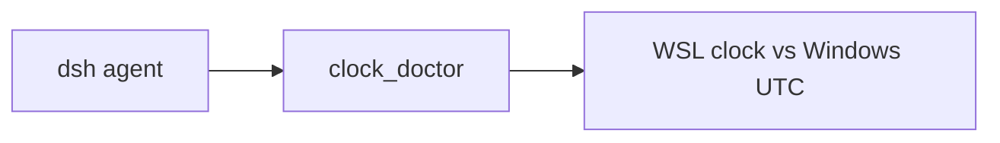

# dsh-wsl-clock

[返回分类](../../views/categories/INFRASTRUCTURE.md) · [返回首页](../../../README.md)

分析版本：[111cc4c](https://github.com/173787247/dsh-wsl-clock/tree/111cc4c013ef17a495c8790fbfa6373d7abbdebc)

<!-- BEGIN META -->
[](https://github.com/173787247/dsh-wsl-clock)
<!-- END META -->

> **实现功能**：提供 clock_doctor 工具，诊断 WSL 与 Windows UTC 时间偏移。

> **核心亮点**：把 WSL/Windows 双时钟排查封装为只读模型工具，并提示睡眠后使用；实现简单，适合故障定位而非自动修复。详见[Q01](#research-q01)、[Q02](#research-q02)。

> **风险与缺陷**：顺序采样的耗时会误记为时钟偏移，空输出经 Number 转换为 0 也未识别为无效时间；应避免将一次读数当成精确诊断。详见[Q03](#research-q03)。

**本文目录**

- [1 插件分析](#detail-section-1)
  - [1.1 用途与适用场景](#detail-section-2)
  - [1.2 能力、流程与成本](#detail-section-3)
  - [1.3 工程贡献](#detail-section-4)
  - [1.4 主要限制](#detail-section-5)
  - [1.5 使用建议](#detail-section-6)
  - [1.6 核查说明与分析版本](#detail-section-7)
- [2 未来设计假设（未验证）](#detail-section-8)
- [3 辅助信息](#detail-section-9)
- [4 研究问题与完整回答](#detail-section-10)
  - [Q01 · clock_doctor 解决 WSL 中哪类故障排查？](#detail-section-11)
  - [Q02 · 时间差怎样读取、分级和呈现？](#detail-section-12)
  - [Q03 · 顺序采样是否会把命令启动耗时算作时钟偏移？](#detail-section-13)
  - [Q04 · 非 WSL、PowerShell 失败和配置异常怎样处理？](#detail-section-14)
  - [Q05 · 怎样安全试用并提高诊断可信度？](#detail-section-15)

<a id="detail-section-1"></a>

## 1 插件分析

<a id="detail-section-2"></a>

### 1.1 用途与适用场景

> **用途**：WSL 笔记本休眠后 TLS/JWT 失败时查看两侧时钟差。

可在 WSL/Windows 命令行分别读 UTC 手工比较；插件减少入口切换但未提高采样精度。

<a id="detail-section-3"></a>

### 1.2 能力、流程与成本

#### 能力

| 能力 | 主要用途 | 使用条件与边界 |
| --- | --- | --- |
| 模型工具 | 比较 WSL/Windows UTC | 需 PowerShell，读数含启动延迟 |

**流程与依赖**

| 条件 | 用途 | 边界 |
| --- | --- | --- |
| WSL 环境 | 执行门槛 | 非 WSL 报错 |
| powershell.exe | Windows 时间 | 默认10秒超时 |
| DSH tools/systemPrompt | 工具/提示 | 版本兼容未测 |

| 步骤 | 动作 | 判据 |
| --- | --- | --- |
| 触发 | 休眠后 TLS/JWT 异常 | 先确认故障 |
| 诊断 | 调 clock_doctor | 与独立时间对照 |
| 处置 | 人工校时/重启 WSL | 故障消失 |

#### 成本

| 阶段 | 现金与资源成本 | 人工与时间投入 | 已知条件与未知项 |
| --- | --- | --- | --- |
| 首次 | 现有 WSL/Windows/DSH 与 PowerShell，无独立收费证据 | 装插件、核时区/阈值及权限，工时未知 | 宿主/PowerShell 可用性未知 |
| 持续 | 每次 PowerShell 进程/10秒上限和少量文本 token，本机计算/现金未知 | 判断 warn/fail 与实际 TLS/JWT 故障，时间未知 | 误报率、节省排障时间未知 |
| 失败恢复 | 重复诊断/重启 WSL 可能有本机计算和停机，金额未知 | 核空输出/慢启动、独立复测与修时钟，工时未知 | 休眠唤醒频率及误操作损失未知 |

| 输出 | 作用 | 边界 |
| --- | --- | --- |
| skewSec | 估计双时钟差 | 含命令延迟 |
| level | 阈值分级 | 默认30秒 fail |
| advice | 人工排障 | 不自动校时 |

> **思考**：顺序采样的耗时会误记为时钟偏移，空输出经 Number 转换为 0 也未识别为无效时间；应避免将一次读数当成精确诊断。详见[Q03](#research-q03)。

<a id="detail-section-4"></a>

### 1.3 工程贡献

> **亮点**：把 WSL/Windows 双时钟排查封装为只读模型工具，并提示睡眠后使用；实现简单，适合故障定位而非自动修复。详见[Q01](#research-q01)、[Q02](#research-q02)。

把 WSL/Windows 双时钟排查封装为只读模型工具，并提示睡眠后使用；实现简单，适合故障定位而非自动修复。详见[Q01](#research-q01)、[Q02](#research-q02)。

ctx.tools 注册无参、可并发调用的工具；PowerShell 读 UTC，按纯函数分级，错误返回 fail。

入口execute未接调用方exec.signal，core固定10秒子进程预算与工具注册timeout独立；不能把外层期限或取消当所有等待/目标系统已停止的证明。工具只执行固定时间读取，不执行建议中的重启/同步。

<a id="detail-section-5"></a>

### 1.4 主要限制

顺序采样的耗时会误记为时钟偏移，空输出经 Number 转换为 0 也未识别为无效时间；应避免将一次读数当成精确诊断。详见[Q03](#research-q03)。

<a id="detail-section-6"></a>

### 1.5 使用建议

只在 WSL/Windows 开发环境试用，交叉对照时间与 TLS/JWT 现象，不自动执行重启。详见[Q05](#research-q05)。

<a id="detail-section-7"></a>

### 1.6 核查说明与分析版本

**核查状态**：已检查源码。

已检查源码。固定查询和分级支持初诊，顺序采样将启动延迟计入偏移，空输出有效性不足；不自动校时，中点方案未验证。

- 已检查：作者 README、包清单、源码路径 README.md、index.js、lib/clock.js、lib/wsl-host.js、test/clock.test.js 及固定范围 inventory；组件：仓库根。抽读不冒充完整审计，来源和原文嵌入正式快照时保留。
- 未执行：插件安装、目标代码与测试、真实宿主及模型任务。源码存在不等于运行通过。
- 边界：固定 SHA 静态审阅 README、入口、时钟与宿主模块；未执行目标插件/PowerShell。
- 下一步：同步/刻意偏移时钟、快速/慢速 PowerShell、空输出、超时和非 WSL 逐项测量，记录 RTT 与真值。

**分析版本**

- **仓库**：[173787247/dsh-wsl-clock](https://github.com/173787247/dsh-wsl-clock)
- **版本号**：0.2.0（[固定提交 111cc4c](https://github.com/173787247/dsh-wsl-clock/tree/111cc4c013ef17a495c8790fbfa6373d7abbdebc)）
- **版本日期**：2026-09-29（固定提交日期，北京时间；不是包发布日期）

<a id="detail-section-8"></a>

## 2 未来设计假设（未验证）

<a id="innovation"></a>

可探索前后WSL时刻中点/RTT及Windows时间有效性检查；仅在采样窗时钟线性且未中途校时等条件下讨论，成本/误警反例见[Q05](#research-q05)，未实现。

同步/刻意偏移时钟、快速/慢速 PowerShell、空输出、超时和非 WSL 逐项测量，记录 RTT 与真值。

<a id="detail-section-9"></a>

## 3 辅助信息

<details>
<summary>工程统计与口径</summary>

| 扩展名 | 范围 | 文件数 | 总行 | 代码行 | 注释行 | 字数 |
|---|---|---:|---:|---:|---:|---:|
| .md | source | 5 | 94 | — | — | 560 |
| .js | source | 3 | 198 | 174 | 4 | — |
| .js | test | 1 | 35 | 31 | 0 | — |

</details>

**活跃度**

[](https://github.com/173787247/dsh-wsl-clock/issues?q=is%3Aissue+is%3Aopen) [](https://github.com/173787247/dsh-wsl-clock/issues?q=is%3Aissue+created%3A2026-09-22T06%3A58%3A24.421Z..2026-10-22T06%3A58%3A24.421Z) [](https://github.com/173787247/dsh-wsl-clock/issues?q=is%3Aissue+is%3Aclosed+closed%3A2026-09-22T06%3A58%3A24.421Z..2026-10-22T06%3A58%3A24.421Z)


统计日期：2026-10-22。

<a id="detail-section-10"></a>

## 4 研究问题与完整回答

**插件研究总目标**：核对 WSL/Windows UTC 诊断机制与顺序采样误差。

<a id="research-q01"></a>

<a id="detail-section-11"></a>

### Q01 · clock_doctor 解决 WSL 中哪类故障排查？

**研究主题**：场景与需求、贡献与相对优势

#### 完整回答

用户在 Windows 笔记本休眠唤醒后遇到 WSL 时间偏移、TLS 或 GitHub App JWT 异常时，可调用 clock_doctor 比较 WSL 与 Windows UTC，得到 ok/warn/fail 及处置提示。插件还把调用时机放入 systemPrompt。它是诊断建议工具，未自动校时；README 把它归于 wsl-kit 的 llm/full 套件。

#### 证据与依据

**依据 1 · 作者声明**：[README.md:8-35](https://github.com/173787247/dsh-wsl-clock/blob/111cc4c013ef17a495c8790fbfa6373d7abbdebc/README.md#L8-L35)

场景与套件位置。

<details>
<summary>查看原文（28行）</summary>

````text
| **Plugin** | `dsh-wsl-clock` **0.2.0** |
| **Minimum dsh** | ≥ **0.1.2** (web UI one-shot `?token=` on Windows relay `:3081`) |
| **Latest verified** | See [dsh-wsl-kit Compatibility](https://github.com/173787247/dsh-wsl-kit#compatibility-2026-09) (currently **`0.2.0-rc.2`**) — single source of truth for the suite |
| **Kit set** | `llm` / `full` (some also useful alone) |
| **Cloud Flash** | Use model id **`deepseek-flash`** (V4.1 Flash) in `~/.dsh/settings.yaml` / `llm-deepseek` — not configured by this plugin |
| **Agent Teams** | Upstream experimental; not required here |

Suite floor versions: kit [`check-plugin-versions.sh`](https://github.com/173787247/dsh-wsl-kit/blob/master/scripts/check-plugin-versions.sh). Fault tree: [TROUBLESHOOTING.md](https://github.com/173787247/dsh-wsl-kit/blob/master/docs/TROUBLESHOOTING.md).

**`clock_doctor`**: WSL vs Windows UTC skew (ok/warn/fail). Large skew breaks TLS and GitHub App JWTs after sleep.

```sh
dsh plugin --profile web add github:173787247/dsh-wsl-clock
npm test
```

MIT

## Where it sits

Compares WSL and Windows UTC so TLS and GitHub App JWTs are not failing on skew.



Suite diagram and version snapshot: [dsh-wsl-kit](https://github.com/173787247/dsh-wsl-kit#how-the-pieces-fit). This plugin is **0.2.0** (full; also in llm). Do not copy that matrix into this README.
````

</details>

**依据 2 · 源码核查**：[index.js:4-20](https://github.com/173787247/dsh-wsl-clock/blob/111cc4c013ef17a495c8790fbfa6373d7abbdebc/index.js#L4-L20)

工具注册与提示。

<details>
<summary>查看原文（17行）</summary>

```text
export const name = "dsh-wsl-clock";
export const inject = ["tools", "systemPrompt"];

export function apply(ctx, config = {}) {
  const timeoutMs = positive(config.timeoutMs, 15_000);
  const wsl = detectWsl();

  ctx.systemPrompt.section({
    name: "tool:clock_doctor",
    order: 115,
    text: "Use clock_doctor after laptop sleep or TLS/GitHub App JWT failures: compare WSL vs Windows UTC skew (warn/fail levels).",
  });

  ctx.tools.register({
    name: "clock_doctor",
    description:
      "Detect WSL2 vs Windows clock skew (ok/warn/fail). Large skew breaks TLS and GitHub App tokens after sleep.",
```

</details>

**依据 3 · 源码核查**：[lib/clock.js:43-60](https://github.com/173787247/dsh-wsl-clock/blob/111cc4c013ef17a495c8790fbfa6373d7abbdebc/lib/clock.js#L43-L60)

诊断建议文本。

<details>
<summary>查看原文（18行）</summary>

```text
export function buildClockAdvice({ level, skewSec, maxSkewSec } = {}) {
  const tips = [];
  if (level === "fail") {
    tips.push(
      `Clock skew ${skewSec}s exceeds maxSkewSec=${maxSkewSec}. TLS handshakes and GitHub App JWTs often fail after laptop sleep.`,
    );
    tips.push(
      "Fix: from elevated Windows run `wsl --shutdown`, reopen the distro, then restart-dsh-web.sh. Or sync NTP inside WSL.",
    );
  } else if (level === "warn") {
    tips.push(
      `Clock skew ${skewSec}s is elevated (warn). Watch for intermittent TLS / token errors; prefer wsl --shutdown after long sleep.`,
    );
  } else {
    tips.push("Skew within tolerance.");
  }
  tips.push("Pair with dns_doctor / net_doctor if HTTPS still fails after time looks OK.");
  return tips;
```

</details>

#### 缺口

- 实际TLS/JWT故障是否由本地双时钟偏移造成、该阈值能否正确定位没有独立对照。
  **影响**：读数不是所有网络故障的根因证明。
  **进一步探讨**：可从合成时刻/启动延迟及独立故障记录区分时间误差和其他原因，不自动重启。

<a id="research-q02"></a>

<a id="detail-section-12"></a>

### Q02 · 时间差怎样读取、分级和呈现？

**研究主题**：功能与机制、工程质量与复用

#### 完整回答

执行时先取 Date.now，再经 powershell.exe -NoProfile -NonInteractive 读 Windows UTC 毫秒；(WSL-Windows)/1000 四舍五入。默认 maxSkewSec 30，超过 30 为 fail，超过 max(5,floor(阈值/2)) 为 warn，否则 ok。工具没有输入参数，错误时返回 ok:false 和提示，text renderer 显示时间/偏移/建议。非 WSL 运行直接返回错误。

#### 证据与依据

**依据 1 · 源码核查**：[index.js:7-38](https://github.com/173787247/dsh-wsl-clock/blob/111cc4c013ef17a495c8790fbfa6373d7abbdebc/index.js#L7-L38)

注册、非 WSL 分支与渲染。

<details>
<summary>查看原文（32行）</summary>

```text
export function apply(ctx, config = {}) {
  const timeoutMs = positive(config.timeoutMs, 15_000);
  const wsl = detectWsl();

  ctx.systemPrompt.section({
    name: "tool:clock_doctor",
    order: 115,
    text: "Use clock_doctor after laptop sleep or TLS/GitHub App JWT failures: compare WSL vs Windows UTC skew (warn/fail levels).",
  });

  ctx.tools.register({
    name: "clock_doctor",
    description:
      "Detect WSL2 vs Windows clock skew (ok/warn/fail). Large skew breaks TLS and GitHub App tokens after sleep.",
    parameters: core.parameters(config),
    output: {
      schema: core.outputSchema(),
      render: (_args, value) => [{ type: "text", text: core.format(value) }],
    },
    timeoutMs,
    isConcurrencySafe: () => true,
    async execute(args) {
      if (!wsl) return core.notWsl ? core.notWsl() : { ok: false, error: "not running in WSL" };
      return core.execute(args, config);
    },
    presentCall: () => ({ card: "generic", title: "clock_doctor" }),
    presentResult: (_args, result) => (
      result.isError
        ? { card: "generic", title: "clock_doctor failed", content: result.content }
        : { card: "generic", title: "clock_doctor", content: result.content }
    ),
  });
```

</details>

**依据 2 · 源码核查**：[lib/clock.js:7-40](https://github.com/173787247/dsh-wsl-clock/blob/111cc4c013ef17a495c8790fbfa6373d7abbdebc/lib/clock.js#L7-L40)

参数、阈值与分级。

<details>
<summary>查看原文（34行）</summary>

```text
export function parameters() {
  return { type: "object", additionalProperties: false, properties: {} };
}

export function outputSchema() {
  return { type: "object", additionalProperties: true };
}

export function format(v) {
  const lines = [`clock_doctor ok=${v.ok} level=${v.level || "?"} skewSec=${v.skewSec}`];
  if (v.wslNow) lines.push(`wslNow: ${v.wslNow}`);
  if (v.windowsNow) lines.push(`windowsNow: ${v.windowsNow}`);
  for (const a of v.advice || []) lines.push(`- ${a}`);
  if (v.error) lines.push(`error: ${v.error}`);
  return lines.join("\n");
}

/**
 * @returns {{ skewSec: number, absSkewSec: number, level: "ok"|"warn"|"fail", ok: boolean }}
 */
export function computeSkew(wslMs, winMs, maxSkewSec = 30) {
  const maxSkew = Number(maxSkewSec) > 0 ? Number(maxSkewSec) : 30;
  const skewSec = Math.round((Number(wslMs) - Number(winMs)) / 1000);
  const absSkewSec = Math.abs(skewSec);
  let level = "ok";
  if (absSkewSec > maxSkew) level = "fail";
  else if (absSkewSec > Math.max(5, Math.floor(maxSkew / 2))) level = "warn";
  return {
    skewSec,
    absSkewSec,
    level,
    ok: level !== "fail",
    maxSkewSec: maxSkew,
  };
```

</details>

**依据 3 · 源码核查**：[lib/clock.js:63-97](https://github.com/173787247/dsh-wsl-clock/blob/111cc4c013ef17a495c8790fbfa6373d7abbdebc/lib/clock.js#L63-L97)

PowerShell 读取与返回结构。

<details>
<summary>查看原文（35行）</summary>

```text
export async function execute(_args, config = {}, deps = {}) {
  const maxSkew = Number(config.maxSkewSec) > 0 ? Number(config.maxSkewSec) : 30;
  const nowFn = deps.now || Date.now;
  const runPs = deps.runPowerShell || runPowerShell;
  const wslMs = nowFn();
  let winMs = 0;
  try {
    const { stdout } = await runPs("[DateTimeOffset]::UtcNow.ToUnixTimeMilliseconds()", {
      timeoutMs: 10_000,
    });
    winMs = Number(String(stdout).trim());
    if (!Number.isFinite(winMs)) {
      return { ok: false, error: "invalid Windows time", advice: [], level: "fail", skewSec: 0 };
    }
  } catch (err) {
    return {
      ok: false,
      error: err instanceof Error ? err.message : String(err),
      advice: ["Could not read Windows UTC time via PowerShell."],
      level: "fail",
      skewSec: 0,
    };
  }
  const skew = computeSkew(wslMs, winMs, maxSkew);
  const advice = buildClockAdvice(skew);
  return {
    ok: skew.ok,
    level: skew.level,
    skewSec: skew.skewSec,
    maxSkewSec: skew.maxSkewSec,
    wslNow: new Date(wslMs).toISOString(),
    windowsNow: new Date(winMs).toISOString(),
    advice,
  };
}
```

</details>

**依据 4 · 源码核查**：[lib/wsl-host.js:21-41](https://github.com/173787247/dsh-wsl-clock/blob/111cc4c013ef17a495c8790fbfa6373d7abbdebc/lib/wsl-host.js#L21-L41)

WSL 探测和命令调用。

<details>
<summary>查看原文（21行）</summary>

```text
export function detectWsl({ env = process.env, readRelease = readOsRelease } = {}) {
  if (env.WSL_DISTRO_NAME || env.WSL_INTEROP) return true;
  try {
    return /microsoft/i.test(readRelease());
  } catch {
    return false;
  }
}

export function distroName({ env = process.env } = {}) {
  return env.WSL_DISTRO_NAME || "WSL";
}

export async function runPowerShell(script, { timeoutMs = 15_000 } = {}) {
  const bin = windowsBin("powershell.exe");
  const { stdout, stderr } = await execFileAsync(
    bin,
    ["-NoProfile", "-NonInteractive", "-Command", script],
    { timeout: timeoutMs, windowsHide: true, encoding: "utf8", maxBuffer: 4 * 1024 * 1024 },
  );
  return { stdout: String(stdout ?? ""), stderr: String(stderr ?? "") };
```

</details>

#### 缺口

- 各Windows命令错误/空输出与慢启动的真实分布未知。
  **影响**：格式可解析不代表时刻有效或精度充分。
  **进一步探讨**：可用固定空/坏文本和延迟回执研究解析/分级语义。

<a id="research-q03"></a>

<a id="detail-section-13"></a>

### Q03 · 顺序采样是否会把命令启动耗时算作时钟偏移？

**研究主题**：缺陷与关键质疑、效果与总成本

#### 完整回答

PowerShell启动前取固定WSL Date.now，Windows时刻在子进程运行后才取；两次采样并非同时，启动等待会计为负偏移。默认30秒fail和15秒warn，慢启动可误警；空stdout经Number转0通过有限性检查，成为巨大偏移而非invalid。实际启动耗时分布/误警频率未知。

| 阶段 | 现金与资源成本 | 人工与时间投入 | 已知条件与未知项 |
| --- | --- | --- | --- |
| 首次 | 现有 WSL/Windows/DSH 与 PowerShell，无独立收费证据 | 装插件、核时区/阈值及权限，工时未知 | 宿主/PowerShell 可用性未知 |
| 持续 | 每次 PowerShell 进程/10秒上限和少量文本 token，本机计算/现金未知 | 判断 warn/fail 与实际 TLS/JWT 故障，时间未知 | 误报率、节省排障时间未知 |
| 失败恢复 | 重复诊断/重启 WSL 可能有本机计算和停机，金额未知 | 核空输出/慢启动、独立复测与修时钟，工时未知 | 休眠唤醒频率及误操作损失未知 |

成功单位是正确定位双时钟相关故障，不能把一条fail或一次重启当修复完成。费用、诊断时延、误警/恢复人时无对照，提示中的shutdown会中断原WSL任务，需读者独立核实际偏移与保存现场。

#### 证据与依据

**依据 1 · 源码核查**：[lib/clock.js:63-86](https://github.com/173787247/dsh-wsl-clock/blob/111cc4c013ef17a495c8790fbfa6373d7abbdebc/lib/clock.js#L63-L86)

前采 WSL、后采 Windows 及 Number 转换。

<details>
<summary>查看原文（24行）</summary>

```text
export async function execute(_args, config = {}, deps = {}) {
  const maxSkew = Number(config.maxSkewSec) > 0 ? Number(config.maxSkewSec) : 30;
  const nowFn = deps.now || Date.now;
  const runPs = deps.runPowerShell || runPowerShell;
  const wslMs = nowFn();
  let winMs = 0;
  try {
    const { stdout } = await runPs("[DateTimeOffset]::UtcNow.ToUnixTimeMilliseconds()", {
      timeoutMs: 10_000,
    });
    winMs = Number(String(stdout).trim());
    if (!Number.isFinite(winMs)) {
      return { ok: false, error: "invalid Windows time", advice: [], level: "fail", skewSec: 0 };
    }
  } catch (err) {
    return {
      ok: false,
      error: err instanceof Error ? err.message : String(err),
      advice: ["Could not read Windows UTC time via PowerShell."],
      level: "fail",
      skewSec: 0,
    };
  }
  const skew = computeSkew(wslMs, winMs, maxSkew);
```

</details>

**依据 2 · 源码核查**：[lib/clock.js:27-40](https://github.com/173787247/dsh-wsl-clock/blob/111cc4c013ef17a495c8790fbfa6373d7abbdebc/lib/clock.js#L27-L40)

阈值分级。

<details>
<summary>查看原文（14行）</summary>

```text
export function computeSkew(wslMs, winMs, maxSkewSec = 30) {
  const maxSkew = Number(maxSkewSec) > 0 ? Number(maxSkewSec) : 30;
  const skewSec = Math.round((Number(wslMs) - Number(winMs)) / 1000);
  const absSkewSec = Math.abs(skewSec);
  let level = "ok";
  if (absSkewSec > maxSkew) level = "fail";
  else if (absSkewSec > Math.max(5, Math.floor(maxSkew / 2))) level = "warn";
  return {
    skewSec,
    absSkewSec,
    level,
    ok: level !== "fail",
    maxSkewSec: maxSkew,
  };
```

</details>

**依据 3 · 源码核查**：[lib/wsl-host.js:34-41](https://github.com/173787247/dsh-wsl-clock/blob/111cc4c013ef17a495c8790fbfa6373d7abbdebc/lib/wsl-host.js#L34-L41)

异步启动 PowerShell。

```text
export async function runPowerShell(script, { timeoutMs = 15_000 } = {}) {
  const bin = windowsBin("powershell.exe");
  const { stdout, stderr } = await execFileAsync(
    bin,
    ["-NoProfile", "-NonInteractive", "-Command", script],
    { timeout: timeoutMs, windowsHide: true, encoding: "utf8", maxBuffer: 4 * 1024 * 1024 },
  );
  return { stdout: String(stdout ?? ""), stderr: String(stderr ?? "") };
```

#### 缺口

- 实际命令启动耗时分布未测。
  **影响**：误警率未量化。
  **进一步探讨**：同次调用记录前后 WSL 时刻和 RTT，对照中点估计。

<a id="research-q04"></a>

<a id="detail-section-14"></a>

### Q04 · 非 WSL、PowerShell 失败和配置异常怎样处理？

**研究主题**：依赖、兼容与流程、缺陷与关键质疑

#### 完整回答

入口以 WSL 环境变量或 kernel release 含 microsoft 为门槛，非 WSL 返回明确错误。PowerShell 通过 Windows 预设路径或 PATH 查找，10 秒超时；失败捕获为 level fail、skewSec 0，并写错误建议。maxSkewSec 非正值回退30，timeoutMs 的正值配置用于工具注册，但核心 PowerShell 调用固定 10 秒，二者可能不一致。工具仅诊断、不执行 wsl --shutdown 或同步时钟，处置需人工操作。

入口execute未接调用方exec.signal，core固定10秒子进程预算与工具注册timeout独立；不能把外层期限或取消当所有等待/目标系统已停止的证明。工具只执行固定时间读取，不执行建议中的重启/同步。

#### 证据与依据

**依据 1 · 源码核查**：[lib/wsl-host.js:8-27](https://github.com/173787247/dsh-wsl-clock/blob/111cc4c013ef17a495c8790fbfa6373d7abbdebc/lib/wsl-host.js#L8-L27)

平台探测与 bin 查找。

<details>
<summary>查看原文（20行）</summary>

```text
const WINDOWS_BINS = {
  "powershell.exe": ["/mnt/c/Windows/System32/WindowsPowerShell/v1.0/powershell.exe"],
  "cmd.exe": ["/mnt/c/Windows/System32/cmd.exe"],
  "explorer.exe": ["/mnt/c/Windows/explorer.exe"],
};

export function windowsBin(name, { exists = existsSync } = {}) {
  for (const p of WINDOWS_BINS[name] || []) {
    if (exists(p)) return p;
  }
  return name;
}

export function detectWsl({ env = process.env, readRelease = readOsRelease } = {}) {
  if (env.WSL_DISTRO_NAME || env.WSL_INTEROP) return true;
  try {
    return /microsoft/i.test(readRelease());
  } catch {
    return false;
  }
```

</details>

**依据 2 · 源码核查**：[lib/wsl-host.js:34-41](https://github.com/173787247/dsh-wsl-clock/blob/111cc4c013ef17a495c8790fbfa6373d7abbdebc/lib/wsl-host.js#L34-L41)

PowerShell 参数与超时。

```text
export async function runPowerShell(script, { timeoutMs = 15_000 } = {}) {
  const bin = windowsBin("powershell.exe");
  const { stdout, stderr } = await execFileAsync(
    bin,
    ["-NoProfile", "-NonInteractive", "-Command", script],
    { timeout: timeoutMs, windowsHide: true, encoding: "utf8", maxBuffer: 4 * 1024 * 1024 },
  );
  return { stdout: String(stdout ?? ""), stderr: String(stderr ?? "") };
```

**依据 3 · 源码核查**：[lib/clock.js:63-85](https://github.com/173787247/dsh-wsl-clock/blob/111cc4c013ef17a495c8790fbfa6373d7abbdebc/lib/clock.js#L63-L85)

核心固定超时及失败返回。

<details>
<summary>查看原文（23行）</summary>

```text
export async function execute(_args, config = {}, deps = {}) {
  const maxSkew = Number(config.maxSkewSec) > 0 ? Number(config.maxSkewSec) : 30;
  const nowFn = deps.now || Date.now;
  const runPs = deps.runPowerShell || runPowerShell;
  const wslMs = nowFn();
  let winMs = 0;
  try {
    const { stdout } = await runPs("[DateTimeOffset]::UtcNow.ToUnixTimeMilliseconds()", {
      timeoutMs: 10_000,
    });
    winMs = Number(String(stdout).trim());
    if (!Number.isFinite(winMs)) {
      return { ok: false, error: "invalid Windows time", advice: [], level: "fail", skewSec: 0 };
    }
  } catch (err) {
    return {
      ok: false,
      error: err instanceof Error ? err.message : String(err),
      advice: ["Could not read Windows UTC time via PowerShell."],
      level: "fail",
      skewSec: 0,
    };
  }
```

</details>

**依据 4 · 源码核查**：[index.js:7-30](https://github.com/173787247/dsh-wsl-clock/blob/111cc4c013ef17a495c8790fbfa6373d7abbdebc/index.js#L7-L30)

工具超时与非 WSL 分支。

<details>
<summary>查看原文（24行）</summary>

```text
export function apply(ctx, config = {}) {
  const timeoutMs = positive(config.timeoutMs, 15_000);
  const wsl = detectWsl();

  ctx.systemPrompt.section({
    name: "tool:clock_doctor",
    order: 115,
    text: "Use clock_doctor after laptop sleep or TLS/GitHub App JWT failures: compare WSL vs Windows UTC skew (warn/fail levels).",
  });

  ctx.tools.register({
    name: "clock_doctor",
    description:
      "Detect WSL2 vs Windows clock skew (ok/warn/fail). Large skew breaks TLS and GitHub App tokens after sleep.",
    parameters: core.parameters(config),
    output: {
      schema: core.outputSchema(),
      render: (_args, value) => [{ type: "text", text: core.format(value) }],
    },
    timeoutMs,
    isConcurrencySafe: () => true,
    async execute(args) {
      if (!wsl) return core.notWsl ? core.notWsl() : { ok: false, error: "not running in WSL" };
      return core.execute(args, config);
```

</details>

#### 缺口

- DSH 工具超时和子进程 10 秒竞态未实际跑。
  **影响**：极短配置下错误形态未知。
  **进一步探讨**：隔离环境测试 1 秒工具超时、命令阻塞和缺失 PowerShell。

<a id="research-q05"></a>

<a id="detail-section-15"></a>

### Q05 · 怎样安全试用并提高诊断可信度？

**研究主题**：采用判断、新假设与验证

#### 完整回答

已知：顺序采样把 PowerShell 启动延迟混进 skew，空 stdout 被 Number 转成0，timeout 配置与内部10秒执行也可能不一致。参照当前一次 WSL/一次 Windows 读数，假设前后各取 WSL 时刻，用中点估算 Windows 对齐时间并记录 RTT，拒绝空/异常 Windows 毫秒值，可减少慢启动误警和荒谬偏移。条件：WSL 在采样窗内时钟近似线性、系统没在中途校时，Windows 命令成功；代价是一次时间读取/校验及 RTT 大时“不确定”提示。最小对照：已同步与人为偏移的隔离 WSL，注入快速/慢速 PowerShell、空/坏输出，比较现版/改造版相对独立 NTP/系统时钟检查的偏移误差、误警率、诊断时延；若误差/误警不降或时延超预注册阈值即证伪。不能单凭该读数自动 shutdown。

#### 证据与依据

**依据 1 · 源码核查**：[lib/clock.js:27-40](https://github.com/173787247/dsh-wsl-clock/blob/111cc4c013ef17a495c8790fbfa6373d7abbdebc/lib/clock.js#L27-L40)

现有分级。

<details>
<summary>查看原文（14行）</summary>

```text
export function computeSkew(wslMs, winMs, maxSkewSec = 30) {
  const maxSkew = Number(maxSkewSec) > 0 ? Number(maxSkewSec) : 30;
  const skewSec = Math.round((Number(wslMs) - Number(winMs)) / 1000);
  const absSkewSec = Math.abs(skewSec);
  let level = "ok";
  if (absSkewSec > maxSkew) level = "fail";
  else if (absSkewSec > Math.max(5, Math.floor(maxSkew / 2))) level = "warn";
  return {
    skewSec,
    absSkewSec,
    level,
    ok: level !== "fail",
    maxSkewSec: maxSkew,
  };
```

</details>

**依据 2 · 源码核查**：[lib/clock.js:63-97](https://github.com/173787247/dsh-wsl-clock/blob/111cc4c013ef17a495c8790fbfa6373d7abbdebc/lib/clock.js#L63-L97)

现有采样与输出。

<details>
<summary>查看原文（35行）</summary>

```text
export async function execute(_args, config = {}, deps = {}) {
  const maxSkew = Number(config.maxSkewSec) > 0 ? Number(config.maxSkewSec) : 30;
  const nowFn = deps.now || Date.now;
  const runPs = deps.runPowerShell || runPowerShell;
  const wslMs = nowFn();
  let winMs = 0;
  try {
    const { stdout } = await runPs("[DateTimeOffset]::UtcNow.ToUnixTimeMilliseconds()", {
      timeoutMs: 10_000,
    });
    winMs = Number(String(stdout).trim());
    if (!Number.isFinite(winMs)) {
      return { ok: false, error: "invalid Windows time", advice: [], level: "fail", skewSec: 0 };
    }
  } catch (err) {
    return {
      ok: false,
      error: err instanceof Error ? err.message : String(err),
      advice: ["Could not read Windows UTC time via PowerShell."],
      level: "fail",
      skewSec: 0,
    };
  }
  const skew = computeSkew(wslMs, winMs, maxSkew);
  const advice = buildClockAdvice(skew);
  return {
    ok: skew.ok,
    level: skew.level,
    skewSec: skew.skewSec,
    maxSkewSec: skew.maxSkewSec,
    wslNow: new Date(wslMs).toISOString(),
    windowsNow: new Date(winMs).toISOString(),
    advice,
  };
}
```

</details>

**依据 3 · 源码核查**：[lib/clock.js:43-60](https://github.com/173787247/dsh-wsl-clock/blob/111cc4c013ef17a495c8790fbfa6373d7abbdebc/lib/clock.js#L43-L60)

当前给出的人工处置。

<details>
<summary>查看原文（18行）</summary>

```text
export function buildClockAdvice({ level, skewSec, maxSkewSec } = {}) {
  const tips = [];
  if (level === "fail") {
    tips.push(
      `Clock skew ${skewSec}s exceeds maxSkewSec=${maxSkewSec}. TLS handshakes and GitHub App JWTs often fail after laptop sleep.`,
    );
    tips.push(
      "Fix: from elevated Windows run `wsl --shutdown`, reopen the distro, then restart-dsh-web.sh. Or sync NTP inside WSL.",
    );
  } else if (level === "warn") {
    tips.push(
      `Clock skew ${skewSec}s is elevated (warn). Watch for intermittent TLS / token errors; prefer wsl --shutdown after long sleep.`,
    );
  } else {
    tips.push("Skew within tolerance.");
  }
  tips.push("Pair with dns_doctor / net_doctor if HTTPS still fails after time looks OK.");
  return tips;
```

</details>

#### 缺口

- 中点算法对 Windows 命令内调度延迟的收益未实测。
  **影响**：改进幅度未知。
  **进一步探讨**：在真实 WSL 量 RTT 与独立时钟偏移。

[返回分类](../../views/categories/INFRASTRUCTURE.md) · [返回首页](../../../README.md)
