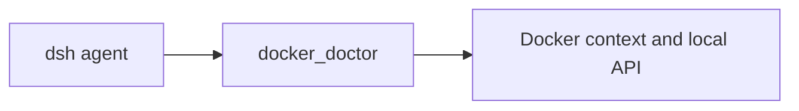

# dsh-wsl-docker

[返回分类](../../views/categories/SOFTWARE-DELIVERY.md) · [返回首页](../../../README.md)

源码版本：[84df8ba](https://github.com/173787247/dsh-wsl-docker/tree/84df8ba469b506b682d35054fdfcd21929d1bf7e)

<!-- BEGIN META -->
[](https://github.com/173787247/dsh-wsl-docker)
<!-- END META -->

> **功能**：集中Docker context、daemon和推理容器线索，给端口/GPU建议；当前health等启发判断不等模型API就绪。

> **亮点**：[Q01](#research-q01)、[Q02](#research-q02) 聚合daemon与容器线索、focus和可注入run/fetch减少接线，非新探测算法，关键布尔仍需修正。

> **主要限制**：[Q03](#research-q03) 404/401也health ok遮专门404提示，空DeviceRequests可判GPU，仅expose可判publish，远程daemon与固定localhost错配；[Q02](#research-q02)吞错/无总取消。

**本文目录**

- [1 插件分析](#detail-section-1)
  - [1.1 用途与适用场景](#detail-section-2)
  - [1.2 能力、流程与成本](#detail-section-3)
  - [1.3 工程亮点](#detail-section-4)
  - [1.4 主要限制](#detail-section-5)
  - [1.5 使用建议](#detail-section-6)
  - [1.6 核查说明与分析版本](#detail-section-7)
- [2 未来设计假设（未验证）](#detail-section-8)
- [3 辅助信息](#detail-section-9)
- [4 研究问题与完整回答](#detail-section-10)
  - [Q01 · Docker诊断集中什么任务，和真实模型验收有何区别？](#detail-section-11)
  - [Q02 · 命令、focus和HTTP如何接线，错误是否保真？](#detail-section-12)
  - [Q03 · 404、GPU和publish布尔是否可能假阳性？](#detail-section-13)
  - [Q04 · 成本与采用怎样限定，怎样检验分层修正？](#detail-section-14)

<a id="detail-section-1"></a>

## 1 插件分析

<a id="detail-section-2"></a>

### 1.1 用途与适用场景

> **用途**：Docker Desktop/WSL/推理容器混淆时初筛，真实daemon/端点/GPU与模型就绪另核。

手工Docker context/version/ps/inspect与curl；集成非GPU/API完整验收。

<a id="detail-section-3"></a>

### 1.2 能力、流程与成本

#### 能力

| 能力 | 主要用途 | 使用条件与边界 |
|---|---|---|
| daemon focus | 查CLI/context/version | 吞错/目标endpoint需核 |
| vllm候选 | 容器名/端口/GPU提示 | 正则非设备/服务身份 |
| HTTP health | 固定localhost状态 | 404/401也ok，不证API |

#### 启动与依赖

| 依赖或条件 | 是否必需 | 用途 | 缺失或不满足时 |
|---|---|---|---|
| DSH tools/prompt、Node>=18/WSL | 必需 | 诊断工具 | 兼容未验/非WSL拒绝 |
| Docker CLI/权限/context | 必需 | 当前daemon查询 | 错误归空非无容器证明 |
| 明确daemon endpoint/端口 | 采用前提 | 归属核验 | 固定localhost未必同一服务 |
| 可信非敏感报告 | 采用前提 | 避免元数据外发 | 无完整inspect输出非零隐私风险 |

#### 启动步骤

| 步骤 | 执行者与动作 | 成功判据或失败处理 |
|---|---|---|
| 初筛 | 明确context与预期端点 | 不按ok改环境 |
| 修正 | 先核404/GPU/publish谓词 | 空/错与ready分开 |
| 对照 | 单daemon原生命令/模型协议 | 正确归属和就绪层级 |
| 退出 | 停工具回CLI/日志 | 手改环境另恢复备份 |

#### 成本

| 阶段 | 现金与资源成本 | 人工与时间投入 | 已知条件与未知项 |
|---|---|---|---|
| 首次 | WSL/Docker/宿主 | context/权限/端点核 | 费用/工时未知 |
| 持续 | 多15秒CLI与2.5秒HTTP/结果token | GPU/映射/API复核 | 总链可超外层15秒 |
| 失败恢复 | 重探/服务日志 | 区分空结果/错daemon/协议 | 不按假绿灯盲改环境 |

#### 效果

| 效果项 | 当前证据支持 | 尚不能确定 |
|---|---|---|
| daemon初筛 | CLI/context/serverVersion | 错误类别与目标endpoint |
| 推理候选 | 名称/镜像/端口正则 | GPU实际工作/发布映射 |
| HTTP线索 | 状态值可见 | health ok非OpenAI/认证/生成 |

> **思考**：[Q03](#research-q03) 404/401也health ok遮专门404提示，空DeviceRequests可判GPU，仅expose可判publish，远程daemon与固定localhost错配；[Q02](#research-q02)吞错/无总取消。

<a id="detail-section-4"></a>

### 1.3 工程亮点

> **亮点**：[Q01](#research-q01)、[Q02](#research-q02) 聚合daemon与容器线索、focus和可注入run/fetch减少接线，非新探测算法，关键布尔仍需修正。

[Q02](#research-q02) core/Host分离、focus、固定argv/run注入可借鉴；[Q03](#research-q03) 强命名布尔应分层，字符串正则不能替结构化设备/端口身份。

<a id="detail-section-5"></a>

### 1.4 主要限制

[Q03](#research-q03) 404/401也health ok遮专门404提示，空DeviceRequests可判GPU，仅expose可判publish，远程daemon与固定localhost错配；[Q02](#research-q02)吞错/无总取消。

<a id="detail-section-6"></a>

### 1.5 使用建议

[Q04](#research-q04) 先观察、修布尔/吞错/归属后评小试；当前只能人工核线索，假绿灯或端点不符停用回原生命令与日志，不自动改环境。

<a id="detail-section-7"></a>

### 1.6 核查说明与分析版本

**核查状态**：已检查源码。

完整重新核固定43行入口/230行docker主逻辑、检测与全部正式findings；未执行目标/CLI/HTTP/测试或真实daemon，逻辑缺陷未运行复现。

- 已检查：作者 README、包清单、源码路径 README.md、index.js、lib/docker.js、package.json 及固定范围 inventory；组件：仓库根。抽读不冒充完整审计，来源和原文嵌入正式快照时保留。
- 未执行：插件安装、目标代码与测试、真实宿主及模型任务。源码存在不等于运行通过。
- 边界：固定docker完整主逻辑/入口与WSL检测/README/package；不审实际daemon、GPU驱动、套件关联工具或执行测试。
- 下一步：[Q04](#research-q04) 404/空设备/仅expose/远程context/超时矩阵测误绿灯、归属和总成本，未执行。

**分析版本**

- **仓库**：[173787247/dsh-wsl-docker](https://github.com/173787247/dsh-wsl-docker)
- **版本号**：0.2.2（[固定提交 84df8ba](https://github.com/173787247/dsh-wsl-docker/tree/84df8ba469b506b682d35054fdfcd21929d1bf7e)）
- **版本日期**：2026-10-30（固定提交日期，北京时间；不是包发布日期）

<a id="detail-section-8"></a>

## 2 未来设计假设（未验证）

<a id="innovation"></a>

[Q04](#research-q04) 待验证结构解析endpoint/映射/设备与分层收据/总deadline，反例仍绿灯即否定，生成测试不自动运行。

[Q04](#research-q04) 404/空设备/仅expose/远程context/超时矩阵测误绿灯、归属和总成本，未执行。

<a id="detail-section-9"></a>

## 3 辅助信息

<details>
<summary>工程统计</summary>

仅统计 Markdown 和指定的 JavaScript／TypeScript 扩展名；Python 等其他语言不纳入，表格不代表全语言代码规模。

| 扩展名 | 范围 | 文件数 | 总行 | 代码行 | 注释行 | 字数 |
|---|---|---:|---:|---:|---:|---:|
| .md | source | 3 | 133 | — | — | 775 |
| .js | source | 3 | 330 | 298 | 2 | — |
| .js | test | 1 | 60 | 54 | 3 | — |

</details>

**活跃度**

Issue 活跃度数据暂未获取（查询日期：2026-11-02），可前往 [GitHub Issues](https://github.com/173787247/dsh-wsl-docker/issues) 查看。

<a id="detail-section-10"></a>

## 4 研究问题与完整回答

**插件研究总目标**：Docker/WSL诊断能否正确分daemon/设备/HTTP与模型状态？

<a id="research-q01"></a>

<a id="detail-section-11"></a>

### Q01 · Docker诊断集中什么任务，和真实模型验收有何区别？

**研究主题**：场景与需求、贡献与相对优势

#### 完整回答

面向WSL里的Docker Desktop/原生daemon混淆及vLLM/OpenAI容器连接排障。相对手工which/context/version/ps/info/inspect/curl，它给结构化线索和静态建议，不安装Docker、不启动/修复容器、不跑GPU计算或模型生成。合格结果是正确daemon/端点归属和错误分层，而非有一个health字段为true。

它可减少手工拼信息，但名称/镜像/端口启发式仅候选；宿主模型/GPU工具和host_reach是其他组件，不计本包能力。已有熟练CLI与明确context者不一定值得新增模型报告。

#### 证据与依据

**依据 1 · 作者声明**：[README.md:5-18](https://github.com/173787247/dsh-wsl-docker/blob/84df8ba469b506b682d35054fdfcd21929d1bf7e/README.md#L5-L18)

作者定位和套件分工。

<details>
<summary>查看原文（14行）</summary>

````text
DeepSeek Harness plugin: Docker Desktop vs WSL engine doctor, plus **vLLM / OpenAI :8000** container hints.

[中文说明 → README.zh.md](./README.zh.md)

## Where it sits

Checks Docker Desktop versus the WSL context, and whether a local inference port is actually an API.



Suite diagram and version snapshot: [dsh-wsl-kit](https://github.com/173787247/dsh-wsl-kit#how-the-pieces-fit). This plugin is **0.2.2** (full; also in llm). Do not copy that matrix into this README.
````

</details>

**依据 2 · 源码核查**：[index.js:11-29](https://github.com/173787247/dsh-wsl-docker/blob/84df8ba469b506b682d35054fdfcd21929d1bf7e/index.js#L11-L29)

工具注册/调用。

<details>
<summary>查看原文（19行）</summary>

```text
  ctx.systemPrompt.section({
    name: "tool:docker_doctor",
    order: 120,
    text: "Use docker_doctor for Docker Desktop vs WSL daemon confusion, and for vLLM/OpenAI containers on port 8000 (focus=vllm). Pair with host_reach when checking baseURL.",
  });

  ctx.tools.register({
    name: "docker_doctor",
    description: "Diagnose Docker in WSL (Desktop vs Engine) and list vLLM/OpenAI-like containers (port 8000). Use focus=vllm for LLM containers.",
    parameters: core.parameters(config),
    output: {
      schema: core.outputSchema(),
      render: (_args, value) => [{ type: "text", text: core.format(value) }],
    },
    timeoutMs,
    isConcurrencySafe: () => true,
    async execute(args) {
      if (!wsl) return core.notWsl ? core.notWsl() : { ok: false, error: "not running in WSL" };
      return core.execute(args, config);
```

</details>

**依据 3 · 源码核查**：[lib/docker.js:148-168](https://github.com/173787247/dsh-wsl-docker/blob/84df8ba469b506b682d35054fdfcd21929d1bf7e/lib/docker.js#L148-L168)

CLI发现和daemon判断。

<details>
<summary>查看原文（21行）</summary>

```text
export async function execute(args = {}, deps = {}) {
  const focus = ["all", "daemon", "vllm"].includes(args?.focus) ? args.focus : "all";
  const runFn = deps.run || run;
  const which = await runFn("bash", ["-lc", "command -v docker || true"]);
  if (!which) {
    return {
      ok: false,
      error: "docker CLI not found in WSL",
      containers: [],
      vllmHints: buildVllmHints([], { daemonOk: false }),
      portHealth: null,
      advice: [
        "Install Docker Engine in WSL, or install Docker Desktop and enable WSL integration.",
        "For local LLM ports without Docker, use host_reach (Ollama/LM Studio/llama-server).",
      ],
    };
  }

  const context = await runFn("docker", ["context", "show"]);
  const serverVersion = await runFn("docker", ["version", "--format", "{{.Server.Version}}"]);
  const daemonOk = Boolean(serverVersion);
```

</details>

<a id="research-q02"></a>

<a id="detail-section-12"></a>

### Q02 · 命令、focus和HTTP如何接线，错误是否保真？

**研究主题**：功能与机制、依赖、兼容与流程、工程质量与复用

#### 完整回答

WSL入口门控，focus=daemon只查CLI/context/serverVersion，其他再ps、info和最多3个疑似容器inspect；实际用当前Docker CLI context/环境。run固定execFile参数、15秒/2MiB，异常一律空字符串，权限拒绝/timeout/不存在与无结果混淆。which用固定bash -lc脚本，非模型任意shell输入，但执行环境仍依宿主。

daemonOk仅serverVersion非空；容器按tab格式和正则，HTTP固定127.0.0.1:8000/v1/models独立2.5秒timeout，与当前daemon远程context/端口映射未绑定。入口tool15秒不传signal给core，顺序多次内部15秒可超过外层且无法据外层返回断言停止。core/注册分离、run/fetch依赖注入和只读动作适合复用，错误类别和总预算应保留。

#### 证据与依据

**依据 1 · 源码核查**：[lib/docker.js:51-61](https://github.com/173787247/dsh-wsl-docker/blob/84df8ba469b506b682d35054fdfcd21929d1bf7e/lib/docker.js#L51-L61)

固定进程与吞错。

<details>
<summary>查看原文（11行）</summary>

```text
async function run(cmd, args) {
  try {
    const { stdout } = await execFileAsync(cmd, args, {
      timeout: 15_000,
      encoding: "utf8",
      maxBuffer: 2 * 1024 * 1024,
    });
    return String(stdout).trim();
  } catch {
    return "";
  }
```

</details>

**依据 2 · 源码核查**：[lib/docker.js:148-208](https://github.com/173787247/dsh-wsl-docker/blob/84df8ba469b506b682d35054fdfcd21929d1bf7e/lib/docker.js#L148-L208)

focus/命令/目标HTTP。

<details>
<summary>查看原文（61行）</summary>

```text
export async function execute(args = {}, deps = {}) {
  const focus = ["all", "daemon", "vllm"].includes(args?.focus) ? args.focus : "all";
  const runFn = deps.run || run;
  const which = await runFn("bash", ["-lc", "command -v docker || true"]);
  if (!which) {
    return {
      ok: false,
      error: "docker CLI not found in WSL",
      containers: [],
      vllmHints: buildVllmHints([], { daemonOk: false }),
      portHealth: null,
      advice: [
        "Install Docker Engine in WSL, or install Docker Desktop and enable WSL integration.",
        "For local LLM ports without Docker, use host_reach (Ollama/LM Studio/llama-server).",
      ],
    };
  }

  const context = await runFn("docker", ["context", "show"]);
  const serverVersion = await runFn("docker", ["version", "--format", "{{.Server.Version}}"]);
  const daemonOk = Boolean(serverVersion);
  const advice = [];
  if (!daemonOk) advice.push("CLI present but daemon not reachable — start Docker Desktop or dockerd.");
  if (/desktop/i.test(context)) advice.push("Context looks like Docker Desktop.");
  else if (context) advice.push(`Active context: ${context}`);

  let containers = [];
  let gpuHint = "";
  let gpuOnHits = null;
  let portHealth = null;
  if (daemonOk && focus !== "daemon") {
    const ps = await runFn("docker", [
      "ps",
      "--format",
      "{{.Names}}\t{{.Image}}\t{{.Ports}}",
    ]);
    containers = parseContainers(ps);
    if (focus === "vllm") containers = containers.filter((c) => looksLikeVllm(c) || c.publishes8000);
    const runtime = await runFn("docker", ["info", "--format", "{{.Runtimes}}"]);
    if (/nvidia/i.test(runtime)) gpuHint = "nvidia runtime present";
    else gpuHint = "nvidia runtime not obvious — check Docker Desktop GPU / nvidia-container-toolkit";

    const hits = containers.filter(looksLikeVllm);
    if (hits.length) {
      let anyGpu = false;
      let inspected = false;
      for (const c of hits.slice(0, 3)) {
        const raw = await runFn("docker", ["inspect", c.name]);
        if (raw) {
          inspected = true;
          if (containerHasGpuRuntime(raw)) anyGpu = true;
        }
      }
      if (inspected) gpuOnHits = anyGpu;
    }

    const publish8000 = containers.some((c) => c.publishes8000) || focus === "vllm";
    if (publish8000 || hits.length) {
      portHealth = await probeHttpHealth("http://127.0.0.1:8000/v1/models", {
        fetchFn: deps.fetchFn,
      });
```

</details>

**依据 3 · 源码核查**：[index.js:25-29](https://github.com/173787247/dsh-wsl-docker/blob/84df8ba469b506b682d35054fdfcd21929d1bf7e/index.js#L25-L29)

timeout未传取消。

```text
    timeoutMs,
    isConcurrencySafe: () => true,
    async execute(args) {
      if (!wsl) return core.notWsl ? core.notWsl() : { ok: false, error: "not running in WSL" };
      return core.execute(args, config);
```

<a id="research-q03"></a>

<a id="detail-section-13"></a>

### Q03 · 404、GPU和publish布尔是否可能假阳性？

**研究主题**：缺陷与关键质疑

#### 完整回答

是。probeHttpHealth将任何1..499状态记ok，包括404/401；buildVllmHints先if ok，专门else if404分支因此对本helper产物不可达。它不解析models JSON或身份认证，HTTP有响应不同于API ready，与作者包描述404≠ready冲突；不是所有网络成功都坏，确认的是布尔压层。

containerHasGpuRuntime对原始inspect文本搜DeviceRequests等，空DeviceRequests字段也能匹配，不能证明有GPU请求/设备实际工作。publishes8000正则接受仅8000/tcp（暴露未发布）与部分8000->映射，未结构解析host port/daemon endpoint；远程daemon或9000:8000时固定本机8000可探错服务。名称/镜像含llm/vllm也非服务身份。

正常输出不返完整inspect/环境，是隐私收缩优点；仍返回容器名、镜像和context/错误元数据进入模型，按权限/敏感性决定。Docker socket实际访问是高权限环境，插件只调用查询不代表凭据权限被沙箱收窄。未执行Docker/HTTP，以上是静态缺陷/启发式限制，不写真实事故。

#### 证据与依据

**依据 1 · 源码核查**：[lib/docker.js:64-90](https://github.com/173787247/dsh-wsl-docker/blob/84df8ba469b506b682d35054fdfcd21929d1bf7e/lib/docker.js#L64-L90)

port/GPU正则和health404归ok。

<details>
<summary>查看原文（27行）</summary>

```text
function parseContainers(psOut) {
  if (!psOut) return [];
  return psOut
    .split(/\r?\n/)
    .map((line) => line.trim())
    .filter(Boolean)
    .map((line) => {
      const [name = "", image = "", ports = ""] = line.split("\t");
      const publishes8000 = /(?:^|[\s,])(?:0\.0\.0\.0:|:::|127\.0\.0\.1:)?8000->|\b8000\/tcp\b/.test(ports);
      return { name, image, ports, publishes8000 };
    });
}

function looksLikeVllm(c) {
  const blob = `${c.name} ${c.image} ${c.ports}`.toLowerCase();
  return /vllm|openai|8000|llm/.test(blob) && /8000|vllm|openai/.test(blob);
}

export function containerHasGpuRuntime(inspectJson) {
  const text = typeof inspectJson === "string" ? inspectJson : JSON.stringify(inspectJson || {});
  return /HostConfig.*?Runtime.*?nvidia|"Runtime"\s*:\s*"nvidia"|DeviceRequests|nvidia.com\/gpu/i.test(text);
}

export async function probeHttpHealth(url, { timeoutMs = 2500, fetchFn = fetch } = {}) {
  try {
    const res = await fetchFn(url, { signal: AbortSignal.timeout(timeoutMs) });
    return { ok: res.status > 0 && res.status < 500, status: res.status, error: "", url };
```

</details>

**依据 2 · 源码核查**：[lib/docker.js:118-134](https://github.com/173787247/dsh-wsl-docker/blob/84df8ba469b506b682d35054fdfcd21929d1bf7e/lib/docker.js#L118-L134)

404提示被先ok遮蔽。

<details>
<summary>查看原文（17行）</summary>

```text
  if (portHealth) {
    if (portHealth.ok) {
      hints.unshift(`HTTP health ${portHealth.url} → status ${portHealth.status}.`);
    } else if (Number(portHealth.status) === 404) {
      hints.unshift(
        `HTTP ${portHealth.url} → 404: TCP/publish open but /v1/models not ready (wrong image, still loading, or non-OpenAI listener). Align with host_reach apiReady=false; check logs then host_reach profile=vllm.`,
      );
    } else {
      hints.unshift(
        `HTTP health ${portHealth.url} failed (${portHealth.error || portHealth.status}). Port publish ≠ API ready — check logs; then host_reach profile=vllm.`,
      );
    }
  }
  if (gpuOnHits === false) {
    hints.unshift("vLLM-related container(s) do not show an nvidia/GPU runtime — expect CPU-only or failed CUDA init; fix Docker GPU then gpu_doctor.");
  } else if (gpuOnHits === true) {
    hints.unshift("vLLM-related container appears to request nvidia/GPU runtime.");
```

</details>

**依据 3 · 源码核查**：[lib/docker.js:190-208](https://github.com/173787247/dsh-wsl-docker/blob/84df8ba469b506b682d35054fdfcd21929d1bf7e/lib/docker.js#L190-L208)

GPU判断和固定localhost。

<details>
<summary>查看原文（19行）</summary>

```text
    const hits = containers.filter(looksLikeVllm);
    if (hits.length) {
      let anyGpu = false;
      let inspected = false;
      for (const c of hits.slice(0, 3)) {
        const raw = await runFn("docker", ["inspect", c.name]);
        if (raw) {
          inspected = true;
          if (containerHasGpuRuntime(raw)) anyGpu = true;
        }
      }
      if (inspected) gpuOnHits = anyGpu;
    }

    const publish8000 = containers.some((c) => c.publishes8000) || focus === "vllm";
    if (publish8000 || hits.length) {
      portHealth = await probeHttpHealth("http://127.0.0.1:8000/v1/models", {
        fetchFn: deps.fetchFn,
      });
```

</details>

**依据 4 · 源码核查**：[lib/docker.js:218-230](https://github.com/173787247/dsh-wsl-docker/blob/84df8ba469b506b682d35054fdfcd21929d1bf7e/lib/docker.js#L218-L230)

输出为精选字段。

<details>
<summary>查看原文（13行）</summary>

```text
  return {
    ok: daemonOk,
    which,
    context,
    serverVersion,
    gpuHint,
    gpuOnHits,
    containers: focus === "daemon" ? [] : containers,
    portHealth,
    vllmHints,
    advice,
  };
}
```

</details>

<a id="research-q04"></a>

<a id="detail-section-14"></a>

### Q04 · 成本与采用怎样限定，怎样检验分层修正？

**研究主题**：效果与总成本、采用判断、新假设与验证

#### 完整回答

建议先观察，修health/GPU/publish谓词与错误保真再评小试。当前仅当手工初筛线索，用明确单daemon核context/端点与原命令；不要按ok改GPU/网络/容器环境。首先有WSL/Docker/宿主安装权限，持续多CLI/HTTP、结果token与人工核对，失败查daemon日志/端点而非把空串当无容器；费用/延迟未知，无额外账户不等零总成本。停止工具回原生命令，无插件写入要回滚，但照建议手改环境需备份并单独恢复。

未验证方向是结构解析context endpoint/Ports/DeviceRequests，分daemon可达、设备请求、HTTP状态、OpenAI协议与生成就绪，并共享deadline/取消。不是简单增加已有404提示字符串。用404/401、空DeviceRequests、8000仅expose、9000映射/远端context、CLI超时夹具对照误绿灯/归属与总人工；若仍给ready或复杂度增大而无净改善即否定。生成探测需额外同意/资源，当前未执行。

#### 证据与依据

**依据 1 · 源码核查**：[lib/docker.js:51-90](https://github.com/173787247/dsh-wsl-docker/blob/84df8ba469b506b682d35054fdfcd21929d1bf7e/lib/docker.js#L51-L90)

吞错/错误谓词提供验证源。

<details>
<summary>查看原文（40行）</summary>

```text
async function run(cmd, args) {
  try {
    const { stdout } = await execFileAsync(cmd, args, {
      timeout: 15_000,
      encoding: "utf8",
      maxBuffer: 2 * 1024 * 1024,
    });
    return String(stdout).trim();
  } catch {
    return "";
  }
}

function parseContainers(psOut) {
  if (!psOut) return [];
  return psOut
    .split(/\r?\n/)
    .map((line) => line.trim())
    .filter(Boolean)
    .map((line) => {
      const [name = "", image = "", ports = ""] = line.split("\t");
      const publishes8000 = /(?:^|[\s,])(?:0\.0\.0\.0:|:::|127\.0\.0\.1:)?8000->|\b8000\/tcp\b/.test(ports);
      return { name, image, ports, publishes8000 };
    });
}

function looksLikeVllm(c) {
  const blob = `${c.name} ${c.image} ${c.ports}`.toLowerCase();
  return /vllm|openai|8000|llm/.test(blob) && /8000|vllm|openai/.test(blob);
}

export function containerHasGpuRuntime(inspectJson) {
  const text = typeof inspectJson === "string" ? inspectJson : JSON.stringify(inspectJson || {});
  return /HostConfig.*?Runtime.*?nvidia|"Runtime"\s*:\s*"nvidia"|DeviceRequests|nvidia.com\/gpu/i.test(text);
}

export async function probeHttpHealth(url, { timeoutMs = 2500, fetchFn = fetch } = {}) {
  try {
    const res = await fetchFn(url, { signal: AbortSignal.timeout(timeoutMs) });
    return { ok: res.status > 0 && res.status < 500, status: res.status, error: "", url };
```

</details>

**依据 2 · 源码核查**：[lib/docker.js:166-208](https://github.com/173787247/dsh-wsl-docker/blob/84df8ba469b506b682d35054fdfcd21929d1bf7e/lib/docker.js#L166-L208)

context/映射与单机HTTP分叉。

<details>
<summary>查看原文（43行）</summary>

```text
  const context = await runFn("docker", ["context", "show"]);
  const serverVersion = await runFn("docker", ["version", "--format", "{{.Server.Version}}"]);
  const daemonOk = Boolean(serverVersion);
  const advice = [];
  if (!daemonOk) advice.push("CLI present but daemon not reachable — start Docker Desktop or dockerd.");
  if (/desktop/i.test(context)) advice.push("Context looks like Docker Desktop.");
  else if (context) advice.push(`Active context: ${context}`);

  let containers = [];
  let gpuHint = "";
  let gpuOnHits = null;
  let portHealth = null;
  if (daemonOk && focus !== "daemon") {
    const ps = await runFn("docker", [
      "ps",
      "--format",
      "{{.Names}}\t{{.Image}}\t{{.Ports}}",
    ]);
    containers = parseContainers(ps);
    if (focus === "vllm") containers = containers.filter((c) => looksLikeVllm(c) || c.publishes8000);
    const runtime = await runFn("docker", ["info", "--format", "{{.Runtimes}}"]);
    if (/nvidia/i.test(runtime)) gpuHint = "nvidia runtime present";
    else gpuHint = "nvidia runtime not obvious — check Docker Desktop GPU / nvidia-container-toolkit";

    const hits = containers.filter(looksLikeVllm);
    if (hits.length) {
      let anyGpu = false;
      let inspected = false;
      for (const c of hits.slice(0, 3)) {
        const raw = await runFn("docker", ["inspect", c.name]);
        if (raw) {
          inspected = true;
          if (containerHasGpuRuntime(raw)) anyGpu = true;
        }
      }
      if (inspected) gpuOnHits = anyGpu;
    }

    const publish8000 = containers.some((c) => c.publishes8000) || focus === "vllm";
    if (publish8000 || hits.length) {
      portHealth = await probeHttpHealth("http://127.0.0.1:8000/v1/models", {
        fetchFn: deps.fetchFn,
      });
```

</details>

**依据 3 · 源码核查**：[package.json:1-18](https://github.com/173787247/dsh-wsl-docker/blob/84df8ba469b506b682d35054fdfcd21929d1bf7e/package.json#L1-L18)

固定包和Node要求。

<details>
<summary>查看原文（18行）</summary>

```text
{
  "name": "dsh-wsl-docker",
  "version": "0.2.2",
  "description": "Docker Desktop vs WSL context doctor; vLLM :8000 health with HTTP 404 ≠ API ready.",
  "license": "MIT",
  "repository": {
    "type": "git",
    "url": "https://github.com/173787247/dsh-wsl-docker.git"
  },
  "bugs": {
    "url": "https://github.com/173787247/dsh-wsl-docker/issues"
  },
  "homepage": "https://github.com/173787247/dsh-wsl-docker#readme",
  "type": "module",
  "main": "index.js",
  "engines": {
    "node": ">=18"
  },
```

</details>

#### 缺口

- 无真实daemon/context/GPU/API或修正对照、耗时与恢复验收
  **影响**：不支持当前可靠诊断/常规采用或省时承诺
  **进一步探讨**：隔离假命令/HTTP先修分层，单daemon原生核对，测假绿灯/错误归属及全周期成本。

[返回分类](../../views/categories/SOFTWARE-DELIVERY.md) · [返回首页](../../../README.md)
