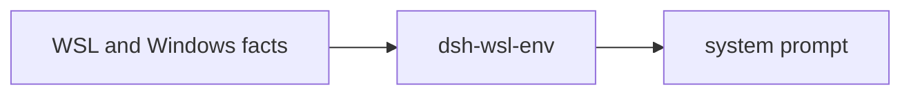

# dsh-wsl-env

[返回分类](../../views/categories/SOFTWARE-DELIVERY.md) · [返回首页](../../../README.md)

源码版本：[eb306d3](https://github.com/173787247/dsh-wsl-env/tree/eb306d3c6c2d34050daebee4485c2a390b4bf530)

<!-- BEGIN META -->
[](https://github.com/173787247/dsh-wsl-env)
<!-- END META -->

> **功能**：把 WSL、Windows 路径和 shell 环境说明注入 DSH 系统提示。

> **亮点**：[Q01](#research-q01) 支持自动填充局部环境事实并整合重复说明，降低每个会话手工组织背景的动作；这是提示集成，不是路径转换或安全隔离。

> **主要限制**：[Q02](#research-q02) 中always仍写WSL肯定句、路径固定/mnt/c且建议未探测的套件工具，可能让建议被误认成事实；自然语言不能约束真实工具参数。

**本文目录**

- [1 插件分析](#detail-section-1)
  - [1.1 用途与适用场景](#detail-section-2)
  - [1.2 能力、流程与成本](#detail-section-3)
  - [1.3 工程亮点](#detail-section-4)
  - [1.4 主要限制](#detail-section-5)
  - [1.5 使用建议](#detail-section-6)
  - [1.6 核查说明与分析版本](#detail-section-7)
- [2 未来设计假设（未验证）](#detail-section-8)
- [3 辅助信息](#detail-section-9)
- [4 研究问题与完整回答](#detail-section-10)
  - [Q01 · 谁用它，较手写提示增加什么？](#detail-section-11)
  - [Q02 · 检测、账户映射到prompt如何接线，什么会误导？](#detail-section-12)
  - [Q03 · 依赖、会话更新与全周期成本是什么？](#detail-section-13)
  - [Q04 · 采用边界与新假设如何验证？](#detail-section-14)

<a id="detail-section-1"></a>

## 1 插件分析

<a id="detail-section-2"></a>

### 1.1 用途与适用场景

> **用途**：浏览器在Windows、工具在WSL的DSH用户，可在新会话获得本地发行版和路径背景。

手写准确的项目提示是直接替代；已有宿主背景充分或特殊挂载环境不一定从固定建议获益。

<a id="detail-section-3"></a>

### 1.2 能力、流程与成本

#### 能力

| 能力 | 主要用途 | 使用条件与边界 |
|---|---|---|
| WSL检测 | 决定默认是否注入 | 信环境变量或kernel，强制模式绕过 |
| 局部环境填充 | 发行版、Linux用户与Windows账户示例 | 固定/mnt/c布局，不动态刷新 |
| 系统提示注册 | 给模型shell/路径建议 | 是自然语言，不是执行约束 |
| 操作员补充 | extraNotes追加自定义说明 | 由用户维护，配置覆盖需核对 |

#### 启动与依赖

| 依赖或条件 | 是否必需 | 用途 | 缺失或不满足时 |
|---|---|---|---|
| Node>=18与DSH systemPrompt | 启动必需 | ESM加载与段注册 | 当前宿主兼容未验收 |
| WSL环境信号 | 默认注入必需 | 环境/内核检测 | 非WSL跳过，always会强制描述WSL |
| /mnt/c/Users布局 | 具体账户示例前提 | 检查候选目录 | 特殊挂载不能自动正确推导 |
| 套件排障工具 | 只对相应建议必需 | host_reach等排障 | 本插件未安装或探测它们 |
| 新会话与人工核对 | 背景更新必需 | 确认SYSTEM和实际环境一致 | 旧会话可能保留旧背景 |

#### 启动步骤

| 步骤 | 执行者与动作 | 成功判据或失败处理 |
|---|---|---|
| 配置 | 用户核when/order/extraNotes | 避免误用always，层覆盖保留必要键 |
| 加载 | 宿主apply读取环境并注册段 | 默认非WSL跳过 |
| 使用 | 用户重启并新建会话核SYSTEM | 路径、发行版和实际工具相符 |
| 退出纠正 | 用户停用或更正并开新会话 | 已发生动作另行恢复，不凭停用回滚 |

#### 成本

| 阶段 | 现金与资源成本 | 人工与时间投入 | 已知条件与未知项 |
|---|---|---|---|
| 首次使用 | Node与宿主资源 | 配置并核实际路径/SYSTEM | 金额与耗时未知 |
| 持续使用 | 固定系统提示token | 跟随挂载/工具变化维护 | 无净费用对照，不以本地运行当0 |
| 失败恢复 | 新会话与已有操作恢复资源 | 停用/纠正提示，核实际环境 | 插件没有文件或外部动作回滚 |
| 退出 | 会话记录留存 | 移除配置并开新会话 | 已有会话背景需另核 |

#### 效果

| 效果项 | 当前证据支持 | 尚不能确定 |
|---|---|---|
| 环境识别 | 环境变量或kernel判断 | 继承信号误报与实际任务效果 |
| 账户示例 | 检查候选/mnt/c目录 | 自定义挂载自动映射 |
| shell引导 | 文本偏好Linux工具 | 模型遵守和误操作降低 |
| 排障说明 | 注入套件工具建议 | 工具是否安装、服务是否可用 |

> **思考**：[Q02](#research-q02) 中always仍写WSL肯定句、路径固定/mnt/c且建议未探测的套件工具，可能让建议被误认成事实；自然语言不能约束真实工具参数。

<a id="detail-section-4"></a>

### 1.3 工程亮点

> **亮点**：[Q01](#research-q01) 支持自动填充局部环境事实并整合重复说明，降低每个会话手工组织背景的动作；这是提示集成，不是路径转换或安全隔离。

[Q02](#research-q02) 小型纯函数支持注入env/文件读取/目录判断，便于定向核查；入口未使用网络模式函数，移植时应按实际调用而非函数存在判断能力。

<a id="detail-section-5"></a>

### 1.4 主要限制

[Q02](#research-q02) 中always仍写WSL肯定句、路径固定/mnt/c且建议未探测的套件工具，可能让建议被误认成事实；自然语言不能约束真实工具参数。

<a id="detail-section-6"></a>

### 1.5 使用建议

[Q04](#research-q04) 标准WSL布局用户核SYSTEM后，可在只读路径任务试用；发现环境/路径不符或工具不存在，就纠正或停用并新建会话。

<a id="detail-section-7"></a>

### 1.6 核查说明与分析版本

**核查状态**：已检查源码。

已检查全部生产JS、patch与代表测试源码，未运行目标或真实宿主。标准WSL且背景核对一致时可试用；特殊挂载和强制模式需谨慎收窄。新方案为未验证假设。

- 已检查：作者 README、包清单、源码路径 README.md、package.json、cordis.patch.yml、index.js、lib/wsl.js、test/wsl.test.js 及固定范围 inventory；组件：仓库根。抽读不冒充完整审计，来源和原文嵌入正式快照时保留。
- 未执行：插件安装、目标代码与测试、真实宿主及模型任务。源码存在不等于运行通过。
- 边界：全读index.js与lib/wsl.js、bundle和包声明，阅读代表测试设计但未执行。未扩展成整个WSL工具套件或验证代理/本地模型服务；提示中的Node/服务建议只按源文本记录，不作为本轮环境验证。
- 下一步：对标准/特殊挂载、缺套件和强制非WSL四组，比手写准确提示与现有注入，记录错误路径/工具调用、合格率和检测/token全负担。

**分析版本**

- **仓库**：[173787247/dsh-wsl-env](https://github.com/173787247/dsh-wsl-env)
- **版本号**：0.3.0（[固定提交 eb306d3](https://github.com/173787247/dsh-wsl-env/tree/eb306d3c6c2d34050daebee4485c2a390b4bf530)）
- **版本日期**：2026-10-30（固定提交日期，北京时间；不是包发布日期）

<a id="detail-section-8"></a>

## 2 未来设计假设（未验证）

<a id="innovation"></a>

[Q04](#research-q04) 提议分开已读事实与可选建议，并只在有挂载/工具依据时展示具体引导；若任务误导不降或额外成本抵消收益，则否定，尚未验证。

对标准/特殊挂载、缺套件和强制非WSL四组，比手写准确提示与现有注入，记录错误路径/工具调用、合格率和检测/token全负担。

<a id="detail-section-9"></a>

## 3 辅助信息

<details>
<summary>工程统计</summary>

仅统计 Markdown 和指定的 JavaScript／TypeScript 扩展名；Python 等其他语言不纳入，表格不代表全语言代码规模。

| 扩展名 | 范围 | 文件数 | 总行 | 代码行 | 注释行 | 字数 |
|---|---|---:|---:|---:|---:|---:|
| .js | source | 2 | 121 | 103 | 4 | — |
| .md | source | 2 | 196 | — | — | 1114 |
| .js | test | 1 | 77 | 65 | 0 | — |

</details>

**活跃度**

[](https://github.com/173787247/dsh-wsl-env/issues?q=is%3Aissue+is%3Aopen) [](https://github.com/173787247/dsh-wsl-env/issues?q=is%3Aissue+created%3A2026-10-03T02%3A08%3A50.948Z..2026-11-02T02%3A08%3A50.948Z) [](https://github.com/173787247/dsh-wsl-env/issues?q=is%3Aissue+is%3Aclosed+closed%3A2026-10-03T02%3A08%3A50.948Z..2026-11-02T02%3A08%3A50.948Z)


统计日期：2026-11-02。

<a id="detail-section-10"></a>

## 4 研究问题与完整回答

**插件研究总目标**：检验自动环境提示较手写说明的增量及其误导边界。

<a id="research-q01"></a>

<a id="detail-section-11"></a>

### Q01 · 谁用它，较手写提示增加什么？

**研究主题**：场景与需求、贡献与相对优势

#### 完整回答

它给浏览器在Windows而Agent工具在WSL运行的DSH用户注入环境背景，不提供模型可调用工具。用户反复遇到的具体摩擦是模型把Windows盘符、PowerShell与Linux工具混用。合格结果不是SYSTEM出现一段文字，而是目标文件路径、shell和工作目录在后续任务中正确；没有路径之外的副作用，也不能把系统提示当授权。

相对在每个新会话手写WSL说明，插件在apply时获取发行版、Linux用户名并选择可见的Windows用户目录，统一加入路径和shell指导。这是局部事实自动填充与重复提示整合，非路径转换器、命令拦截器或环境沙箱。手工维护一段准确的项目提示仍是直接替代；环境简单且已有宿主背景充分时增量可能只是少写几行。README的“模型经常误认”是作者问题描述，本轮没有独立用户频率或模型对照，不能量化避免误操作的收益。

#### 证据与依据

**依据 1 · 作者声明**：[README.md:11-20](https://github.com/173787247/dsh-wsl-env/blob/eb306d3c6c2d34050daebee4485c2a390b4bf530/README.md#L11-L20)

作者将其定位为system prompt而非工具。

<details>
<summary>查看原文（10行）</summary>

````text
## Where it sits

Injects WSL and Windows path facts into the system prompt. It is not a tool the model calls.



Suite diagram and version snapshot: [dsh-wsl-kit](https://github.com/173787247/dsh-wsl-kit#how-the-pieces-fit). This plugin is **0.3.0** (daily; also in llm). Do not copy that matrix into this README.
````

</details>

**依据 2 · 源码核查**：[index.js:18-32](https://github.com/173787247/dsh-wsl-env/blob/eb306d3c6c2d34050daebee4485c2a390b4bf530/index.js#L18-L32)

局部事实、路径与shell指导的实际文本构造。

<details>
<summary>查看原文（15行）</summary>

```text
  const distro = distroName();
  const linuxUser = os.userInfo().username;
  const windowsUser = resolveWindowsUser(linuxUser);
  let text = [
    `You are running inside Windows Subsystem for Linux (${distro}) as ${linuxUser}.`,
    "The browser may be on Windows, but tools and the shell run in Linux.",
    "",
    "Path and shell rules:",
    "- Use bash and Linux paths. Do not use PowerShell, cmd.exe, or Windows drive letters as command paths.",
    `- ${windowsPathRule(windowsUser || linuxUser)}`,
    "- Prefer the selected workspace and the current session working directory. Do not scan the entire Windows home or Desktop unless asked.",
    "- Node, git, python, and package managers mean the Linux copies in this distro, not the Windows ones.",
    "- Files under /mnt/c often have CRLF endings. Strip carriage returns before running a script with bash.",
    "- Prefer the current session working directory and /home for git and new files. Do not treat /mnt/c as the daily working tree unless asked.",
    "- Node 24 fetch ignores HTTP_PROXY/HTTPS_PROXY unless NODE_USE_ENV_PROXY=1. Set that when a Node script must use the proxy.",
```

</details>

**依据 3 · 源码核查**：[index.js:47-51](https://github.com/173787247/dsh-wsl-env/blob/eb306d3c6c2d34050daebee4485c2a390b4bf530/index.js#L47-L51)

真实systemPrompt注册点。

```text
  ctx.systemPrompt.section({
    name: "runtime:wsl-windows",
    order,
    text,
  });
```

#### 缺口

- 没有相同任务在已有宿主提示、手写提示与插件下的错误率资料。
  **影响**：只能确认整合机制，不能证明降低误操作或节时。
  **进一步探讨**：固定模型与路径任务，记录错误shell/路径、人工纠正和提示token总量。

<a id="research-q02"></a>

<a id="detail-section-12"></a>

### Q02 · 检测、账户映射到prompt如何接线，什么会误导？

**研究主题**：功能与机制、缺陷与关键质疑、工程质量与复用

#### 完整回答

package的bundle patch插入dsh-wsl-env，入口注入systemPrompt。when只有精确always会强制，其余按wsl处理；detectWsl先信WSL_DISTRO_NAME/WSL_INTEROP，再读kernel osrelease含microsoft，失败返回false。默认非WSL直接跳过。apply随后读发行版和os.userInfo用户名，优先检查USERPROFILE解析的名字，再查Linux用户名是否有对应/mnt/c/Users目录；路径示例只有目录存在时才带真实名字，否则输出通用name示例。这比盲猜账户有边界，且生产代码没有网络、子进程或文件写入。

关键限制是事实与建议混在同一段肯定语气文本。always即使不在WSL也会写“You are running inside Windows Subsystem for Linux”；环境变量继承也可能误报。路径规则固定/mnt/c/Users，不解析实际自动挂载配置，因此自定义挂载不能由它完整识别。额外lib函数readWslNetworkingMode存在但入口没有调用，不能据函数名说已检测网络模式。提示里的host_reach/net_doctor/wsl_dns/wsl_clock来自其他组件，本插件既未注册也未探测；若用户未装套件，模型会收到不可用工具建议。

所有shell偏好和“不扫描整个Windows home”的句子都是自然语言规则，没有检查实际工具参数或权限；它也不会替用户设置代理变量、修复CRLF、配置模型或恢复文件。lib测试以可注入env/读文件/exists验证若干纯函数场景，未覆盖整个apply在真实宿主的新会话行为，本轮只读测试源码而未执行。

#### 证据与依据

**依据 1 · 源码核查**：[cordis.patch.yml:1-7](https://github.com/173787247/dsh-wsl-env/blob/eb306d3c6c2d34050daebee4485c2a390b4bf530/cordis.patch.yml#L1-L7)

bundle默认配置。

```text
- insert:
    - id: dsh-wsl-env
      name: dsh-wsl-env
      config:
        when: wsl
        order: 15
        extraNotes: ""
```

**依据 2 · 源码核查**：[index.js:4-20](https://github.com/173787247/dsh-wsl-env/blob/eb306d3c6c2d34050daebee4485c2a390b4bf530/index.js#L4-L20)

注入声明、默认跳过和apply时事实采集。

<details>
<summary>查看原文（17行）</summary>

```text
export const name = "dsh-wsl-env";
export const inject = ["systemPrompt"];

export function apply(ctx, config = {}) {
  const when = config.when === "always" ? "always" : "wsl";
  const extra = String(config.extraNotes ?? "").trim();
  const order = Number.isFinite(config.order) ? config.order : 15;
  const wsl = detectWsl();

  if (when === "wsl" && !wsl) {
    console.log("[dsh-wsl-env] not running in WSL; skipping prompt injection");
    return;
  }

  const distro = distroName();
  const linuxUser = os.userInfo().username;
  const windowsUser = resolveWindowsUser(linuxUser);
```

</details>

**依据 3 · 源码核查**：[lib/wsl.js:4-36](https://github.com/173787247/dsh-wsl-env/blob/eb306d3c6c2d34050daebee4485c2a390b4bf530/lib/wsl.js#L4-L36)

检测和固定挂载映射的完整边界。

<details>
<summary>查看原文（33行）</summary>

```text
export function detectWsl({ env = process.env, readRelease = readOsRelease } = {}) {
  if (env.WSL_DISTRO_NAME || env.WSL_INTEROP) {
    return true;
  }
  try {
    return /microsoft/i.test(readRelease());
  } catch {
    return false;
  }
}

export function userFromWindowsHome(home) {
  if (!home) return "";
  const normalized = String(home).replace(/\\/g, "/");
  const match = normalized.match(/\/Users\/([^/]+)/i);
  return match ? match[1] : "";
}

export function resolveWindowsUser(linuxUser, { env = process.env, exists = existsSync } = {}) {
  const fromProfile = userFromWindowsHome(env.USERPROFILE);
  const names = [...new Set([fromProfile, linuxUser].filter(Boolean))];
  for (const name of names) {
    if (exists(`/mnt/c/Users/${name}`)) return name;
  }
  return fromProfile || "";
}

export function windowsPathRule(user, { exists = existsSync } = {}) {
  const linuxHome = user ? `/mnt/c/Users/${user}` : "";
  if (user && exists(linuxHome)) {
    return `A Windows path such as C:\\Users\\${user}\\project is ${linuxHome}/project in this environment.`;
  }
  return "A Windows path such as C:\\Users\\name\\project is /mnt/c/Users/name/project in this environment.";
```

</details>

**依据 4 · 源码核查**：[lib/wsl.js:39-60](https://github.com/173787247/dsh-wsl-env/blob/eb306d3c6c2d34050daebee4485c2a390b4bf530/lib/wsl.js#L39-L60)

发行版回退与未由入口调用的网络模式函数。

<details>
<summary>查看原文（22行）</summary>

```text
export function distroName({ env = process.env, readOsReleaseFile = readEtcOsRelease } = {}) {
  if (env.WSL_DISTRO_NAME) return env.WSL_DISTRO_NAME;
  try {
    const text = readOsReleaseFile();
    const pretty = text.match(/^PRETTY_NAME="?([^"\n]+)"?/m);
    if (pretty) return pretty[1];
  } catch {
    // /etc/os-release is missing on some test hosts
  }
  return "WSL";
}

/** Reads networkingMode from /etc/wsl.conf when present (mirrored | nat | unknown). */
export function readWslNetworkingMode({ readFile = readFileSync } = {}) {
  try {
    const text = readFile("/etc/wsl.conf", "utf8");
    const m = text.match(/^\s*networkingMode\s*=\s*(\w+)/im);
    if (m) return m[1].toLowerCase();
  } catch {
    /* ignore */
  }
  return "unknown";
```

</details>

**依据 5 · 源码核查**：[index.js:22-40](https://github.com/173787247/dsh-wsl-env/blob/eb306d3c6c2d34050daebee4485c2a390b4bf530/index.js#L22-L40)

始终WSL句子与套件工具建议。

<details>
<summary>查看原文（19行）</summary>

```text
    `You are running inside Windows Subsystem for Linux (${distro}) as ${linuxUser}.`,
    "The browser may be on Windows, but tools and the shell run in Linux.",
    "",
    "Path and shell rules:",
    "- Use bash and Linux paths. Do not use PowerShell, cmd.exe, or Windows drive letters as command paths.",
    `- ${windowsPathRule(windowsUser || linuxUser)}`,
    "- Prefer the selected workspace and the current session working directory. Do not scan the entire Windows home or Desktop unless asked.",
    "- Node, git, python, and package managers mean the Linux copies in this distro, not the Windows ones.",
    "- Files under /mnt/c often have CRLF endings. Strip carriage returns before running a script with bash.",
    "- Prefer the current session working directory and /home for git and new files. Do not treat /mnt/c as the daily working tree unless asked.",
    "- Node 24 fetch ignores HTTP_PROXY/HTTPS_PROXY unless NODE_USE_ENV_PROXY=1. Set that when a Node script must use the proxy.",
    "",
    "Local LLM on Windows (Ollama / LM Studio / vLLM / Unsloth Desktop):",
    "- dsh runs in WSL; the inference server often runs on Windows. Use host_reach to find a reachable baseURL (127.0.0.1 vs Windows host IP depends on WSL networking mode).",
    "- Paste host_reach providerSnippets into ~/.dsh/settings.yaml under llm-pi-ai.providers; export the matching *_API_KEY dummy env vars before dsh web.",
    "- Ollama: align settings contextWindow with the model's real n_ctx (OLLAMA_NUM_CTX / Modelfile). A settings value of 131072 when Ollama n_ctx=8192 causes API errors.",
    "- Unsloth Desktop (llama-server, often :8080) is separate from Unsloth Studio; Flash-Next multi-shard GGUF may not load in plain Ollama.",
    "",
    "When connectivity fails, run tools in order: host_reach (local LLM) → net_doctor (HTTPS/proxy) → wsl_dns → wsl_clock. See dsh-wsl-kit docs/TROUBLESHOOTING.zh.md.",
```

</details>

**依据 6 · 源码核查**：[test/wsl.test.js:5-35](https://github.com/173787247/dsh-wsl-env/blob/eb306d3c6c2d34050daebee4485c2a390b4bf530/test/wsl.test.js#L5-L35)

已有纯函数断言是测试设计，不是本轮运行结果。

<details>
<summary>查看原文（31行）</summary>

```text
describe("detectWsl", () => {
  it("trusts WSL_DISTRO_NAME", () => {
    assert.equal(detectWsl({ env: { WSL_DISTRO_NAME: "Ubuntu-24.04" }, readRelease: () => { throw new Error("unused"); } }), true);
  });

  it("trusts WSL_INTEROP", () => {
    assert.equal(detectWsl({ env: { WSL_INTEROP: "/run/WSL/1_interop" }, readRelease: () => { throw new Error("unused"); } }), true);
  });

  it("reads the kernel osrelease when env is empty", () => {
    assert.equal(detectWsl({ env: {}, readRelease: () => "6.8.0-microsoft-standard-WSL2" }), true);
    assert.equal(detectWsl({ env: {}, readRelease: () => "6.8.0-generic" }), false);
  });

  it("returns false when osrelease cannot be read", () => {
    assert.equal(detectWsl({ env: {}, readRelease: () => { throw new Error("ENOENT"); } }), false);
  });
});

describe("windowsPathRule", () => {
  it("uses the Linux username when /mnt/c/Users/<user> exists", () => {
    const text = windowsPathRule("alice", { exists: (p) => p === "/mnt/c/Users/alice" });
    assert.match(text, /C:\\Users\\alice\\project/);
    assert.match(text, /\/mnt\/c\/Users\/alice\/project/);
  });

  it("falls back to a generic mapping when that home is missing", () => {
    const text = windowsPathRule("alice", { exists: () => false });
    assert.match(text, /C:\\Users\\name\\project/);
    assert.match(text, /\/mnt\/c\/Users\/name\/project/);
  });
```

</details>

#### 缺口

- 自定义挂载、继承环境和缺套件时的真实模型行为未知。
  **影响**：自然语言可能被模型当成已探测事实，影响命令选择。
  **进一步探讨**：用标准WSL、非WSL强制、自定义挂载和仅单装插件四种环境，对照实际SYSTEM文本与工具可用性。

<a id="research-q03"></a>

<a id="detail-section-13"></a>

### Q03 · 依赖、会话更新与全周期成本是什么？

**研究主题**：依赖、兼容与流程、效果与总成本

#### 完整回答

启动依赖Node>=18的ESM和宿主systemPrompt接口，具体DSH最低版本/最新验证是README作者兼容说明，不是本轮宿主验收。默认只在WSL注入，extraNotes会直接追加操作员说明；配置层若整对象替换，需按README重述保留键，不能以漏字段猜测覆盖效果。文本在apply时构造，没有事件监听或定时刷新；README要求重启dsh web并开新会话，已有会话保留旧prompt。因此挂载、用户名、模型服务或工具变化后，操作者要重新核对当前会话实际背景，而不是认为每次工具调用会重新探测。

首次负担是安装配置、核SYSTEM背景和实际挂载；持续负担是固定提示占用上下文和同步环境变化，文本包含本地模型及排障建议，单装用户也会承担不适用说明的token。没有API金额、对照任务或测量，不把本地读取和MIT许可证解释为零总成本。失败退路是停用/更正配置并开新会话，再人工核实际环境；插件不执行回滚，已按错误提示发生的文件或远端副作用仍由用户恢复。退出前保留会话和用户文件，对提示配置作可逆变更即可，不能把关闭插件当撤销既有命令。

#### 证据与依据

**依据 1 · 源码核查**：[package.json:13-19](https://github.com/173787247/dsh-wsl-env/blob/eb306d3c6c2d34050daebee4485c2a390b4bf530/package.json#L13-L19)

ESM入口与Node版本声明。

```text
  "homepage": "https://github.com/173787247/dsh-wsl-env#readme",
  "type": "module",
  "main": "index.js",
  "engines": {
    "node": ">=18"
  },
  "scripts": {
```

**依据 2 · 源码核查**：[index.js:7-20](https://github.com/173787247/dsh-wsl-env/blob/eb306d3c6c2d34050daebee4485c2a390b4bf530/index.js#L7-L20)

只在apply计算事实。

<details>
<summary>查看原文（14行）</summary>

```text
export function apply(ctx, config = {}) {
  const when = config.when === "always" ? "always" : "wsl";
  const extra = String(config.extraNotes ?? "").trim();
  const order = Number.isFinite(config.order) ? config.order : 15;
  const wsl = detectWsl();

  if (when === "wsl" && !wsl) {
    console.log("[dsh-wsl-env] not running in WSL; skipping prompt injection");
    return;
  }

  const distro = distroName();
  const linuxUser = os.userInfo().username;
  const windowsUser = resolveWindowsUser(linuxUser);
```

</details>

**依据 3 · 源码核查**：[index.js:43-51](https://github.com/173787247/dsh-wsl-env/blob/eb306d3c6c2d34050daebee4485c2a390b4bf530/index.js#L43-L51)

extraNotes直接追加并注册静态段。

```text
  if (extra) {
    text += `\n\nAdditional operator notes:\n${extra}`;
  }

  ctx.systemPrompt.section({
    name: "runtime:wsl-windows",
    order,
    text,
  });
```

**依据 4 · 作者声明**：[README.md:53-67](https://github.com/173787247/dsh-wsl-env/blob/eb306d3c6c2d34050daebee4485c2a390b4bf530/README.md#L53-L67)

作者安装后重启、新会话及SYSTEM核查说明。

<details>
<summary>查看原文（15行）</summary>

````text
```sh
dsh plugin --profile web add github:173787247/dsh-wsl-env
# or:
dsh plugin --profile web add /absolute/path/to/dsh-wsl-env
```

Restart `dsh web`. Open a **new** session (existing sessions keep the old prompt).

## Verify

1. Send any message.
2. Trajectory → **SYSTEM** → **System Prompt** (not the Tools tab).
3. Search for `Windows Subsystem for Linux`.

You should see the distro name and path mapping. The UI concatenates sections, so the internal id `runtime:wsl-windows` may not appear as a heading.
````

</details>

**依据 5 · 作者声明**：[README.md:73-88](https://github.com/173787247/dsh-wsl-env/blob/eb306d3c6c2d34050daebee4485c2a390b4bf530/README.md#L73-L88)

配置整对象替换提醒与选项。

<details>
<summary>查看原文（16行）</summary>

````text
Later profile layers that set `config` **replace the whole object**—restate every key you keep:

```yaml
- id: dsh-wsl-env
  name: dsh-wsl-env
  config:
    when: wsl          # or: always
    order: 15
    extraNotes: "Prefer /home over /mnt/c for new files."
```

| Key | Default | Meaning |
|-----|---------|---------|
| `when` | `wsl` | Inject only in WSL, or `always` |
| `order` | `15` | Prompt section order |
| `extraNotes` | `""` | Extra operator notes appended to the section |
````

</details>

#### 缺口

- 缺少提示新增token、用户维护时间和错误命令恢复投入。
  **影响**：无法计算单位合格任务成本或证明配置负担更小。
  **进一步探讨**：按相同任务记录首次配置、持续上下文和失败纠正总投入；先核新旧会话差异。

<a id="research-q04"></a>

<a id="detail-section-14"></a>

### Q04 · 采用边界与新假设如何验证？

**研究主题**：采用判断、新假设与验证

#### 完整回答

标准/mnt/c布局的WSL用户，在确认SYSTEM与实际环境一致后可小范围试用，先做无副作用的路径读取与shell选择任务。仅需要一段固定说明或使用自定义挂载的人，可先继续维护手写项目提示；always不应被当作探测开关，它是强制注入。发现发行版/路径不符或模型反复调用未安装套件工具，就停用或纠正说明并开新会话，实际操作仍按当前工作区授权。

可验证假设是把“已经读取的事实”和“可选工作建议”分开，只在挂载或工具存在性有依据时附具体路径和排障步骤。推导来自Q02的固定挂载、always肯定句与不可用工具提示，不能说现有代码没有目录存在检查；真正增量是发现实际挂载和工具范围，并显式输出未知。最小对照用标准WSL、自定义挂载、仅安装本插件与非WSL强制四组，固定模型和路径任务，比较当前提示、人工准确提示和事实/建议分离版本。观察错误路径/不可用工具次数、任务合格率、额外检测延迟与token、维护负担。若分离版本没有减少误导或动态探测成本超过收益，就否定其价值；这个方案尚未实现，不能计为现有贡献。

#### 证据与依据

**依据 1 · 源码核查**：[lib/wsl.js:22-36](https://github.com/173787247/dsh-wsl-env/blob/eb306d3c6c2d34050daebee4485c2a390b4bf530/lib/wsl.js#L22-L36)

已存在目录检查，假设需在此基线上增加实际挂载范围。

<details>
<summary>查看原文（15行）</summary>

```text
export function resolveWindowsUser(linuxUser, { env = process.env, exists = existsSync } = {}) {
  const fromProfile = userFromWindowsHome(env.USERPROFILE);
  const names = [...new Set([fromProfile, linuxUser].filter(Boolean))];
  for (const name of names) {
    if (exists(`/mnt/c/Users/${name}`)) return name;
  }
  return fromProfile || "";
}

export function windowsPathRule(user, { exists = existsSync } = {}) {
  const linuxHome = user ? `/mnt/c/Users/${user}` : "";
  if (user && exists(linuxHome)) {
    return `A Windows path such as C:\\Users\\${user}\\project is ${linuxHome}/project in this environment.`;
  }
  return "A Windows path such as C:\\Users\\name\\project is /mnt/c/Users/name/project in this environment.";
```

</details>

**依据 2 · 源码核查**：[index.js:22-40](https://github.com/173787247/dsh-wsl-env/blob/eb306d3c6c2d34050daebee4485c2a390b4bf530/index.js#L22-L40)

肯定WSL文本与工具建议是具体问题来源。

<details>
<summary>查看原文（19行）</summary>

```text
    `You are running inside Windows Subsystem for Linux (${distro}) as ${linuxUser}.`,
    "The browser may be on Windows, but tools and the shell run in Linux.",
    "",
    "Path and shell rules:",
    "- Use bash and Linux paths. Do not use PowerShell, cmd.exe, or Windows drive letters as command paths.",
    `- ${windowsPathRule(windowsUser || linuxUser)}`,
    "- Prefer the selected workspace and the current session working directory. Do not scan the entire Windows home or Desktop unless asked.",
    "- Node, git, python, and package managers mean the Linux copies in this distro, not the Windows ones.",
    "- Files under /mnt/c often have CRLF endings. Strip carriage returns before running a script with bash.",
    "- Prefer the current session working directory and /home for git and new files. Do not treat /mnt/c as the daily working tree unless asked.",
    "- Node 24 fetch ignores HTTP_PROXY/HTTPS_PROXY unless NODE_USE_ENV_PROXY=1. Set that when a Node script must use the proxy.",
    "",
    "Local LLM on Windows (Ollama / LM Studio / vLLM / Unsloth Desktop):",
    "- dsh runs in WSL; the inference server often runs on Windows. Use host_reach to find a reachable baseURL (127.0.0.1 vs Windows host IP depends on WSL networking mode).",
    "- Paste host_reach providerSnippets into ~/.dsh/settings.yaml under llm-pi-ai.providers; export the matching *_API_KEY dummy env vars before dsh web.",
    "- Ollama: align settings contextWindow with the model's real n_ctx (OLLAMA_NUM_CTX / Modelfile). A settings value of 131072 when Ollama n_ctx=8192 causes API errors.",
    "- Unsloth Desktop (llama-server, often :8080) is separate from Unsloth Studio; Flash-Next multi-shard GGUF may not load in plain Ollama.",
    "",
    "When connectivity fails, run tools in order: host_reach (local LLM) → net_doctor (HTTPS/proxy) → wsl_dns → wsl_clock. See dsh-wsl-kit docs/TROUBLESHOOTING.zh.md.",
```

</details>

**依据 3 · 源码核查**：[index.js:47-51](https://github.com/173787247/dsh-wsl-env/blob/eb306d3c6c2d34050daebee4485c2a390b4bf530/index.js#L47-L51)

当前一个段的组织方式。

```text
  ctx.systemPrompt.section({
    name: "runtime:wsl-windows",
    order,
    text,
  });
```

#### 缺口

- 事实/建议分离方案未实现，尚无用户结果。
  **影响**：不能预先保证动态探测或额外文本有净收益。
  **进一步探讨**：先以准确人工提示作上界对照，再比较改动与现有方案的任务结果和全部开销。

[返回分类](../../views/categories/SOFTWARE-DELIVERY.md) · [返回首页](../../../README.md)
