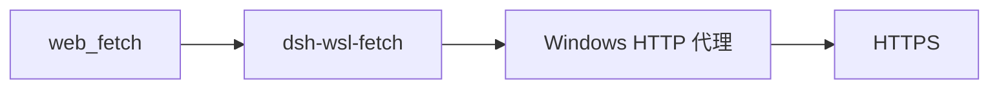

# dsh-wsl-fetch

[返回分类](../../views/categories/INFRASTRUCTURE.md) · [返回首页](../../../README.md)

源码版本：[ef32d59](https://github.com/173787247/dsh-wsl-fetch/tree/ef32d59a6e95929aa18e86c5495d0f3f9d78185a)

<!-- BEGIN META -->
[](https://github.com/173787247/dsh-wsl-fetch)
<!-- END META -->

> **功能**：为 DSH WSL 的官方 web_fetch 提供进程内 HTTP(S) 代理传输 provider。

> **亮点**：将代理放入官方 web_fetch 进程内调用链，并在无代理/已有其他 provider 时避免强行覆盖。详见[Q01](#research-q01)。

> **主要限制**：公有域名解析到私网的路径不受此插件代码校验，普通 sleep 不响应 deadline；宿主与代理外层控制未知。详见[Q03](#research-q03)和[Q04](#research-q04)。

**本文目录**

- [1 插件分析](#detail-section-1)
  - [1.1 用途与适用场景](#detail-section-2)
  - [1.2 能力、流程与成本](#detail-section-3)
  - [1.3 工程亮点](#detail-section-4)
  - [1.4 主要限制](#detail-section-5)
  - [1.5 使用建议](#detail-section-6)
  - [1.6 核查说明与分析版本](#detail-section-7)
- [2 未来设计假设（未验证）](#detail-section-8)
- [3 辅助信息](#detail-section-9)
- [4 研究问题与完整回答](#detail-section-10)
  - [Q01 · 它修复了 WSL 中哪条抓取路径，何时接管官方 provider？](#detail-section-11)
  - [Q02 · URL、重定向、响应体和重试如何受控？](#detail-section-12)
  - [Q03 · 私网地址保护是否覆盖 DNS 与代理后的真实目标？](#detail-section-13)
  - [Q04 · 单次超时和重试延时是否严格封顶？](#detail-section-14)
  - [Q05 · 安装与故障判读应怎样落地？](#detail-section-15)

<a id="detail-section-1"></a>

## 1 插件分析

<a id="detail-section-2"></a>

### 1.1 用途与适用场景

> **用途**：WSL 中官方 web_fetch 直连失败而 Windows HTTP 代理可用的公开网页抓取。详见[Q01](#research-q01)。

官方 http provider 直接抓取；在作者 WSL 场景会直连失败（仅作者报告），可对照同站成功率。

<a id="detail-section-3"></a>

### 1.2 能力、流程与成本

**能力**

| 能力 | 用途 | 边界 |
| --- | --- | --- |
| 代理 provider | WSL 公开网页抓取 | 需进程内代理变量 |
| URL/重定向限制 | 限制目标 | 无最终 DNS/IP 校验 |
| 字节/时间限制 | 降低资源成本 | 退避等待不响应截止时间 |

**流程与依赖**

#### 启动与依赖

| 依赖 | 必需 | 用途 | 缺失后果 |
| --- | --- | --- | --- |
| DSH web/systemPrompt | 必需 | provider 注册/提示 | 无接管 |
| HTTP(S)_PROXY/undici | 必需 | 进程内代理 | provider 不可用/失败 |
| Windows 代理/DNS | 运行必需 | 最终连接 | 站点不可达或安全边界未知 |

#### 使用步骤

| 步骤 | 动作 | 判据/恢复 |
| --- | --- | --- |
| 安装 | web profile 加包、设代理、新会话 | 日志 provider=wsl-proxy |
| 验证 | 抓公开 HTTPS 页 | status/body 与原站核对 |
| 故障 | 403/跳转/网络错误分型 | 换源或检查代理 |
| 复核 | 审私网/DNS 边界 | 敏感环境再部署 |

**效果与成本**

#### 成本

| 阶段 | 资源成本 | 人工投入 | 边界 |
| --- | --- | --- | --- |
| 安装 | DSH WSL/Windows 代理，价格未知 | 环境变量/重启/新会话 | 代理可用性未测 |
| 抓取 | 默认30秒、5MB、2次网络重试 | 查故障/换源 | 真实流量/成功率未知 |
| 安全 | 代理可达的网络 | 审 DNS/代理 ACL | 最终 IP 未强校验 |

#### 效果

| 效果项 | 源码支持 | 未证实 |
| --- | --- | --- |
| 进程内代理 | ProxyAgent 与条件选中 | 真实站点成功率 |
| 内容上限 | 5MB/10万字符默认 | 解码内容完整性 |
| 目的地址保护 | 字面量/后缀过滤 | DNS/代理最终 IP 安全 |

> **思考**：公有域名解析到私网的路径不受此插件代码校验，普通 sleep 不响应 deadline；宿主与代理外层控制未知。详见[Q03](#research-q03)和[Q04](#research-q04)。

<a id="detail-section-4"></a>

### 1.3 工程亮点

> **亮点**：将代理放入官方 web_fetch 进程内调用链，并在无代理/已有其他 provider 时避免强行覆盖。详见[Q01](#research-q01)。

同站跳转和流读取限额可借鉴；代理侧私网解析、退避取消和配置上限需补。详见[Q02](#research-q02)至[Q04](#research-q04)。

<a id="detail-section-5"></a>

### 1.4 主要限制

公有域名解析到私网的路径不受此插件代码校验，普通 sleep 不响应 deadline；宿主与代理外层控制未知。详见[Q03](#research-q03)和[Q04](#research-q04)。

<a id="detail-section-6"></a>

### 1.5 使用建议

可信代理与公开站点小范围试用；含敏感内网的环境先验证代理目的地址控制。详见[Q05](#research-q05)。

<a id="detail-section-7"></a>

### 1.6 核查说明与分析版本

**核查状态**：已检查源码。

固定源码可核 provider 接管与响应限制；私网过滤只检 URL 字面量/后缀，DNS/代理最终 IP 未验；长重试等待可超出 timeout。

- 已检查：作者 README、包清单、源码路径 README.zh.md、index.js、lib/fetch.js、package.json 及固定范围 inventory；组件：仓库根。抽读不冒充完整审计，来源和原文嵌入正式快照时保留。
- 未执行：插件安装、目标代码与测试、真实宿主及模型任务。源码存在不等于运行通过。
- 边界：只读核固定提交 README.zh.md、index.js、lib/fetch.js、package.json；未运行目标插件/测试/代理/宿主，旧 META 仅复用。
- 下一步：目标 WSL 测代理连通性、已有 provider 共存、大小/跳转/403、私网域名解析、可中止超时与响应完整性。

**分析版本**

- **仓库**：[173787247/dsh-wsl-fetch](https://github.com/173787247/dsh-wsl-fetch)
- **版本号**：0.1.2（[固定提交 ef32d59](https://github.com/173787247/dsh-wsl-fetch/tree/ef32d59a6e95929aa18e86c5495d0f3f9d78185a)）
- **版本日期**：2026-09-30（固定提交日期，北京时间；不是包发布日期）

<a id="detail-section-8"></a>

## 2 未来设计假设（未验证）

<a id="innovation"></a>

未验证改进是代理最终目的地约束、可中止退避、配置上限和受控站点效果测量。详见[Q05](#research-q05)。

目标 WSL 测代理连通性、已有 provider 共存、大小/跳转/403、私网域名解析、可中止超时与响应完整性。

<a id="detail-section-9"></a>

## 3 辅助信息

<details>
<summary>工程统计</summary>

| 扩展名 | 范围 | 文件数 | 总行 | 代码行 | 注释行 | 字数 |
|---|---|---:|---:|---:|---:|---:|
| .md | source | 3 | 238 | — | — | 1459 |
| .js | source | 2 | 405 | 371 | 6 | — |
| .mjs | source | 1 | 113 | 98 | 14 | — |
| .js | test | 1 | 191 | 177 | 16 | — |

</details>

**活跃度**

Issue 活跃度数据暂未获取（查询日期：2026-10-21），可前往 [GitHub Issues](https://github.com/173787247/dsh-wsl-fetch/issues) 查看。

<a id="detail-section-10"></a>

## 4 研究问题与完整回答

**插件研究总目标**：代理抓取能否改善 WSL web_fetch，同时守住目标地址、超时和响应大小边界？

<a id="research-q01"></a>

<a id="detail-section-11"></a>

### Q01 · 它修复了 WSL 中哪条抓取路径，何时接管官方 provider？

**研究主题**：场景与需求、贡献与相对优势

#### 完整回答

插件向 DSH web 注册 wsl-proxy 抓取 provider，以 undici ProxyAgent 从宿主进程内走 HTTP(S)_PROXY，目标是避免官方 web_fetch 在 WSL 直连公网 IP 的失败。只在代理环境非空且当前 fetchProviderId 为空或 http 时才选中自己，已有其他 provider 不覆盖；无代理仍注册但不可用。README 关于官方失败、最低版本和套件效果属作者声明，未在目标 WSL 重现。它改变的是官方 web_fetch 的传输路径，不提供新搜索工具或站点解锁能力。

#### 证据与依据

**依据 1 · 作者声明**：[README.zh.md:7-44](https://github.com/173787247/dsh-wsl-fetch/blob/ef32d59a6e95929aa18e86c5495d0f3f9d78185a/README.zh.md#L7-L44)

作者 WSL 代理场景与限制

<details>
<summary>查看原文（38行）</summary>

````text
让官方 **`web_fetch`** 从 WSL 走 Windows HTTP 代理，而不是直连公网 IP。

[English → README.md](./README.md)

## 在套件里的位置

让官方 web_fetch 走 Windows HTTP 代理。dsh-wsl-net 只诊断，本插件才真正去抓。



整套关系图和版本快照：[dsh-wsl-kit 中文说明](https://github.com/173787247/dsh-wsl-kit/blob/master/README.zh.md)。本插件是 **0.1.2**（daily，也在 llm）。不要把那份总表抄进本 README。


## 兼容性

| 项 | 值 |
|----|----|
| **插件** | `dsh-wsl-fetch` **0.1.2** |
| **最低 dsh** | ≥ **0.1.2**（Windows 中继 `:3081` 一次性 `?token=`） |
| **最新验证** | 以 [dsh-wsl-kit 兼容性](https://github.com/173787247/dsh-wsl-kit#compatibility-2026-09) 为准（当前 **`0.2.0-rc.2`**）— 套件唯一真源 |
| **套件档位** | `daily`（亦含于 `github` / `full`；fetch+net 亦在 `llm`） |
| **云端 Flash** | settings / `llm-deepseek` 使用 **`deepseek-flash`**（V4.1 Flash）；本插件不配置模型 id |
| **Agent Teams** | 上游实验包；本插件不依赖 |

套件版本地板：[`check-plugin-versions.sh`](https://github.com/173787247/dsh-wsl-kit/blob/master/scripts/check-plugin-versions.sh)。故障树：[TROUBLESHOOTING.zh.md](https://github.com/173787247/dsh-wsl-kit/blob/master/docs/TROUBLESHOOTING.zh.md)。

**范围：** 进程内官方 `web_fetch` 走 undici `ProxyAgent`。需要 `HTTP(S)_PROXY`。经 Clash 遇到 Cloudflare 403/1010 需对该域名 **DIRECT**——不在本插件能力内。

## 为什么

官方 `dsh-web-fetch-http` 在 WSL 解析 DNS 后，用自定义 undici `Agent` **直连**该 IP，从而绕过 `NODE_USE_ENV_PROXY`。DeepSeek API 可以通，Mattermost / 文档站的 `web_fetch` 却报 `TypeError: fetch failed`。

`dsh-wsl-net` 只给 bash/npm **子进程**注入代理，管不到进程内的 `web_fetch`。

本插件注册 `wsl-proxy`；存在 `HTTPS_PROXY` / `HTTP_PROXY` 时选中它，用 `ProxyAgent` 抓公网 HTTPS。内网和 localhost 仍然拒绝。
````

</details>

**依据 2 · 源码核查**：[index.js:6-36](https://github.com/173787247/dsh-wsl-fetch/blob/ef32d59a6e95929aa18e86c5495d0f3f9d78185a/index.js#L6-L36)

注册与条件选中 provider

<details>
<summary>查看原文（31行）</summary>

```text
export function apply(ctx, config = {}) {
  const proxyUrl = readProxyUrl();
  const provider = createFetchProvider({
    proxyUrl,
    timeoutMs: positive(config.timeoutMs, 30_000),
    maxRedirects: integer(config.maxRedirects, 5),
    maxResponseBytes: positive(config.maxResponseBytes, 5_000_000),
    maxBodyChars: positive(config.maxBodyChars, 100_000),
    retries: integer(config.retries, 2),
    retryDelayMs: positive(config.retryDelayMs, 400),
    userAgent: typeof config.userAgent === "string" && config.userAgent.trim() ? config.userAgent.trim() : undefined,
  });

  ctx.web.registerFetchProvider(provider);

  if (provider.available() && shouldPinFetchProvider(ctx.web.fetchProviderId)) {
    ctx.web.fetchProviderId = PROVIDER_ID;
    console.log(`[dsh-wsl-fetch] web_fetch via proxy (${redactProxy(proxyUrl)}) provider=${PROVIDER_ID}`);
  } else if (!provider.available()) {
    console.log("[dsh-wsl-fetch] no HTTP(S)_PROXY; official http fetch stays selected");
  } else {
    console.log(`[dsh-wsl-fetch] registered ${PROVIDER_ID} but left fetchProvider=${ctx.web.fetchProviderId}`);
  }

  ctx.systemPrompt.section({
    name: "runtime:wsl-web-fetch",
    order: 117,
    text: provider.available()
      ? "web_fetch goes through the Windows HTTP proxy (Clash/V2Ray) instead of connecting from WSL to a pinned public IP. Keep using web_fetch for public https pages. Do not fetch localhost or private addresses. If a fetch fails or reports a cross-origin redirect, retry the Location URL directly or switch to another public source; do not loop the same failing URL."
      : "No HTTP(S)_PROXY is set, so web_fetch uses the official direct provider. On Windows+WSL that often fails; set HTTPS_PROXY and restart dsh web, or install dsh-wsl-net and run net_doctor.",
  });
```

</details>

**依据 3 · 源码核查**：[lib/fetch.js:108-110](https://github.com/173787247/dsh-wsl-fetch/blob/ef32d59a6e95929aa18e86c5495d0f3f9d78185a/lib/fetch.js#L108-L110)

仅覆盖空/http provider

```text
export function shouldPinFetchProvider(existingId) {
  return existingId == null || existingId === "" || existingId === "http";
}
```

**依据 4 · 源码核查**：[lib/fetch.js:331-346](https://github.com/173787247/dsh-wsl-fetch/blob/ef32d59a6e95929aa18e86c5495d0f3f9d78185a/lib/fetch.js#L331-L346)

undici ProxyAgent 实际请求路径

<details>
<summary>查看原文（16行）</summary>

```text
async function defaultRequest(url, { proxyUrl, userAgent, signal }) {
  const { fetch } = await import("undici");
  const dispatcher = await getSharedProxyAgent(proxyUrl);
  const response = await fetch(url, {
    method: "GET",
    redirect: "manual",
    headers: {
      "user-agent": userAgent,
      accept: "text/html,application/xhtml+xml,text/*;q=0.9,application/json;q=0.8,*/*;q=0.1",
      "accept-language": "zh-TW,zh;q=0.9,en;q=0.8",
    },
    signal,
    dispatcher,
  });
  // Shared ProxyAgent — do not close per request.
  return { response, close: async () => {} };
```

</details>

#### 缺口

- 目标 DSH provider API 与 Windows 代理连通性未测
  **影响**：不能称已修复用户环境中的所有 web_fetch 失败
  **进一步探讨**：目标 WSL 对照官方/代理抓取与已有 provider 共存

<a id="research-q02"></a>

<a id="detail-section-12"></a>

### Q02 · URL、重定向、响应体和重试如何受控？

**研究主题**：功能与机制、工程质量与复用

#### 完整回答

只接受最长2048字符的 http/https、无 URL 凭据且非显式 localhost/私网地址，重定向最多5次且只跟同源或 www 与裸域互跳。发送 GET 并手动处理跳转，接受 HTML/文本/JSON/XML，Content-Length 超上限即拒绝；实际流读取最多5MB，再将解码文字截为10万字符。仅未带 truthy code 的请求异常默认最多重试两次，带 code 的异常直接抛出且共享一个 deadline；HTTP 403/500 响应本身不进入重试，仍以 statusCode 返回。ProxyAgent 按代理 URL 缓存。

#### 证据与依据

**依据 1 · 源码核查**：[lib/fetch.js:60-110](https://github.com/173787247/dsh-wsl-fetch/blob/ef32d59a6e95929aa18e86c5495d0f3f9d78185a/lib/fetch.js#L60-L110)

URL/跳转限制

<details>
<summary>查看原文（51行）</summary>

```text
export function parseFetchUrl(input) {
  const raw = String(input ?? "").trim();
  if (!raw) {
    const err = Object.assign(new Error("empty URL"), { code: "WEB_INVALID_URL" });
    throw err;
  }
  if (raw.length > MAX_URL_LENGTH) {
    throw Object.assign(new Error(`URL exceeds the maximum length of ${MAX_URL_LENGTH}`), { code: "WEB_INVALID_URL" });
  }
  let url;
  try {
    url = new URL(raw);
  } catch {
    throw Object.assign(new Error(`invalid URL "${raw}"`), { code: "WEB_INVALID_URL" });
  }
  if (url.protocol !== "http:" && url.protocol !== "https:") {
    throw Object.assign(new Error(`unsupported URL protocol "${url.protocol}"`), { code: "WEB_INVALID_URL" });
  }
  if (url.username || url.password) {
    throw Object.assign(new Error("URLs with credentials are blocked"), { code: "WEB_BLOCKED_URL" });
  }
  if (isBlockedHostname(url.hostname)) {
    throw Object.assign(new Error(`URL hostname "${url.hostname}" is not a public destination`), { code: "WEB_BLOCKED_URL" });
  }
  return url;
}

export function isRedirectStatus(status) {
  return status === 301 || status === 302 || status === 303 || status === 307 || status === 308;
}

export function isSameOrigin(a, b) {
  return a.protocol === b.protocol && a.hostname === b.hostname && a.port === b.port;
}

/** Allow www.example.com ↔ example.com only (same port/protocol). Still blocks real cross-site hops. */
export function isWwwHostAlias(a, b) {
  if (a.protocol !== b.protocol || a.port !== b.port) return false;
  const ha = String(a.hostname || "").toLowerCase();
  const hb = String(b.hostname || "").toLowerCase();
  if (ha === hb) return true;
  return ha === `www.${hb}` || hb === `www.${ha}`;
}

export function shouldFollowRedirect(from, to) {
  return isSameOrigin(from, to) || isWwwHostAlias(from, to);
}

export function shouldPinFetchProvider(existingId) {
  return existingId == null || existingId === "" || existingId === "http";
}
```

</details>

**依据 2 · 源码核查**：[lib/fetch.js:177-231](https://github.com/173787247/dsh-wsl-fetch/blob/ef32d59a6e95929aa18e86c5495d0f3f9d78185a/lib/fetch.js#L177-L231)

字节/字符限制

<details>
<summary>查看原文（55行）</summary>

```text
export async function readCapped(response, maxBytes, signal) {
  const declared = response.headers.get("content-length");
  if (declared !== null) {
    const length = Number(declared);
    if (Number.isFinite(length) && length > maxBytes) {
      await response.body?.cancel();
      throw Object.assign(new Error(`response exceeds the maximum of ${maxBytes} bytes`), { code: "WEB_FETCH_TOO_LARGE" });
    }
  }
  if (response.body == null) return { bytes: new Uint8Array(0), truncatedByBytes: false };
  const chunks = [];
  let total = 0;
  let truncatedByBytes = false;
  const reader = response.body.getReader();
  try {
    for (;;) {
      const { done, value } = await reader.read();
      if (done) break;
      const remaining = maxBytes - total;
      if (value.byteLength > remaining) {
        chunks.push(value.subarray(0, remaining));
        total += remaining;
        truncatedByBytes = true;
        break;
      }
      chunks.push(value);
      total += value.byteLength;
    }
  } catch (error) {
    throw translateNetwork(error, signal);
  } finally {
    await reader.cancel().catch(() => {});
  }
  const bytes = new Uint8Array(total);
  let offset = 0;
  for (const chunk of chunks) {
    bytes.set(chunk, offset);
    offset += chunk.byteLength;
  }
  return { bytes, truncatedByBytes };
}

export function decodeBody(bytes, contentType, maxChars) {
  const charset = /;\s*charset\s*=\s*"?([^";]+)"?/i.exec(contentType ?? "")?.[1]?.trim() || "utf-8";
  let decoded;
  try {
    decoded = new TextDecoder(charset).decode(bytes);
  } catch {
    decoded = new TextDecoder("utf-8").decode(bytes);
  }
  const truncatedByChars = decoded.length > maxChars;
  return {
    content: truncatedByChars ? decoded.slice(0, maxChars) : decoded,
    truncatedByChars,
  };
```

</details>

**依据 3 · 源码核查**：[lib/fetch.js:234-328](https://github.com/173787247/dsh-wsl-fetch/blob/ef32d59a6e95929aa18e86c5495d0f3f9d78185a/lib/fetch.js#L234-L328)

重试/重定向/结果

<details>
<summary>查看原文（95行）</summary>

```text
export function createFetchProvider(options = {}) {
  const proxyUrl = options.proxyUrl ?? readProxyUrl();
  const timeoutMs = Number.isFinite(options.timeoutMs) ? options.timeoutMs : 30_000;
  const maxRedirects = Number.isInteger(options.maxRedirects) ? options.maxRedirects : 5;
  const maxResponseBytes = Number.isFinite(options.maxResponseBytes) ? options.maxResponseBytes : 5_000_000;
  const maxBodyChars = Number.isFinite(options.maxBodyChars) ? options.maxBodyChars : 100_000;
  const retries = Number.isInteger(options.retries) && options.retries >= 0 ? options.retries : 2;
  const retryDelayMs = Number.isFinite(options.retryDelayMs) && options.retryDelayMs >= 0 ? options.retryDelayMs : 400;
  const userAgent = options.userAgent || DEFAULT_USER_AGENT;
  const requestFn = options.request || defaultRequest;

  return {
    id: PROVIDER_ID,
    available() {
      return Boolean(proxyUrl);
    },
    async fetch(request, signal) {
      if (signal?.aborted) {
        throw Object.assign(new Error("web fetch aborted"), { code: "WEB_ABORTED" });
      }
      const deadline = AbortSignal.any([
        signal ?? new AbortController().signal,
        AbortSignal.timeout(timeoutMs),
      ]);
      let current = parseFetchUrl(request?.url);
      let redirects = 0;
      let networkAttempt = 0;
      for (;;) {
        let handled;
        try {
          handled = await requestFn(current, {
            proxyUrl,
            userAgent,
            signal: deadline,
          });
          networkAttempt = 0;
        } catch (error) {
          if (error && typeof error === "object" && "code" in error && error.code) throw error;
          if (networkAttempt < retries && !deadline.aborted) {
            networkAttempt += 1;
            await sleep(retryDelayMs * networkAttempt);
            continue;
          }
          throw translateNetwork(error, deadline);
        }
        const response = handled.response;
        try {
          if (isRedirectStatus(response.status)) {
            if (redirects >= maxRedirects) {
              await response.body?.cancel();
              throw Object.assign(new Error(`exceeded the maximum of ${maxRedirects} redirects`), { code: "WEB_REDIRECT_BLOCKED" });
            }
            const location = response.headers.get("location");
            if (!location) {
              await response.body?.cancel();
              throw Object.assign(new Error(`redirect response (HTTP ${response.status}) without a Location header`), { code: "WEB_PROVIDER_ERROR" });
            }
            let next;
            try {
              next = parseFetchUrl(new URL(location, current).toString());
            } catch (error) {
              await response.body?.cancel();
              throw error;
            }
            if (!shouldFollowRedirect(current, next)) {
              await response.body?.cancel();
              throw Object.assign(
                new Error(`cross-origin redirect to ${next.origin} is not followed automatically; retry against that URL directly`),
                { code: "WEB_REDIRECT_BLOCKED" },
              );
            }
            await response.body?.cancel();
            current = next;
            redirects += 1;
            continue;
          }
          const kind = classifyContentType(response.headers.get("content-type"));
          if (kind === undefined) {
            await response.body?.cancel();
            throw Object.assign(new Error(`unsupported content type "${response.headers.get("content-type") ?? "unknown"}"`), { code: "WEB_UNSUPPORTED_CONTENT_TYPE" });
          }
          const { bytes, truncatedByBytes } = await readCapped(response, maxResponseBytes, deadline);
          const decoded = decodeBody(bytes, response.headers.get("content-type"), maxBodyChars);
          return {
            url: current.toString(),
            statusCode: response.status,
            body: { kind, content: decoded.content },
            truncated: truncatedByBytes || decoded.truncatedByChars,
          };
        } finally {
          await handled.close?.();
        }
      }
    },
  };
```

</details>

**依据 4 · 源码核查**：[lib/fetch.js:331-346](https://github.com/173787247/dsh-wsl-fetch/blob/ef32d59a6e95929aa18e86c5495d0f3f9d78185a/lib/fetch.js#L331-L346)

GET、手动跳转、代理

<details>
<summary>查看原文（16行）</summary>

```text
async function defaultRequest(url, { proxyUrl, userAgent, signal }) {
  const { fetch } = await import("undici");
  const dispatcher = await getSharedProxyAgent(proxyUrl);
  const response = await fetch(url, {
    method: "GET",
    redirect: "manual",
    headers: {
      "user-agent": userAgent,
      accept: "text/html,application/xhtml+xml,text/*;q=0.9,application/json;q=0.8,*/*;q=0.1",
      "accept-language": "zh-TW,zh;q=0.9,en;q=0.8",
    },
    signal,
    dispatcher,
  });
  // Shared ProxyAgent — do not close per request.
  return { response, close: async () => {} };
```

</details>

#### 缺口

- 目标代理对压缩/流式/错误状态的实际行为未测
  **影响**：不能从上限和重试代码推断真实成功率
  **进一步探讨**：用公开站点构造大响应/跳转/状态矩阵

<a id="research-q03"></a>

<a id="detail-section-13"></a>

### Q03 · 私网地址保护是否覆盖 DNS 与代理后的真实目标？

**研究主题**：缺陷与关键质疑、依赖、兼容与流程

#### 完整回答

源码只在构造 URL 时按 hostname 字符串和 IP 字面量过滤私网、localhost 与若干内网后缀；没有解析 DNS、检查 A/AAAA 结果，也没有约束代理服务器最终连接的 IP。一个表面公开域名若经 DNS/代理解析到私网，代码本身不会在请求前发现；真实可达性受代理策略与目标网络影响，不能据此断言已经发生 SSRF。提示词“不要抓内网”是模型提示而非强制网络边界。

#### 证据与依据

**依据 1 · 源码核查**：[lib/fetch.js:13-47](https://github.com/173787247/dsh-wsl-fetch/blob/ef32d59a6e95929aa18e86c5495d0f3f9d78185a/lib/fetch.js#L13-L47)

字面量/后缀过滤

<details>
<summary>查看原文（35行）</summary>

```text
export function isPrivateIp(ip) {
  const raw = String(ip || "").replace(/^\[|\]$/g, "");
  if (!raw) return true;
  if (raw.includes(".")) {
    const p = raw.split(".").map((n) => Number(n));
    if (p.length !== 4 || p.some((n) => !Number.isInteger(n) || n < 0 || n > 255)) return true;
    if (p[0] === 10 || p[0] === 127 || p[0] === 0) return true;
    if (p[0] === 169 && p[1] === 254) return true;
    if (p[0] === 192 && p[1] === 168) return true;
    if (p[0] === 172 && p[1] >= 16 && p[1] <= 31) return true;
    if (p[0] === 100 && p[1] >= 64 && p[1] <= 127) return true;
    return false;
  }
  const h = raw.toLowerCase();
  if (h === "::1" || h === "::" || h === "0:0:0:0:0:0:0:1") return true;
  if (h.startsWith("fe80:") || h.startsWith("fc") || h.startsWith("fd")) return true;
  if (h.startsWith("::ffff:")) return isPrivateIp(h.slice(7));
  return false;
}

export function isBlockedHostname(hostname) {
  const host = String(hostname || "").replace(/^\[|\]$/g, "").toLowerCase();
  if (!host) return true;
  if (host === "localhost" || host === "0.0.0.0") return true;
  if (
    host.endsWith(".localhost") ||
    host.endsWith(".local") ||
    host.endsWith(".internal") ||
    host.endsWith(".lan")
  ) {
    return true;
  }
  if (isIP(host)) return isPrivateIp(host);
  return false;
}
```

</details>

**依据 2 · 源码核查**：[lib/fetch.js:60-85](https://github.com/173787247/dsh-wsl-fetch/blob/ef32d59a6e95929aa18e86c5495d0f3f9d78185a/lib/fetch.js#L60-L85)

请求前仅 parse URL

<details>
<summary>查看原文（26行）</summary>

```text
export function parseFetchUrl(input) {
  const raw = String(input ?? "").trim();
  if (!raw) {
    const err = Object.assign(new Error("empty URL"), { code: "WEB_INVALID_URL" });
    throw err;
  }
  if (raw.length > MAX_URL_LENGTH) {
    throw Object.assign(new Error(`URL exceeds the maximum length of ${MAX_URL_LENGTH}`), { code: "WEB_INVALID_URL" });
  }
  let url;
  try {
    url = new URL(raw);
  } catch {
    throw Object.assign(new Error(`invalid URL "${raw}"`), { code: "WEB_INVALID_URL" });
  }
  if (url.protocol !== "http:" && url.protocol !== "https:") {
    throw Object.assign(new Error(`unsupported URL protocol "${url.protocol}"`), { code: "WEB_INVALID_URL" });
  }
  if (url.username || url.password) {
    throw Object.assign(new Error("URLs with credentials are blocked"), { code: "WEB_BLOCKED_URL" });
  }
  if (isBlockedHostname(url.hostname)) {
    throw Object.assign(new Error(`URL hostname "${url.hostname}" is not a public destination`), { code: "WEB_BLOCKED_URL" });
  }
  return url;
}
```

</details>

**依据 3 · 源码核查**：[lib/fetch.js:331-346](https://github.com/173787247/dsh-wsl-fetch/blob/ef32d59a6e95929aa18e86c5495d0f3f9d78185a/lib/fetch.js#L331-L346)

代理承担最终连接

<details>
<summary>查看原文（16行）</summary>

```text
async function defaultRequest(url, { proxyUrl, userAgent, signal }) {
  const { fetch } = await import("undici");
  const dispatcher = await getSharedProxyAgent(proxyUrl);
  const response = await fetch(url, {
    method: "GET",
    redirect: "manual",
    headers: {
      "user-agent": userAgent,
      accept: "text/html,application/xhtml+xml,text/*;q=0.9,application/json;q=0.8,*/*;q=0.1",
      "accept-language": "zh-TW,zh;q=0.9,en;q=0.8",
    },
    signal,
    dispatcher,
  });
  // Shared ProxyAgent — do not close per request.
  return { response, close: async () => {} };
```

</details>

**依据 4 · 源码核查**：[index.js:30-36](https://github.com/173787247/dsh-wsl-fetch/blob/ef32d59a6e95929aa18e86c5495d0f3f9d78185a/index.js#L30-L36)

systemPrompt 提示非授权边界

```text
  ctx.systemPrompt.section({
    name: "runtime:wsl-web-fetch",
    order: 117,
    text: provider.available()
      ? "web_fetch goes through the Windows HTTP proxy (Clash/V2Ray) instead of connecting from WSL to a pinned public IP. Keep using web_fetch for public https pages. Do not fetch localhost or private addresses. If a fetch fails or reports a cross-origin redirect, retry the Location URL directly or switch to another public source; do not loop the same failing URL."
      : "No HTTP(S)_PROXY is set, so web_fetch uses the official direct provider. On Windows+WSL that often fails; set HTTPS_PROXY and restart dsh web, or install dsh-wsl-net and run net_doctor.",
  });
```

#### 缺口

- 代理/DNS/宿主网络对私网域名的阻断未核
  **影响**：不能宣称完全防私网访问
  **进一步探讨**：测试自控解析域名、代理策略与 DNS 重绑定

<a id="research-q04"></a>

<a id="detail-section-14"></a>

### Q04 · 单次超时和重试延时是否严格封顶？

**研究主题**：缺陷与关键质疑、效果与总成本

#### 完整回答

fetch 创建 AbortSignal.timeout 并在每次网络请求中使用，但失败后调用普通 sleep(retryDelayMs × attempt)，这个 sleep 不监听 deadline。若网络失败后进入较长重试等待，计时器已到期也要等待 sleep 完成才开始下一轮；配置 retryDelayMs 仅要求正数、retries 为非负整数，没有合理上限。默认 400/800ms 影响小，但可配置极大值让任务明显超出 timeoutMs，且代理请求能否响应 abort 还取决于 undici。

#### 证据与依据

**依据 1 · 源码核查**：[index.js:10-16](https://github.com/173787247/dsh-wsl-fetch/blob/ef32d59a6e95929aa18e86c5495d0f3f9d78185a/index.js#L10-L16)

重试和超时可配置

```text
    timeoutMs: positive(config.timeoutMs, 30_000),
    maxRedirects: integer(config.maxRedirects, 5),
    maxResponseBytes: positive(config.maxResponseBytes, 5_000_000),
    maxBodyChars: positive(config.maxBodyChars, 100_000),
    retries: integer(config.retries, 2),
    retryDelayMs: positive(config.retryDelayMs, 400),
    userAgent: typeof config.userAgent === "string" && config.userAgent.trim() ? config.userAgent.trim() : undefined,
```

**依据 2 · 源码核查**：[index.js:39-47](https://github.com/173787247/dsh-wsl-fetch/blob/ef32d59a6e95929aa18e86c5495d0f3f9d78185a/index.js#L39-L47)

参数只做正数/非负整数校验

```text
function positive(value, fallback) {
  const n = Number(value);
  return Number.isFinite(n) && n > 0 ? n : fallback;
}

function integer(value, fallback) {
  const n = Number(value);
  return Number.isInteger(n) && n >= 0 ? n : fallback;
}
```

**依据 3 · 源码核查**：[lib/fetch.js:161-163](https://github.com/173787247/dsh-wsl-fetch/blob/ef32d59a6e95929aa18e86c5495d0f3f9d78185a/lib/fetch.js#L161-L163)

普通 sleep

```text
function sleep(ms) {
  return new Promise((resolve) => setTimeout(resolve, ms));
}
```

**依据 4 · 源码核查**：[lib/fetch.js:254-277](https://github.com/173787247/dsh-wsl-fetch/blob/ef32d59a6e95929aa18e86c5495d0f3f9d78185a/lib/fetch.js#L254-L277)

deadline 与重试时序

<details>
<summary>查看原文（24行）</summary>

```text
      const deadline = AbortSignal.any([
        signal ?? new AbortController().signal,
        AbortSignal.timeout(timeoutMs),
      ]);
      let current = parseFetchUrl(request?.url);
      let redirects = 0;
      let networkAttempt = 0;
      for (;;) {
        let handled;
        try {
          handled = await requestFn(current, {
            proxyUrl,
            userAgent,
            signal: deadline,
          });
          networkAttempt = 0;
        } catch (error) {
          if (error && typeof error === "object" && "code" in error && error.code) throw error;
          if (networkAttempt < retries && !deadline.aborted) {
            networkAttempt += 1;
            await sleep(retryDelayMs * networkAttempt);
            continue;
          }
          throw translateNetwork(error, deadline);
```

</details>

#### 缺口

- 目标 abort 与长 sleep 精确时延未测
  **影响**：不能把 timeoutMs 当端到端硬上限
  **进一步探讨**：用受控失败请求和大 retryDelayMs 量测并使等待可中止

<a id="research-q05"></a>

<a id="detail-section-15"></a>

### Q05 · 安装与故障判读应怎样落地？

**研究主题**：采用判断、新假设与验证、效果与总成本

#### 完整回答

README 给 web profile 安装、新会话、代理环境和日志判据；应先确认进程内 HTTPS_PROXY/HTTP_PROXY 有效、provider=wsl-proxy 日志出现，再以公开页面对照抓取。Cloudflare/WAF 403 并非插件能绕过，跨站跳转会显式报错需用户自行核 Location，直接重试同一失败 URL 可能浪费资源。可改进 DNS/代理目标限制、可中止退避、上限配置及 proxy 环境显式校验；这些是假设，不是现有能力。建议在可信代理下小范围试用。

#### 证据与依据

**依据 1 · 作者声明**：[README.zh.md:46-92](https://github.com/173787247/dsh-wsl-fetch/blob/ef32d59a6e95929aa18e86c5495d0f3f9d78185a/README.zh.md#L46-L92)

作者安装/日志/403 故障说明

<details>
<summary>查看原文（47行）</summary>

````text
## 安装

```sh
dsh plugin --profile web add github:173787247/dsh-wsl-fetch
```

或经套件：`KIT_SET=daily bash install.sh`（已含本插件）。

本地目录：

```sh
dsh plugin --profile web add /path/to/dsh-wsl-fetch
```

用套件 [`restart-dsh-web.sh`](https://github.com/173787247/dsh-wsl-kit/blob/master/scripts/restart-dsh-web.sh) 重启（带 `NODE_USE_ENV_PROXY=1` 和代理环境）。**新开会话**。

awesome 已收录：[条目](https://github.com/awesome-dsh-plugin/awesome-dsh-plugin/blob/main/data/plugins/173787247__dsh-wsl-fetch.yml)（[#4736](https://github.com/awesome-dsh-plugin/awesome-dsh-plugin/pull/4736) 已合）。

## 配置

```yaml
- id: dsh-wsl-fetch
  name: dsh-wsl-fetch
  config:
    timeoutMs: 30000
    maxRedirects: 5
    retries: 2
    retryDelayMs: 400
```

| 键 | 默认 | 含义 |
|----|------|------|
| `timeoutMs` | `30000` | 单次抓取超时 |
| `maxRedirects` | `5` | 同站重定向（允许 `www` ↔ 裸域） |
| `retries` | `2` | 代理/网络瞬时失败后的额外重试 |
| `retryDelayMs` | `400` | 重试基础间隔（× 次数） |
| `maxResponseBytes` | `5000000` | 响应体字节上限 |
| `maxBodyChars` | `100000` | 解码后字符上限 |
| `userAgent` | 产品 UA | 请求 User-Agent |

没有 `HTTP(S)_PROXY` 时插件保持注册但**不可用**，继续走官方 `http`。

## 成功 / 失败怎么判断

- 日志出现 `[dsh-wsl-fetch] web_fetch via proxy (...:端口) provider=wsl-proxy` → 后端已启用。
- UI 变红但有上述日志 → **单个 URL** 的代理/TLS/站点问题，换源再抓；不是「没装插件」。
- 经 Clash 遇到 Cloudflare **403 / 1010** → 站点 WAF；对该域名加 Clash **DIRECT**。本插件改不了 WAF。
````

</details>

**依据 2 · 源码核查**：[index.js:21-36](https://github.com/173787247/dsh-wsl-fetch/blob/ef32d59a6e95929aa18e86c5495d0f3f9d78185a/index.js#L21-L36)

选中和日志

<details>
<summary>查看原文（16行）</summary>

```text
  if (provider.available() && shouldPinFetchProvider(ctx.web.fetchProviderId)) {
    ctx.web.fetchProviderId = PROVIDER_ID;
    console.log(`[dsh-wsl-fetch] web_fetch via proxy (${redactProxy(proxyUrl)}) provider=${PROVIDER_ID}`);
  } else if (!provider.available()) {
    console.log("[dsh-wsl-fetch] no HTTP(S)_PROXY; official http fetch stays selected");
  } else {
    console.log(`[dsh-wsl-fetch] registered ${PROVIDER_ID} but left fetchProvider=${ctx.web.fetchProviderId}`);
  }

  ctx.systemPrompt.section({
    name: "runtime:wsl-web-fetch",
    order: 117,
    text: provider.available()
      ? "web_fetch goes through the Windows HTTP proxy (Clash/V2Ray) instead of connecting from WSL to a pinned public IP. Keep using web_fetch for public https pages. Do not fetch localhost or private addresses. If a fetch fails or reports a cross-origin redirect, retry the Location URL directly or switch to another public source; do not loop the same failing URL."
      : "No HTTP(S)_PROXY is set, so web_fetch uses the official direct provider. On Windows+WSL that often fails; set HTTPS_PROXY and restart dsh web, or install dsh-wsl-net and run net_doctor.",
  });
```

</details>

**依据 3 · 源码核查**：[lib/fetch.js:125-145](https://github.com/173787247/dsh-wsl-fetch/blob/ef32d59a6e95929aa18e86c5495d0f3f9d78185a/lib/fetch.js#L125-L145)

故障建议

<details>
<summary>查看原文（21行）</summary>

```text
/** Human/agent tips when web_fetch fails (red UI ≠ plugin missing). */
export function adviceForFetchFailure(detail = "") {
  const d = String(detail || "");
  const tips = [
    "If logs show [dsh-wsl-fetch] web_fetch via proxy, the provider is active — try another URL/source.",
    "On redirect/failure, retry the Location URL or a different page.",
  ];
  if (/403|1010|cloudflare|forbidden/i.test(d)) {
    tips.push("Cloudflare/WAF via Clash (403/1010): add Clash DIRECT for that host; this plugin cannot override WAF.");
  }
  if (/ECONNRESET|ETIMEDOUT|UND_ERR|handshake|CERT|TLS/i.test(d)) {
    tips.push("Transient proxy/TLS — confirm Clash mixed port; retries are enabled by default.");
  }
  if (/ENOTFOUND|getaddrinfo|EAI_/i.test(d)) {
    tips.push("DNS failed — run dns_doctor; keep using HTTP(S)_PROXY for public HTTPS.");
  }
  if (!process.env.HTTPS_PROXY && !process.env.HTTP_PROXY && !process.env.https_proxy && !process.env.http_proxy) {
    tips.push("No HTTP(S)_PROXY in process — wsl-proxy stays unavailable; set proxy and restart-dsh-web.sh.");
  }
  return tips;
}
```

</details>

**依据 4 · 源码核查**：[lib/fetch.js:298-303](https://github.com/173787247/dsh-wsl-fetch/blob/ef32d59a6e95929aa18e86c5495d0f3f9d78185a/lib/fetch.js#L298-L303)

跨站跳转拒绝

```text
            if (!shouldFollowRedirect(current, next)) {
              await response.body?.cancel();
              throw Object.assign(
                new Error(`cross-origin redirect to ${next.origin} is not followed automatically; retry against that URL directly`),
                { code: "WEB_REDIRECT_BLOCKED" },
              );
```

#### 缺口

- 代理可用性、站点成功率和费用未测
  **影响**：不可将日志可见等同外站内容成功获取
  **进一步探讨**：目标 WSL 代理链路测试、失败分型和结果完整性核对

[返回分类](../../views/categories/INFRASTRUCTURE.md) · [返回首页](../../../README.md)
