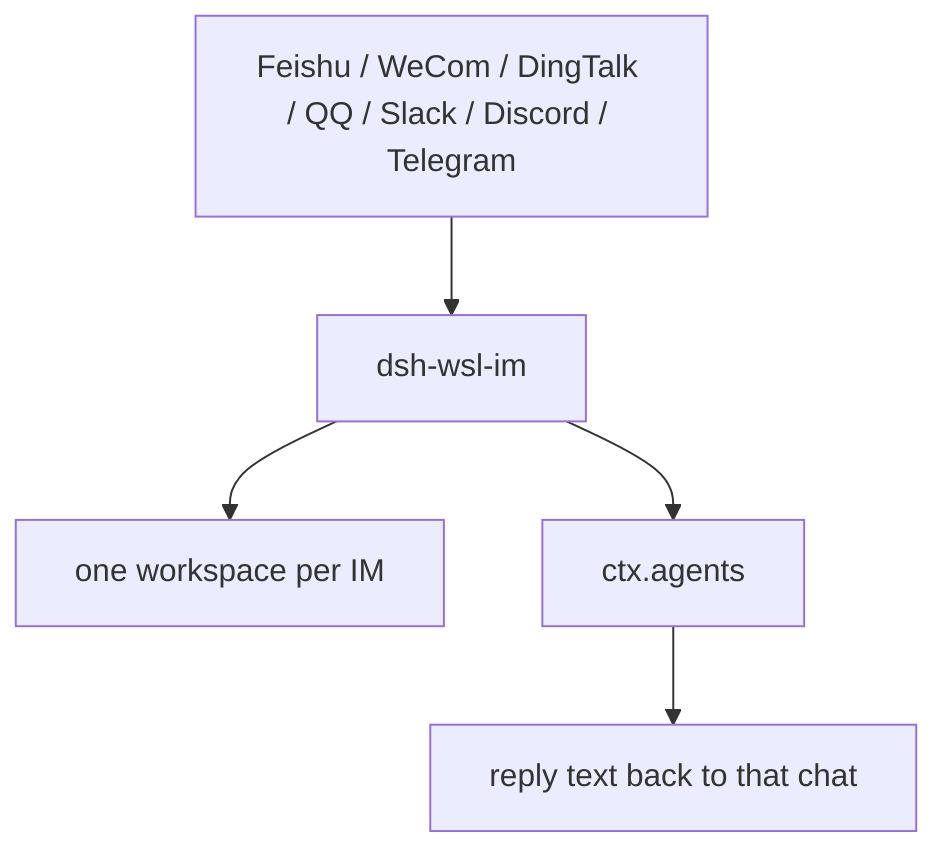

# dsh-wsl-im

[返回分类](../../views/categories/OFFICE-OPERATIONS.md) · [返回首页](../../../README.md)

源码版本：[2e2520e](https://github.com/173787247/dsh-wsl-im/tree/2e2520e07ad108468b3693da42a685a1580db594)

<!-- BEGIN META -->
[](https://github.com/173787247/dsh-wsl-im)
<!-- END META -->

> **功能**：把多个即时通信平台的消息、附件和回复桥接到 WSL 中的 DSH Agent。

> **亮点**：[Q01](#research-q01) 将平台接入和 Agent 会话/工作区组织分离，多个渠道共享附件和回复通路；工具、模型和附件存储仍由宿主提供。

> **主要限制**：[Q02](#research-q02) 默认允许空白名单并用 danger-full-access，设置更低权限失败仍继续。真实 bot 试用前要能核实平台 ID 和实际宿主工具边界。

**本文目录**

- [1 插件分析](#detail-section-1)
  - [1.1 用途与适用场景](#detail-section-2)
  - [1.2 能力、流程与成本](#detail-section-3)
  - [1.3 工程亮点](#detail-section-4)
  - [1.4 主要限制](#detail-section-5)
  - [1.5 使用建议](#detail-section-6)
  - [1.6 核查说明与分析版本](#detail-section-7)
- [2 未来设计假设（未验证）](#detail-section-8)
- [3 辅助信息](#detail-section-9)
- [4 研究问题与完整回答](#detail-section-10)
  - [Q01 · 谁使用桥接，消息如何到达宿主并回复？](#detail-section-11)
  - [Q02 · 哪些白名单和权限条件会放行或拒绝？](#detail-section-12)
  - [Q03 · 如何限定试用，附件与故障带来什么代价？](#detail-section-13)

<a id="detail-section-1"></a>

## 1 插件分析

<a id="detail-section-2"></a>

### 1.1 用途与适用场景

> **用途**：已有 WSL 上 DSH 的用户，希望在 Telegram 等聊天平台继续处理任务并收到回复。

直接使用 DSH UI 可以完成相同 Agent 任务；若必须从 IM 发起，可维护单渠道机器人和专用模型调用。桥接复用 Host 预设与工具，同时引入远端授权问题。

<a id="detail-section-3"></a>

### 1.2 能力、流程与成本

#### 能力

| 能力 | 主要用途 | 使用条件与边界 |
| --- | --- | --- |
| 聊天桥接 | 从 IM 调用 Agent | 真实平台需要凭据与来源授权 |
| 会话事件监听 | 收集轮次文本与错误 | 依赖 Host 的 Agent 和会话 API |
| 状态查询 | 核对适配器及名单状态 | 显示配置状态，需独立验权限 |
| 附件接入 | 转交文件、图片及可选语音文本 | 宿主支持且需明确留存策略 |

#### 启动与依赖

| 依赖或条件 | 是否必需 | 用途 | 缺失或不满足时 |
| --- | --- | --- | --- |
| Node.js 18+ 与相容 DSH Profile | 必需 | 加载插件、Agent 与预设 | 不启用桥接 |
| 适配器凭据和网络 | 真实 IM 必需 | 读写 IM 消息 | 先用本机 mock |
| 白名单与可实证的最小权限 | 真实暴露前必需 | 限制入口和可用工具 | 禁用真实 bot |
| 附件存储与转写工具 | 附件或语音按需 | 保存媒体和转写 | 限制为文字 |

#### 启动步骤

| 步骤 | 执行者与动作 | 成功判据或失败处理 |
| --- | --- | --- |
| 隔离准备 | 操作者启用本机 mock 和低权限 Profile | 状态显示仅 mock |
| 往返 | 操作者发送无敏感文本并核对回复 | 确认 session、flush 和回发 |
| 上线门槛 | 管理员用一个测试 bot 验证身份与工具越界 | 拒绝未授权 ID 及越界请求 |
| 退出 | 禁用适配器并检查 token、会话和文件 | 手工处理留存内容 |

#### 成本

| 阶段 | 现金与资源成本 | 人工与时间投入 | 已知条件与未知项 |
| --- | --- | --- | --- |
| 首次 | 测试 bot 与网络成本未知 | 配置凭据、权限及宿主 | 真实平台需单独配置 |
| 持续 | 模型、转写、磁盘与网络未知 | 轮换凭据和核日志 | 附件可能双落点 |
| 失败恢复 | 重试和留存资源未知 | 排查平台、Host 与代理状态 | 未量化恢复时长 |

#### 效果

| 效果项 | 当前证据支持 | 尚不能确定 |
| --- | --- | --- |
| 聊天会话 | 公共 Bridge 转入 Agent 并回发 | 重复消息和跨平台稳定性 |
| 访问控制 | 支持来源白名单和可配置权限 | 实际最小权限、账号映射 |
| 附件 | 保存并可复制到工作区 | 清理、所有平台的媒体边界 |

> **思考**：[Q02](#research-q02) 默认允许空白名单并用 danger-full-access，设置更低权限失败仍继续。真实 bot 试用前要能核实平台 ID 和实际宿主工具边界。

<a id="detail-section-4"></a>

### 1.3 工程亮点

> **亮点**：[Q01](#research-q01) 将平台接入和 Agent 会话/工作区组织分离，多个渠道共享附件和回复通路；工具、模型和附件存储仍由宿主提供。

[Q01](#research-q01) 已创建聊天的 turn 走串行 Promise 链，但并发首条查找与创建之间无占位；[Q02](#research-q02) 权限设置失败未阻断。

<a id="detail-section-5"></a>

### 1.4 主要限制

[Q02](#research-q02) 默认允许空白名单并用 danger-full-access，设置更低权限失败仍继续。真实 bot 试用前要能核实平台 ID 和实际宿主工具边界。

<a id="detail-section-6"></a>

### 1.5 使用建议

[Q03](#research-q03) 先隔离验证本机 mock；真实 bot 仅在 [Q02](#research-q02) 的白名单与实际最小权限均可确认后再评估。

<a id="detail-section-7"></a>

### 1.6 核查说明与分析版本

**核查状态**：已检查源码。

固定提交证实桥接接线、默认权限和落盘路径，未运行实际宿主或平台。

- 已检查：作者 README、包清单、源码路径 README.md、index.js、lib/adapters/telegram.js、lib/bridge.js、CHANGELOG.md、lib/config.js、lib/adapters/mock.js、lib/download.js 及固定范围 inventory；组件：仓库根。抽读不冒充完整审计，来源和原文嵌入正式快照时保留。
- 未执行：插件安装、目标代码与测试、真实宿主及模型任务。源码存在不等于运行通过。
- 边界：固定提交根组件，抽查入口、Bridge、配置、Telegram、mock 和代表媒体下载器。未运行代码，也未遍历所有适配器、真实平台和 Host。
- 下一步：在隔离宿主验证 mock、真实平台 ID 和群聊边界、错预设、并发首发及媒体超限；停止后清点附件和日志。

**分析版本**

- **仓库**：[173787247/dsh-wsl-im](https://github.com/173787247/dsh-wsl-im)
- **版本号**：0.3.8（[固定提交 2e2520e](https://github.com/173787247/dsh-wsl-im/tree/2e2520e07ad108468b3693da42a685a1580db594)）
- **版本日期**：2026-11-04（固定提交日期，北京时间；不是包发布日期）

<a id="detail-section-8"></a>

## 2 未来设计假设（未验证）

<a id="innovation"></a>

[Q03](#research-q03) 比较当前警告后继续与权限设置失败即停止的策略，观察错权限下的工具触发及正常任务完成率。若越界未减少或合法流程代价过高则放弃；未做实验。

在隔离宿主验证 mock、真实平台 ID 和群聊边界、错预设、并发首发及媒体超限；停止后清点附件和日志。

<a id="detail-section-9"></a>

## 3 辅助信息

<details>
<summary>工程统计</summary>

仅统计 Markdown 和指定的 JavaScript／TypeScript 扩展名；Python 等其他语言不纳入，表格不代表全语言代码规模。

| 扩展名 | 范围 | 文件数 | 总行 | 代码行 | 注释行 | 字数 |
|---|---|---:|---:|---:|---:|---:|
| .md | source | 5 | 369 | — | — | 2838 |
| .js | source | 22 | 4203 | 3681 | 259 | — |
| .js | test | 1 | 482 | 460 | 10 | — |

</details>

**活跃度**

[](https://github.com/173787247/dsh-wsl-im/issues?q=is%3Aissue+is%3Aopen) [](https://github.com/173787247/dsh-wsl-im/issues?q=is%3Aissue+created%3A2026-10-05T14%3A32%3A21.161Z..2026-11-04T14%3A32%3A21.161Z) [](https://github.com/173787247/dsh-wsl-im/issues?q=is%3Aissue+is%3Aclosed+closed%3A2026-10-05T14%3A32%3A21.161Z..2026-11-04T14%3A32%3A21.161Z)


统计日期：2026-11-04。

<a id="detail-section-10"></a>

## 4 研究问题与完整回答

**插件研究总目标**：WSL 用户何时能从 IM 安全地复用 DSH Agent 会话和工具？

<a id="research-q01"></a>

<a id="detail-section-11"></a>

### Q01 · 谁使用桥接，消息如何到达宿主并回复？

**研究主题**：场景与需求、功能与机制、贡献与相对优势

#### 完整回答

在 WSL 运行 DSH 的用户，可以从已有即时通信入口发起 Agent 轮次，不必回到浏览器。插件入口登记 im_status，注册各平台工作区并启动 Bridge。以 Telegram 为样本，适配器长轮询更新，将消息映射给公共 Bridge；Bridge 用平台与聊天 ID 为键，创建 Agent，挂载预设并尝试关联工作区。收到后续消息时复用缓存对象，使用该对象的 Promise 链串行处理 turn；首次查缓存和异步创建之间没有占位，同一聊天并发首条消息可能各自创建会话。Bridge 监听 assistant/message 与 turn/end，提交 followup 后等待 idle、刷新会话并分块回发，错误或无文本会生成提示。相对直接开 DSH UI，增量是渠道与会话接线，模型工具能力仍来自宿主。与自行维护每个平台脚本相比，公共 Bridge 复用 Agent 与附件生命周期，但聊天成员共享上下文的适用性和适配器可靠性各自需要确认。

#### 证据与依据

**依据 1 · 作者声明**：[README.md:1-33](https://github.com/173787247/dsh-wsl-im/blob/2e2520e07ad108468b3693da42a685a1580db594/README.md#L1-L33)

作者定位多平台接入及每聊天会话。

<details>
<summary>查看原文（33行）</summary>

````text
# dsh-wsl-im

DeepSeek Harness plugin: chat with **dsh** from **Feishu / WeCom / DingTalk / QQ / Slack / Discord / Telegram**.

[中文说明 → README.zh.md](./README.zh.md)

Messages go: `IM → this plugin → ctx.agents → reply`.

---

## Compatibility

| Field | Value |
|-------|-------|
| **Plugin** | `dsh-wsl-im` **0.3.8** |
| **Minimum dsh** | ≥ **0.1.2** |
| **Latest verified** | See [dsh-wsl-kit Compatibility](https://github.com/173787247/dsh-wsl-kit#compatibility-2026-09) |
| **Kit set** | not in `install.sh` (optional) |
| **Cloud Flash** | `deepseek-flash` — not configured here |

## Architecture

Not in `install.sh`. Wire behavior follows vendor docs.



Each IM gets `~/.dsh/im-workspace/{feishu,wecom,dingtalk,qq,slack,discord,telegram,mattermost}`, registered on plugin start. One session per chat, not one session for the whole platform. Suite diagram: [dsh-wsl-kit](https://github.com/173787247/dsh-wsl-kit#how-the-pieces-fit). This plugin is **0.3.7** (optional, not in install.sh).
````

</details>

**依据 2 · 源码核查**：[index.js:7-49](https://github.com/173787247/dsh-wsl-im/blob/2e2520e07ad108468b3693da42a685a1580db594/index.js#L7-L49)

宿主依赖与 im_status 实际注册。

<details>
<summary>查看原文（43行）</summary>

```text
export const name = "dsh-wsl-im";
export const inject = [
  "agentDefaultModel",
  "agents",
  "sessions",
  "loader",
  "tools",
  "systemPrompt",
  "attachments",
  "agentPresets",
  "permissionPresets",
  "workspaceRegistry",
];

import { Bridge, ensureImWorkspaces } from "./lib/bridge.js";
import { resolveConfig } from "./lib/config.js";

export function apply(ctx, raw = {}) {
  const config = resolveConfig(raw, process.env);
  let bridge;

  ctx.systemPrompt.section({
    name: "tool:im_status",
    order: 126,
    text:
      "dsh-wsl-im bridges Feishu / WeCom / DingTalk / QQ / Slack / Discord / Telegram / Mattermost " +
      "directly into dsh agents over outbound long connections, long-poll, or webhook. " +
      "Use im_status to see which adapters are up. Never paste bot secrets into chat.",
  });

  ctx.tools.register({
    name: "im_status",
    description:
      "Show dsh-wsl-im adapter status (Feishu / WeCom / DingTalk / QQ / Slack / Discord / Telegram / Mattermost / mock).",
    parameters: { type: "object", additionalProperties: false, properties: {} },
    output: {
      schema: { type: "object", additionalProperties: true },
      render: (_a, v) => [{ type: "text", text: formatStatus(v) }],
    },
    timeoutMs: 5_000,
    isConcurrencySafe: () => true,
    async execute() {
      return bridge ? bridge.status() : { ok: false, error: "bridge not started" };
```

</details>

**依据 3 · 源码核查**：[index.js:69-95](https://github.com/173787247/dsh-wsl-im/blob/2e2520e07ad108468b3693da42a685a1580db594/index.js#L69-L95)

启动、工作区与 dispose。

<details>
<summary>查看原文（27行）</summary>

```text
    try {
      const rows = await ensureImWorkspaces(ctx.workspaceRegistry, {
        base: config.agent.cwd || undefined,
      });
      console.info(
        `[dsh-wsl-im] workspaces ${rows.map((w) => `${w.title}:${w.path}`).join(" | ")}`,
      );
    } catch (err) {
      const msg = err instanceof Error ? err.message : String(err);
      console.warn(`[dsh-wsl-im] workspace register failed: ${msg}`);
    }
    const flags = Object.entries(config.adapters)
      .filter(([, v]) => v?.enabled)
      .map(([k]) => k);
    console.info(`[dsh-wsl-im] starting adapters=[${flags.join(",") || "none"}]`);
    bridge = new Bridge(ctx, config);
    bridge.start().catch((err) => {
      const msg = err instanceof Error ? err.message : String(err);
      console.warn(`[dsh-wsl-im] start failed: ${msg}`);
      ctx.logger?.warn?.(`dsh-wsl-im: start failed: ${msg}`);
    });
  };

  ctx.on("dispose", () => {
    if (bridge) bridge.stop();
  });
  start();
```

</details>

**依据 4 · 源码核查**：[lib/adapters/telegram.js:232-275](https://github.com/173787247/dsh-wsl-im/blob/2e2520e07ad108468b3693da42a685a1580db594/lib/adapters/telegram.js#L232-L275)

平台事件传入并按 offset 轮询。

<details>
<summary>查看原文（44行）</summary>

```text
      text,
      images,
      files,
      messageId: parsed.messageId,
      reply,
    });
  }

  async function pollLoop() {
    state = "up";
    while (!stopped) {
      try {
        const result = await api("getUpdates", {
          offset,
          timeout: POLL_TIMEOUT_SEC,
          allowed_updates: ["message", "edited_message"],
        });
        if (Array.isArray(result)) {
          for (const update of result) {
            const id = Number(update.update_id) || 0;
            if (id >= offset) offset = id + 1;
            await handleUpdate(update).catch((e) =>
              logger?.warn?.(`telegram update: ${e.message}`),
            );
          }
        }
      } catch (e) {
        if (stopped) break;
        logger?.warn?.(`telegram poll: ${e.message}`);
        await new Promise((r) => setTimeout(r, 3_000));
      }
    }
    state = "down";
  }

  return {
    name: "telegram",
    state: () => state,
    detail: () => `getUpdates${uname ? ` @${uname}` : ""}`,
    async start() {
      stopped = false;
      await api("getMe", {});
      loopPromise = pollLoop();
      logger?.info?.("dsh-wsl-im telegram long-poll ready");
```

</details>

**依据 5 · 源码核查**：[lib/bridge.js:206-229](https://github.com/173787247/dsh-wsl-im/blob/2e2520e07ad108468b3693da42a685a1580db594/lib/bridge.js#L206-L229)

入站验证、聊天键与单缓存对象的串行 turn。

<details>
<summary>查看原文（24行）</summary>

```text
  async handleMessage(input) {
    const { platform, chatId, userId, text, images, files } = input;
    const imgCount = Array.isArray(images) ? images.length : 0;
    const fileCount = Array.isArray(files) ? files.length : 0;
    console.info(
      `[dsh-wsl-im] handleMessage ${platform} user=${userId} chat=${chatId} text=${String(text || "").slice(0, 40)} images=${imgCount} files=${fileCount}`,
    );
    if ((typeof text !== "string" || !text.trim()) && imgCount === 0 && fileCount === 0) return;
    if (!this.isAllowed(platform, userId)) {
      await input.reply("⛔ 无权限使用此助手。");
      return;
    }
    if (text?.startsWith("/") && imgCount === 0 && fileCount === 0) {
      await this.handleCommand(`${platform}:${chatId}`, text, input);
      return;
    }
    const key = `${platform}:${chatId}`;
    try {
      const chat = await this.getOrCreateChat(key);
      const run = chat.busy.then(() => this.runTurn(chat, input));
      chat.busy = run.catch((e) => {
        console.warn(`[dsh-wsl-im] turn error: ${e?.message || e}`);
      });
      await run;
```

</details>

**依据 6 · 源码核查**：[lib/bridge.js:272-279](https://github.com/173787247/dsh-wsl-im/blob/2e2520e07ad108468b3693da42a685a1580db594/lib/bridge.js#L272-L279)

缓存 miss 在创建后才写入。

```text
  async getOrCreateChat(key) {
    let chat = this.chats.get(key);
    if (!chat) {
      chat = await this.createChat(key);
      this.chats.set(key, chat);
    }
    chat.lastUsed = Date.now();
    return chat;
```

**依据 7 · 源码核查**：[lib/bridge.js:315-345](https://github.com/173787247/dsh-wsl-im/blob/2e2520e07ad108468b3693da42a685a1580db594/lib/bridge.js#L315-L345)

Agent 创建与平台工作区关联。

<details>
<summary>查看原文（31行）</summary>

```text
    const sessionId = SessionId(`wsl-im-${randomUUID()}`);
    console.info(
      `[dsh-wsl-im] createChat key=${key} preset=${resolvedPreset.id} cwd=${cwd} model=${provider}/${model}`,
    );
    const handle = await ctx.agents.create({
      sessionId,
      meta: { cwd, agentPreset: resolvedPreset.id },
      agentOptions: { provider, model },
      setup: async (agentCtx) => {
        installModelSelection(agentCtx, {
          current: { provider, model },
          assembled: undefined,
        });
        await presets.mount(agentCtx, resolvedPreset.id);
      },
    });

    /* The sidebar groups sessions by workspace, and a workspace resolves its
     * sessions from the session's canonical cwd at read time — a session that was
     * never registered matches none of them, so an IM chat would exist on disk and
     * still be invisible under its platform. Registration is the only thing that
     * puts it there; everything above this line creates the session but leaves it
     * unowned. Failures stay non-fatal: an ungrouped chat is still reachable, and
     * a bridge that refuses to answer because the sidebar could not be updated
     * would be worse than one that does not appear in the sidebar. */
    try {
      const workspace = await ctx.workspaceRegistry?.resolveByPath?.(cwd);
      if (workspace?.attachSession) await workspace.attachSession(sessionId);
    } catch (e) {
      console.warn(`[dsh-wsl-im] attachSession failed: ${e?.message || e}`);
    }
```

</details>

**依据 8 · 源码核查**：[lib/bridge.js:90-107](https://github.com/173787247/dsh-wsl-im/blob/2e2520e07ad108468b3693da42a685a1580db594/lib/bridge.js#L90-L107)

收集 session 事件并接线适配器。

<details>
<summary>查看原文（18行）</summary>

```text
  async start() {
    this.disposeListener = this.ctx.on("session/event", (session, event) => {
      const collector = this.pending.get(session.id);
      if (!collector) return;
      if (event.type === "assistant/message") {
        const text = assistantText(event.data?.message);
        if (text) collector.parts.push(text);
      } else if (event.type === "turn/end") {
        collector.reason = event.data?.reason;
      }
    });

    this.warnAllowlists();

    const adapters = createAdapters({
      config: this.config,
      onMessage: (input) => this.handleMessage(input),
      logger: this.ctx.logger,
```

</details>

**依据 9 · 源码核查**：[lib/bridge.js:482-511](https://github.com/173787247/dsh-wsl-im/blob/2e2520e07ad108468b3693da42a685a1580db594/lib/bridge.js#L482-L511)

实际 followup、flush 与回发。

<details>
<summary>查看原文（30行）</summary>

```text
      chat.agent.followup(
        createUserMessage({
          content: parts,
          // dsh ≥0.1.7 session format v4 rejects retired kind:"plugin";
          // use producer-owned kind (see dsh-session-format-v3-to-v4 rewritePluginSource).
          source: { kind: "plugin:dsh-wsl-im", form: "relay" },
        }),
      );
      await chat.agent.whenIdle();
      await this.ctx.sessions.flush(chat.agent.session);
      const answer = formatImOutbound(collector.parts.join("\n\n").trim(), {
        platform: input.platform,
      });
      if (collector.reason?.kind === "error") {
        const err = collector.reason.error;
        await input.reply(
          formatImOutbound(`⚠️ ${err?.code || "error"}: ${err?.message || "unknown"}`, {
            platform: input.platform,
          }),
        );
        return;
      }
      if (!answer) {
        await input.reply(formatImOutbound("(无文本回复)", { platform: input.platform }));
        return;
      }
      for (const chunk of splitText(answer, this.config.agent.maxMessageLength)) {
        await input.reply(chunk);
      }
      await this.maybeVecmemOnReply(input.platform, answer);
```

</details>

#### 缺口

- 没有在真实 WSL 和 IM 群聊验证重连、并发首条消息或上下文边界
  **影响**：不保证只有一个新会话、消息恰好一次或各平台一致
  **进一步探讨**：从单平台测试 bot 并发发送相同与不同 chat ID，核 Agent 会话数、转发结果和重启行为

<a id="research-q02"></a>

<a id="detail-section-12"></a>

### Q02 · 哪些白名单和权限条件会放行或拒绝？

**研究主题**：缺陷与关键质疑、工程质量与复用、依赖、兼容与流程

#### 完整回答

固定版本 0.3.8 支持每个平台的白名单环境变量，非空 Cordis 配置优先，空配置会回退到 env，双方为空最终允许所有输入 ID。启用 requireAllowlist 时，启用且空名单的真实适配器拒绝启动，mock 例外；这个开关默认关闭，状态只提示风险。Bridge 在进入工具轮次前检查平台提供的用户 ID，但日志在验证前记录用户、聊天和前 40 字符；附件的采集步骤可能已发生在适配器。默认 Agent 使用 standard 和 danger-full-access。权限预设 resolve 或 set 抛错只警告，创建及 turn 可继续，配置某个最小权限名称不能证明真正生效。白名单和工具权限分别控制谁可进入、进入后能做什么；群聊或来源 ID 需要按平台单独核对。

#### 证据与依据

**依据 1 · 作者声明**：[CHANGELOG.md:3-6](https://github.com/173787247/dsh-wsl-im/blob/2e2520e07ad108468b3693da42a685a1580db594/CHANGELOG.md#L3-L6)

作者说明新增环境变量入口。

```text
## 0.3.8

- Allowlists from env: `DSH_IM_<PLATFORM>_ALLOWED_USER_IDS` (comma/space-separated),
  e.g. `DSH_IM_QQ_ALLOWED_USER_IDS=…`. Cordis `allowedUserIds` still wins when non-empty.
```

**依据 2 · 源码核查**：[lib/config.js:3-23](https://github.com/173787247/dsh-wsl-im/blob/2e2520e07ad108468b3693da42a685a1580db594/lib/config.js#L3-L23)

强制开关与代表适配器白名单入口。

<details>
<summary>查看原文（21行）</summary>

```text
export function resolveConfig(raw = {}, env = process.env) {
  const a = raw.adapters || {};
  return {
    enabled: raw.enabled !== false,
    /** When true, refuse to start non-mock adapters with empty allowedUserIds. */
    requireAllowlist: bool(raw.requireAllowlist, env.DSH_IM_REQUIRE_ALLOWLIST),
    voiceAsr: {
      enabled: raw.voiceAsr?.enabled !== false && env.DSH_IM_VOICE_ASR !== "0",
      timeoutMs: num(raw.voiceAsr?.timeoutMs ?? env.DSH_IM_VOICE_ASR_TIMEOUT_MS, 300_000),
      language: str(raw.voiceAsr?.language || env.DSH_IM_VOICE_ASR_LANG),
    },
    adapters: {
      mock: {
        enabled: bool(a.mock?.enabled, env.DSH_IM_MOCK),
        port: num(a.mock?.port ?? env.DSH_IM_MOCK_PORT, 18999),
      },
      feishu: {
        enabled: bool(a.feishu?.enabled, env.DSH_IM_FEISHU),
        appId: str(a.feishu?.appId || env.FEISHU_APP_ID || env.DSH_IM_FEISHU_APP_ID),
        appSecret: str(a.feishu?.appSecret || env.FEISHU_APP_SECRET || env.DSH_IM_FEISHU_APP_SECRET),
        allowedUserIds: idList(a.feishu?.allowedUserIds, env.DSH_IM_FEISHU_ALLOWED_USER_IDS),
```

</details>

**依据 3 · 源码核查**：[lib/config.js:82-99](https://github.com/173787247/dsh-wsl-im/blob/2e2520e07ad108468b3693da42a685a1580db594/lib/config.js#L82-L99)

默认 Agent、工具权限和可选记忆。

<details>
<summary>查看原文（18行）</summary>

```text
    agent: {
      cwd: str(raw.agent?.cwd || env.DSH_IM_AGENT_CWD),
      provider: str(raw.agent?.provider || env.DSH_IM_PROVIDER),
      model: str(raw.agent?.model || env.DSH_IM_MODEL),
      /** Agent preset id (tools/prompt). Default `standard` so bash/read exist. */
      preset: str(raw.agent?.preset || env.DSH_IM_PRESET || "standard") || "standard",
      /** Permission preset: workspace-write | danger-full-access | … */
      permissionPreset: str(
        raw.agent?.permissionPreset || env.DSH_IM_PERMISSION_PRESET || "danger-full-access",
      ),
      maxMessageLength: num(raw.agent?.maxMessageLength, 4000),
      idleTimeoutMs: num(raw.agent?.idleTimeoutMs, 30 * 60 * 1000),
      instructionPrefix: str(raw.agent?.instructionPrefix || ""),
      /**
       * When true, after a successful IM reply try `vecmem_add` with workspace=`im:{platform}`
       * (first 500 chars). Requires dsh-wsl-vecmem and a tools.invoke / get API; otherwise logs and skips.
       */
      vecmemOnReply: bool(raw.agent?.vecmemOnReply, env.DSH_IM_VECMEM_ON_REPLY),
```

</details>

**依据 4 · 源码核查**：[lib/config.js:111-130](https://github.com/173787247/dsh-wsl-im/blob/2e2520e07ad108468b3693da42a685a1580db594/lib/config.js#L111-L130)

未配置布尔值以及白名单优先级。

<details>
<summary>查看原文（20行）</summary>

```text
function bool(cfg, envFlag) {
  const e = String(envFlag || "").toLowerCase();
  if (e === "1" || e === "true" || e === "yes") return true;
  if (e === "0" || e === "false" || e === "no") return false;
  return cfg === true;
}
function arr(v) {
  return Array.isArray(v) ? v.map(String) : [];
}

/** Prefer non-empty cordis list; else parse comma/space-separated env. */
function idList(cfgArr, envCsv) {
  const fromCfg = arr(cfgArr).map((x) => String(x).trim()).filter(Boolean);
  if (fromCfg.length) return fromCfg;
  const raw = String(envCsv || "").trim();
  if (!raw) return [];
  return raw
    .split(/[,;\s]+/)
    .map((x) => x.trim())
    .filter(Boolean);
```

</details>

**依据 5 · 源码核查**：[lib/bridge.js:186-217](https://github.com/173787247/dsh-wsl-im/blob/2e2520e07ad108468b3693da42a685a1580db594/lib/bridge.js#L186-L217)

拒绝启动条件、日志和运行时授权顺序。

<details>
<summary>查看原文（32行）</summary>

```text
  warnAllowlists() {
    const { open, perPlatform } = this.allowlistReport();
    if (!open) return;
    const names = Object.entries(perPlatform)
      .filter(([, v]) => v.open)
      .map(([k]) => k);
    console.warn(
      `[dsh-wsl-im] SECURITY: empty allowedUserIds on [${names.join(", ")}] — ANYONE can drive host tools. Set allowedUserIds or DSH_IM_REQUIRE_ALLOWLIST=1`,
    );
  }

  shouldBlockAdapter(adapterName) {
    if (!this.config.requireAllowlist) return false;
    const name = String(adapterName || "").toLowerCase();
    if (name === "mock") return false;
    const cfg = this.config.adapters?.[name];
    if (!cfg?.enabled) return false;
    return !Array.isArray(cfg.allowedUserIds) || cfg.allowedUserIds.length === 0;
  }

  async handleMessage(input) {
    const { platform, chatId, userId, text, images, files } = input;
    const imgCount = Array.isArray(images) ? images.length : 0;
    const fileCount = Array.isArray(files) ? files.length : 0;
    console.info(
      `[dsh-wsl-im] handleMessage ${platform} user=${userId} chat=${chatId} text=${String(text || "").slice(0, 40)} images=${imgCount} files=${fileCount}`,
    );
    if ((typeof text !== "string" || !text.trim()) && imgCount === 0 && fileCount === 0) return;
    if (!this.isAllowed(platform, userId)) {
      await input.reply("⛔ 无权限使用此助手。");
      return;
    }
```

</details>

**依据 6 · 源码核查**：[lib/bridge.js:241-244](https://github.com/173787247/dsh-wsl-im/blob/2e2520e07ad108468b3693da42a685a1580db594/lib/bridge.js#L241-L244)

空名单默认放行。

```text
  isAllowed(platform, userId) {
    const list = this.config.adapters[platform]?.allowedUserIds || [];
    return list.length === 0 || list.includes(String(userId));
  }
```

**依据 7 · 源码核查**：[lib/bridge.js:296-313](https://github.com/173787247/dsh-wsl-im/blob/2e2520e07ad108468b3693da42a685a1580db594/lib/bridge.js#L296-L313)

权限预设 resolve 出错只记日志。

<details>
<summary>查看原文（18行）</summary>

```text
    // Match dsh-webhook / api-session: join a full agent preset (bash/read/fs).
    const presets = ctx.agentPresets;
    if (!presets?.mount) {
      throw new Error("agentPresets.mount unavailable — cannot compose standard tools for IM");
    }
    const resolvedPreset = await presets.resolve(presetId);
    if (presets.standingKeyFor) {
      await presets.standingKeyFor(resolvedPreset.id);
    }
    if (ctx.permissionPresets?.resolve && permissionPreset) {
      try {
        ctx.permissionPresets.resolve(permissionPreset);
      } catch (e) {
        console.warn(
          `[dsh-wsl-im] permissionPresets.resolve(${permissionPreset}) failed: ${e?.message || e}`,
        );
      }
    }
```

</details>

**依据 8 · 源码核查**：[lib/bridge.js:347-355](https://github.com/173787247/dsh-wsl-im/blob/2e2520e07ad108468b3693da42a685a1580db594/lib/bridge.js#L347-L355)

设置权限失败不阻断聊天。

```text
    if (ctx.permissionPresets?.set && permissionPreset) {
      try {
        ctx.permissionPresets.set(handle.agent.session, permissionPreset);
      } catch (e) {
        console.warn(
          `[dsh-wsl-im] permissionPresets.set(${permissionPreset}) failed: ${e?.message || e}`,
        );
      }
    }
```

#### 缺口

- 未核验平台身份映射、主机默认权限与强制预设在实际 Host 的结果
  **影响**：即使名单正确也不能保证工具权限收窄
  **进一步探讨**：先用独立低权限宿主，实测允许和拒绝 ID、错权限名、工具越界请求及错误日志

<a id="research-q03"></a>

<a id="detail-section-13"></a>

### Q03 · 如何限定试用，附件与故障带来什么代价？

**研究主题**：效果与总成本、采用判断、新假设与验证

#### 完整回答

可先在隔离 DSH Profile 使用仅绑定 127.0.0.1 的 mock，验证状态、文字往返和停止，mock 不验证真实 IM 发送者身份。实际 bot 上线还需轮换凭据、配置网络及名单，按平台核验文件大小、转发授权和日志保留。部分下载器默认 HTTPS，限制跳转次数与 50 MiB 累积字节，只有调用方提供 allow 才检查主机；不能推广到所有平台。Bridge 文件除存入宿主附件服务，还尝试复制到工作区 inbox，复制失败只记录；语音可额外触发本地转写并进入模型消息。退出时禁用适配器并撤 bot token，再按宿主和工作区分别处理已存内容。一个可检验的假设是把未知或设置失败的权限视为拒绝，加上入站身份约束，可以阻断越界而不显著增加正常消息丢失。对照当前路径，测错误预设下 Agent turn 是否开始、错误回复比例及恢复耗时；若合法流程明显受损且越界未下降则不采用。

#### 证据与依据

**依据 1 · 源码核查**：[lib/adapters/mock.js:12-51](https://github.com/173787247/dsh-wsl-im/blob/2e2520e07ad108468b3693da42a685a1580db594/lib/adapters/mock.js#L12-L51)

仅回环监听，调用方可提供 mock 用户 ID。

<details>
<summary>查看原文（40行）</summary>

```text
    async start() {
      server = createServer(async (req, res) => {
        if (req.method === "GET" && req.url?.startsWith("/health")) {
          res.writeHead(200, { "content-type": "application/json" });
          res.end(JSON.stringify({ ok: true }));
          return;
        }
        if (req.method === "POST" && req.url?.startsWith("/mock")) {
          const body = await readBody(req);
          let json = {};
          try {
            json = JSON.parse(body || "{}");
          } catch {
            res.writeHead(400);
            res.end("bad json");
            return;
          }
          const replies = [];
          await onMessage({
            platform: "mock",
            chatId: String(json.chatId || "mock-chat"),
            userId: String(json.userId || "mock-user"),
            text: String(json.text || ""),
            messageId: String(json.messageId || Date.now()),
            reply: async (text) => {
              replies.push(text);
            },
          });
          res.writeHead(200, { "content-type": "application/json" });
          res.end(JSON.stringify({ ok: true, replies }));
          return;
        }
        res.writeHead(404);
        res.end("not found");
      });
      await new Promise((resolve, reject) => {
        server.once("error", reject);
        server.listen(port, "127.0.0.1", resolve);
      });
      state = "up";
```

</details>

**依据 2 · 源码核查**：[lib/download.js:10-25](https://github.com/173787247/dsh-wsl-im/blob/2e2520e07ad108468b3693da42a685a1580db594/lib/download.js#L10-L25)

默认大小上限、协议和可选主机约束。

<details>
<summary>查看原文（16行）</summary>

```text
export const MAX_MEDIA_BYTES = 50 * 1024 * 1024;

export function downloadBytes(
  url,
  { headers = {}, timeoutMs = 60_000, maxBytes = MAX_MEDIA_BYTES, allow, allowHttp = false } = {},
) {
  if (!url || !/^https?:\/\//i.test(url)) {
    return Promise.reject(new Error("media download: url must be http(s)"));
  }
  if (/^http:\/\//i.test(url) && !allowHttp) {
    return Promise.reject(new Error("media download: url must be https"));
  }
  if (allow && !allow(url)) {
    return Promise.reject(new Error("media download: host not allowed"));
  }
  return httpGet(url, { headers, timeoutMs, maxBytes, redirects: 0, allow, allowHttp });
```

</details>

**依据 3 · 源码核查**：[lib/download.js:54-102](https://github.com/173787247/dsh-wsl-im/blob/2e2520e07ad108468b3693da42a685a1580db594/lib/download.js#L54-L102)

跳转与字节处理。

<details>
<summary>查看原文（49行）</summary>

```text
function httpGet(url, { headers, timeoutMs, maxBytes, redirects, allow, allowHttp }) {
  return new Promise((resolve, reject) => {
    if (redirects > 5) {
      reject(new Error("media download: too many redirects"));
      return;
    }
    if (/^http:\/\//i.test(url) && !allowHttp) {
      reject(new Error("media download: url must be https"));
      return;
    }
    const req = proxyHttpRequest(url, { headers, timeoutMs });
    req.on("response", (res) => {
      const code = res.statusCode || 0;
      if (code >= 300 && code < 400 && res.headers.location) {
        res.resume();
        const next = new URL(res.headers.location, url).href;
        if (allow && !allow(next)) {
          reject(new Error("media download: redirect host not allowed"));
          return;
        }
        resolve(
          httpGet(next, {
            headers,
            timeoutMs,
            maxBytes,
            redirects: redirects + 1,
            allow,
            allowHttp,
          }),
        );
        return;
      }
      if (code < 200 || code >= 300) {
        res.resume();
        reject(new Error(`media download HTTP ${code}`));
        return;
      }
      const chunks = [];
      let size = 0;
      res.on("data", (c) => {
        size += c.length;
        if (size > maxBytes) {
          req.destroy();
          reject(new Error("media download: too large"));
          return;
        }
        chunks.push(c);
      });
      res.on("end", () => resolve(Buffer.concat(chunks)));
```

</details>

**依据 4 · 源码核查**：[lib/bridge.js:411-455](https://github.com/173787247/dsh-wsl-im/blob/2e2520e07ad108468b3693da42a685a1580db594/lib/bridge.js#L411-L455)

附件仓库和 inbox 是独立落点。

<details>
<summary>查看原文（45行）</summary>

```text
      const store = this.ctx.attachments;
      const images = Array.isArray(input.images) ? input.images : [];
      if (images.length) {
        if (!store?.saveImages) {
          throw new Error("ctx.attachments.saveImages unavailable (need dsh-attachment-local)");
        }
        const refs = await store.saveImages(
          images.map((img, i) => ({
            data: img.data,
            mediaType: img.mediaType,
            name: img.name || `wecom-${i + 1}`,
          })),
        );
        for (const ref of refs) {
          parts.push({ type: "image", attachment: ref });
        }
        console.info(`[dsh-wsl-im] attached ${refs.length} image(s) to user message`);
      }

      if (files.length) {
        if (!store?.saveFile) {
          throw new Error("ctx.attachments.saveFile unavailable (need dsh-attachment-local)");
        }
        const inbox = join(chat.cwd || this.resolveAgentCwd("im"), "inbox");
        try {
          mkdirSync(inbox, { recursive: true });
        } catch {
          /* ignore */
        }
        const savedAudio = [];
        for (const [i, f] of files.entries()) {
          const ref = await store.saveFile({
            data: f.data,
            name: f.name || `wecom-file-${i + 1}`,
          });
          parts.push({ type: "file", attachment: ref });
          // Also drop a copy in agent cwd so workspace-write sandbox can read it.
          try {
            const dest = join(inbox, f.name || `wecom-file-${i + 1}`);
            writeFileSync(dest, Buffer.from(f.data));
            console.info(`[dsh-wsl-im] copied attachment to ${dest}`);
            const { isProbablyAudioName } = await import("./local-asr.js");
            if (isProbablyAudioName(f.name || dest)) savedAudio.push(dest);
          } catch (e) {
            console.warn(`[dsh-wsl-im] inbox copy failed: ${e?.message || e}`);
```

</details>

**依据 5 · 源码核查**：[lib/bridge.js:460-478](https://github.com/173787247/dsh-wsl-im/blob/2e2520e07ad108468b3693da42a685a1580db594/lib/bridge.js#L460-L478)

本地转写与原始附件仍保留。

<details>
<summary>查看原文（19行）</summary>

```text
        if (savedAudio.length && this.config.voiceAsr?.enabled !== false) {
          const { localAsrTranscribe, NO_ASR_HINT } = await import("./local-asr.js");
          const asrBits = [];
          for (const dest of savedAudio) {
            const r = await localAsrTranscribe(dest, this.config.voiceAsr || {});
            if (r.ok && r.text) {
              asrBits.push(r.text);
              console.info(`[dsh-wsl-im] local ASR ok engine=${r.engine} chars=${r.text.length}`);
            } else {
              console.info(`[dsh-wsl-im] local ASR skip: ${r.error || "unknown"}`);
            }
          }
          if (asrBits.length) {
            textBody = `[语音转写] ${asrBits.join(" ")}\n\n${textBody}`;
            parts[0] = { type: "text", text: prefix ? `${prefix}\n\n${textBody}` : textBody };
          } else if (/Whisper|转写为空|没有可用转写/i.test(textBody)) {
            textBody = `${NO_ASR_HINT}\n（原附件仍在 inbox）\n\n${textBody}`;
            parts[0] = { type: "text", text: prefix ? `${prefix}\n\n${textBody}` : textBody };
          }
```

</details>

**依据 6 · 作者声明**：[README.md:77-90](https://github.com/173787247/dsh-wsl-im/blob/2e2520e07ad108468b3693da42a685a1580db594/README.md#L77-L90)

作者给出 mock 并提示空名单边界。

<details>
<summary>查看原文（14行）</summary>

````text
Source env (see `examples/dsh-wsl-im.env.example`), restart web, **new session**. Tool: `im_status`.

### Mock smoke (no real bot)

```sh
export DSH_IM_MOCK=1
# restart dsh web, then:
curl -s http://127.0.0.1:18999/mock -H 'content-type: application/json' \
  -d '{"text":"/status","chatId":"t1"}'
```

## Security

Empty `allowedUserIds` = everyone. Set a whitelist before exposing bots. IM input can drive tools on the host.
````

</details>

#### 缺口

- 未在生产平台核文件名清洗、保留周期、故障清理和模型消耗
  **影响**：无法给出敏感文档与公开 bot 的采用结论
  **进一步探讨**：只用无敏感样例回放拒绝、超限和代理失败，并清点附件仓、inbox、日志和模型调用

[返回分类](../../views/categories/OFFICE-OPERATIONS.md) · [返回首页](../../../README.md)
