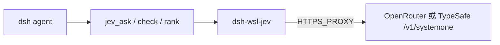

# dsh-wsl-jev

[返回分类](../../views/categories/SOFTWARE-DELIVERY.md) · [返回首页](../../../README.md)

分析版本：[9f56c82](https://github.com/173787247/dsh-wsl-jev/tree/9f56c8231b4a226ad1b396c38b6375fbdf3d83fb)

<!-- BEGIN META -->
[](https://github.com/173787247/dsh-wsl-jev)
<!-- END META -->

> **实现功能**：向 DSH 注册四个 Jev 工具，经 OpenRouter 或 TypeSafe System One 获取 typed 判断。

> **核心亮点**：把 Jev System One API 包装为 DSH 工具并处理 WSL 代理和候选键映射；模型能力归外部服务。详见[Q02](#research-q02)。

> **风险与缺陷**：缺 evidence 仍可问模型，有限清洗不能保证外发安全，未知 rank key 仍可 ok:true。详见[Q03](#research-q03)。

**本文目录**

- [1 插件分析](#detail-section-1)
  - [1.1 用途与适用场景](#detail-section-2)
  - [1.2 能力、流程与成本](#detail-section-3)
  - [1.3 工程亮点](#detail-section-4)
  - [1.4 主要限制](#detail-section-5)
  - [1.5 使用建议](#detail-section-6)
  - [1.6 核查说明与分析版本](#detail-section-7)
- [2 未来设计假设（未验证）](#detail-section-8)
- [3 辅助信息](#detail-section-9)
- [4 研究问题与完整回答](#detail-section-10)
  - [Q01 · Jev typed 决策适合哪些任务，结果是否等于验证？](#detail-section-11)
  - [Q02 · 请求、代理、类型问题和结果怎样走通？](#detail-section-12)
  - [Q03 · 外发数据和“证据支持”有哪些可靠性边界？](#detail-section-13)
  - [Q04 · 安装、网络和额度依赖是什么？](#detail-section-14)
  - [Q05 · 怎样以可核的方式评估 typed 决策净收益？](#detail-section-15)

<a id="detail-section-1"></a>

## 1 插件分析

<a id="detail-section-2"></a>

### 1.1 用途与适用场景

> **用途**：在 WSL/DSH 中以短结构化结果辅助选择、评分和声称/证据匹配。

原 DSH 模型直接回答、确定性规则或人工审核；本包增加特定 Jev 调用。

<a id="detail-section-3"></a>

### 1.2 能力、流程与成本

**能力**

| 能力 | 用途 | 边界 |
| --- | --- | --- |
| ask/check/rank | typed 模型结果 | 非独立验证 |
| redact | 外发前有限清洗 | 非完整 DLP |
| proxy | WSL HTTPS 代理 | 网络/服务依赖 |

**流程与依赖**

| 条件 | 用途 | 失败时 |
| --- | --- | --- |
| DSH tools/systemPrompt | 注册 | 工具不可见 |
| OpenRouter/TypeSafe key | System One | 调用拒绝 |
| 代理/网络与额度 | HTTPS 外发 | 超时或错误 |

| 步骤 | 动作 | 判据 |
| --- | --- | --- |
| 准备 | key/代理与数据分类 | 低敏、可外发 |
| 试用 | status 后 ask/rank | 有 answers/usage |
| 复核 | 人工或规则对照 | 正确且成本可接受 |

**效果与成本**

| 阶段 | 投入 | 未知 |
| --- | --- | --- |
| 配置 | API key、provider/代理 | 兼容性 |
| 调用 | 每次远端模型请求 | 单次价格和准确率 |
| 审核 | 脱敏与结果复核 | 敏感信息和误判成本 |

| 结果 | 源码支持 | 未证实 |
| --- | --- | --- |
| typed 输出 | 三工具向 System One 请求 | 判断准确率 |
| 代理 | HTTPS_PROXY 适配 | 全网络环境稳定 |
| 清洗 | 有限 token 正则 | 无泄漏保证 |

> **思考**：缺 evidence 仍可问模型，有限清洗不能保证外发安全，未知 rank key 仍可 ok:true。详见[Q03](#research-q03)。

<a id="detail-section-4"></a>

### 1.3 工程亮点

> **亮点**：把 Jev System One API 包装为 DSH 工具并处理 WSL 代理和候选键映射；模型能力归外部服务。详见[Q02](#research-q02)。

把 Jev System One API 包装为 DSH 工具并处理 WSL 代理和候选键映射；模型能力归外部服务。详见[Q02](#research-q02)。

无 key 工具仍注册但调用失败；client 发 state/questions；rank 未识别 key 可 ok:true 且 text:null；错误响应片段可能进工具结果。

<a id="detail-section-5"></a>

### 1.4 主要限制

缺 evidence 仍可问模型，有限清洗不能保证外发安全，未知 rank key 仍可 ok:true。详见[Q03](#research-q03)。

<a id="detail-section-6"></a>

### 1.5 使用建议

仅低敏任务试点并保存人工标签；check 仍须外部证据或人工确认。详见[Q05](#research-q05)。

<a id="detail-section-7"></a>

### 1.6 核查说明与分析版本

**核查状态**：已检查源码。

源码证实适配与外发；“证据支持”是模型输出，脱敏为有限正则；未评测准确率。

- 已检查：作者 README、包清单、源码路径 README.md、package.json、index.js、lib/tools.js、lib/client.js、lib/proxy.js、lib/redact.js 及固定范围 inventory；组件：仓库根。抽读不冒充完整审计，来源和原文嵌入正式快照时保留。
- 未执行：插件安装、目标代码与测试、真实宿主及模型任务。源码存在不等于运行通过。
- 边界：审阅固定提交 README、入口、问题构造、客户端、代理和清洗源码；未运行测试或 API。
- 下一步：mock 注入空证据/假密钥/异常返回；真实低敏有标签集对照直接模型和规则，测准确、校准、延迟、费用。

**分析版本**

- **仓库**：[173787247/dsh-wsl-jev](https://github.com/173787247/dsh-wsl-jev)
- **版本号**：0.2.0（[固定提交 9f56c82](https://github.com/173787247/dsh-wsl-jev/tree/9f56c8231b4a226ad1b396c38b6375fbdf3d83fb)）
- **版本日期**：2026-09-30（固定提交日期，北京时间；不是包发布日期）

<a id="detail-section-8"></a>

## 2 未来设计假设（未验证）

<a id="innovation"></a>

外发字段白名单、缺证据拒绝与无效 choice 校验可形成可核决策门槛；尚未实现。详见[Q05](#research-q05)。

mock 注入空证据/假密钥/异常返回；真实低敏有标签集对照直接模型和规则，测准确、校准、延迟、费用。

<a id="detail-section-9"></a>

## 3 辅助信息

<details>
<summary>工程统计与口径</summary>

| 扩展名 | 范围 | 文件数 | 总行 | 代码行 | 注释行 | 字数 |
|---|---|---:|---:|---:|---:|---:|
| .md | source | 7 | 215 | — | — | 907 |
| .js | source | 5 | 706 | 619 | 41 | — |
| .js | test | 1 | 120 | 115 | 0 | — |

</details>

**活跃度**

[](https://github.com/173787247/dsh-wsl-jev/issues?q=is%3Aissue+is%3Aopen) [](https://github.com/173787247/dsh-wsl-jev/issues?q=is%3Aissue+created%3A2026-09-22T05%3A41%3A55.471Z..2026-10-22T05%3A41%3A55.471Z) [](https://github.com/173787247/dsh-wsl-jev/issues?q=is%3Aissue+is%3Aclosed+closed%3A2026-09-22T05%3A41%3A55.471Z..2026-10-22T05%3A41%3A55.471Z)


统计日期：2026-10-22。

<a id="detail-section-10"></a>

## 4 研究问题与完整回答

**插件研究总目标**：判断 System One typed 决策适配的增量、外发边界和证据可信度。

<a id="research-q01"></a>

<a id="detail-section-11"></a>

### Q01 · Jev typed 决策适合哪些任务，结果是否等于验证？

**研究主题**：场景与需求

#### 完整回答

插件为 DSH 暴露状态、提问、证据支持判断、候选排序四工具，目标是把需要短 yes/no、选择或评分的状态判断交给 OpenRouter/TypeSafe System One，不产长文。合格用途是候选排序和低风险辅助判断；jev_check 仅把 claim/evidence 写入模型问题并返回 noul，没有独立证据检索或事实校验，所以“支持”是模型输出而非验证结论。基线是原模型直接判断，或确定性规则/人工复核。

#### 证据与依据

**依据 1 · 作者声明**：[README.md:5-37](https://github.com/173787247/dsh-wsl-jev/blob/9f56c8231b4a226ad1b396c38b6375fbdf3d83fb/README.md#L5-L37)

作者场景与工具说明。

<details>
<summary>查看原文（33行）</summary>

````text
> **套件位置：** [dsh-wsl-kit](https://github.com/173787247/dsh-wsl-kit) 的**可选**插件，不在 `KIT_SET=daily` / `install.sh`。

DeepSeek Harness（WSL）插件：调用 **TypeSafe Jev**（System One）做结构化判断——`noul` / `choice` / `score`，**不生成长文**。

**自包含。** 不依赖第三方 Jev dsh/MCP 插件；直接打 OpenRouter 或 TypeSafe HTTP。

## 链路



## 兼容性

| 字段 | 值 |
|------|-----|
| **插件** | `dsh-wsl-jev` **0.2.0** |
| **最低 dsh** | ≥ **0.1.2** |
| **最新验证** | 以 [dsh-wsl-kit 兼容性](https://github.com/173787247/dsh-wsl-kit#compatibility-2026-09) 为准（当前 **`0.2.0-rc.2`**）— 套件唯一真源 |
| **套件** | 可选（不在 `install.sh`） |
| **API** | 优先 `OPENROUTER_API_KEY`，否则 `TYPESAFE_API_KEY` |

## 工具

| 工具 | 作用 |
|------|------|
| `jev_status` | provider / endpoint / 是否有 key / 代理 |
| `jev_ask` | 对 `state` 提 typed 问题 |
| `jev_check` | 单题 noul：证据是否支持 claim |
| `jev_rank` | 从候选里选最贴合 query 的一项 |
````

</details>

**依据 2 · 源码核查**：[index.js:63-180](https://github.com/173787247/dsh-wsl-jev/blob/9f56c8231b4a226ad1b396c38b6375fbdf3d83fb/index.js#L63-L180)

三项调用路由。

<details>
<summary>查看原文（118行）</summary>

```text
  ctx.tools.register({
    name: "jev_ask",
    description:
      "Ask Jev typed questions about a state. Each question is noul (yes/no), choice, or score. Returns answers with confidence — not prose.",
    parameters: {
      type: "object",
      additionalProperties: false,
      required: ["state", "questions"],
      properties: {
        state: {
          type: "string",
          description: "Context to evaluate (string). Keep under ~16k chars.",
        },
        questions: {
          type: "array",
          description: "Typed questions with id, type (noul|choice|score), instructions, criteria.",
          items: {
            type: "object",
            additionalProperties: true,
            required: ["id", "type", "instructions"],
            properties: {
              id: { type: "string" },
              type: { type: "string", enum: ["noul", "choice", "score"] },
              instructions: { type: "string" },
              criteria: {},
              true: { type: "string" },
              false: { type: "string" },
            },
          },
        },
      },
    },
    output: {
      schema: { type: "object", additionalProperties: true },
      render: (_a, v) => [{ type: "text", text: formatResult(v) }],
    },
    timeoutMs,
    isConcurrencySafe: () => true,
    async execute(args) {
      try {
        const questions = buildAskQuestions(args);
        return await client.systemOne({ state: args.state, questions });
      } catch (e) {
        return { ok: false, error: e instanceof Error ? e.message : String(e) };
      }
    },
    presentCall: () => ({ card: "generic", title: "Jev ask" }),
    presentResult: (_a, r) => ({ card: "generic", title: "Jev ask", content: r.content }),
  });

  ctx.tools.register({
    name: "jev_check",
    description: "Ask Jev whether a claim is supported by evidence (single noul). Not for open-ended reasoning.",
    parameters: {
      type: "object",
      additionalProperties: false,
      required: ["claim"],
      properties: {
        claim: { type: "string" },
        evidence: { type: "string", description: "Optional supporting text" },
      },
    },
    output: {
      schema: { type: "object", additionalProperties: true },
      render: (_a, v) => [{ type: "text", text: formatResult(v) }],
    },
    timeoutMs,
    isConcurrencySafe: () => true,
    async execute(args) {
      try {
        const questions = buildCheckQuestions(args);
        const state = [args.claim, args.evidence].filter(Boolean).join("\n\n");
        const out = await client.systemOne({ state, questions });
        return { ...out, claim: args.claim };
      } catch (e) {
        return { ok: false, error: e instanceof Error ? e.message : String(e) };
      }
    },
    presentCall: () => ({ card: "generic", title: "Jev check" }),
    presentResult: (_a, r) => ({ card: "generic", title: "Jev check", content: r.content }),
  });

  ctx.tools.register({
    name: "jev_rank",
    description: "Ask Jev which candidate best matches a query (choice). Returns pick key, text, confidence.",
    parameters: {
      type: "object",
      additionalProperties: false,
      required: ["query", "candidates"],
      properties: {
        query: { type: "string" },
        candidates: {
          type: "array",
          items: { type: "string" },
          minItems: 2,
          maxItems: 32,
        },
      },
    },
    output: {
      schema: { type: "object", additionalProperties: true },
      render: (_a, v) => [{ type: "text", text: formatResult(v) }],
    },
    timeoutMs,
    isConcurrencySafe: () => true,
    async execute(args) {
      try {
        const questions = buildRankQuestions(args);
        const out = await client.systemOne({ state: args.query, questions });
        const pick = resolveRankPick(out.answers, args.candidates);
        return { ...out, pick, candidates: args.candidates };
      } catch (e) {
        return { ok: false, error: e instanceof Error ? e.message : String(e) };
      }
    },
    presentCall: () => ({ card: "generic", title: "Jev rank" }),
    presentResult: (_a, r) => ({ card: "generic", title: "Jev rank", content: r.content }),
  });
```

</details>

**依据 3 · 源码核查**：[lib/tools.js:20-33](https://github.com/173787247/dsh-wsl-jev/blob/9f56c8231b4a226ad1b396c38b6375fbdf3d83fb/lib/tools.js#L20-L33)

check 将 claim/evidence 拼成问题。

<details>
<summary>查看原文（14行）</summary>

```text
export function buildCheckQuestions({ claim, evidence } = {}) {
  const c = String(claim || "").trim();
  if (!c) throw new Error("jev_check: claim is required");
  const ev = evidence == null ? "" : typeof evidence === "string" ? evidence : JSON.stringify(evidence);
  return {
    supported: {
      type: "noul",
      instructions: `Is the following claim supported by the evidence?\nClaim: ${c}${ev ? `\nEvidence:\n${ev}` : ""}`,
      criteria: {
        true: "The evidence supports the claim.",
        false: "The evidence does not support the claim, or evidence is missing.",
      },
    },
  };
```

</details>

#### 缺口

- 无真实决策样本评测。
  **影响**：准确率、校准和增量价值未知。
  **进一步探讨**：固定带答案的三类样本与原模型/规则对照。

<a id="research-q02"></a>

<a id="detail-section-12"></a>

### Q02 · 请求、代理、类型问题和结果怎样走通？

**研究主题**：功能与机制、贡献与相对优势

#### 完整回答

启用时注入 systemPrompt 提示并注册 status/ask/check/rank；ask 验 ID/type/criteria，check 构造一个 noul，rank 为候选编 c0..键并尝试把返回 key 映回原文。客户端按显式 provider 或环境变量选 OpenRouter/TypeSafe，默认模型 jev-latest，将经正则清洗并截断的 state、清洗后 questions 发 HTTPS POST；API 返回 answers、usage、latency。HTTPS_PROXY 经 https-proxy-agent 路径，未设代理用全局 fetch。增量是 DSH 与特定 System One API/WSL 代理的适配和工具形态，不是 Jev 模型能力本身。

#### 证据与依据

**依据 1 · 源码核查**：[index.js:9-40](https://github.com/173787247/dsh-wsl-jev/blob/9f56c8231b4a226ad1b396c38b6375fbdf3d83fb/index.js#L9-L40)

提示与客户端。

<details>
<summary>查看原文（32行）</summary>

```text
export const name = "dsh-wsl-jev";
export const inject = ["tools", "systemPrompt"];

export function apply(ctx, config = {}) {
  if (config.enabled === false) {
    console.log("[dsh-wsl-jev] disabled");
    return;
  }

  const client = createJevClient({
    provider: config.provider,
    model: config.model,
    timeoutMs: config.timeoutMs,
    maxStateChars: config.maxStateChars,
  });
  const st = client.status();
  console.log(
    `[dsh-wsl-jev] provider=${st.provider} endpoint=${st.endpoint} proxy=${st.proxy ? "on" : "off"} key=${st.hasKey ? "set" : "missing"} egress=${st.egress}`,
  );

  ctx.systemPrompt.section({
    name: "tool:jev",
    order: 127,
    text: [
      "dsh-wsl-jev calls TypeSafe Jev (System One): it returns noul/choice/score with confidence — it does NOT write prose or code.",
      "Use jev_status before first call if unsure about credentials.",
      "Use jev_ask for typed questions, jev_check to verify a claim against evidence, jev_rank to pick among candidates.",
      "Never paste API keys into chat or tool arguments.",
    ].join(" "),
  });

  const timeoutMs = client.timeoutMs;
```

</details>

**依据 2 · 源码核查**：[index.js:42-180](https://github.com/173787247/dsh-wsl-jev/blob/9f56c8231b4a226ad1b396c38b6375fbdf3d83fb/index.js#L42-L180)

四工具注册。

<details>
<summary>查看原文（139行）</summary>

```text
  ctx.tools.register({
    name: "jev_status",
    description: "Show dsh-wsl-jev provider, endpoint, whether an API key is set, and proxy status (no secrets).",
    parameters: {
      type: "object",
      additionalProperties: false,
      properties: {},
    },
    output: {
      schema: { type: "object", additionalProperties: true },
      render: (_a, v) => [{ type: "text", text: formatStatus(v) }],
    },
    timeoutMs: 5_000,
    isConcurrencySafe: () => true,
    async execute() {
      return client.status();
    },
    presentCall: () => ({ card: "generic", title: "Jev status" }),
    presentResult: (_a, r) => ({ card: "generic", title: "Jev status", content: r.content }),
  });

  ctx.tools.register({
    name: "jev_ask",
    description:
      "Ask Jev typed questions about a state. Each question is noul (yes/no), choice, or score. Returns answers with confidence — not prose.",
    parameters: {
      type: "object",
      additionalProperties: false,
      required: ["state", "questions"],
      properties: {
        state: {
          type: "string",
          description: "Context to evaluate (string). Keep under ~16k chars.",
        },
        questions: {
          type: "array",
          description: "Typed questions with id, type (noul|choice|score), instructions, criteria.",
          items: {
            type: "object",
            additionalProperties: true,
            required: ["id", "type", "instructions"],
            properties: {
              id: { type: "string" },
              type: { type: "string", enum: ["noul", "choice", "score"] },
              instructions: { type: "string" },
              criteria: {},
              true: { type: "string" },
              false: { type: "string" },
            },
          },
        },
      },
    },
    output: {
      schema: { type: "object", additionalProperties: true },
      render: (_a, v) => [{ type: "text", text: formatResult(v) }],
    },
    timeoutMs,
    isConcurrencySafe: () => true,
    async execute(args) {
      try {
        const questions = buildAskQuestions(args);
        return await client.systemOne({ state: args.state, questions });
      } catch (e) {
        return { ok: false, error: e instanceof Error ? e.message : String(e) };
      }
    },
    presentCall: () => ({ card: "generic", title: "Jev ask" }),
    presentResult: (_a, r) => ({ card: "generic", title: "Jev ask", content: r.content }),
  });

  ctx.tools.register({
    name: "jev_check",
    description: "Ask Jev whether a claim is supported by evidence (single noul). Not for open-ended reasoning.",
    parameters: {
      type: "object",
      additionalProperties: false,
      required: ["claim"],
      properties: {
        claim: { type: "string" },
        evidence: { type: "string", description: "Optional supporting text" },
      },
    },
    output: {
      schema: { type: "object", additionalProperties: true },
      render: (_a, v) => [{ type: "text", text: formatResult(v) }],
    },
    timeoutMs,
    isConcurrencySafe: () => true,
    async execute(args) {
      try {
        const questions = buildCheckQuestions(args);
        const state = [args.claim, args.evidence].filter(Boolean).join("\n\n");
        const out = await client.systemOne({ state, questions });
        return { ...out, claim: args.claim };
      } catch (e) {
        return { ok: false, error: e instanceof Error ? e.message : String(e) };
      }
    },
    presentCall: () => ({ card: "generic", title: "Jev check" }),
    presentResult: (_a, r) => ({ card: "generic", title: "Jev check", content: r.content }),
  });

  ctx.tools.register({
    name: "jev_rank",
    description: "Ask Jev which candidate best matches a query (choice). Returns pick key, text, confidence.",
    parameters: {
      type: "object",
      additionalProperties: false,
      required: ["query", "candidates"],
      properties: {
        query: { type: "string" },
        candidates: {
          type: "array",
          items: { type: "string" },
          minItems: 2,
          maxItems: 32,
        },
      },
    },
    output: {
      schema: { type: "object", additionalProperties: true },
      render: (_a, v) => [{ type: "text", text: formatResult(v) }],
    },
    timeoutMs,
    isConcurrencySafe: () => true,
    async execute(args) {
      try {
        const questions = buildRankQuestions(args);
        const out = await client.systemOne({ state: args.query, questions });
        const pick = resolveRankPick(out.answers, args.candidates);
        return { ...out, pick, candidates: args.candidates };
      } catch (e) {
        return { ok: false, error: e instanceof Error ? e.message : String(e) };
      }
    },
    presentCall: () => ({ card: "generic", title: "Jev rank" }),
    presentResult: (_a, r) => ({ card: "generic", title: "Jev rank", content: r.content }),
  });
```

</details>

**依据 3 · 源码核查**：[lib/tools.js:7-115](https://github.com/173787247/dsh-wsl-jev/blob/9f56c8231b4a226ad1b396c38b6375fbdf3d83fb/lib/tools.js#L7-L115)

typed 问题构造与映射。

<details>
<summary>查看原文（109行）</summary>

```text
export function buildAskQuestions(args = {}) {
  const list = Array.isArray(args.questions) ? args.questions : [];
  if (!list.length) throw new Error("jev_ask: questions[] is required");
  const out = {};
  for (const q of list) {
    const id = String(q?.id || "").trim();
    if (!id) throw new Error("jev_ask: each question needs id");
    if (out[id]) throw new Error(`jev_ask: duplicate question id ${id}`);
    out[id] = normalizeQuestion(q);
  }
  return out;
}

export function buildCheckQuestions({ claim, evidence } = {}) {
  const c = String(claim || "").trim();
  if (!c) throw new Error("jev_check: claim is required");
  const ev = evidence == null ? "" : typeof evidence === "string" ? evidence : JSON.stringify(evidence);
  return {
    supported: {
      type: "noul",
      instructions: `Is the following claim supported by the evidence?\nClaim: ${c}${ev ? `\nEvidence:\n${ev}` : ""}`,
      criteria: {
        true: "The evidence supports the claim.",
        false: "The evidence does not support the claim, or evidence is missing.",
      },
    },
  };
}

export function buildRankQuestions({ query, candidates } = {}) {
  const q = String(query || "").trim();
  if (!q) throw new Error("jev_rank: query is required");
  const list = Array.isArray(candidates) ? candidates.map(String) : [];
  if (list.length < 2) throw new Error("jev_rank: need at least 2 candidates");
  if (list.length > 32) throw new Error("jev_rank: at most 32 candidates");
  const criteria = {};
  for (let i = 0; i < list.length; i++) {
    const key = `c${i}`;
    criteria[key] = list[i];
  }
  return {
    best: {
      type: "choice",
      instructions: `Which candidate best matches this query?\nQuery: ${q}`,
      criteria,
    },
  };
}

export function normalizeQuestion(q) {
  const type = String(q.type || "").toLowerCase().trim();
  const instructions = String(q.instructions || "").trim();
  if (!instructions) throw new Error("question instructions required");
  if (type === "noul" || type === "boolean") {
    const criteria =
      q.criteria && typeof q.criteria === "object" && !Array.isArray(q.criteria)
        ? q.criteria
        : {
            true: String(q.true || "Yes / true"),
            false: String(q.false || "No / false"),
          };
    return { type: "noul", instructions, criteria };
  }
  if (type === "choice") {
    const criteria = toCriteriaMap(q.criteria);
    if (Object.keys(criteria).length < 2) throw new Error("choice needs >=2 criteria");
    return { type: "choice", instructions, criteria };
  }
  if (type === "score") {
    const criteria = Array.isArray(q.criteria)
      ? q.criteria.map(String)
      : typeof q.criteria === "object" && q.criteria
        ? Object.values(q.criteria).map(String)
        : null;
    if (!criteria || criteria.length < 2) throw new Error("score needs ordered criteria[]");
    return { type: "score", instructions, criteria };
  }
  throw new Error(`unsupported question type: ${type || "(empty)"}`);
}

function toCriteriaMap(criteria) {
  if (Array.isArray(criteria)) {
    const out = {};
    criteria.forEach((c, i) => {
      out[`opt${i}`] = String(c);
    });
    return out;
  }
  if (criteria && typeof criteria === "object") {
    const out = {};
    for (const [k, v] of Object.entries(criteria)) out[k] = String(v);
    return out;
  }
  return {};
}

/** Map rank choice key back to candidate text. */
export function resolveRankPick(answers, candidates) {
  const pick = answers?.best;
  const key = pick?.choice ?? pick?.value ?? null;
  const list = Array.isArray(candidates) ? candidates.map(String) : [];
  if (key == null) return { key: null, text: null, confidence: pick?.confidence ?? null };
  const m = /^c(\d+)$/.exec(String(key));
  const idx = m ? Number(m[1]) : -1;
  return {
    key: String(key),
    text: idx >= 0 && idx < list.length ? list[idx] : null,
    confidence: pick?.confidence ?? null,
    raw: pick,
```

</details>

**依据 4 · 源码核查**：[lib/client.js:21-105](https://github.com/173787247/dsh-wsl-jev/blob/9f56c8231b4a226ad1b396c38b6375fbdf3d83fb/lib/client.js#L21-L105)

provider、脱敏与请求。

<details>
<summary>查看原文（85行）</summary>

```text
export function createJevClient(opts = {}) {
  const env = opts.env || process.env;
  const resolved = resolveProvider(opts.provider || env.DSH_JEV_PROVIDER || "auto", env);
  const model = String(opts.model || env.DSH_JEV_MODEL || "jev-latest").trim() || "jev-latest";
  const timeoutMs = positive(opts.timeoutMs, 15_000);
  const maxStateChars = positive(opts.maxStateChars, 16_000);
  const fetchImpl = opts.fetchImpl || defaultFetch;

  return {
    resolved,
    model,
    timeoutMs,
    maxStateChars,
    status() {
      const hasKey = Boolean(resolved.apiKey);
      return {
        ok: true,
        provider: resolved.provider,
        endpoint: resolved.endpoint,
        hasKey,
        model,
        proxy: Boolean(resolveProxyUrl(env)),
        proxyMode: proxyLabel(env),
        timeoutMs,
        maxStateChars,
        egress: hasKey ? "ON when tools called" : "blocked (no API key)",
        ready: hasKey,
        hint: hasKey
          ? null
          : "No API key — set OPENROUTER_API_KEY or TYPESAFE_API_KEY (see examples/dsh-wsl-jev.env.example). Tools stay registered but jev_ask/check/rank will refuse until a key is present.",
      };
    },
    async systemOne({ state, questions }) {
      if (!resolved.apiKey) {
        throw new Error(
          "dsh-wsl-jev: no API key — set OPENROUTER_API_KEY or TYPESAFE_API_KEY (see examples/dsh-wsl-jev.env.example)",
        );
      }
      if (!questions || typeof questions !== "object" || !Object.keys(questions).length) {
        throw new Error("dsh-wsl-jev: questions object is required");
      }

      const safeState = prepareState(state, maxStateChars);
      const safeQuestions = redactValue(questions);
      const body = {
        model,
        state: safeState,
        questions: safeQuestions,
      };

      const started = Date.now();
      const res = await fetchImpl(resolved.endpoint, {
        method: "POST",
        headers: {
          Authorization: `Bearer ${resolved.apiKey}`,
          "Content-Type": "application/json",
          Accept: "application/json",
          "HTTP-Referer": "https://github.com/173787247/dsh-wsl-jev",
          "X-OpenRouter-Title": "dsh-wsl-jev",
        },
        body: JSON.stringify(body),
        timeoutMs,
        env,
      });
      const latencyMs = Date.now() - started;
      const text = await res.text();
      let json;
      try {
        json = text ? JSON.parse(text) : {};
      } catch {
        throw new Error(`dsh-wsl-jev: non-JSON response HTTP ${res.status}: ${text.slice(0, 200)}`);
      }
      if (!res.ok) {
        const err = json?.error?.message || json?.message || json?.error || text.slice(0, 200);
        throw new Error(`dsh-wsl-jev: HTTP ${res.status}: ${err}`);
      }
      return {
        ok: true,
        provider: resolved.provider,
        model: json.model || model,
        answers: json.answers || {},
        usage: json.usage || null,
        id: json.id || null,
        latencyMs,
      };
```

</details>

**依据 5 · 源码核查**：[lib/proxy.js:12-44](https://github.com/173787247/dsh-wsl-jev/blob/9f56c8231b4a226ad1b396c38b6375fbdf3d83fb/lib/proxy.js#L12-L44)

代理选择。

<details>
<summary>查看原文（33行）</summary>

```text
export function resolveProxyUrl(env = process.env) {
  return String(
    env.HTTPS_PROXY || env.https_proxy || env.HTTP_PROXY || env.http_proxy || "",
  ).trim();
}

export function resolveWsProxyAgent(env = process.env) {
  const proxy = resolveProxyUrl(env);
  if (!proxy) return undefined;
  try {
    const { HttpsProxyAgent } = require("https-proxy-agent");
    return new HttpsProxyAgent(proxy);
  } catch {
    return undefined;
  }
}

export function proxyLabel(env = process.env) {
  return resolveProxyUrl(env) ? "via-proxy" : "direct";
}

/**
 * Same surface as global `fetch`, but tunnels via HTTPS_PROXY when configured.
 * Without a proxy (or if the agent package is missing), falls back to global fetch.
 *
 * @param {string | URL} input
 * @param {RequestInit} [init]
 * @param {NodeJS.ProcessEnv} [env]
 * @returns {Promise<Response>}
 */
export async function proxiedFetch(input, init = {}, env = process.env) {
  const agent = resolveWsProxyAgent(env);
  if (!agent) return fetch(input, init);
```

</details>

<a id="research-q03"></a>

<a id="detail-section-13"></a>

### Q03 · 外发数据和“证据支持”有哪些可靠性边界？

**研究主题**：缺陷与关键质疑、工程质量与复用

#### 完整回答

state 与 questions 会发送给外部 provider；清洗仅覆盖列出的字段名和有限 token 形状，普通敏感文本、未匹配密钥和返回的服务端错误消息不能保证脱敏。state 只按字符数截断，questions 没有同等长度预算。jev_check 允许 evidence 缺省，prompt 虽要求无证据应 false，但仍由远端模型判定，没有强制拒绝或来源核验。rank 对无法映射的 choice key 返回 text:null/confidence，但外层仍 ok:true。HTTP 非 JSON/错误响应会把前 200 字符放进工具错误文本。

#### 证据与依据

**依据 1 · 源码核查**：[lib/redact.js:3-44](https://github.com/173787247/dsh-wsl-jev/blob/9f56c8231b4a226ad1b396c38b6375fbdf3d83fb/lib/redact.js#L3-L44)

有限正则与字段名清洗。

<details>
<summary>查看原文（42行）</summary>

```text
const SENSITIVE_KEY =
  /^(password|passwd|secret|token|api[_-]?key|authorization|auth|access[_-]?token|refresh[_-]?token|private[_-]?key|client[_-]?secret)$/i;

const SECRET_SHAPES = [
  /\bBearer\s+[A-Za-z0-9._\-+/=]{20,}\b/gi,
  /\bsk-[A-Za-z0-9]{20,}\b/g,
  /\bsk-or-[A-Za-z0-9_-]{20,}\b/g,
  /\bts_live_[A-Za-z0-9_-]{20,}\b/g,
  /\bxox[baprs]-[A-Za-z0-9-]{20,}\b/g,
  /\bxapp-[A-Za-z0-9-]{20,}\b/g,
  /\bgh[pousr]_[A-Za-z0-9_]{20,}\b/g,
  /\beyJ[A-Za-z0-9_-]+\.[A-Za-z0-9_-]+\.[A-Za-z0-9_-]+\b/g,
  /-----BEGIN [A-Z ]*PRIVATE KEY-----[\s\S]*?-----END [A-Z ]*PRIVATE KEY-----/g,
];

export function redactString(text) {
  let s = String(text ?? "");
  for (const re of SECRET_SHAPES) {
    s = s.replace(re, "[REDACTED]");
  }
  return s;
}

export function redactValue(value) {
  if (value == null) return value;
  if (typeof value === "string") return redactString(value);
  if (Array.isArray(value)) return value.map(redactValue);
  if (typeof value === "object") {
    const out = {};
    for (const [k, v] of Object.entries(value)) {
      out[k] = SENSITIVE_KEY.test(k) ? "[REDACTED]" : redactValue(v);
    }
    return out;
  }
  return value;
}

export function truncateChars(text, maxChars) {
  const s = String(text ?? "");
  const n = Number(maxChars);
  if (!Number.isFinite(n) || n <= 0 || s.length <= n) return s;
  return `${s.slice(0, n)}\n…[truncated ${s.length - n} chars]`;
```

</details>

**依据 2 · 源码核查**：[lib/client.js:53-105](https://github.com/173787247/dsh-wsl-jev/blob/9f56c8231b4a226ad1b396c38b6375fbdf3d83fb/lib/client.js#L53-L105)

外发、错误透出与响应接受。

<details>
<summary>查看原文（53行）</summary>

```text
    async systemOne({ state, questions }) {
      if (!resolved.apiKey) {
        throw new Error(
          "dsh-wsl-jev: no API key — set OPENROUTER_API_KEY or TYPESAFE_API_KEY (see examples/dsh-wsl-jev.env.example)",
        );
      }
      if (!questions || typeof questions !== "object" || !Object.keys(questions).length) {
        throw new Error("dsh-wsl-jev: questions object is required");
      }

      const safeState = prepareState(state, maxStateChars);
      const safeQuestions = redactValue(questions);
      const body = {
        model,
        state: safeState,
        questions: safeQuestions,
      };

      const started = Date.now();
      const res = await fetchImpl(resolved.endpoint, {
        method: "POST",
        headers: {
          Authorization: `Bearer ${resolved.apiKey}`,
          "Content-Type": "application/json",
          Accept: "application/json",
          "HTTP-Referer": "https://github.com/173787247/dsh-wsl-jev",
          "X-OpenRouter-Title": "dsh-wsl-jev",
        },
        body: JSON.stringify(body),
        timeoutMs,
        env,
      });
      const latencyMs = Date.now() - started;
      const text = await res.text();
      let json;
      try {
        json = text ? JSON.parse(text) : {};
      } catch {
        throw new Error(`dsh-wsl-jev: non-JSON response HTTP ${res.status}: ${text.slice(0, 200)}`);
      }
      if (!res.ok) {
        const err = json?.error?.message || json?.message || json?.error || text.slice(0, 200);
        throw new Error(`dsh-wsl-jev: HTTP ${res.status}: ${err}`);
      }
      return {
        ok: true,
        provider: resolved.provider,
        model: json.model || model,
        answers: json.answers || {},
        usage: json.usage || null,
        id: json.id || null,
        latencyMs,
      };
```

</details>

**依据 3 · 源码核查**：[lib/tools.js:20-33](https://github.com/173787247/dsh-wsl-jev/blob/9f56c8231b4a226ad1b396c38b6375fbdf3d83fb/lib/tools.js#L20-L33)

无证据仍构问题。

<details>
<summary>查看原文（14行）</summary>

```text
export function buildCheckQuestions({ claim, evidence } = {}) {
  const c = String(claim || "").trim();
  if (!c) throw new Error("jev_check: claim is required");
  const ev = evidence == null ? "" : typeof evidence === "string" ? evidence : JSON.stringify(evidence);
  return {
    supported: {
      type: "noul",
      instructions: `Is the following claim supported by the evidence?\nClaim: ${c}${ev ? `\nEvidence:\n${ev}` : ""}`,
      criteria: {
        true: "The evidence supports the claim.",
        false: "The evidence does not support the claim, or evidence is missing.",
      },
    },
  };
```

</details>

**依据 4 · 源码核查**：[lib/tools.js:103-116](https://github.com/173787247/dsh-wsl-jev/blob/9f56c8231b4a226ad1b396c38b6375fbdf3d83fb/lib/tools.js#L103-L116)

未知 choice 仍返回空映射。

<details>
<summary>查看原文（14行）</summary>

```text
/** Map rank choice key back to candidate text. */
export function resolveRankPick(answers, candidates) {
  const pick = answers?.best;
  const key = pick?.choice ?? pick?.value ?? null;
  const list = Array.isArray(candidates) ? candidates.map(String) : [];
  if (key == null) return { key: null, text: null, confidence: pick?.confidence ?? null };
  const m = /^c(\d+)$/.exec(String(key));
  const idx = m ? Number(m[1]) : -1;
  return {
    key: String(key),
    text: idx >= 0 && idx < list.length ? list[idx] : null,
    confidence: pick?.confidence ?? null,
    raw: pick,
  };
```

</details>

#### 缺口

- 未对真实 provider 响应和含假密钥文本测试。
  **影响**：实际泄漏或误判概率未知。
  **进一步探讨**：隔离 mock 注入 canary、空证据、异常 key/响应，核外发和结果。

<a id="research-q04"></a>

<a id="detail-section-14"></a>

### Q04 · 安装、网络和额度依赖是什么？

**研究主题**：依赖、兼容与流程、效果与总成本

#### 完整回答

包 0.2.0 MIT、Node>=18，依赖 https-proxy-agent；需要 DSH tools/systemPrompt、有效 OpenRouter 或 TypeSafe key，WSL 环境可能需 HTTPS_PROXY。无 key 仍注册工具，但实际调用拒绝。每次 ask/check/rank 都是一次远端模型请求，默认 15 秒超时、state 16k 字符；延迟、计费、失败恢复由外部服务和网络决定，仓库没有真实单位成本。README 的 dsh>=0.1.2 是作者兼容说法，包元数据未约束 DSH。

#### 证据与依据

**依据 1 · 源码核查**：[package.json:1-49](https://github.com/173787247/dsh-wsl-jev/blob/9f56c8231b4a226ad1b396c38b6375fbdf3d83fb/package.json#L1-L49)

版本、依赖与引擎。

<details>
<summary>查看原文（49行）</summary>

```text
{
  "name": "dsh-wsl-jev",
  "version": "0.2.0",
  "description": "DeepSeek Harness WSL plugin: call TypeSafe Jev / OpenRouter System One for noul, choice, and score decisions (jev_ask / jev_check / jev_rank).",
  "license": "MIT",
  "repository": {
    "type": "git",
    "url": "https://github.com/173787247/dsh-wsl-jev.git"
  },
  "bugs": {
    "url": "https://github.com/173787247/dsh-wsl-jev/issues"
  },
  "homepage": "https://github.com/173787247/dsh-wsl-jev#readme",
  "type": "module",
  "main": "index.js",
  "engines": {
    "node": ">=18"
  },
  "scripts": {
    "test": "node --test test/*.test.js"
  },
  "files": [
    "index.js",
    "lib",
    "cordis.patch.yml",
    "README.md",
    "README.en.md", "README.zh.md",
    "LICENSE",
    "CHANGELOG.md",
    "examples",
    "CONTRIBUTING.md",
    "SECURITY.md"
  ],
  "keywords": [
    "dsh-plugin",
    "deepseek-harness",
    "wsl",
    "jev",
    "system-one",
    "typesafe"
  ],
  "dependencies": {
    "https-proxy-agent": "^7.0.6"
  },
  "dsh": {
    "bundle": {
      "patch": "./cordis.patch.yml"
    }
  }
```

</details>

**依据 2 · 作者声明**：[README.md:20-28](https://github.com/173787247/dsh-wsl-jev/blob/9f56c8231b4a226ad1b396c38b6375fbdf3d83fb/README.md#L20-L28)

作者兼容性。

```text
## 兼容性

| 字段 | 值 |
|------|-----|
| **插件** | `dsh-wsl-jev` **0.2.0** |
| **最低 dsh** | ≥ **0.1.2** |
| **最新验证** | 以 [dsh-wsl-kit 兼容性](https://github.com/173787247/dsh-wsl-kit#compatibility-2026-09) 为准（当前 **`0.2.0-rc.2`**）— 套件唯一真源 |
| **套件** | 可选（不在 `install.sh`） |
| **API** | 优先 `OPENROUTER_API_KEY`，否则 `TYPESAFE_API_KEY` |
```

**依据 3 · 源码核查**：[lib/client.js:21-50](https://github.com/173787247/dsh-wsl-jev/blob/9f56c8231b4a226ad1b396c38b6375fbdf3d83fb/lib/client.js#L21-L50)

配置和状态。

<details>
<summary>查看原文（30行）</summary>

```text
export function createJevClient(opts = {}) {
  const env = opts.env || process.env;
  const resolved = resolveProvider(opts.provider || env.DSH_JEV_PROVIDER || "auto", env);
  const model = String(opts.model || env.DSH_JEV_MODEL || "jev-latest").trim() || "jev-latest";
  const timeoutMs = positive(opts.timeoutMs, 15_000);
  const maxStateChars = positive(opts.maxStateChars, 16_000);
  const fetchImpl = opts.fetchImpl || defaultFetch;

  return {
    resolved,
    model,
    timeoutMs,
    maxStateChars,
    status() {
      const hasKey = Boolean(resolved.apiKey);
      return {
        ok: true,
        provider: resolved.provider,
        endpoint: resolved.endpoint,
        hasKey,
        model,
        proxy: Boolean(resolveProxyUrl(env)),
        proxyMode: proxyLabel(env),
        timeoutMs,
        maxStateChars,
        egress: hasKey ? "ON when tools called" : "blocked (no API key)",
        ready: hasKey,
        hint: hasKey
          ? null
          : "No API key — set OPENROUTER_API_KEY or TYPESAFE_API_KEY (see examples/dsh-wsl-jev.env.example). Tools stay registered but jev_ask/check/rank will refuse until a key is present.",
```

</details>

**依据 4 · 源码核查**：[lib/client.js:53-84](https://github.com/173787247/dsh-wsl-jev/blob/9f56c8231b4a226ad1b396c38b6375fbdf3d83fb/lib/client.js#L53-L84)

无 key 拒绝及请求。

<details>
<summary>查看原文（32行）</summary>

```text
    async systemOne({ state, questions }) {
      if (!resolved.apiKey) {
        throw new Error(
          "dsh-wsl-jev: no API key — set OPENROUTER_API_KEY or TYPESAFE_API_KEY (see examples/dsh-wsl-jev.env.example)",
        );
      }
      if (!questions || typeof questions !== "object" || !Object.keys(questions).length) {
        throw new Error("dsh-wsl-jev: questions object is required");
      }

      const safeState = prepareState(state, maxStateChars);
      const safeQuestions = redactValue(questions);
      const body = {
        model,
        state: safeState,
        questions: safeQuestions,
      };

      const started = Date.now();
      const res = await fetchImpl(resolved.endpoint, {
        method: "POST",
        headers: {
          Authorization: `Bearer ${resolved.apiKey}`,
          "Content-Type": "application/json",
          Accept: "application/json",
          "HTTP-Referer": "https://github.com/173787247/dsh-wsl-jev",
          "X-OpenRouter-Title": "dsh-wsl-jev",
        },
        body: JSON.stringify(body),
        timeoutMs,
        env,
      });
```

</details>

**依据 5 · 源码核查**：[lib/client.js:149-175](https://github.com/173787247/dsh-wsl-jev/blob/9f56c8231b4a226ad1b396c38b6375fbdf3d83fb/lib/client.js#L149-L175)

超时行为。

<details>
<summary>查看原文（27行）</summary>

```text
/**
 * Default egress: proxiedFetch (honors HTTPS_PROXY) with AbortSignal timeout.
 * fetchImpl test hooks keep the same (url, opts) surface.
 */
async function defaultFetch(url, { method, headers, body, timeoutMs, env }) {
  const ctrl = new AbortController();
  const t = setTimeout(() => ctrl.abort(), timeoutMs || 15_000);
  try {
    const res = await proxiedFetch(
      url,
      {
        method: method || "GET",
        headers,
        body,
        signal: ctrl.signal,
      },
      env || process.env,
    );
    return res;
  } catch (e) {
    if (ctrl.signal.aborted) {
      throw new Error(`dsh-wsl-jev: timeout after ${timeoutMs}ms`);
    }
    throw e;
  } finally {
    clearTimeout(t);
  }
```

</details>

#### 缺口

- 未调用实际 API。
  **影响**：可用性、价格、延迟和精度未知。
  **进一步探讨**：固定样本记录请求次数、usage、延迟、错误和费用。

<a id="research-q05"></a>

<a id="detail-section-15"></a>

### Q05 · 怎样以可核的方式评估 typed 决策净收益？

**研究主题**：新假设与验证、采用判断

#### 完整回答

先在无敏感、可公开或可脱敏状态上试用 ask/rank，保留原始答案、confidence 与人工标注；check 不能作为独立事实验证。未实现假设是外发前结构化字段白名单和 canary 检测、缺 evidence 时确定性拒绝、rank key 不在候选时返回失败并重试/人工复核。对照直接原模型回答、规则和人工，测任务准确率、置信度校准、外发泄漏、每正确决策成本与延迟。

#### 证据与依据

**依据 1 · 源码核查**：[lib/client.js:63-105](https://github.com/173787247/dsh-wsl-jev/blob/9f56c8231b4a226ad1b396c38b6375fbdf3d83fb/lib/client.js#L63-L105)

当前清洗、外发和宽松响应。

<details>
<summary>查看原文（43行）</summary>

```text
      const safeState = prepareState(state, maxStateChars);
      const safeQuestions = redactValue(questions);
      const body = {
        model,
        state: safeState,
        questions: safeQuestions,
      };

      const started = Date.now();
      const res = await fetchImpl(resolved.endpoint, {
        method: "POST",
        headers: {
          Authorization: `Bearer ${resolved.apiKey}`,
          "Content-Type": "application/json",
          Accept: "application/json",
          "HTTP-Referer": "https://github.com/173787247/dsh-wsl-jev",
          "X-OpenRouter-Title": "dsh-wsl-jev",
        },
        body: JSON.stringify(body),
        timeoutMs,
        env,
      });
      const latencyMs = Date.now() - started;
      const text = await res.text();
      let json;
      try {
        json = text ? JSON.parse(text) : {};
      } catch {
        throw new Error(`dsh-wsl-jev: non-JSON response HTTP ${res.status}: ${text.slice(0, 200)}`);
      }
      if (!res.ok) {
        const err = json?.error?.message || json?.message || json?.error || text.slice(0, 200);
        throw new Error(`dsh-wsl-jev: HTTP ${res.status}: ${err}`);
      }
      return {
        ok: true,
        provider: resolved.provider,
        model: json.model || model,
        answers: json.answers || {},
        usage: json.usage || null,
        id: json.id || null,
        latencyMs,
      };
```

</details>

**依据 2 · 源码核查**：[lib/tools.js:20-53](https://github.com/173787247/dsh-wsl-jev/blob/9f56c8231b4a226ad1b396c38b6375fbdf3d83fb/lib/tools.js#L20-L53)

check/rank 构造。

<details>
<summary>查看原文（34行）</summary>

```text
export function buildCheckQuestions({ claim, evidence } = {}) {
  const c = String(claim || "").trim();
  if (!c) throw new Error("jev_check: claim is required");
  const ev = evidence == null ? "" : typeof evidence === "string" ? evidence : JSON.stringify(evidence);
  return {
    supported: {
      type: "noul",
      instructions: `Is the following claim supported by the evidence?\nClaim: ${c}${ev ? `\nEvidence:\n${ev}` : ""}`,
      criteria: {
        true: "The evidence supports the claim.",
        false: "The evidence does not support the claim, or evidence is missing.",
      },
    },
  };
}

export function buildRankQuestions({ query, candidates } = {}) {
  const q = String(query || "").trim();
  if (!q) throw new Error("jev_rank: query is required");
  const list = Array.isArray(candidates) ? candidates.map(String) : [];
  if (list.length < 2) throw new Error("jev_rank: need at least 2 candidates");
  if (list.length > 32) throw new Error("jev_rank: at most 32 candidates");
  const criteria = {};
  for (let i = 0; i < list.length; i++) {
    const key = `c${i}`;
    criteria[key] = list[i];
  }
  return {
    best: {
      type: "choice",
      instructions: `Which candidate best matches this query?\nQuery: ${q}`,
      criteria,
    },
  };
```

</details>

**依据 3 · 源码核查**：[lib/tools.js:103-116](https://github.com/173787247/dsh-wsl-jev/blob/9f56c8231b4a226ad1b396c38b6375fbdf3d83fb/lib/tools.js#L103-L116)

未知 key 结果。

<details>
<summary>查看原文（14行）</summary>

```text
/** Map rank choice key back to candidate text. */
export function resolveRankPick(answers, candidates) {
  const pick = answers?.best;
  const key = pick?.choice ?? pick?.value ?? null;
  const list = Array.isArray(candidates) ? candidates.map(String) : [];
  if (key == null) return { key: null, text: null, confidence: pick?.confidence ?? null };
  const m = /^c(\d+)$/.exec(String(key));
  const idx = m ? Number(m[1]) : -1;
  return {
    key: String(key),
    text: idx >= 0 && idx < list.length ? list[idx] : null,
    confidence: pick?.confidence ?? null,
    raw: pick,
  };
```

</details>

#### 缺口

- 强校验与白名单尚未实现。
  **影响**：不可计入现有能力。
  **进一步探讨**：先 mock 用例再 provider 灰度对照。

[返回分类](../../views/categories/SOFTWARE-DELIVERY.md) · [返回首页](../../../README.md)
