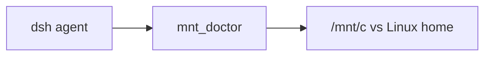

# dsh-wsl-mnt

[返回分类](../../views/categories/INFRASTRUCTURE.md) · [返回首页](../../../README.md)

分析版本：[fd4dfd4](https://github.com/173787247/dsh-wsl-mnt/tree/fd4dfd42ed07ca3c1e78942252547b895970ff8f)

<!-- BEGIN META -->
[](https://github.com/173787247/dsh-wsl-mnt)
<!-- END META -->

> **实现功能**：按 WSL 路径规则判断 /mnt 工作区并给出 Linux home 迁移建议。

> **核心亮点**：把常见 WSL 工作区位置问题变成模型可调用的路径提醒，减少人工定位。详见[Q01](#research-q01)、[Q02](#research-q02)。

> **风险与缺陷**：所有 /mnt 路径统一判为不佳、非 /mnt 判为 ok，未核文件系统/符号链接或测速；建议路径可能与现有项目冲突。详见[Q03](#research-q03)。

**本文目录**

- [1 插件分析](#detail-section-1)
  - [1.1 用途与适用场景](#detail-section-2)
  - [1.2 能力、流程与成本](#detail-section-3)
  - [1.3 工程贡献](#detail-section-4)
  - [1.4 主要限制](#detail-section-5)
  - [1.5 使用建议](#detail-section-6)
  - [1.6 核查说明与分析版本](#detail-section-7)
- [2 未来设计假设（未验证）](#detail-section-8)
- [3 辅助信息](#detail-section-9)
- [4 研究问题与完整回答](#detail-section-10)
  - [Q01 · 谁在何时使用，输出何种建议？](#detail-section-11)
  - [Q02 · WSL 和路径分类规则准确到什么程度？](#detail-section-12)
  - [Q03 · 慢/快与安全迁移是否有实际测量？](#detail-section-13)
  - [Q04 · 如何采用并验证？](#detail-section-14)

<a id="detail-section-1"></a>

## 1 插件分析

<a id="detail-section-2"></a>

### 1.1 用途与适用场景

> **用途**：WSL 中 git/npm 在 Windows 挂载路径可能偏慢时的初步排查。

人工 pwd、查看 /mnt/路径与 .git，再决定是否迁移；插件把这些提示聚合成模型工具。

<a id="detail-section-3"></a>

### 1.2 能力、流程与成本

**能力**

| 能力 | 用途 | 边界 |
| --- | --- | --- |
| mnt_doctor | 路径分类和建议 | 不测速、不迁移、不核真实挂载 |

**流程与依赖**

#### 条件

| 条件 | 用途 | 不满足时 |
| --- | --- | --- |
| WSL 环境 | 允许执行工具 | 返回 not running in WSL |
| DSH tools/systemPrompt | 注册与提示 | 工具不可用 |
| 可读项目路径 | 检查 .git 存在 | 路径判断仍可返回但精度下降 |


#### 使用

| 步骤 | 动作 | 判据 |
| --- | --- | --- |
| 指定 | 输入实际工作区路径 | 输出路径正确 |
| 诊断 | 读 onMnt/drive/kind/hasGit | 只是规则分类 |
| 验证 | 查真实挂载和同机耗时 | 确认有性能差异 |
| 迁移 | 备份后人工 clone/rsync | 项目状态与构建正常 |

**效果与成本**

#### 成本

| 阶段 | 资源与人工 | 未知 |
| --- | --- | --- |
| 诊断 | 读取路径与 .git，近乎本地操作 | 真实分类正确率 |
| 决策 | 核挂载与同机负载基准 | 性能差异 |
| 迁移 | 备份、clone/rsync、重装依赖、修路径 | 未提交改动/权限与省时 |


#### 效果

| 项 | 源码支持 | 未知 |
| --- | --- | --- |
| 路径分类 | /mnt 前缀、目录和 .git | 实际挂载与符号链接 |
| 建议 | home/src/叶名 | 目标冲突与迁移收益 |
| 性能判断 | 无测量 | 当前机器真实延迟 |

> **思考**：所有 /mnt 路径统一判为不佳、非 /mnt 判为 ok，未核文件系统/符号链接或测速；建议路径可能与现有项目冲突。详见[Q03](#research-q03)。

<a id="detail-section-4"></a>

### 1.3 工程贡献

> **亮点**：把常见 WSL 工作区位置问题变成模型可调用的路径提醒，减少人工定位。详见[Q01](#research-q01)、[Q02](#research-q02)。

把常见 WSL 工作区位置问题变成模型可调用的路径提醒，减少人工定位。详见[Q01](#research-q01)、[Q02](#research-q02)。

没有执行 shell 或修改文件；只依赖路径和 .git 存在性。分类未做 realpath/mountinfo；结果 ok 实为不在 /mnt，非健康探针。

<a id="detail-section-5"></a>

### 1.4 主要限制

所有 /mnt 路径统一判为不佳、非 /mnt 判为 ok，未核文件系统/符号链接或测速；建议路径可能与现有项目冲突。详见[Q03](#research-q03)。

<a id="detail-section-6"></a>

### 1.5 使用建议

观察。先测真实项目，再决定是否迁移；不要按 onMnt/ok 字段自动搬移项目。详见[Q03](#research-q03)、[Q04](#research-q04)。

<a id="detail-section-7"></a>

### 1.6 核查说明与分析版本

**核查状态**：已检查源码。

路径分类源码明确；无真实挂载类型或 I/O 测量，ok 仅为路径规则，迁移建议未执行。

- 已检查：作者 README、包清单、源码路径 README.md、package.json、index.js、lib/mnt.js、lib/wsl-host.js、test/mnt.test.js 及固定范围 inventory；组件：仓库根。抽读不冒充完整审计，来源和原文嵌入正式快照时保留。
- 未执行：插件安装、目标代码与测试、真实宿主及模型任务。源码存在不等于运行通过。
- 边界：固定提交静态阅读 README、入口、路径模块、WSL 检测及单测；未运行目标代码或真实 WSL 基准。
- 下一步：WSL1/2 上对 DrvFs、Linux fs、自定义挂载、symlink 和同名仓库目标做分类与 git/npm 重复耗时对照。

**分析版本**

- **仓库**：[173787247/dsh-wsl-mnt](https://github.com/173787247/dsh-wsl-mnt)
- **版本号**：0.2.0（[固定提交 fd4dfd4](https://github.com/173787247/dsh-wsl-mnt/tree/fd4dfd42ed07ca3c1e78942252547b895970ff8f)）
- **版本日期**：2026-09-30（固定提交日期，北京时间；不是包发布日期）

<a id="detail-section-8"></a>

## 2 未来设计假设（未验证）

<a id="innovation"></a>

结合 realpath、mountinfo、目标冲突预检及同机工作负载基准，使迁移建议由当前机器证据支持；本版未实现。详见[Q04](#research-q04)。

WSL1/2 上对 DrvFs、Linux fs、自定义挂载、symlink 和同名仓库目标做分类与 git/npm 重复耗时对照。

<a id="detail-section-9"></a>

## 3 辅助信息

<details>
<summary>工程统计与口径</summary>

| 扩展名 | 范围 | 文件数 | 总行 | 代码行 | 注释行 | 字数 |
|---|---|---:|---:|---:|---:|---:|
| .md | source | 5 | 99 | — | — | 573 |
| .js | source | 3 | 212 | 189 | 2 | — |
| .js | test | 1 | 49 | 45 | 0 | — |

</details>

**活跃度**

[](https://github.com/173787247/dsh-wsl-mnt/issues?q=is%3Aissue+is%3Aopen) [](https://github.com/173787247/dsh-wsl-mnt/issues?q=is%3Aissue+created%3A2026-09-22T05%3A29%3A07.002Z..2026-10-22T05%3A29%3A07.002Z) [](https://github.com/173787247/dsh-wsl-mnt/issues?q=is%3Aissue+is%3Aclosed+closed%3A2026-09-22T05%3A29%3A07.002Z..2026-10-22T05%3A29%3A07.002Z)


统计日期：2026-10-22。

<a id="detail-section-10"></a>

## 4 研究问题与完整回答

**插件研究总目标：**核实 WSL 路径诊断的分类、性能声明与迁移建议边界。

<a id="research-q01"></a>

<a id="detail-section-11"></a>

### Q01 · 谁在何时使用，输出何种建议？

**研究主题：**场景与需求、贡献与相对优势

#### 完整回答

针对在 WSL 的 /mnt/c 等 Windows 挂载路径运行 DSH、git 或 npm 而担心 I/O 慢、权限/换行问题的用户。一个 mnt_doctor 工具接受可选路径，默认进程 cwd，输出是否 /mnt、盘符、Windows 用户目录类别、是否有 .git、建议的 ~/src/<叶名> 路径及文本建议。系统提示在 git/npm 慢或项目位于 /mnt/c 时建议调用。相对用户自行检查 pwd/.git 并猜测路径，它把规则归类和下一步建议集中在模型工具；没有实际迁移、基准测量或文件修复。合格结果应让用户确认原路径、真实挂载类型和项目数据备份后再决定迁移，不能把建议路径当已建立的仓库。

#### 证据与依据

**依据 1 · 作者声明**：[README.md:1-17](https://github.com/173787247/dsh-wsl-mnt/blob/fd4dfd42ed07ca3c1e78942252547b895970ff8f/README.md#L1-L17)

作者定位为 /mnt 工作区诊断和 Linux home 路径建议。

<details>
<summary>查看原文（17行）</summary>

````text
# dsh-wsl-mnt
> **Install set:** [dsh-wsl-kit](https://github.com/173787247/dsh-wsl-kit)

Tool **`mnt_doctor`**: classify slow `/mnt` workspaces (drive, Desktop, `.git`) and suggest a Linux home path.

[中文说明 → README.zh.md](./README.zh.md)

## Where it sits

Flags a workspace on /mnt/c (slow git, NTFS). Prefer a Linux home path when it says so.



Suite diagram and version snapshot: [dsh-wsl-kit](https://github.com/173787247/dsh-wsl-kit#how-the-pieces-fit). This plugin is **0.2.0** (full). Do not copy that matrix into this README.
````

</details>

**依据 2 · 源码核查**：[index.js:7-37](https://github.com/173787247/dsh-wsl-mnt/blob/fd4dfd42ed07ca3c1e78942252547b895970ff8f/index.js#L7-L37)

WSL 检测、系统提示和 mnt_doctor 注册。

<details>
<summary>查看原文（31行）</summary>

```text
export function apply(ctx, config = {}) {
  const timeoutMs = positive(config.timeoutMs, 15_000);
  const wsl = detectWsl();

  ctx.systemPrompt.section({
    name: "tool:mnt_doctor",
    order: 117,
    text: "Use mnt_doctor when git/npm feels slow or the workspace is under /mnt/c: classifies Desktop/Downloads, detects .git on NTFS, suggests a ~/src/… Linux path, and points to encoding_doctor for CRLF scripts.",
  });

  ctx.tools.register({
    name: "mnt_doctor",
    description: "Classify whether the workspace is on slow /mnt (drive, Desktop, .git) and suggest a Linux home path.",
    parameters: core.parameters(config),
    output: {
      schema: core.outputSchema(),
      render: (_args, value) => [{ type: "text", text: core.format(value) }],
    },
    timeoutMs,
    isConcurrencySafe: () => true,
    async execute(args) {
      if (!wsl) return core.notWsl ? core.notWsl() : { ok: false, error: "not running in WSL" };
      return core.execute(args, config);
    },
    presentCall: () => ({ card: "generic", title: "mnt_doctor" }),
    presentResult: (_args, result) => (
      result.isError
        ? { card: "generic", title: "mnt_doctor failed", content: result.content }
        : { card: "generic", title: "mnt_doctor", content: result.content }
    ),
  });
```

</details>

**依据 3 · 源码核查**：[lib/mnt.js:91-112](https://github.com/173787247/dsh-wsl-mnt/blob/fd4dfd42ed07ca3c1e78942252547b895970ff8f/lib/mnt.js#L91-L112)

默认 cwd、路径解析、结果字段与建议。

<details>
<summary>查看原文（22行）</summary>

```text
export async function execute(args, _config = {}, deps = {}) {
  const home = deps.home || homedir();
  const exists = deps.exists || existsSync;
  const raw = typeof args?.path === "string" && args.path.trim() ? args.path.trim() : process.cwd();
  const abs = raw.startsWith("~/")
    ? `${home}${raw.slice(1)}`
    : raw === "~"
      ? home
      : resolve(raw);
  const info = classifyMntPath(abs, { home, exists });
  const advice = buildMntAdvice(info);
  return {
    ok: !info.onMnt,
    path: info.path,
    onMnt: info.onMnt,
    drive: info.drive || "",
    kind: info.kind,
    hasGit: info.hasGit,
    suggestedHome: info.suggestedHome || "",
    advice,
  };
}
```

</details>

<a id="research-q02"></a>

<a id="detail-section-12"></a>

### Q02 · WSL 和路径分类规则准确到什么程度？

**研究主题：**功能与机制、工程质量与复用、依赖、兼容与流程

#### 完整回答

detectWsl 先看 WSL_DISTRO_NAME/WSL_INTEROP，再看 /proc/sys/kernel/osrelease 是否含 microsoft。路径规则只按解析后的字符串判断：等于 /mnt 或前缀 /mnt/ 即 onMnt，^/mnt/<字母> 抽盘符；含 Desktop/Downloads/Documents 识别 Windows 用户文件夹，其他按 Users 或 mnt_other，检查 path/.git 是否存在，并从 basename 生成 home/src/叶名。它不读取 mountinfo、不解析符号链接真实目标、不检查目标路径碰撞或 Git 工作树是否有效。因而非驱动器的 /mnt 挂载也被泛化为“慢 Windows 挂载”；通过 symlink 指向 /mnt 的 Linux 路径会被当作非 /mnt，反向亦然。hasGit 只表示 .git 路径存在，不能证明完整仓库或其元数据一定在 NTFS。参数 config.timeoutMs 被入口读取但核心同步分类未用，工具超时只由宿主层声明。

#### 证据与依据

**依据 1 · 源码核查**：[lib/wsl-host.js:21-28](https://github.com/173787247/dsh-wsl-mnt/blob/fd4dfd42ed07ca3c1e78942252547b895970ff8f/lib/wsl-host.js#L21-L28)

WSL 环境变量及内核 release 检测。

```text
export function detectWsl({ env = process.env, readRelease = readOsRelease } = {}) {
  if (env.WSL_DISTRO_NAME || env.WSL_INTEROP) return true;
  try {
    return /microsoft/i.test(readRelease());
  } catch {
    return false;
  }
}
```

**依据 2 · 源码核查**：[lib/mnt.js:33-56](https://github.com/173787247/dsh-wsl-mnt/blob/fd4dfd42ed07ca3c1e78942252547b895970ff8f/lib/mnt.js#L33-L56)

字符串前缀、目录名、.git 存在性和 home 建议。

<details>
<summary>查看原文（24行）</summary>

```text
/** Classify an absolute Linux path for WSL /mnt hygiene. */
export function classifyMntPath(abs, { home = homedir(), exists = existsSync } = {}) {
  const path = String(abs || "");
  const onMnt = path === "/mnt" || path.startsWith("/mnt/");
  const driveMatch = path.match(/^\/mnt\/([a-zA-Z])(?:\/|$)/);
  const drive = driveMatch ? driveMatch[1].toLowerCase() : "";
  let kind = "linux_home";
  if (onMnt) {
    if (/\/(Desktop|Downloads|Documents)(\/|$)/i.test(path)) kind = "windows_user_folder";
    else if (path.includes("/Users/")) kind = "windows_users";
    else kind = "mnt_other";
  } else if (path === home || path.startsWith(`${home}/`)) {
    kind = "linux_home";
  } else {
    kind = "linux_other";
  }
  const gitPath = path.endsWith("/") ? `${path}.git` : `${path}/.git`;
  const hasGit = exists(gitPath);
  let suggestedHome = "";
  if (onMnt) {
    const leaf = basename(path) || "project";
    suggestedHome = `${home.replace(/\/+$/, "")}/src/${leaf}`;
  }
  return { path, onMnt, drive, kind, hasGit, suggestedHome };
```

</details>

**依据 3 · 源码核查**：[lib/mnt.js:91-112](https://github.com/173787247/dsh-wsl-mnt/blob/fd4dfd42ed07ca3c1e78942252547b895970ff8f/lib/mnt.js#L91-L112)

~ 扩展、resolve 后分类，未用 realpath/mountinfo。

<details>
<summary>查看原文（22行）</summary>

```text
export async function execute(args, _config = {}, deps = {}) {
  const home = deps.home || homedir();
  const exists = deps.exists || existsSync;
  const raw = typeof args?.path === "string" && args.path.trim() ? args.path.trim() : process.cwd();
  const abs = raw.startsWith("~/")
    ? `${home}${raw.slice(1)}`
    : raw === "~"
      ? home
      : resolve(raw);
  const info = classifyMntPath(abs, { home, exists });
  const advice = buildMntAdvice(info);
  return {
    ok: !info.onMnt,
    path: info.path,
    onMnt: info.onMnt,
    drive: info.drive || "",
    kind: info.kind,
    hasGit: info.hasGit,
    suggestedHome: info.suggestedHome || "",
    advice,
  };
}
```

</details>

**依据 4 · 源码核查**：[index.js:7-30](https://github.com/173787247/dsh-wsl-mnt/blob/fd4dfd42ed07ca3c1e78942252547b895970ff8f/index.js#L7-L30)

timeout 配置与非 WSL 拒绝路径。

<details>
<summary>查看原文（24行）</summary>

```text
export function apply(ctx, config = {}) {
  const timeoutMs = positive(config.timeoutMs, 15_000);
  const wsl = detectWsl();

  ctx.systemPrompt.section({
    name: "tool:mnt_doctor",
    order: 117,
    text: "Use mnt_doctor when git/npm feels slow or the workspace is under /mnt/c: classifies Desktop/Downloads, detects .git on NTFS, suggests a ~/src/… Linux path, and points to encoding_doctor for CRLF scripts.",
  });

  ctx.tools.register({
    name: "mnt_doctor",
    description: "Classify whether the workspace is on slow /mnt (drive, Desktop, .git) and suggest a Linux home path.",
    parameters: core.parameters(config),
    output: {
      schema: core.outputSchema(),
      render: (_args, value) => [{ type: "text", text: core.format(value) }],
    },
    timeoutMs,
    isConcurrencySafe: () => true,
    async execute(args) {
      if (!wsl) return core.notWsl ? core.notWsl() : { ok: false, error: "not running in WSL" };
      return core.execute(args, config);
    },
```

</details>

#### 缺口

- 未在符号链接、自定义 /mnt 挂载与 WSL1/2 上对照真实文件系统。
  **影响：**路径分类不能等同真实磁盘或性能归因。
  **进一步探讨：**在隔离 WSL 中用 mountinfo/realpath 对比工具分类，覆盖 bind、symlink、DrvFs 与 Linux fs。

<a id="research-q03"></a>

<a id="detail-section-13"></a>

### Q03 · 慢/快与安全迁移是否有实际测量？

**研究主题：**缺陷与关键质疑、效果与总成本

#### 完整回答

没有。源码只有路径字符串及 .git 存在性，没有运行 git status、npm install、I/O 计时或确认 /mnt 实际挂载类型；`ok` 直接设为 `!onMnt`，所以 /mnt 下任意位置都标 false，Linux 其它路径标 true，即使实际性能相反。建议文本将 /mnt 归因为 9p 比 ext4 慢，并建议 clone/rsync 到 ~/src；这属于规则性提醒而非此机器的实测结论，也未执行复制。叶名相同的两个 Windows 仓库会得到相同目标，已有路径/未提交改动/权限/大小写差异需要人工核验。测试只断言若干固定路径分类和建议文字，不能证明性能或迁移安全。故不得把“慢工作区”“good default”当当前主机的独立证据。

#### 证据与依据

**依据 1 · 源码核查**：[lib/mnt.js:33-88](https://github.com/173787247/dsh-wsl-mnt/blob/fd4dfd42ed07ca3c1e78942252547b895970ff8f/lib/mnt.js#L33-L88)

诊断与建议基于路径字符串和 .git，没有测速或文件系统检查。

<details>
<summary>查看原文（56行）</summary>

```text
/** Classify an absolute Linux path for WSL /mnt hygiene. */
export function classifyMntPath(abs, { home = homedir(), exists = existsSync } = {}) {
  const path = String(abs || "");
  const onMnt = path === "/mnt" || path.startsWith("/mnt/");
  const driveMatch = path.match(/^\/mnt\/([a-zA-Z])(?:\/|$)/);
  const drive = driveMatch ? driveMatch[1].toLowerCase() : "";
  let kind = "linux_home";
  if (onMnt) {
    if (/\/(Desktop|Downloads|Documents)(\/|$)/i.test(path)) kind = "windows_user_folder";
    else if (path.includes("/Users/")) kind = "windows_users";
    else kind = "mnt_other";
  } else if (path === home || path.startsWith(`${home}/`)) {
    kind = "linux_home";
  } else {
    kind = "linux_other";
  }
  const gitPath = path.endsWith("/") ? `${path}.git` : `${path}/.git`;
  const hasGit = exists(gitPath);
  let suggestedHome = "";
  if (onMnt) {
    const leaf = basename(path) || "project";
    suggestedHome = `${home.replace(/\/+$/, "")}/src/${leaf}`;
  }
  return { path, onMnt, drive, kind, hasGit, suggestedHome };
}

export function buildMntAdvice(info) {
  const tips = [];
  if (!info.onMnt) {
    tips.push("Path is outside /mnt — good default for day-to-day DSH / git / npm work.");
    if (info.hasGit) tips.push("Git repo on a Linux filesystem — prefer this over /mnt/c clones.");
    return tips;
  }

  tips.push(
    "This path is under /mnt — 9p I/O is much slower than ext4 under /home; git status, npm install, and node_modules suffer.",
  );
  if (info.drive === "c") {
    tips.push("Especially avoid long-lived repos on /mnt/c (NTFS + metadata). Clone or worktree under ~/… instead.");
  }
  if (info.kind === "windows_user_folder") {
    tips.push(
      "Desktop/Downloads/Documents on /mnt/c are fine for opening Office files, but not as the agent workspace root.",
    );
  }
  if (info.hasGit) {
    tips.push(
      "Detected .git on /mnt — expect slow status and permission/executable-bit quirks. Move the clone to Linux home when possible.",
    );
  }
  tips.push("CRLF line endings on /mnt/c often break bash scripts (set: pipefail invalid option) — run encoding_doctor or dos2unix.");
  if (info.suggestedHome) {
    tips.push(`Suggested Linux path: ${info.suggestedHome} (mkdir -p && git clone / rsync there).`);
  }
  tips.push("Pair with path_convert / dsh-wsl-open when you only need to open a Windows file from chat.");
  return tips;
```

</details>

**依据 2 · 源码核查**：[lib/mnt.js:91-111](https://github.com/173787247/dsh-wsl-mnt/blob/fd4dfd42ed07ca3c1e78942252547b895970ff8f/lib/mnt.js#L91-L111)

ok 只依赖 !onMnt，建议不执行迁移。

<details>
<summary>查看原文（21行）</summary>

```text
export async function execute(args, _config = {}, deps = {}) {
  const home = deps.home || homedir();
  const exists = deps.exists || existsSync;
  const raw = typeof args?.path === "string" && args.path.trim() ? args.path.trim() : process.cwd();
  const abs = raw.startsWith("~/")
    ? `${home}${raw.slice(1)}`
    : raw === "~"
      ? home
      : resolve(raw);
  const info = classifyMntPath(abs, { home, exists });
  const advice = buildMntAdvice(info);
  return {
    ok: !info.onMnt,
    path: info.path,
    onMnt: info.onMnt,
    drive: info.drive || "",
    kind: info.kind,
    hasGit: info.hasGit,
    suggestedHome: info.suggestedHome || "",
    advice,
  };
```

</details>

**依据 3 · 源码核查**：[test/mnt.test.js:5-49](https://github.com/173787247/dsh-wsl-mnt/blob/fd4dfd42ed07ca3c1e78942252547b895970ff8f/test/mnt.test.js#L5-L49)

测试为静态分类、建议匹配与格式，不含 I/O 基准或迁移。

<details>
<summary>查看原文（45行）</summary>

```text
describe("classifyMntPath", () => {
  it("flags /mnt/c Desktop and suggests home", () => {
    const info = classifyMntPath("/mnt/c/Users/alice/Desktop/AIFullStackDevelopment", {
      home: "/home/alice",
      exists: (p) => p.endsWith("/.git"),
    });
    assert.equal(info.onMnt, true);
    assert.equal(info.drive, "c");
    assert.equal(info.kind, "windows_user_folder");
    assert.equal(info.hasGit, true);
    assert.match(info.suggestedHome, /\/home\/alice\/src\/AIFullStackDevelopment/);
  });

  it("accepts linux home", () => {
    const info = classifyMntPath("/home/alice/proj", {
      home: "/home/alice",
      exists: () => false,
    });
    assert.equal(info.onMnt, false);
    assert.equal(info.kind, "linux_home");
  });
});

describe("buildMntAdvice", () => {
  it("warns about git on mnt", () => {
    const tips = buildMntAdvice({
      onMnt: true,
      drive: "c",
      kind: "windows_users",
      hasGit: true,
      suggestedHome: "/home/alice/src/x",
    });
    assert.ok(tips.some((t) => /\.git on \/mnt/i.test(t)));
    assert.ok(tips.some((t) => /CRLF/i.test(t)));
  });
});

describe("format", () => {
  it("includes kind", () => {
    assert.match(
      format({ ok: false, onMnt: true, path: "/mnt/c/x", kind: "mnt_other", advice: ["tip"] }),
      /kind: mnt_other/,
    );
  });
});
```

</details>

<a id="research-q04"></a>

<a id="detail-section-14"></a>

### Q04 · 如何采用并验证？

**研究主题：**采用判断、新假设与验证

#### 完整回答

适合做低成本提醒：先由用户确认在 WSL，指定真实项目路径，读分类和建议，再用当前机器的 git status/npm install 或小文件/元数据负载做同条件测量。若确有性能问题，先备份和核对未提交改动、目标路径占用与文件模式，再人工迁移和复测。现金成本基本为本地资源；时间成本主要是诊断、迁移、重装依赖以及修复 Windows/Linux 路径引用。当前建议观察使用，不将工具的 ok 字段作为迁移命令。未实现的改进假设是读取 realpath/mountinfo，再显示实际文件系统、同一仓库工作负载的前后耗时和冲突预检；通过 /mnt 与 Linux home 的重复测量判断增益。若不同挂载类型性能接近或迁移引入路径问题，则应保持原位。

#### 证据与依据

**依据 1 · 作者声明**：[README.md:8-35](https://github.com/173787247/dsh-wsl-mnt/blob/fd4dfd42ed07ca3c1e78942252547b895970ff8f/README.md#L8-L35)

作者建议 Linux home 路径及安装/套件条件。

<details>
<summary>查看原文（28行）</summary>

````text
## Where it sits

Flags a workspace on /mnt/c (slow git, NTFS). Prefer a Linux home path when it says so.


Suite diagram and version snapshot: [dsh-wsl-kit](https://github.com/173787247/dsh-wsl-kit#how-the-pieces-fit). This plugin is **0.2.0** (full). Do not copy that matrix into this README.


## Compatibility

| Field | Value |
|-------|-------|
| **Plugin** | `dsh-wsl-mnt` **0.2.0** |
| **Minimum dsh** | ≥ **0.1.2** (web UI one-shot `?token=` on Windows relay `:3081`) |
| **Latest verified** | See [dsh-wsl-kit Compatibility](https://github.com/173787247/dsh-wsl-kit#compatibility-2026-09) (currently **`0.2.0-rc.2`**) — single source of truth for the suite |
| **Kit set** | `full` or install alone |
| **Cloud Flash** | Use model id **`deepseek-flash`** (V4.1 Flash) in `~/.dsh/settings.yaml` / `llm-deepseek` — not configured by this plugin |
| **Agent Teams** | Upstream experimental; not required here |

Suite floor versions: kit [`check-plugin-versions.sh`](https://github.com/173787247/dsh-wsl-kit/blob/master/scripts/check-plugin-versions.sh). Fault tree: [TROUBLESHOOTING.md](https://github.com/173787247/dsh-wsl-kit/blob/master/docs/TROUBLESHOOTING.md).

```sh
dsh plugin --profile web add github:173787247/dsh-wsl-mnt
npm test
````

</details>

**依据 2 · 源码核查**：[lib/mnt.js:49-56](https://github.com/173787247/dsh-wsl-mnt/blob/fd4dfd42ed07ca3c1e78942252547b895970ff8f/lib/mnt.js#L49-L56)

建议目标仅取原路径叶名，没有冲突或未提交状态检查。

```text
  const gitPath = path.endsWith("/") ? `${path}.git` : `${path}/.git`;
  const hasGit = exists(gitPath);
  let suggestedHome = "";
  if (onMnt) {
    const leaf = basename(path) || "project";
    suggestedHome = `${home.replace(/\/+$/, "")}/src/${leaf}`;
  }
  return { path, onMnt, drive, kind, hasGit, suggestedHome };
```

**依据 3 · 源码核查**：[lib/mnt.js:59-88](https://github.com/173787247/dsh-wsl-mnt/blob/fd4dfd42ed07ca3c1e78942252547b895970ff8f/lib/mnt.js#L59-L88)

迁移、CRLF 和配套工具皆为文字建议。

<details>
<summary>查看原文（30行）</summary>

```text
export function buildMntAdvice(info) {
  const tips = [];
  if (!info.onMnt) {
    tips.push("Path is outside /mnt — good default for day-to-day DSH / git / npm work.");
    if (info.hasGit) tips.push("Git repo on a Linux filesystem — prefer this over /mnt/c clones.");
    return tips;
  }

  tips.push(
    "This path is under /mnt — 9p I/O is much slower than ext4 under /home; git status, npm install, and node_modules suffer.",
  );
  if (info.drive === "c") {
    tips.push("Especially avoid long-lived repos on /mnt/c (NTFS + metadata). Clone or worktree under ~/… instead.");
  }
  if (info.kind === "windows_user_folder") {
    tips.push(
      "Desktop/Downloads/Documents on /mnt/c are fine for opening Office files, but not as the agent workspace root.",
    );
  }
  if (info.hasGit) {
    tips.push(
      "Detected .git on /mnt — expect slow status and permission/executable-bit quirks. Move the clone to Linux home when possible.",
    );
  }
  tips.push("CRLF line endings on /mnt/c often break bash scripts (set: pipefail invalid option) — run encoding_doctor or dos2unix.");
  if (info.suggestedHome) {
    tips.push(`Suggested Linux path: ${info.suggestedHome} (mkdir -p && git clone / rsync there).`);
  }
  tips.push("Pair with path_convert / dsh-wsl-open when you only need to open a Windows file from chat.");
  return tips;
```

</details>

#### 缺口

- 缺同机 I/O 基准、迁移风险和实际用户省时数据。
  **影响：**无法量化采用收益或给出通用迁移阈值。
  **进一步探讨：**选择有代表性的 WSL 仓库，重复测 git/npm/元数据操作并记录迁移前后。
- realpath、挂载识别与冲突预检未实现。
  **影响：**属于研究假设，不能算现版准确性。
  **进一步探讨：**原型与现版对照误分类、耗时及迁移错误。

[返回分类](../../views/categories/INFRASTRUCTURE.md) · [返回首页](../../../README.md)
