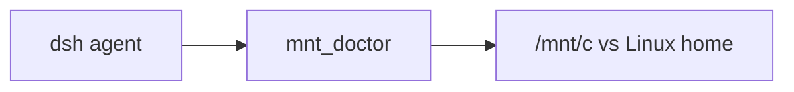

# dsh-wsl-mnt

[返回分类](../../views/categories/INFRASTRUCTURE.md) · [返回首页](../../../README.md)

源码版本：[f413ffc](https://github.com/173787247/dsh-wsl-mnt/tree/f413ffcfa277e3d8a855aec914f748e0b7a73dcb)

<!-- BEGIN META -->
[](https://github.com/173787247/dsh-wsl-mnt)
<!-- END META -->

> **功能**：提供 mnt_doctor，按路径分类 Windows 挂载工作区并给出 Linux home 建议。

> **亮点**：[Q01](#research-q01) 将常见工作区位置提醒放入模型工具，减少路径信息手抄。

> **主要限制**：[Q02](#research-q02) ok仅非/mnt，未核挂载/symlink/会话cwd，建议目标未预检。

**本文目录**

- [1 插件分析](#detail-section-1)
  - [1.1 用途与适用场景](#detail-section-2)
  - [1.2 能力、流程与成本](#detail-section-3)
  - [1.3 工程亮点](#detail-section-4)
  - [1.4 主要限制](#detail-section-5)
  - [1.5 使用建议](#detail-section-6)
  - [1.6 核查说明与分析版本](#detail-section-7)
- [2 未来设计假设（未验证）](#detail-section-8)
- [3 辅助信息](#detail-section-9)
- [4 研究问题与完整回答](#detail-section-10)
  - [Q01 · 路径提醒对慢项目排障有什么贡献？](#detail-section-11)
  - [Q02 · 分类是不是实际挂载/健康判断？](#detail-section-12)
  - [Q03 · 诊断与人工迁移分别依赖和花费什么？](#detail-section-13)
  - [Q04 · 采用条件和新假设是什么？](#detail-section-14)

<a id="detail-section-1"></a>

## 1 插件分析

<a id="detail-section-2"></a>

### 1.1 用途与适用场景

> **用途**：WSL git/npm慢时先检查是否使用Windows目录。

pwd/realpath/mount与同机git/npm基准；本插件不测性能或迁移。

<a id="detail-section-3"></a>

### 1.2 能力、流程与成本

#### 能力

| 能力 | 主要用途 | 使用条件与边界 |
|---|---|---|
| 路径分类 | 提醒Windows目录候选 | 非真实挂载/性能检测 |
| .git存在 | 提示仓库位置 | 不向父查，不验Git状态 |
| home路径建议 | 人工迁移参考 | 不验冲突、不移动文件 |

#### 启动与依赖

| 依赖或条件 | 是否必需 | 用途 | 缺失或不满足时 |
|---|---|---|---|
| Node>=18/WSL/匹配DSH | 必需 | 工具入口 | 不等套件实测 |
| 显式正确path | 建议必需 | 避免进程cwd误指 | 可能查错项目 |
| 挂载与同机基准 | 迁移前提 | 验证实际瓶颈 | 路径分类非测速 |

#### 启动步骤

| 步骤 | 执行者与动作 | 成功判据或失败处理 |
|---|---|---|
| 输入 | 用户明确项目path | 对应目标会话 |
| 提醒 | Agent取分类/.git | 与实际挂载复核 |
| 决策 | 用户备份并比较负载 | 收益抵人工代价 |
| 退出 | 停用提醒/保原仓库 | 人工迁移单独恢复 |

#### 成本

| 阶段 | 现金与资源成本 | 人工与时间投入 | 已知条件与未知项 |
|---|---|---|---|
| 首次 | 原宿主 | 安装/核path | 工时未知 |
| 持续 | 本地路径/存在读取及上下文 | 理解启发式 | 性能未测 |
| 失败恢复 | 复制/重装/可能停工 | 保未提交改动和权限 | 迁移由人执行 |
| 退出 | 保留原项目 | 关工具或回原路径 | 插件无迁移状态 |

#### 效果

| 效果项 | 当前证据支持 | 尚不能确定 |
|---|---|---|
| 位置提示 | 字符串分类/.git | 实际文件系统 |
| 迁移建议 | home/src/叶名 | 目标冲突/可用性 |
| 工作效率 | 有排查入口 | 实际速度与净收益 |

> **思考**：[Q02](#research-q02) ok仅非/mnt，未核挂载/symlink/会话cwd，建议目标未预检。

<a id="detail-section-4"></a>

### 1.3 工程亮点

> **亮点**：[Q01](#research-q01) 将常见工作区位置提醒放入模型工具，减少路径信息手抄。

[Q02](#research-q02) 无shell/写入使直接副作用较小；字符串启发式应与真实挂载分开呈现。

<a id="detail-section-5"></a>

### 1.4 主要限制

[Q02](#research-q02) ok仅非/mnt，未核挂载/symlink/会话cwd，建议目标未预检。

<a id="detail-section-6"></a>

### 1.5 使用建议

[Q04](#research-q04) 显式path并核挂载/基准，不按ok自动迁移，冲突或误判回原检查。

<a id="detail-section-7"></a>

### 1.6 核查说明与分析版本

**核查状态**：已检查源码。

已核完整三JS和声明，源码只读提醒成立；性能与迁移收益未验，建议观察自动迁移用途。

- 已检查：作者 README、包清单、源码路径 README.md、package.json、index.js、lib/mnt.js、lib/wsl-host.js 及固定范围 inventory；组件：仓库根。抽读不冒充完整审计，来源和原文嵌入正式快照时保留。
- 未执行：插件安装、目标代码与测试、真实宿主及模型任务。源码存在不等于运行通过。
- 边界：完整读README/清单/入口/mnt/wsl-host，复核旧findings；未执行目标、测速或迁移。
- 下一步：对照symlink、bind mount、会话cwd和目标冲突；同机交替测冷/热负载与迁移人工成本。

**分析版本**

- **仓库**：[173787247/dsh-wsl-mnt](https://github.com/173787247/dsh-wsl-mnt)
- **版本号**：0.2.0（[固定提交 f413ffc](https://github.com/173787247/dsh-wsl-mnt/tree/f413ffcfa277e3d8a855aec914f748e0b7a73dcb)）
- **版本日期**：2026-10-30（固定提交日期，北京时间；不是包发布日期）

<a id="detail-section-8"></a>

## 2 未来设计假设（未验证）

<a id="innovation"></a>

[Q04](#research-q04) 可探索挂载证据/冲突预检/同机负载，若误迁移和成本不改善即否定。

对照symlink、bind mount、会话cwd和目标冲突；同机交替测冷/热负载与迁移人工成本。

<a id="detail-section-9"></a>

## 3 辅助信息

<details>
<summary>工程统计</summary>

仅统计 Markdown 和指定的 JavaScript／TypeScript 扩展名；Python 等其他语言不纳入，表格不代表全语言代码规模。

| 扩展名 | 范围 | 文件数 | 总行 | 代码行 | 注释行 | 字数 |
|---|---|---:|---:|---:|---:|---:|
| .md | source | 5 | 99 | — | — | 573 |
| .js | source | 3 | 212 | 189 | 2 | — |
| .js | test | 1 | 49 | 45 | 0 | — |

</details>

**活跃度**

Issue 活跃度数据暂未获取（查询日期：2026-11-02），可前往 [GitHub Issues](https://github.com/173787247/dsh-wsl-mnt/issues) 查看。

<a id="detail-section-10"></a>

## 4 研究问题与完整回答

**插件研究总目标**：判断路径提醒能否支持有证据且可逆的工作区迁移决策。

<a id="research-q01"></a>

<a id="detail-section-11"></a>

### Q01 · 路径提醒对慢项目排障有什么贡献？

**研究主题**：场景与需求、贡献与相对优势

#### 完整回答

WSL开发者在git/npm慢、项目放Windows桌面时，可用mnt_doctor先看路径位置、.git和建议Linux路径。比手查cwd与目录，多了统一模型入口和常见目录解释；合格结果是识别需进一步测量的候选，而不是仅凭工具把项目搬走。index实际注册tools/systemPrompt，是真实原生插件。它不执行测速/迁移，系统路径和存在性能力来自Node，贡献是位置提醒而非存储性能算法。偶发用户用pwd/mount即可，不必为一次位置判断常驻插件。

#### 证据与依据

**依据 1 · 源码核查**：[README.md:1-17](https://github.com/173787247/dsh-wsl-mnt/blob/f413ffcfa277e3d8a855aec914f748e0b7a73dcb/README.md#L1-L17)

作者位置/性能提醒。

<details>
<summary>查看原文（17行）</summary>

````text
# dsh-wsl-mnt
> **Install set:** [dsh-wsl-kit](https://github.com/173787247/dsh-wsl-kit)

Tool **`mnt_doctor`**: classify slow `/mnt` workspaces (drive, Desktop, `.git`) and suggest a Linux home path.

[中文说明 → README.zh.md](./README.zh.md)

## Where it sits

Flags a workspace on /mnt/c (slow git, NTFS). Prefer a Linux home path when it says so.



Suite diagram and version snapshot: [dsh-wsl-kit](https://github.com/173787247/dsh-wsl-kit#how-the-pieces-fit). This plugin is **0.2.0** (full). Do not copy that matrix into this README.
````

</details>

**依据 2 · 源码核查**：[index.js:1-29](https://github.com/173787247/dsh-wsl-mnt/blob/f413ffcfa277e3d8a855aec914f748e0b7a73dcb/index.js#L1-L29)

实际提示和工具接线。

<details>
<summary>查看原文（29行）</summary>

```text
import { detectWsl } from "./lib/wsl-host.js";
import * as core from "./lib/mnt.js";

export const name = "dsh-wsl-mnt";
export const inject = ["tools", "systemPrompt"];

export function apply(ctx, config = {}) {
  const timeoutMs = positive(config.timeoutMs, 15_000);
  const wsl = detectWsl();

  ctx.systemPrompt.section({
    name: "tool:mnt_doctor",
    order: 117,
    text: "Use mnt_doctor when git/npm feels slow or the workspace is under /mnt/c: classifies Desktop/Downloads, detects .git on NTFS, suggests a ~/src/… Linux path, and points to encoding_doctor for CRLF scripts.",
  });

  ctx.tools.register({
    name: "mnt_doctor",
    description: "Classify whether the workspace is on slow /mnt (drive, Desktop, .git) and suggest a Linux home path.",
    parameters: core.parameters(config),
    output: {
      schema: core.outputSchema(),
      render: (_args, value) => [{ type: "text", text: core.format(value) }],
    },
    timeoutMs,
    isConcurrencySafe: () => true,
    async execute(args) {
      if (!wsl) return core.notWsl ? core.notWsl() : { ok: false, error: "not running in WSL" };
      return core.execute(args, config);
```

</details>

#### 缺口

- 慢项目的实测瓶颈与用户摩擦未取得。
  **影响**：不能从/mnt位置推出该项目迁移收益。
  **进一步探讨**：同机同工作负载测git/npm及人工迁移代价。

<a id="research-q02"></a>

<a id="detail-section-12"></a>

### Q02 · 分类是不是实际挂载/健康判断？

**研究主题**：功能与机制、缺陷与关键质疑、工程质量与复用

#### 完整回答

输入空时process.cwd，相对path以进程cwd resolve，~展开后按字符串/mnt前缀、盘符和Desktop等名字分类；只检查该目录下.git存在，未向父找仓库。ok等于不在/mnt，不是健康、性能或文件系统探针。未realpath/mountinfo，非/mnt符号链接指向DrvFs可误判好，/mnt下Linux挂载可被误判慢；不应把建议文案9p/NTFS当已识别事实。

默认cwd不是显式会话工作区，Agent若省path且宿主进程cwd不同，可能查错项目。suggestedHome仅home/src/叶名，未预检目标冲突/权限/未提交变更；相同叶名项目可能撞路径。源码只existsSync，无shell或迁移写入，移除或重试不直接改文件；format不显示notWsl error，非WSL原因可能只剩ok=false。这些是诊断语义限制而非已复现数据丢失。

#### 证据与依据

**依据 1 · 源码核查**：[lib/mnt.js:23-56](https://github.com/173787247/dsh-wsl-mnt/blob/f413ffcfa277e3d8a855aec914f748e0b7a73dcb/lib/mnt.js#L23-L56)

格式和字符串分类/.git检查。

<details>
<summary>查看原文（34行）</summary>

```text
export function format(v) {
  const lines = [`mnt_doctor ok=${v.ok} onMnt=${v.onMnt} path=${v.path}`];
  if (v.drive) lines.push(`drive: ${v.drive}`);
  if (v.kind) lines.push(`kind: ${v.kind}`);
  if (v.hasGit != null) lines.push(`hasGit: ${v.hasGit}`);
  if (v.suggestedHome) lines.push(`suggestedHome: ${v.suggestedHome}`);
  for (const a of v.advice || []) lines.push(`- ${a}`);
  return lines.join("\n");
}

/** Classify an absolute Linux path for WSL /mnt hygiene. */
export function classifyMntPath(abs, { home = homedir(), exists = existsSync } = {}) {
  const path = String(abs || "");
  const onMnt = path === "/mnt" || path.startsWith("/mnt/");
  const driveMatch = path.match(/^\/mnt\/([a-zA-Z])(?:\/|$)/);
  const drive = driveMatch ? driveMatch[1].toLowerCase() : "";
  let kind = "linux_home";
  if (onMnt) {
    if (/\/(Desktop|Downloads|Documents)(\/|$)/i.test(path)) kind = "windows_user_folder";
    else if (path.includes("/Users/")) kind = "windows_users";
    else kind = "mnt_other";
  } else if (path === home || path.startsWith(`${home}/`)) {
    kind = "linux_home";
  } else {
    kind = "linux_other";
  }
  const gitPath = path.endsWith("/") ? `${path}.git` : `${path}/.git`;
  const hasGit = exists(gitPath);
  let suggestedHome = "";
  if (onMnt) {
    const leaf = basename(path) || "project";
    suggestedHome = `${home.replace(/\/+$/, "")}/src/${leaf}`;
  }
  return { path, onMnt, drive, kind, hasGit, suggestedHome };
```

</details>

**依据 2 · 源码核查**：[lib/mnt.js:59-88](https://github.com/173787247/dsh-wsl-mnt/blob/f413ffcfa277e3d8a855aec914f748e0b7a73dcb/lib/mnt.js#L59-L88)

性能判断为通用建议。

<details>
<summary>查看原文（30行）</summary>

```text
export function buildMntAdvice(info) {
  const tips = [];
  if (!info.onMnt) {
    tips.push("Path is outside /mnt — good default for day-to-day DSH / git / npm work.");
    if (info.hasGit) tips.push("Git repo on a Linux filesystem — prefer this over /mnt/c clones.");
    return tips;
  }

  tips.push(
    "This path is under /mnt — 9p I/O is much slower than ext4 under /home; git status, npm install, and node_modules suffer.",
  );
  if (info.drive === "c") {
    tips.push("Especially avoid long-lived repos on /mnt/c (NTFS + metadata). Clone or worktree under ~/… instead.");
  }
  if (info.kind === "windows_user_folder") {
    tips.push(
      "Desktop/Downloads/Documents on /mnt/c are fine for opening Office files, but not as the agent workspace root.",
    );
  }
  if (info.hasGit) {
    tips.push(
      "Detected .git on /mnt — expect slow status and permission/executable-bit quirks. Move the clone to Linux home when possible.",
    );
  }
  tips.push("CRLF line endings on /mnt/c often break bash scripts (set: pipefail invalid option) — run encoding_doctor or dos2unix.");
  if (info.suggestedHome) {
    tips.push(`Suggested Linux path: ${info.suggestedHome} (mkdir -p && git clone / rsync there).`);
  }
  tips.push("Pair with path_convert / dsh-wsl-open when you only need to open a Windows file from chat.");
  return tips;
```

</details>

**依据 3 · 源码核查**：[lib/mnt.js:91-111](https://github.com/173787247/dsh-wsl-mnt/blob/f413ffcfa277e3d8a855aec914f748e0b7a73dcb/lib/mnt.js#L91-L111)

process.cwd默认与ok定义。

<details>
<summary>查看原文（21行）</summary>

```text
export async function execute(args, _config = {}, deps = {}) {
  const home = deps.home || homedir();
  const exists = deps.exists || existsSync;
  const raw = typeof args?.path === "string" && args.path.trim() ? args.path.trim() : process.cwd();
  const abs = raw.startsWith("~/")
    ? `${home}${raw.slice(1)}`
    : raw === "~"
      ? home
      : resolve(raw);
  const info = classifyMntPath(abs, { home, exists });
  const advice = buildMntAdvice(info);
  return {
    ok: !info.onMnt,
    path: info.path,
    onMnt: info.onMnt,
    drive: info.drive || "",
    kind: info.kind,
    hasGit: info.hasGit,
    suggestedHome: info.suggestedHome || "",
    advice,
  };
```

</details>

#### 缺口

- 目标宿主cwd与真实挂载映射/符号链接未验。
  **影响**：可能提醒错项目或给无益迁移建议。
  **进一步探讨**：用会话cwd不同、bind mount、symlink和worktree .git文件做受控分类对照。

<a id="research-q03"></a>

<a id="detail-section-13"></a>

### Q03 · 诊断与人工迁移分别依赖和花费什么？

**研究主题**：依赖、兼容与流程、效果与总成本

#### 完整回答

Node>=18、WSL检测和匹配DSH为启动条件；此工具实际不调用Windows二进制，不能因共享host模块有PowerShell就把它列必需。读取路径/.git不测速度，也不验证路径存在或权限，输出绝对路径/项目名可能进入模型上下文。作者套件兼容声明未实测。

首次核明确path，持续本地路径/存在查询开销未测；没有独立收费机制不等宿主/上下文免费。真正成本在人工确认挂载、备份、clone/rsync、依赖重装、路径/IDE修复和未提交改动保护；这些不是插件完成的操作。失败先保留原仓库和未提交数据，建议目录冲突时另选；迁移收益不够则继续原位置。退出停用工具，无插件迁移状态需回滚；人工迁移另保退出方案。

#### 证据与依据

**依据 1 · 源码核查**：[package.json:14-28](https://github.com/173787247/dsh-wsl-mnt/blob/f413ffcfa277e3d8a855aec914f748e0b7a73dcb/package.json#L14-L28)

Node/发布。

<details>
<summary>查看原文（15行）</summary>

```text
  "type": "module",
  "main": "index.js",
  "engines": {
    "node": ">=18"
  },
  "scripts": {
    "test": "node --test test/*.test.js"
  },
  "files": [
    "index.js",
    "lib",
    "cordis.patch.yml",
    "README.md",
    "README.zh.md",
    "LICENSE"
```

</details>

**依据 2 · 源码核查**：[lib/wsl-host.js:21-28](https://github.com/173787247/dsh-wsl-mnt/blob/f413ffcfa277e3d8a855aec914f748e0b7a73dcb/lib/wsl-host.js#L21-L28)

实际仅使用检测。

```text
export function detectWsl({ env = process.env, readRelease = readOsRelease } = {}) {
  if (env.WSL_DISTRO_NAME || env.WSL_INTEROP) return true;
  try {
    return /microsoft/i.test(readRelease());
  } catch {
    return false;
  }
}
```

**依据 3 · 源码核查**：[lib/mnt.js:1-3](https://github.com/173787247/dsh-wsl-mnt/blob/f413ffcfa277e3d8a855aec914f748e0b7a73dcb/lib/mnt.js#L1-L3)

核心只路径/fs/os依赖。

```text
import { existsSync } from "node:fs";
import { basename, resolve } from "node:path";
import { homedir } from "node:os";
```

**依据 4 · 源码核查**：[lib/mnt.js:78-87](https://github.com/173787247/dsh-wsl-mnt/blob/f413ffcfa277e3d8a855aec914f748e0b7a73dcb/lib/mnt.js#L78-L87)

迁移只是建议。

<details>
<summary>查看原文（10行）</summary>

```text
  if (info.hasGit) {
    tips.push(
      "Detected .git on /mnt — expect slow status and permission/executable-bit quirks. Move the clone to Linux home when possible.",
    );
  }
  tips.push("CRLF line endings on /mnt/c often break bash scripts (set: pipefail invalid option) — run encoding_doctor or dos2unix.");
  if (info.suggestedHome) {
    tips.push(`Suggested Linux path: ${info.suggestedHome} (mkdir -p && git clone / rsync there).`);
  }
  tips.push("Pair with path_convert / dsh-wsl-open when you only need to open a Windows file from chat.");
```

</details>

#### 缺口

- 本机性能/迁移工时和数据保护方案未验。
  **影响**：可能投入迁移超过收益。
  **进一步探讨**：先复制脱敏项目并保原件，用相同命令测两位置再估人工恢复时间。

<a id="research-q04"></a>

<a id="detail-section-14"></a>

### Q04 · 采用条件和新假设是什么？

**研究主题**：采用判断、新假设与验证

#### 完整回答

建议观察自动迁移用途；可作为只读提醒，但先显式path、核实际挂载和工作负载，不按onMnt/ok触发搬移。若分类与mount/realpath不符，或目标路径已有项目，退回原生路径/挂载检查，保留原仓库。

可探索基于实际挂载/realpath与目标冲突预检、同机小型真实工作负载的迁移建议。增量是把当前字符串提醒升级为可核实的迁移前证据，而不是更强烈劝迁移。对DrvFs symlink、/mnt Linux卷、不同规模项目和同叶名冲突，对照误迁移率、性能收益与采样/人工成本；测速本身可污染缓存，应交替顺序并留冷/热状态。若建议不比简单mount加手测可靠，或测量/迁移成本超过收益，否定该方向。未实现。

#### 证据与依据

**依据 1 · 源码核查**：[lib/mnt.js:34-56](https://github.com/173787247/dsh-wsl-mnt/blob/f413ffcfa277e3d8a855aec914f748e0b7a73dcb/lib/mnt.js#L34-L56)

现有字符串与目标生成基线。

<details>
<summary>查看原文（23行）</summary>

```text
export function classifyMntPath(abs, { home = homedir(), exists = existsSync } = {}) {
  const path = String(abs || "");
  const onMnt = path === "/mnt" || path.startsWith("/mnt/");
  const driveMatch = path.match(/^\/mnt\/([a-zA-Z])(?:\/|$)/);
  const drive = driveMatch ? driveMatch[1].toLowerCase() : "";
  let kind = "linux_home";
  if (onMnt) {
    if (/\/(Desktop|Downloads|Documents)(\/|$)/i.test(path)) kind = "windows_user_folder";
    else if (path.includes("/Users/")) kind = "windows_users";
    else kind = "mnt_other";
  } else if (path === home || path.startsWith(`${home}/`)) {
    kind = "linux_home";
  } else {
    kind = "linux_other";
  }
  const gitPath = path.endsWith("/") ? `${path}.git` : `${path}/.git`;
  const hasGit = exists(gitPath);
  let suggestedHome = "";
  if (onMnt) {
    const leaf = basename(path) || "project";
    suggestedHome = `${home.replace(/\/+$/, "")}/src/${leaf}`;
  }
  return { path, onMnt, drive, kind, hasGit, suggestedHome };
```

</details>

**依据 2 · 源码核查**：[lib/mnt.js:67-85](https://github.com/173787247/dsh-wsl-mnt/blob/f413ffcfa277e3d8a855aec914f748e0b7a73dcb/lib/mnt.js#L67-L85)

缺测速的迁移建议。

<details>
<summary>查看原文（19行）</summary>

```text
  tips.push(
    "This path is under /mnt — 9p I/O is much slower than ext4 under /home; git status, npm install, and node_modules suffer.",
  );
  if (info.drive === "c") {
    tips.push("Especially avoid long-lived repos on /mnt/c (NTFS + metadata). Clone or worktree under ~/… instead.");
  }
  if (info.kind === "windows_user_folder") {
    tips.push(
      "Desktop/Downloads/Documents on /mnt/c are fine for opening Office files, but not as the agent workspace root.",
    );
  }
  if (info.hasGit) {
    tips.push(
      "Detected .git on /mnt — expect slow status and permission/executable-bit quirks. Move the clone to Linux home when possible.",
    );
  }
  tips.push("CRLF line endings on /mnt/c often break bash scripts (set: pipefail invalid option) — run encoding_doctor or dos2unix.");
  if (info.suggestedHome) {
    tips.push(`Suggested Linux path: ${info.suggestedHome} (mkdir -p && git clone / rsync there).`);
```

</details>

#### 缺口

- 实际挂载/工作负载设计尚无实现。
  **影响**：不能计为已提升诊断准确率。
  **进一步探讨**：先与手工mount/基准对照，保全原目录并计缓存影响。

[返回分类](../../views/categories/INFRASTRUCTURE.md) · [返回首页](../../../README.md)
