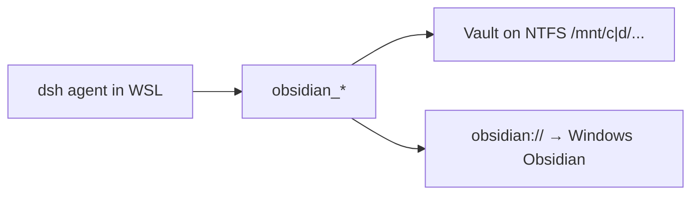

# dsh-wsl-obsidian

[返回分类](../../views/categories/RESEARCH-KNOWLEDGE.md) · [返回首页](../../../README.md)

源码版本：[7c4b91b](https://github.com/173787247/dsh-wsl-obsidian/tree/7c4b91b8eeaf131a7e51d601be34fd6f9b972801)

<!-- BEGIN META -->
[](https://github.com/173787247/dsh-wsl-obsidian)
<!-- END META -->

> **功能**：让 WSL 中的 DSH Agent 搜索、读写 Windows Obsidian 笔记并打开桌面应用。

> **亮点**：[Q01](#research-q01) 把库发现、状态检查和双链作为 Agent 工具接入现有本地笔记，减少每次解释挂载路径的操作；没有建立独立语义索引或冲突解决机制。

> **主要限制**：[Q02](#research-q02) 写入只检查工具参数和词法路径，缺少真实路径与文件版本约束。库内链接、外部编辑与重复追加必须独立验证。

**本文目录**

- [1 插件分析](#detail-section-1)
  - [1.1 用途与适用场景](#detail-section-2)
  - [1.2 能力、流程与成本](#detail-section-3)
  - [1.3 工程亮点](#detail-section-4)
  - [1.4 主要限制](#detail-section-5)
  - [1.5 使用建议](#detail-section-6)
  - [1.6 核查说明与分析版本](#detail-section-7)
- [2 未来设计假设（未验证）](#detail-section-8)
- [3 辅助信息](#detail-section-9)
- [4 研究问题与完整回答](#detail-section-10)
  - [Q01 · 谁能用它处理什么，如何定位库和内容？](#detail-section-11)
  - [Q02 · 确认参数与路径检查保护什么？](#detail-section-12)
  - [Q03 · 怎样验证、退出和恢复，如何证伪改进设想？](#detail-section-13)

<a id="detail-section-1"></a>

## 1 插件分析

<a id="detail-section-2"></a>

### 1.1 用途与适用场景

> **用途**：使用 WSL 的 DSH 用户希望在不搬迁现有 Obsidian 库的情况下搜索笔记、阅读双链并打开桌面页。

从 WSL 用通用文件工具查 Markdown，再在 Windows Obsidian 手工打开。专用工具集中定位库和查链接，但并未替代通用编辑器的审阅与版本控制。

<a id="detail-section-3"></a>

### 1.2 能力、流程与成本

#### 能力

| 能力 | 主要用途 | 使用条件与边界 |
| --- | --- | --- |
| vault 状态 | 定位库名与路径 | 解析成功后仍核路径存在 |
| 搜索与链接 | 查本地 Markdown 与双链 | 文件上限与同名歧义 |
| 直接写入 | 覆盖或追加到库内路径 | 工具参数确认，无版本保护 |
| 桌面打开 | 从 WSL 调用 Windows 应用 | 请求成功后核实际窗口 |

#### 启动与依赖

| 依赖或条件 | 是否必需 | 用途 | 缺失或不满足时 |
| --- | --- | --- | --- |
| Node.js 与相容 DSH | 必需 | 注册工具 | 继续使用 Obsidian 界面 |
| 可访问的 Windows vault | 读写必需 | 在 WSL 访问实际笔记 | 核对存在状态与显式路径 |
| WSL interop 与 Windows Obsidian | 桌面打开必需 | 发 URI 至目标应用 | 仅用只读文件工具 |
| 隔离备份库 | 写入评估必需 | 避免损坏正式笔记 | 只读试用 |

#### 启动步骤

| 步骤 | 执行者与动作 | 成功判据或失败处理 |
| --- | --- | --- |
| 定位 | 用户指定测试库并查 status | 库路径和 vaultExists 均正确 |
| 试读 | 用户用样例查找并核双链 | 逐个比对路径与内容 |
| 桌面 | 用户发 open 后观察界面 | 确认正确应用和笔记 |
| 恢复 | 用户禁用工具并比对文件 | 有差异用已知备份恢复 |

#### 成本

| 阶段 | 现金与资源成本 | 人工与时间投入 | 已知条件与未知项 |
| --- | --- | --- | --- |
| 首次 | WSL 与存储配置资源未知 | 准备副本和显式路径 | 需核两个端的路径 |
| 持续 | 扫描、存储和模型开销未知 | 复核检索与写入 | 大库查全不保证 |
| 失败恢复 | 备份占用未知 | 比对内容和解决外部编辑冲突 | 没有内置历史恢复 |

#### 效果

| 效果项 | 当前证据支持 | 尚不能确定 |
| --- | --- | --- |
| 定位与搜索 | 库发现和有限子串扫描 | 大库查全及同名链接 |
| 本地编辑 | 确认参数后直接读写 | 外部编辑下的数据保全 |
| 桌面打开 | 发起 Windows URI 请求 | 窗口实际打开与监听 |

> **思考**：[Q02](#research-q02) 写入只检查工具参数和词法路径，缺少真实路径与文件版本约束。库内链接、外部编辑与重复追加必须独立验证。

<a id="detail-section-4"></a>

### 1.3 工程亮点

> **亮点**：[Q01](#research-q01) 把库发现、状态检查和双链作为 Agent 工具接入现有本地笔记，减少每次解释挂载路径的操作；没有建立独立语义索引或冲突解决机制。

[Q02](#research-q02) 词法包含性与显式确认是基本约束；写入缺版本校验，工具的非并发声明覆盖不了其他进程。

<a id="detail-section-5"></a>

### 1.4 主要限制

[Q02](#research-q02) 写入只检查工具参数和词法路径，缺少真实路径与文件版本约束。库内链接、外部编辑与重复追加必须独立验证。

<a id="detail-section-6"></a>

### 1.5 使用建议

[Q03](#research-q03) 先从复制库核路径、搜索与桌面打开。若路径、内容或窗口目标不一致，停止写入并回到手工处理。

<a id="detail-section-7"></a>

### 1.6 核查说明与分析版本

**核查状态**：已检查源码。

固定源码支持文件工具、路径检查和 URI 机制。真实 Windows 窗口、同步与共享库写入效果未经核验。

- 已检查：作者 README、包清单、源码路径 README.md、index.js、lib/vault.js、CHANGELOG.md、lib/open.js、lib/wsl-host.js、scripts/smoke.mjs 及固定范围 inventory；组件：仓库根。抽读不冒充完整审计，来源和原文嵌入正式快照时保留。
- 未执行：插件安装、目标代码与测试、真实宿主及模型任务。源码存在不等于运行通过。
- 边界：固定提交根组件，阅读入口、vault 文件操作、PowerShell/URI 和手工 smoke 源码。未执行目标代码，未访问真实用户笔记。
- 下一步：对复制 vault 回放显式和自动定位、超限搜索、同名双链、绝对路径、符号链接、外部写冲突、URI 打开与退出。

**分析版本**

- **仓库**：[173787247/dsh-wsl-obsidian](https://github.com/173787247/dsh-wsl-obsidian)
- **版本号**：0.2.1（[固定提交 7c4b91b](https://github.com/173787247/dsh-wsl-obsidian/tree/7c4b91b8eeaf131a7e51d601be34fd6f9b972801)）
- **版本日期**：2026-11-04（固定提交日期，北京时间；不是包发布日期）

<a id="detail-section-8"></a>

## 2 未来设计假设（未验证）

<a id="innovation"></a>

[Q03](#research-q03) 可尝试真实路径约束、预期哈希和可恢复替换，使用链接越界及同时编辑对照。若冲突与越界不降，或合法路径大量被拒绝，就放弃；尚未实现。

对复制 vault 回放显式和自动定位、超限搜索、同名双链、绝对路径、符号链接、外部写冲突、URI 打开与退出。

<a id="detail-section-9"></a>

## 3 辅助信息

<details>
<summary>工程统计</summary>

仅统计 Markdown 和指定的 JavaScript／TypeScript 扩展名；Python 等其他语言不纳入，表格不代表全语言代码规模。

| 扩展名 | 范围 | 文件数 | 总行 | 代码行 | 注释行 | 字数 |
|---|---|---:|---:|---:|---:|---:|
| .md | source | 5 | 187 | — | — | 955 |
| .js | source | 5 | 875 | 788 | 28 | — |
| .mjs | source | 1 | 104 | 89 | 5 | — |
| .md | example | 2 | 12 | — | — | 12 |
| .js | test | 1 | 164 | 145 | 1 | — |

</details>

**活跃度**

[](https://github.com/173787247/dsh-wsl-obsidian/issues?q=is%3Aissue+is%3Aopen)

暂未获取：近30天新建、近30天关闭。

统计日期：2026-11-04。

<a id="detail-section-10"></a>

## 4 研究问题与完整回答

**插件研究总目标**：WSL 用户如何复用已有 Windows Obsidian 笔记库，何时可以安全试用？

<a id="research-q01"></a>

<a id="detail-section-11"></a>

### Q01 · 谁能用它处理什么，如何定位库和内容？

**研究主题**：场景与需求、功能与机制、贡献与相对优势

#### 完整回答

已经在 Windows Obsidian 保存 Markdown 库、在 WSL 使用 DSH 的用户，可以让 Agent 查找并读取笔记，不必人工复制全文。Host 通过 ctx.tools 注册状态、列表、搜索、读取、链接、写入、追加和打开。每次调用解析配置，显式 vaultPath 优先；省略时读 Windows Obsidian 配置，选第一个打开的库，否则首条。即使路径解析返回成功，状态还另报 vaultExists；多库用户需核名称和路径。搜索做不区分大小写的子串匹配，最多枚举 5000 篇并跳过超过 512000 字节或不可读文件，最终 truncated 只按命中上限判断，无法据此确认全库查全。双链按相对路径 stem 或 basename 查字典，同名 basename 的后项会覆盖先项，语义与 Obsidian 的实际链接解析未证一致。相对通用文件工具，多了库发现、相对路径和双链入口；同样能浏览本地 Markdown，且不能替代内容审查或完整索引。

#### 证据与依据

**依据 1 · 作者声明**：[README.md:2-29](https://github.com/173787247/dsh-wsl-obsidian/blob/7c4b91b8eeaf131a7e51d601be34fd6f9b972801/README.md#L2-L29)

作者定位 WSL 与 Windows Obsidian 配合。

<details>
<summary>查看原文（28行）</summary>

````text
> **Install set:** optional companion to [dsh-wsl-kit](https://github.com/173787247/dsh-wsl-kit). Not in `KIT_SET=daily`. Fault tree: [TROUBLESHOOTING.md](https://github.com/173787247/dsh-wsl-kit/blob/master/docs/TROUBLESHOOTING.md).

DeepSeek Harness plugin: **WSL agent ↔ Windows Obsidian vault** — `obsidian_status` / `open` / `list` / `search` / `read` / `write` / `append`.

Standalone MIT plugin under **[dsh-wsl-kit](https://github.com/173787247/dsh-wsl-kit)** (optional; not shipped in `install.sh` by default).

[中文说明 → README.zh.md](./README.zh.md)

## Where it sits



Keep the vault on **Windows NTFS**. Opening a vault from `\\wsl$\…` breaks Obsidian’s file watcher.

## Compatibility

| Field | Value |
|-------|-------|
| **Plugin** | `dsh-wsl-obsidian` **0.2.1** |
| **Minimum dsh** | ≥ **0.1.2** |
| **Latest verified** | See [dsh-wsl-kit Compatibility](https://github.com/173787247/dsh-wsl-kit#compatibility-2026-09) (currently **`0.2.2-alpha.3`**) — single source of truth for the suite |
| **Kit set** | optional (not in `daily`) |
| **Obsidian** | Windows desktop app (install from [obsidian.md](https://obsidian.md)) |
````

</details>

**依据 2 · 源码核查**：[index.js:17-43](https://github.com/173787247/dsh-wsl-obsidian/blob/7c4b91b8eeaf131a7e51d601be34fd6f9b972801/index.js#L17-L43)

实际宿主插件和状态工具入口。

<details>
<summary>查看原文（27行）</summary>

```text
export const name = "dsh-wsl-obsidian";
export const inject = ["tools", "systemPrompt"];

export function apply(ctx, config = {}) {
  const timeoutMs = positive(config.timeoutMs, 20_000);
  const excludeDirs = Array.isArray(config.excludeDirs) && config.excludeDirs.length
    ? config.excludeDirs.map(String)
    : DEFAULT_EXCLUDE;
  const wsl = detectWsl();

  ctx.systemPrompt.section({
    name: "tool:obsidian",
    order: 119,
    text: [
      "Use obsidian_* tools for the local Obsidian vault on Windows NTFS (prefer /mnt/<drive>/… paths).",
      "Keep the vault on Windows filesystem, not under the Linux home disk, so the Windows Obsidian app can watch files.",
      "obsidian_open launches the Windows Obsidian UI via obsidian:// — Obsidian must be installed on Windows.",
      "obsidian_write / obsidian_append require confirm=true. Use obsidian_wikilinks or read with resolveLinks to follow [[links]].",
      "Do not invent vault paths; call obsidian_status first if unsure.",
    ].join(" "),
  });

  const vaultDeps = () => resolveVaultConfig(config);

  ctx.tools.register({
    name: "obsidian_status",
    description: "Report Obsidian vault resolution, path kind (drvfs vs wsl$), and whether Obsidian.exe / URI open are available.",
```

</details>

**依据 3 · 源码核查**：[index.js:55-74](https://github.com/173787247/dsh-wsl-obsidian/blob/7c4b91b8eeaf131a7e51d601be34fd6f9b972801/index.js#L55-L74)

区分解析成功和路径存在。

<details>
<summary>查看原文（20行）</summary>

```text
    async execute() {
      const vault = vaultDeps();
      const exe = findObsidianExe();
      const win = vault.ok ? toWindowsPath(vault.vaultPath) : null;
      return {
        ok: true,
        wsl: Boolean(wsl),
        vaultOk: vault.ok,
        vaultPath: vault.vaultPath || null,
        vaultWindowsPath: vault.vaultWindowsPath || (win?.ok ? win.windows : null),
        vaultName: vault.vaultName || null,
        vaultKind: vault.kind || win?.kind || null,
        vaultSource: vault.source || null,
        vaultExists: vault.ok ? existsSync(vault.vaultPath) : false,
        vaultError: vault.ok ? null : vault.error,
        obsidianExe: exe,
        warning: vault.kind === "wsl$" || win?.kind === "wsl$"
          ? "Vault appears on Linux FS (\\\\wsl$). Windows Obsidian file watching is unreliable — prefer NTFS under /mnt/<drive>/."
          : null,
      };
```

</details>

**依据 4 · 源码核查**：[lib/vault.js:55-78](https://github.com/173787247/dsh-wsl-obsidian/blob/7c4b91b8eeaf131a7e51d601be34fd6f9b972801/lib/vault.js#L55-L78)

发现顺序与选择规则。

<details>
<summary>查看原文（24行）</summary>

```text
export function discoverVaultFromObsidianJson({ env = process.env, exists = existsSync, read = readFileSync } = {}) {
  for (const p of candidateObsidianJsonPaths({ env, exists })) {
    if (!exists(p)) continue;
    let raw;
    try {
      raw = read(p, "utf8");
    } catch {
      continue;
    }
    const vaults = parseObsidianJson(raw);
    if (!vaults.length) continue;
    const chosen = vaults.find((v) => v.open) || vaults[0];
    const linux = toLinuxPath(chosen.path);
    if (!linux.ok) continue;
    return {
      ok: true,
      vaultPath: linux.linux,
      vaultWindowsPath: chosen.path,
      vaultName: basenamePath(chosen.path),
      source: p,
      kind: linux.kind,
    };
  }
  return { ok: false, error: "obsidian.json not found or has no vaults" };
```

</details>

**依据 5 · 源码核查**：[lib/vault.js:81-105](https://github.com/173787247/dsh-wsl-obsidian/blob/7c4b91b8eeaf131a7e51d601be34fd6f9b972801/lib/vault.js#L81-L105)

显式配置优先。

<details>
<summary>查看原文（25行）</summary>

```text
export function resolveVaultConfig(config = {}, deps = {}) {
  const { exists = existsSync } = deps;
  const explicit = String(config.vaultPath || "").trim();
  if (explicit) {
    // Prefer a path that exists on this runtime (native Windows tests vs WSL /mnt).
    if (exists(explicit)) {
      const asWin = /^[a-zA-Z]:[\\/]/.test(explicit) || explicit.startsWith("\\\\");
      const win = asWin ? explicit.replace(/\//g, "\\") : (toWindowsPath(explicit).windows || explicit);
      const kind = explicit.replace(/\\/g, "/").startsWith("/mnt/") || asWin
        ? "drvfs"
        : explicit.startsWith("/")
          ? "linux"
          : "drvfs";
      return {
        ok: true,
        vaultPath: explicit,
        vaultWindowsPath: win,
        vaultName: String(config.vaultName || basenamePath(explicit)),
        source: "config",
        kind,
      };
    }
    const n = normalizeVaultRoot(explicit);
    if (!n.ok) return n;
    if (exists(n.linux)) {
```

</details>

**依据 6 · 源码核查**：[lib/vault.js:116-133](https://github.com/173787247/dsh-wsl-obsidian/blob/7c4b91b8eeaf131a7e51d601be34fd6f9b972801/lib/vault.js#L116-L133)

找不到显式路径仍可返回解析结果。

<details>
<summary>查看原文（18行）</summary>

```text
    const win = n.windows || toWindowsPath(n.linux);
    return {
      ok: true,
      vaultPath: n.linux,
      vaultWindowsPath: typeof win === "string" ? win : win.windows,
      vaultName: String(config.vaultName || basenamePath(n.linux)),
      source: "config",
      kind: n.kind,
    };
  }
  const discovered = discoverVaultFromObsidianJson(deps);
  if (!discovered.ok) return discovered;
  // If discovered Linux mount does not exist (running outside WSL), try Windows path.
  if (discovered.vaultWindowsPath && !exists(discovered.vaultPath) && exists(discovered.vaultWindowsPath)) {
    discovered.vaultPath = discovered.vaultWindowsPath;
  }
  if (config.vaultName) discovered.vaultName = String(config.vaultName);
  return discovered;
```

</details>

**依据 7 · 源码核查**：[lib/vault.js:215-240](https://github.com/173787247/dsh-wsl-obsidian/blob/7c4b91b8eeaf131a7e51d601be34fd6f9b972801/lib/vault.js#L215-L240)

搜索枚举和大小边界，以及 truncated 条件。

<details>
<summary>查看原文（26行）</summary>

```text
export function searchNotes(vaultRoot, query, { excludeDirs = DEFAULT_EXCLUDE, limit = 50, maxBytes = 512_000 } = {}) {
  const q = String(query || "").trim();
  if (!q) return { ok: false, error: "empty query" };
  const listed = listNotes(vaultRoot, { excludeDirs, limit: 5000 });
  if (!listed.ok) return listed;
  const needle = q.toLowerCase();
  const hits = [];
  for (const rel of listed.notes) {
    if (hits.length >= limit) break;
    const abs = join(vaultRoot, rel);
    let text;
    try {
      const st = statSync(abs);
      if (st.size > maxBytes) continue;
      text = readFileSync(abs, "utf8");
    } catch {
      continue;
    }
    const idx = text.toLowerCase().indexOf(needle);
    if (idx < 0 && !rel.toLowerCase().includes(needle)) continue;
    const lineStart = text.lastIndexOf("\n", Math.max(0, idx)) + 1;
    const lineEnd = text.indexOf("\n", idx);
    const snippet = text.slice(lineStart, lineEnd < 0 ? lineStart + 160 : lineEnd).trim().slice(0, 160);
    hits.push({ path: rel, snippet: snippet || `(filename match: ${rel})` });
  }
  return { ok: true, query: q, hits, truncated: hits.length >= limit };
```

</details>

**依据 8 · 源码核查**：[lib/vault.js:280-297](https://github.com/173787247/dsh-wsl-obsidian/blob/7c4b91b8eeaf131a7e51d601be34fd6f9b972801/lib/vault.js#L280-L297)

双链按 stem 和 basename 建索引，未保留冲突项。

<details>
<summary>查看原文（18行）</summary>

```text
export function resolveWikilinks(vaultRoot, content, { excludeDirs = DEFAULT_EXCLUDE } = {}) {
  const links = parseWikilinks(content);
  const listed = listNotes(vaultRoot, { excludeDirs, limit: 5000 });
  const byKey = new Map();
  if (listed.ok) {
    for (const n of listed.notes) {
      const norm = n.replace(/\\/g, "/");
      const stem = norm.replace(/\.md$/i, "");
      const base = stem.split("/").pop();
      byKey.set(stem.toLowerCase(), norm);
      if (base) byKey.set(base.toLowerCase(), norm);
    }
  }
  return links.map((l) => {
    const key = l.target.replace(/\\/g, "/").replace(/\.md$/i, "").toLowerCase();
    const path = byKey.get(key) || null;
    return { ...l, path, found: Boolean(path) };
  });
```

</details>

#### 缺口

- 未用实际多库、重名笔记或大库实测
  **影响**：不能保证自动选中目标库或查全
  **进一步探讨**：用固定测试库复核库路径、双链消歧和超限后漏查

<a id="research-q02"></a>

<a id="detail-section-12"></a>

### Q02 · 确认参数与路径检查保护什么？

**研究主题**：工程质量与复用、缺陷与关键质疑

#### 完整回答

写入和追加要求调用参数 confirm 严格等于 true，拒绝缺省请求并声明不适合并发。参数由工具调用方提供，源码没有独立人工确认 UI；同一 Host 的调度声明也覆盖不了 Windows Obsidian、同步器或其他进程。safeJoinVault 统一反斜杠并拒绝 POSIX、盘符绝对路径、UNC 与词法越界，但未检查目标或父目录的真实路径；若存在可跟随符号链接或挂载点，词法在库内的路径仍可能指向库外。ensureMarkdownRel 在已有字母数字后缀时直接保留，库内显式非 Markdown 后缀仍可进入直接读写路径。writeFileSync 直接覆盖，没有版本比对、临时文件原子替换或备份；appendFileSync 可新建文件，重试可能重复追加。目录扫描跳过的 .obsidian 等目录也不自动成为直接读写禁区。

#### 证据与依据

**依据 1 · 作者声明**：[CHANGELOG.md:3-13](https://github.com/173787247/dsh-wsl-obsidian/blob/7c4b91b8eeaf131a7e51d601be34fd6f9b972801/CHANGELOG.md#L3-L13)

说明绝对路径和 confirm 的作者预期。

<details>
<summary>查看原文（11行）</summary>

```text
## 0.2.1

- Absolute note paths are rejected with `absolute paths not allowed` instead of
  being re-rooted inside the vault: `/etc/passwd` no longer resolves to
  `etc/passwd.md` and report "not found". Covers POSIX, Windows drive and UNC
  forms — the behaviour the READMEs already documented.

## 0.2.0

- `obsidian_wikilinks` plus `obsidian_read` `resolveLinks` — parse/resolve `[[wikilinks]]`.
- `obsidian_write` / `obsidian_append` require `confirm=true`.
```

</details>

**依据 2 · 源码核查**：[index.js:199-225](https://github.com/173787247/dsh-wsl-obsidian/blob/7c4b91b8eeaf131a7e51d601be34fd6f9b972801/index.js#L199-L225)

写入参数、并发声明、实际门槛与调用。

<details>
<summary>查看原文（27行）</summary>

```text
  ctx.tools.register({
    name: "obsidian_write",
    description: "Create or overwrite a Markdown note (vault-relative path). Requires confirm=true.",
    parameters: {
      type: "object",
      additionalProperties: false,
      required: ["path", "content", "confirm"],
      properties: {
        path: { type: "string" },
        content: { type: "string" },
        confirm: { type: "boolean", description: "Must be true to write." },
      },
    },
    output: {
      schema: { type: "object", additionalProperties: true },
      render: (_a, v) => [{ type: "text", text: formatWrite(v) }],
    },
    timeoutMs,
    isConcurrencySafe: () => false,
    async execute(args) {
      if (args?.confirm !== true) {
        return { ok: false, error: "obsidian_write refused: pass confirm=true" };
      }
      const vault = vaultDeps();
      if (!vault.ok) return vault;
      return writeNote(vault.vaultPath, args?.path, args?.content);
    },
```

</details>

**依据 3 · 源码核查**：[index.js:230-256](https://github.com/173787247/dsh-wsl-obsidian/blob/7c4b91b8eeaf131a7e51d601be34fd6f9b972801/index.js#L230-L256)

追加参数、并发声明与实际门槛。

<details>
<summary>查看原文（27行）</summary>

```text
  ctx.tools.register({
    name: "obsidian_append",
    description: "Append text to a Markdown note (creates parent dirs / file if needed). Requires confirm=true.",
    parameters: {
      type: "object",
      additionalProperties: false,
      required: ["path", "content", "confirm"],
      properties: {
        path: { type: "string" },
        content: { type: "string" },
        confirm: { type: "boolean", description: "Must be true to append." },
      },
    },
    output: {
      schema: { type: "object", additionalProperties: true },
      render: (_a, v) => [{ type: "text", text: formatAppend(v) }],
    },
    timeoutMs,
    isConcurrencySafe: () => false,
    async execute(args) {
      if (args?.confirm !== true) {
        return { ok: false, error: "obsidian_append refused: pass confirm=true" };
      }
      const vault = vaultDeps();
      if (!vault.ok) return vault;
      return appendNote(vault.vaultPath, args?.path, args?.content);
    },
```

</details>

**依据 4 · 源码核查**：[lib/vault.js:146-179](https://github.com/173787247/dsh-wsl-obsidian/blob/7c4b91b8eeaf131a7e51d601be34fd6f9b972801/lib/vault.js#L146-L179)

词法包含性与后缀处理。

<details>
<summary>查看原文（34行）</summary>

```text
export function safeJoinVault(vaultRoot, relPath) {
  const root = resolve(String(vaultRoot));
  const raw = String(relPath ?? "");
  if (raw.includes("\0")) return { ok: false, error: "invalid path" };
  const rel = raw.replace(/\\/g, "/");
  if (!rel) return { ok: false, error: "empty relative path" };
  // Absolute paths are rejected rather than re-rooted inside the vault. A caller
  // that passes one is working from the wrong contract, and silently rewriting
  // "/etc/passwd" to "etc/passwd.md" reports "not found" for what is really a
  // misuse. The check runs after backslash normalization, so it covers POSIX
  // ("/x"), Windows drive ("C:/x") and UNC ("//server/share") forms alike.
  if (rel.startsWith("/") || /^[a-zA-Z]:\//.test(rel)) {
    return { ok: false, error: "absolute paths not allowed" };
  }
  const abs = resolve(root, rel);
  const relCheck = relative(root, abs);
  if (relCheck.startsWith("..") || relCheck === ".." || abs === root && rel.includes("..")) {
    return { ok: false, error: "path escapes vault" };
  }
  if (!abs.startsWith(root + sep) && abs !== root) {
    // On Windows resolve may change casing; compare lowercase
    if (abs.toLowerCase() !== root.toLowerCase() && !abs.toLowerCase().startsWith(root.toLowerCase() + sep)) {
      return { ok: false, error: "path escapes vault" };
    }
  }
  return { ok: true, absolute: abs, relative: relCheck.replace(/\\/g, "/") || rel };
}

export function ensureMarkdownRel(rel) {
  const r = String(rel || "").replace(/\\/g, "/");
  if (!r) return r;
  if (/\.[a-z0-9]+$/i.test(r)) return r;
  return `${r}.md`;
}
```

</details>

**依据 5 · 源码核查**：[lib/vault.js:181-205](https://github.com/173787247/dsh-wsl-obsidian/blob/7c4b91b8eeaf131a7e51d601be34fd6f9b972801/lib/vault.js#L181-L205)

目录排除只用于枚举。

<details>
<summary>查看原文（25行）</summary>

```text
export function listNotes(vaultRoot, { prefix = "", excludeDirs = DEFAULT_EXCLUDE, limit = 200 } = {}) {
  const root = resolve(vaultRoot);
  if (!existsSync(root)) return { ok: false, error: `vault not found: ${vaultRoot}` };
  const exclude = new Set((excludeDirs || DEFAULT_EXCLUDE).map(String));
  const out = [];
  const start = prefix ? safeJoinVault(root, prefix) : { ok: true, absolute: root, relative: "" };
  if (!start.ok) return start;

  function walk(dir, relBase) {
    if (out.length >= limit) return;
    let entries;
    try {
      entries = readdirSync(dir, { withFileTypes: true });
    } catch (err) {
      return;
    }
    for (const ent of entries) {
      if (out.length >= limit) break;
      if (exclude.has(ent.name)) continue;
      const rel = relBase ? `${relBase}/${ent.name}` : ent.name;
      const abs = join(dir, ent.name);
      if (ent.isDirectory()) {
        walk(abs, rel);
      } else if (ent.isFile() && /\.md$/i.test(ent.name)) {
        out.push(rel.replace(/\\/g, "/"));
```

</details>

**依据 6 · 源码核查**：[lib/vault.js:243-255](https://github.com/173787247/dsh-wsl-obsidian/blob/7c4b91b8eeaf131a7e51d601be34fd6f9b972801/lib/vault.js#L243-L255)

直接读文件走 safeJoinVault，无排除目录判定。

<details>
<summary>查看原文（13行）</summary>

```text
export function readNote(vaultRoot, relPath, { resolveLinks = false, excludeDirs = DEFAULT_EXCLUDE } = {}) {
  const rel = ensureMarkdownRel(relPath);
  const joined = safeJoinVault(vaultRoot, rel);
  if (!joined.ok) return joined;
  if (!existsSync(joined.absolute)) return { ok: false, error: `not found: ${joined.relative}` };
  try {
    const content = readFileSync(joined.absolute, "utf8");
    const out = { ok: true, path: joined.relative, content, bytes: Buffer.byteLength(content, "utf8") };
    if (resolveLinks) {
      out.links = resolveWikilinks(vaultRoot, content, { excludeDirs });
    }
    return out;
  } catch (err) {
```

</details>

**依据 7 · 源码核查**：[lib/vault.js:300-323](https://github.com/173787247/dsh-wsl-obsidian/blob/7c4b91b8eeaf131a7e51d601be34fd6f9b972801/lib/vault.js#L300-L323)

直接覆盖/追加与失败返回。

<details>
<summary>查看原文（24行）</summary>

```text
export function writeNote(vaultRoot, relPath, content, { createDirs = true } = {}) {
  const rel = ensureMarkdownRel(relPath);
  const joined = safeJoinVault(vaultRoot, rel);
  if (!joined.ok) return joined;
  try {
    if (createDirs) mkdirSync(dirname(joined.absolute), { recursive: true });
    writeFileSync(joined.absolute, String(content ?? ""), "utf8");
    return { ok: true, path: joined.relative, bytes: Buffer.byteLength(String(content ?? ""), "utf8") };
  } catch (err) {
    return { ok: false, error: err instanceof Error ? err.message : String(err) };
  }
}

export function appendNote(vaultRoot, relPath, content) {
  const rel = ensureMarkdownRel(relPath);
  const joined = safeJoinVault(vaultRoot, rel);
  if (!joined.ok) return joined;
  try {
    mkdirSync(dirname(joined.absolute), { recursive: true });
    const chunk = String(content ?? "");
    appendFileSync(joined.absolute, chunk, "utf8");
    return { ok: true, path: joined.relative, appended: Buffer.byteLength(chunk, "utf8") };
  } catch (err) {
    return { ok: false, error: err instanceof Error ? err.message : String(err) };
```

</details>

#### 缺口

- 未验证 NTFS/DrvFs 上各类链接、外部并发与重试表现
  **影响**：不能承诺库内限定或共享编辑的数据保全
  **进一步探讨**：在无生产权限的复制库构造链接、断写与同文件双端编辑并核内容

<a id="research-q03"></a>

<a id="detail-section-13"></a>

### Q03 · 怎样验证、退出和恢复，如何证伪改进设想？

**研究主题**：依赖、兼容与流程、效果与总成本、采用判断、新假设与验证

#### 完整回答

文件处理依赖 WSL 到 Windows 卷的访问权限，建议固定为实际存在的 NTFS 测试库。桌面打开还要 WSL interop、Windows PowerShell 与正确 URI 处理器。open 把库名和笔记填入 URLSearchParams，PowerShell 用引号包装后调用 Start-Process；它没有复用文件路径检查，进程调用成功后直接回 ok，未回读窗口或确认目标笔记。手工 smoke 源码会直接写并追加 Smoke/Agent.md，既可能覆盖旧同名测试页，也未走 DSH 注册确认路径；只有拿专用副本才能验证。实际试用先核状态、搜索样例与 UI 是否打开对应文件，写操作只在测试库新文件，退出禁用工具并从备份恢复改动。一个假设是对真实路径做库内约束，再以已读内容哈希及可恢复替换防止误覆盖；用同样样例比较越界、冲突丢失及合法路径误拒绝。如果越界和丢失未降或合法路径不可接受地受阻，就不采用。

#### 证据与依据

**依据 1 · 作者声明**：[README.md:19-29](https://github.com/173787247/dsh-wsl-obsidian/blob/7c4b91b8eeaf131a7e51d601be34fd6f9b972801/README.md#L19-L29)

作者推荐 NTFS，兼容版本为作者声明。

<details>
<summary>查看原文（11行）</summary>

```text
Keep the vault on **Windows NTFS**. Opening a vault from `\\wsl$\…` breaks Obsidian’s file watcher.

## Compatibility

| Field | Value |
|-------|-------|
| **Plugin** | `dsh-wsl-obsidian` **0.2.1** |
| **Minimum dsh** | ≥ **0.1.2** |
| **Latest verified** | See [dsh-wsl-kit Compatibility](https://github.com/173787247/dsh-wsl-kit#compatibility-2026-09) (currently **`0.2.2-alpha.3`**) — single source of truth for the suite |
| **Kit set** | optional (not in `daily`) |
| **Obsidian** | Windows desktop app (install from [obsidian.md](https://obsidian.md)) |
```

</details>

**依据 2 · 源码核查**：[index.js:261-293](https://github.com/173787247/dsh-wsl-obsidian/blob/7c4b91b8eeaf131a7e51d601be34fd6f9b972801/index.js#L261-L293)

打开调用和进程完成后的返回。

<details>
<summary>查看原文（33行）</summary>

```text
  ctx.tools.register({
    name: "obsidian_open",
    description: "Open a note (or the vault) in the Windows Obsidian app via obsidian:// URI.",
    parameters: {
      type: "object",
      additionalProperties: false,
      properties: {
        path: { type: "string", description: "Optional vault-relative note path." },
      },
    },
    output: {
      schema: { type: "object", additionalProperties: true },
      render: (_a, v) => [{ type: "text", text: formatOpenResult(v) }],
    },
    timeoutMs,
    isConcurrencySafe: () => false,
    async execute(args) {
      if (!wsl) return { ok: false, error: "not running in WSL (obsidian_open needs Windows host)" };
      const vault = vaultDeps();
      if (!vault.ok) return vault;
      const rel = args?.path ? ensureMarkdownRel(args.path) : "";
      const built = buildOpenUri({ vaultName: vault.vaultName, file: rel });
      if (!built.ok) return built;
      try {
        await runPowerShell(buildOpenScript(built.uri), { timeoutMs });
        return { ok: true, uri: built.uri, path: rel || null, vaultName: vault.vaultName };
      } catch (err) {
        return {
          ok: false,
          uri: built.uri,
          error: err instanceof Error ? err.message : String(err),
        };
      }
```

</details>

**依据 3 · 源码核查**：[lib/open.js:4-12](https://github.com/173787247/dsh-wsl-obsidian/blob/7c4b91b8eeaf131a7e51d601be34fd6f9b972801/lib/open.js#L4-L12)

参数编码及文件后缀处理。

```text
/** Build obsidian://open URI. file is vault-relative (with or without .md). */
export function buildOpenUri({ vaultName, file } = {}) {
  const vault = String(vaultName || "").trim();
  if (!vault) return { ok: false, error: "missing vaultName" };
  const params = new URLSearchParams();
  params.set("vault", vault);
  const f = String(file || "").trim().replace(/\\/g, "/").replace(/^\/+/, "");
  if (f) params.set("file", f.replace(/\.md$/i, ""));
  return { ok: true, uri: `obsidian://open?${params.toString()}` };
```

**依据 4 · 源码核查**：[lib/open.js:54-57](https://github.com/173787247/dsh-wsl-obsidian/blob/7c4b91b8eeaf131a7e51d601be34fd6f9b972801/lib/open.js#L54-L57)

Start-Process 拼接对单引号转义。

```text
export function buildOpenScript(uri) {
  const u = String(uri).replace(/'/g, "''");
  return `Start-Process '${u}'; 'ok'`;
}
```

**依据 5 · 源码核查**：[lib/wsl-host.js:21-41](https://github.com/173787247/dsh-wsl-obsidian/blob/7c4b91b8eeaf131a7e51d601be34fd6f9b972801/lib/wsl-host.js#L21-L41)

WSL 检测及 PowerShell 调用。

<details>
<summary>查看原文（21行）</summary>

```text
export function detectWsl({ env = process.env, readRelease = readOsRelease } = {}) {
  if (env.WSL_DISTRO_NAME || env.WSL_INTEROP) return true;
  try {
    return /microsoft/i.test(readRelease());
  } catch {
    return false;
  }
}

export function distroName({ env = process.env } = {}) {
  return env.WSL_DISTRO_NAME || "WSL";
}

export async function runPowerShell(script, { timeoutMs = 15_000 } = {}) {
  const bin = windowsBin("powershell.exe");
  const { stdout, stderr } = await execFileAsync(
    bin,
    ["-NoProfile", "-NonInteractive", "-Command", script],
    { timeout: timeoutMs, windowsHide: true, encoding: "utf8", maxBuffer: 4 * 1024 * 1024 },
  );
  return { stdout: String(stdout ?? ""), stderr: String(stderr ?? "") };
```

</details>

**依据 6 · 源码核查**：[scripts/smoke.mjs:58-75](https://github.com/173787247/dsh-wsl-obsidian/blob/7c4b91b8eeaf131a7e51d601be34fd6f9b972801/scripts/smoke.mjs#L58-L75)

手工 smoke 直接写本地文件及发 URI。

<details>
<summary>查看原文（18行）</summary>

```text
step("list", listNotes(vault.vaultPath));
step("search", searchNotes(vault.vaultPath, "pineapple"));
step("read", readNote(vault.vaultPath, "Welcome.md"));
step("write", writeNote(vault.vaultPath, "Smoke/Agent.md", `# Agent smoke\n\nwritten at ${new Date().toISOString()}\n`));
step("append", appendNote(vault.vaultPath, "Smoke/Agent.md", "\nappended line\n"));
step("read-smoke", readNote(vault.vaultPath, "Smoke/Agent.md"));

const uri = buildOpenUri({ vaultName: config.vaultName, file: "Welcome.md" });
step("build-uri", uri);

let openResult = { ok: false, error: "skipped" };
if (detectWsl()) {
  try {
    await runPowerShell(buildOpenScript(uri.uri), { timeoutMs: 20_000 });
    openResult = { ok: true, uri: uri.uri, via: "powershell" };
  } catch (err) {
    openResult = { ok: false, error: err instanceof Error ? err.message : String(err), uri: uri.uri };
  }
```

</details>

#### 缺口

- 未运行 WSL、真实 Obsidian 或手工 smoke
  **影响**：不能判断界面激活、监听同步或恢复耗时
  **进一步探讨**：在隔离库比较实际窗口目标、冲突前后文件哈希与回滚时间

[返回分类](../../views/categories/RESEARCH-KNOWLEDGE.md) · [返回首页](../../../README.md)
