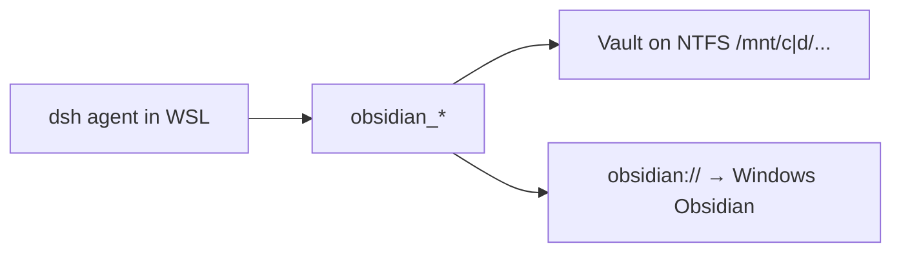

# dsh-wsl-obsidian

[返回分类](../../views/categories/RESEARCH-KNOWLEDGE.md) · [返回首页](../../../README.md)

分析版本：[0d37b05](https://github.com/173787247/dsh-wsl-obsidian/tree/0d37b05d030b265559238e740ea92ba6baf2adff)

<!-- BEGIN META -->
[](https://github.com/173787247/dsh-wsl-obsidian)
<!-- END META -->

> **实现功能**：给 WSL 中的 DSH Agent 提供 Windows Obsidian 笔记库的状态、检索、读写和桌面打开工具。

> **核心亮点**：让已有 Obsidian 库可被 Agent 以专用工具操作，并保留原有文件和双链工作方式；相比通用文件工具增加 vault 发现/路径规则，但不解决内容正确性、同步或冲突。详见[Q01](#research-q01)。

> **风险与缺陷**：safeJoinVault 只验证词法路径，没有 realpath；writeFileSync/appendFileSync 无预期版本或恢复机制。confirm=true 与工具串行声明不足以保护库外 symlink 和 Obsidian 外部编辑。详见[Q03](#research-q03)。

**本文目录**

- [1 插件分析](#detail-section-1)
  - [1.1 用途与适用场景](#detail-section-2)
  - [1.2 能力、流程与成本](#detail-section-3)
  - [1.3 工程亮点](#detail-section-4)
  - [1.4 主要限制](#detail-section-5)
  - [1.5 使用建议](#detail-section-6)
  - [1.6 核查说明与分析版本](#detail-section-7)
- [2 未来设计假设（未验证）](#detail-section-8)
- [3 辅助信息](#detail-section-9)
- [4 研究问题与完整回答](#detail-section-10)
  - [Q01 · 现有 Obsidian 库接入 Agent 的具体任务和相对替代方案是什么？](#detail-section-11)
  - [Q02 · vault 如何确定，列举、搜索、读取与打开经过哪些边界？](#detail-section-12)
  - [Q03 · 路径约束、confirm 参数和写入机制能否保护库外文件与并发编辑？](#detail-section-13)
  - [Q04 · 启动、持续与失败恢复分别需承担什么成本？](#detail-section-14)
  - [Q05 · 在保留文件桥接便利性的同时，如何验证更可靠的写入语义？](#detail-section-15)
  - [Q06 · 当前版本适合怎样试用，哪些用途应避免直接采用？](#detail-section-16)

<a id="detail-section-1"></a>

## 1 插件分析

<a id="detail-section-2"></a>

### 1.1 用途与适用场景

> **用途**：用于对既有 Windows Obsidian 库进行 Agent 辅助整理；知识正确性、同步和覆盖风险仍需人核。详见[Q01](#research-q01)。

通用文件工具或人工 Obsidian 编辑也能操作 Markdown；插件提供专用路径和双链入口，但没有解决文件并发和知识质量。

<a id="detail-section-3"></a>

### 1.2 能力、流程与成本

#### 能力

| 能力 | 主要用途 | 使用条件与边界 |
| --- | --- | --- |
| vault 发现 | 从配置或 Obsidian 文件识别库 | 多库时需用户确认目标 |
| 笔记检索/读取 | 查 .md 正文和双链 | 大库/大文件有数量限制，内容可敏感 |
| 写入/追加 | 更新 vault Markdown | confirm 参数非版本锁，需备份和外部冲突处理 |
| 桌面打开 | 用 URI 唤起 Windows Obsidian | 需 Windows 桌面与 WSL 桥接 |

#### 启动与依赖

| 依赖或条件 | 是否必需 | 用途 | 缺失或不满足时 |
| --- | --- | --- | --- |
| DSH/Node 与 WSL 文件访问 | 必需 | Agent 工具与 NTFS 路径 | 无法桥接 |
| 明确 vaultPath 或可读 obsidian.json | 必需 | 选择目标库 | 自动选库可能错误 |
| Windows Obsidian/URI | 桌面打开需要 | 从 Agent 打开笔记 | 文件操作仍可能可用 |
| 备份和人工确认 | 重要写入需要 | 避免覆盖难恢复 | 冲突可能静默丢失 |

#### 启动步骤

| 步骤 | 执行者与动作 | 成功判据或失败处理 |
| --- | --- | --- |
| 准备 | 用户备份并明确测试 vault 的 NTFS 路径 | status 显示预期库 |
| 读取 | Agent 列/搜/读测试笔记 | 与 Windows 原件一致且明白截断边界 |
| 写入 | 用户核内容，Agent 写新文件 | Obsidian 显示及同步无冲突 |
| 恢复 | 若覆盖/同步异常，从备份回滚 | 原件可恢复并记录原因 |

#### 成本

| 阶段 | 现金与资源成本 | 人工与时间投入 | 已知条件与未知项 |
| --- | --- | --- | --- |
| 首次使用 | Windows Obsidian、WSL/DSH、NTFS vault；金额未知 | 配路径、安装重启、确认库；耗时未知 | 多库自动发现需核 |
| 持续使用 | 文件扫描/模型上下文；资源未知 | 备份、审阅写入及同步；频率未知 | 搜索最多先列 5000 篇 |
| 失败恢复 | 备份或同步历史；金额未知 | 恢复覆盖、去重追加、解决冲突；耗时未知 | 无内建版本/原子写入 |

#### 效果

| 效果项 | 当前证据支持 | 尚不能确定 |
| --- | --- | --- |
| vault 定位与检索 | 显式/配置发现、列表/搜索/读取 | 大库完整率、真实定位节时 |
| 笔记写入 | confirm 参数与文件写入链 | 外部并发/同步下内容保全 |
| 桌面打开 | obsidian:// 和 Windows 桥接 | 真正打开、文件监视与同步成功 |

> **思考**：safeJoinVault 只验证词法路径，没有 realpath；writeFileSync/appendFileSync 无预期版本或恢复机制。confirm=true 与工具串行声明不足以保护库外 symlink 和 Obsidian 外部编辑。详见[Q03](#research-q03)。

<a id="detail-section-4"></a>

### 1.3 工程亮点

> **亮点**：让已有 Obsidian 库可被 Agent 以专用工具操作，并保留原有文件和双链工作方式；相比通用文件工具增加 vault 发现/路径规则，但不解决内容正确性、同步或冲突。详见[Q01](#research-q01)。

让已有 Obsidian 库可被 Agent 以专用工具操作，并保留原有文件和双链工作方式；相比通用文件工具增加 vault 发现/路径规则，但不解决内容正确性、同步或冲突。详见[Q01](#research-q01)。

vault 发现、路径转换和内容操作分层有复用价值；词法路径检查与无版本覆盖限制了可靠写入。详见[Q05](#research-q05)。

<a id="detail-section-5"></a>

### 1.4 主要限制

safeJoinVault 只验证词法路径，没有 realpath；writeFileSync/appendFileSync 无预期版本或恢复机制。confirm=true 与工具串行声明不足以保护库外 symlink 和 Obsidian 外部编辑。详见[Q03](#research-q03)。

<a id="detail-section-6"></a>

### 1.5 使用建议

建议观察，在测试 vault/备份副本先核 status、读写新文件和 Windows 显示；重要共享库暂不自动覆盖。详见[Q06](#research-q06)。

<a id="detail-section-7"></a>

### 1.6 核查说明与分析版本

**核查状态**：已检查源码。

固定源码支撑 vault 发现、文件工具和词法路径检查；符号链接与外部并发风险是源码推导，未在真实宿主复现；改进假设未实现。

- 已检查：作者 README、包清单、源码路径 README.md、package.json、index.js、lib/vault.js、lib/open.js 及固定范围 inventory；组件：仓库根。抽读不冒充完整审计，来源和原文嵌入正式快照时保留。
- 未执行：插件安装、目标代码与测试、真实宿主及模型任务。源码存在不等于运行通过。
- 边界：只读核固定提交 README、package、index.js、lib/vault.js、lib/open.js；未访问用户 vault、执行目标代码/测试或真实宿主；旧 META 仅复用。
- 下一步：隔离库内 symlink 指向库外、双端编辑、同步改写、超过 5000 篇、大文件及打开 URI；核越界、漏检、覆盖、恢复耗时与用户操作量。

**分析版本**

- **仓库**：[173787247/dsh-wsl-obsidian](https://github.com/173787247/dsh-wsl-obsidian)
- **版本号**：0.2.1（[固定提交 0d37b05](https://github.com/173787247/dsh-wsl-obsidian/tree/0d37b05d030b265559238e740ea92ba6baf2adff)）
- **版本日期**：2026-10-01（固定提交日期，北京时间；不是包发布日期）

<a id="detail-section-8"></a>

## 2 未来设计假设（未验证）

<a id="innovation"></a>

未验证方向是以 realpath 约束目标，写入携带已读内容哈希并进行比较、备份和原子替换；用 symlink/双端竞争/中断夹具比较丢失与误拒绝。详见[Q05](#research-q05)。

隔离库内 symlink 指向库外、双端编辑、同步改写、超过 5000 篇、大文件及打开 URI；核越界、漏检、覆盖、恢复耗时与用户操作量。

<a id="detail-section-9"></a>

## 3 辅助信息

<details>
<summary>工程统计与口径</summary>

| 扩展名 | 范围 | 文件数 | 总行 | 代码行 | 注释行 | 字数 |
|---|---|---:|---:|---:|---:|---:|
| .md | source | 5 | 187 | — | — | 955 |
| .js | source | 5 | 875 | 788 | 28 | — |
| .mjs | source | 1 | 104 | 89 | 5 | — |
| .md | example | 2 | 12 | — | — | 12 |
| .js | test | 1 | 164 | 145 | 1 | — |

</details>

**活跃度**

Issue 活跃度数据暂未获取（查询日期：2026-10-21），可前往 [GitHub Issues](https://github.com/173787247/dsh-wsl-obsidian/issues) 查看。

<a id="detail-section-10"></a>

## 4 研究问题与完整回答

**插件研究总目标**：dsh-wsl-obsidian 如何桥接 WSL Agent 与 Windows Obsidian vault，写入的范围和并发安全边界是什么？

<a id="research-q01"></a>

<a id="detail-section-11"></a>

### Q01 · 现有 Obsidian 库接入 Agent 的具体任务和相对替代方案是什么？

**研究主题**：场景与需求、贡献与相对优势

#### 完整回答

目标是让 WSL 中的 DSH Agent 在已有 Windows Obsidian vault 中列出、搜索、读取、写入、追加笔记，并可通过 URI 让桌面端打开。合格交付应是对明确 vault 的正确笔记完成操作、无越界读取/覆盖，且 Windows 端能看到和同步；源文件桥接不能证明笔记知识准确或同步成功。相对直接给 Agent 通用文件工具或人工在 Obsidian 复制粘贴，专用工具提供 vault 发现、相对路径与 Markdown/双链语义，降低定位步骤；并未新增检索算法或同步机制。作者称它是 dsh-wsl-kit 可选 companion，不在 daily 集合。

#### 证据与依据

**依据 1 · 作者声明**：[README.md:1-20](https://github.com/173787247/dsh-wsl-obsidian/blob/0d37b05d030b265559238e740ea92ba6baf2adff/README.md#L1-L20)

作者定义 WSL 到 Windows vault 的可选桥接。

<details>
<summary>查看原文（20行）</summary>

````text
# dsh-wsl-obsidian
> **Install set:** optional companion to [dsh-wsl-kit](https://github.com/173787247/dsh-wsl-kit). Not in `KIT_SET=daily`. Fault tree: [TROUBLESHOOTING.md](https://github.com/173787247/dsh-wsl-kit/blob/master/docs/TROUBLESHOOTING.md).

DeepSeek Harness plugin: **WSL agent ↔ Windows Obsidian vault** — `obsidian_status` / `open` / `list` / `search` / `read` / `write` / `append`.

Standalone MIT plugin under **[dsh-wsl-kit](https://github.com/173787247/dsh-wsl-kit)** (optional; not shipped in `install.sh` by default).

[中文说明 → README.zh.md](./README.zh.md)

## Where it sits



Keep the vault on **Windows NTFS**. Opening a vault from `\\wsl$\…` breaks Obsidian’s file watcher.

````

</details>

**依据 2 · 作者声明**：[README.md:31-43](https://github.com/173787247/dsh-wsl-obsidian/blob/0d37b05d030b265559238e740ea92ba6baf2adff/README.md#L31-L43)

工具清单和 vault 相对路径规则。

<details>
<summary>查看原文（13行）</summary>

```text
## Tools

| Tool | Role |
|------|------|
| `obsidian_status` | Resolve vault (`vaultPath` or `%APPDATA%\obsidian\obsidian.json`), path kind, `Obsidian.exe` |
| `obsidian_list` | List `.md` notes |
| `obsidian_search` | Case-insensitive substring search |
| `obsidian_read` | Read note |
| `obsidian_write` | Create / overwrite note |
| `obsidian_append` | Append to note |
| `obsidian_open` | `obsidian://open?vault=…&file=…` via PowerShell (WSL only) |

Paths are **vault-relative** (`Inbox/Note.md`). Absolute / `../` paths are rejected.
```

</details>

**依据 3 · 源码核查**：[index.js:20-39](https://github.com/173787247/dsh-wsl-obsidian/blob/0d37b05d030b265559238e740ea92ba6baf2adff/index.js#L20-L39)

插件注册提示与 vault 配置接线。

<details>
<summary>查看原文（20行）</summary>

```text
export function apply(ctx, config = {}) {
  const timeoutMs = positive(config.timeoutMs, 20_000);
  const excludeDirs = Array.isArray(config.excludeDirs) && config.excludeDirs.length
    ? config.excludeDirs.map(String)
    : DEFAULT_EXCLUDE;
  const wsl = detectWsl();

  ctx.systemPrompt.section({
    name: "tool:obsidian",
    order: 119,
    text: [
      "Use obsidian_* tools for the local Obsidian vault on Windows NTFS (prefer /mnt/<drive>/… paths).",
      "Keep the vault on Windows filesystem, not under the Linux home disk, so the Windows Obsidian app can watch files.",
      "obsidian_open launches the Windows Obsidian UI via obsidian:// — Obsidian must be installed on Windows.",
      "obsidian_write / obsidian_append require confirm=true. Use obsidian_wikilinks or read with resolveLinks to follow [[links]].",
      "Do not invent vault paths; call obsidian_status first if unsure.",
    ].join(" "),
  });

  const vaultDeps = () => resolveVaultConfig(config);
```

</details>

#### 缺口

- 未用真实 Obsidian vault 与用户任务评估
  **影响**：不能证明整理效率、知识质量或同步效果
  **进一步探讨**：在测试 vault 对比通用文件工具和人工操作，记录定位与纠错成本

<a id="research-q02"></a>

<a id="detail-section-12"></a>

### Q02 · vault 如何确定，列举、搜索、读取与打开经过哪些边界？

**研究主题**：功能与机制

#### 完整回答

优先接受显式 vaultPath；否则从 Windows Obsidian 配置中选 open 标记的库或首库，再换算 WSL 路径。status 显示来源、路径类型和存在性；列表按目录递归仅取 .md 并排除设定目录，默认最多 200；全文搜索先列最多 5000 篇，再按大小上限和大小写不敏感子串读取、提取片段。read 以 vault 相对路径读取，双链解析可选；open 由 obsidian:// URI 和 PowerShell/Windows 桥接实现。自动选择首库有误写目标风险，status 的存在标记也非用户确认。搜索超过 5000 篇或文件大小限制会漏结果，因此无命中不等于库中不存在。

#### 证据与依据

**依据 1 · 源码核查**：[lib/vault.js:55-133](https://github.com/173787247/dsh-wsl-obsidian/blob/0d37b05d030b265559238e740ea92ba6baf2adff/lib/vault.js#L55-L133)

自动发现和显式配置优先级。

<details>
<summary>查看原文（79行）</summary>

```text
export function discoverVaultFromObsidianJson({ env = process.env, exists = existsSync, read = readFileSync } = {}) {
  for (const p of candidateObsidianJsonPaths({ env, exists })) {
    if (!exists(p)) continue;
    let raw;
    try {
      raw = read(p, "utf8");
    } catch {
      continue;
    }
    const vaults = parseObsidianJson(raw);
    if (!vaults.length) continue;
    const chosen = vaults.find((v) => v.open) || vaults[0];
    const linux = toLinuxPath(chosen.path);
    if (!linux.ok) continue;
    return {
      ok: true,
      vaultPath: linux.linux,
      vaultWindowsPath: chosen.path,
      vaultName: basenamePath(chosen.path),
      source: p,
      kind: linux.kind,
    };
  }
  return { ok: false, error: "obsidian.json not found or has no vaults" };
}

export function resolveVaultConfig(config = {}, deps = {}) {
  const { exists = existsSync } = deps;
  const explicit = String(config.vaultPath || "").trim();
  if (explicit) {
    // Prefer a path that exists on this runtime (native Windows tests vs WSL /mnt).
    if (exists(explicit)) {
      const asWin = /^[a-zA-Z]:[\\/]/.test(explicit) || explicit.startsWith("\\\\");
      const win = asWin ? explicit.replace(/\//g, "\\") : (toWindowsPath(explicit).windows || explicit);
      const kind = explicit.replace(/\\/g, "/").startsWith("/mnt/") || asWin
        ? "drvfs"
        : explicit.startsWith("/")
          ? "linux"
          : "drvfs";
      return {
        ok: true,
        vaultPath: explicit,
        vaultWindowsPath: win,
        vaultName: String(config.vaultName || basenamePath(explicit)),
        source: "config",
        kind,
      };
    }
    const n = normalizeVaultRoot(explicit);
    if (!n.ok) return n;
    if (exists(n.linux)) {
      const win = n.windows || toWindowsPath(n.linux);
      return {
        ok: true,
        vaultPath: n.linux,
        vaultWindowsPath: typeof win === "string" ? win : win.windows,
        vaultName: String(config.vaultName || basenamePath(n.linux)),
        source: "config",
        kind: n.kind,
      };
    }
    const win = n.windows || toWindowsPath(n.linux);
    return {
      ok: true,
      vaultPath: n.linux,
      vaultWindowsPath: typeof win === "string" ? win : win.windows,
      vaultName: String(config.vaultName || basenamePath(n.linux)),
      source: "config",
      kind: n.kind,
    };
  }
  const discovered = discoverVaultFromObsidianJson(deps);
  if (!discovered.ok) return discovered;
  // If discovered Linux mount does not exist (running outside WSL), try Windows path.
  if (discovered.vaultWindowsPath && !exists(discovered.vaultPath) && exists(discovered.vaultWindowsPath)) {
    discovered.vaultPath = discovered.vaultWindowsPath;
  }
  if (config.vaultName) discovered.vaultName = String(config.vaultName);
  return discovered;
```

</details>

**依据 2 · 源码核查**：[lib/vault.js:181-240](https://github.com/173787247/dsh-wsl-obsidian/blob/0d37b05d030b265559238e740ea92ba6baf2adff/lib/vault.js#L181-L240)

列表与搜索的数量、大小和子串限制。

<details>
<summary>查看原文（60行）</summary>

```text
export function listNotes(vaultRoot, { prefix = "", excludeDirs = DEFAULT_EXCLUDE, limit = 200 } = {}) {
  const root = resolve(vaultRoot);
  if (!existsSync(root)) return { ok: false, error: `vault not found: ${vaultRoot}` };
  const exclude = new Set((excludeDirs || DEFAULT_EXCLUDE).map(String));
  const out = [];
  const start = prefix ? safeJoinVault(root, prefix) : { ok: true, absolute: root, relative: "" };
  if (!start.ok) return start;

  function walk(dir, relBase) {
    if (out.length >= limit) return;
    let entries;
    try {
      entries = readdirSync(dir, { withFileTypes: true });
    } catch (err) {
      return;
    }
    for (const ent of entries) {
      if (out.length >= limit) break;
      if (exclude.has(ent.name)) continue;
      const rel = relBase ? `${relBase}/${ent.name}` : ent.name;
      const abs = join(dir, ent.name);
      if (ent.isDirectory()) {
        walk(abs, rel);
      } else if (ent.isFile() && /\.md$/i.test(ent.name)) {
        out.push(rel.replace(/\\/g, "/"));
      }
    }
  }

  walk(start.absolute, start.relative);
  out.sort((a, b) => a.localeCompare(b));
  return { ok: true, notes: out, truncated: out.length >= limit };
}

export function searchNotes(vaultRoot, query, { excludeDirs = DEFAULT_EXCLUDE, limit = 50, maxBytes = 512_000 } = {}) {
  const q = String(query || "").trim();
  if (!q) return { ok: false, error: "empty query" };
  const listed = listNotes(vaultRoot, { excludeDirs, limit: 5000 });
  if (!listed.ok) return listed;
  const needle = q.toLowerCase();
  const hits = [];
  for (const rel of listed.notes) {
    if (hits.length >= limit) break;
    const abs = join(vaultRoot, rel);
    let text;
    try {
      const st = statSync(abs);
      if (st.size > maxBytes) continue;
      text = readFileSync(abs, "utf8");
    } catch {
      continue;
    }
    const idx = text.toLowerCase().indexOf(needle);
    if (idx < 0 && !rel.toLowerCase().includes(needle)) continue;
    const lineStart = text.lastIndexOf("\n", Math.max(0, idx)) + 1;
    const lineEnd = text.indexOf("\n", idx);
    const snippet = text.slice(lineStart, lineEnd < 0 ? lineStart + 160 : lineEnd).trim().slice(0, 160);
    hits.push({ path: rel, snippet: snippet || `(filename match: ${rel})` });
  }
  return { ok: true, query: q, hits, truncated: hits.length >= limit };
```

</details>

**依据 3 · 源码核查**：[lib/vault.js:243-257](https://github.com/173787247/dsh-wsl-obsidian/blob/0d37b05d030b265559238e740ea92ba6baf2adff/lib/vault.js#L243-L257)

读取与可选双链解析。

<details>
<summary>查看原文（15行）</summary>

```text
export function readNote(vaultRoot, relPath, { resolveLinks = false, excludeDirs = DEFAULT_EXCLUDE } = {}) {
  const rel = ensureMarkdownRel(relPath);
  const joined = safeJoinVault(vaultRoot, rel);
  if (!joined.ok) return joined;
  if (!existsSync(joined.absolute)) return { ok: false, error: `not found: ${joined.relative}` };
  try {
    const content = readFileSync(joined.absolute, "utf8");
    const out = { ok: true, path: joined.relative, content, bytes: Buffer.byteLength(content, "utf8") };
    if (resolveLinks) {
      out.links = resolveWikilinks(vaultRoot, content, { excludeDirs });
    }
    return out;
  } catch (err) {
    return { ok: false, error: err instanceof Error ? err.message : String(err) };
  }
```

</details>

**依据 4 · 源码核查**：[lib/open.js:4-14](https://github.com/173787247/dsh-wsl-obsidian/blob/0d37b05d030b265559238e740ea92ba6baf2adff/lib/open.js#L4-L14)

桌面 URI 的构造。

<details>
<summary>查看原文（11行）</summary>

```text
/** Build obsidian://open URI. file is vault-relative (with or without .md). */
export function buildOpenUri({ vaultName, file } = {}) {
  const vault = String(vaultName || "").trim();
  if (!vault) return { ok: false, error: "missing vaultName" };
  const params = new URLSearchParams();
  params.set("vault", vault);
  const f = String(file || "").trim().replace(/\\/g, "/").replace(/^\/+/, "");
  if (f) params.set("file", f.replace(/\.md$/i, ""));
  return { ok: true, uri: `obsidian://open?${params.toString()}` };
}

```

</details>

#### 缺口

- 未在含大库、非典型路径与 Windows 桌面环境验证
  **影响**：无法给搜索完整率和打开成功率
  **进一步探讨**：用多库、大文件、超过 5000 篇及 WSL 路径夹具核对

<a id="research-q03"></a>

<a id="detail-section-13"></a>

### Q03 · 路径约束、confirm 参数和写入机制能否保护库外文件与并发编辑？

**研究主题**：缺陷与关键质疑

#### 完整回答

safeJoinVault 拒绝绝对路径和词法逃逸，保护了 ../ 等直接越界；但仅使用 resolve/relative 字符串，没有解析最终路径的符号链接。read/write/append 均把该结果交给 Node 文件 API，若库内路径穿过指向库外的符号链接，静态数据流存在库外读写可能。write 工具需要 confirm=true、声明 isConcurrencySafe=false，可降低模型并发工具调用；然而 confirm 是调用参数，不能证明用户逐笔授权，也不处理 Obsidian 或同步进程的外部编辑。writeFileSync 直接覆盖，无预期版本、备份或原子替换；append 也无冲突/重复检测。上述为源码边界，未在隔离环境实测具体 symlink 与竞争结果。

#### 证据与依据

**依据 1 · 源码核查**：[lib/vault.js:146-171](https://github.com/173787247/dsh-wsl-obsidian/blob/0d37b05d030b265559238e740ea92ba6baf2adff/lib/vault.js#L146-L171)

词法路径包含检查，没有 realpath。

<details>
<summary>查看原文（26行）</summary>

```text
export function safeJoinVault(vaultRoot, relPath) {
  const root = resolve(String(vaultRoot));
  const raw = String(relPath ?? "");
  if (raw.includes("\0")) return { ok: false, error: "invalid path" };
  const rel = raw.replace(/\\/g, "/");
  if (!rel) return { ok: false, error: "empty relative path" };
  // Absolute paths are rejected rather than re-rooted inside the vault. A caller
  // that passes one is working from the wrong contract, and silently rewriting
  // "/etc/passwd" to "etc/passwd.md" reports "not found" for what is really a
  // misuse. The check runs after backslash normalization, so it covers POSIX
  // ("/x"), Windows drive ("C:/x") and UNC ("//server/share") forms alike.
  if (rel.startsWith("/") || /^[a-zA-Z]:\//.test(rel)) {
    return { ok: false, error: "absolute paths not allowed" };
  }
  const abs = resolve(root, rel);
  const relCheck = relative(root, abs);
  if (relCheck.startsWith("..") || relCheck === ".." || abs === root && rel.includes("..")) {
    return { ok: false, error: "path escapes vault" };
  }
  if (!abs.startsWith(root + sep) && abs !== root) {
    // On Windows resolve may change casing; compare lowercase
    if (abs.toLowerCase() !== root.toLowerCase() && !abs.toLowerCase().startsWith(root.toLowerCase() + sep)) {
      return { ok: false, error: "path escapes vault" };
    }
  }
  return { ok: true, absolute: abs, relative: relCheck.replace(/\\/g, "/") || rel };
```

</details>

**依据 2 · 源码核查**：[lib/vault.js:243-257](https://github.com/173787247/dsh-wsl-obsidian/blob/0d37b05d030b265559238e740ea92ba6baf2adff/lib/vault.js#L243-L257)

读取直接使用检查后的路径。

<details>
<summary>查看原文（15行）</summary>

```text
export function readNote(vaultRoot, relPath, { resolveLinks = false, excludeDirs = DEFAULT_EXCLUDE } = {}) {
  const rel = ensureMarkdownRel(relPath);
  const joined = safeJoinVault(vaultRoot, rel);
  if (!joined.ok) return joined;
  if (!existsSync(joined.absolute)) return { ok: false, error: `not found: ${joined.relative}` };
  try {
    const content = readFileSync(joined.absolute, "utf8");
    const out = { ok: true, path: joined.relative, content, bytes: Buffer.byteLength(content, "utf8") };
    if (resolveLinks) {
      out.links = resolveWikilinks(vaultRoot, content, { excludeDirs });
    }
    return out;
  } catch (err) {
    return { ok: false, error: err instanceof Error ? err.message : String(err) };
  }
```

</details>

**依据 3 · 源码核查**：[lib/vault.js:300-325](https://github.com/173787247/dsh-wsl-obsidian/blob/0d37b05d030b265559238e740ea92ba6baf2adff/lib/vault.js#L300-L325)

写入和追加直接操作检查后的路径。

<details>
<summary>查看原文（26行）</summary>

```text
export function writeNote(vaultRoot, relPath, content, { createDirs = true } = {}) {
  const rel = ensureMarkdownRel(relPath);
  const joined = safeJoinVault(vaultRoot, rel);
  if (!joined.ok) return joined;
  try {
    if (createDirs) mkdirSync(dirname(joined.absolute), { recursive: true });
    writeFileSync(joined.absolute, String(content ?? ""), "utf8");
    return { ok: true, path: joined.relative, bytes: Buffer.byteLength(String(content ?? ""), "utf8") };
  } catch (err) {
    return { ok: false, error: err instanceof Error ? err.message : String(err) };
  }
}

export function appendNote(vaultRoot, relPath, content) {
  const rel = ensureMarkdownRel(relPath);
  const joined = safeJoinVault(vaultRoot, rel);
  if (!joined.ok) return joined;
  try {
    mkdirSync(dirname(joined.absolute), { recursive: true });
    const chunk = String(content ?? "");
    appendFileSync(joined.absolute, chunk, "utf8");
    return { ok: true, path: joined.relative, appended: Buffer.byteLength(chunk, "utf8") };
  } catch (err) {
    return { ok: false, error: err instanceof Error ? err.message : String(err) };
  }
}
```

</details>

**依据 4 · 源码核查**：[index.js:199-255](https://github.com/173787247/dsh-wsl-obsidian/blob/0d37b05d030b265559238e740ea92ba6baf2adff/index.js#L199-L255)

confirm=true 与 isConcurrencySafe=false 的工具端门槛。

<details>
<summary>查看原文（57行）</summary>

```text
  ctx.tools.register({
    name: "obsidian_write",
    description: "Create or overwrite a Markdown note (vault-relative path). Requires confirm=true.",
    parameters: {
      type: "object",
      additionalProperties: false,
      required: ["path", "content", "confirm"],
      properties: {
        path: { type: "string" },
        content: { type: "string" },
        confirm: { type: "boolean", description: "Must be true to write." },
      },
    },
    output: {
      schema: { type: "object", additionalProperties: true },
      render: (_a, v) => [{ type: "text", text: formatWrite(v) }],
    },
    timeoutMs,
    isConcurrencySafe: () => false,
    async execute(args) {
      if (args?.confirm !== true) {
        return { ok: false, error: "obsidian_write refused: pass confirm=true" };
      }
      const vault = vaultDeps();
      if (!vault.ok) return vault;
      return writeNote(vault.vaultPath, args?.path, args?.content);
    },
    presentCall: () => ({ card: "generic", title: "Obsidian write" }),
    presentResult: (_a, r) => ({ card: "generic", title: "Obsidian write", content: r.content }),
  });

  ctx.tools.register({
    name: "obsidian_append",
    description: "Append text to a Markdown note (creates parent dirs / file if needed). Requires confirm=true.",
    parameters: {
      type: "object",
      additionalProperties: false,
      required: ["path", "content", "confirm"],
      properties: {
        path: { type: "string" },
        content: { type: "string" },
        confirm: { type: "boolean", description: "Must be true to append." },
      },
    },
    output: {
      schema: { type: "object", additionalProperties: true },
      render: (_a, v) => [{ type: "text", text: formatAppend(v) }],
    },
    timeoutMs,
    isConcurrencySafe: () => false,
    async execute(args) {
      if (args?.confirm !== true) {
        return { ok: false, error: "obsidian_append refused: pass confirm=true" };
      }
      const vault = vaultDeps();
      if (!vault.ok) return vault;
      return appendNote(vault.vaultPath, args?.path, args?.content);
```

</details>

#### 缺口

- 未用符号链接与双端并发编辑复现
  **影响**：不能量化越界或覆盖影响，也不能宣称宿主串行锁可覆盖外部编辑
  **进一步探讨**：在复制 vault 中构造库内指向库外链接、外部同步并发与断电失败夹具

<a id="research-q04"></a>

<a id="detail-section-14"></a>

### Q04 · 启动、持续与失败恢复分别需承担什么成本？

**研究主题**：依赖、兼容与流程、效果与总成本

#### 完整回答

首次需 Windows Obsidian、NTFS vault、WSL/DSH 环境、明确 vaultPath 或能读取 obsidian.json，安装后重启并新建会话；Node >=18，README 声称 DSH >=0.1.2。笔记数据留在本地路径，但 Agent 读取正文会消耗模型上下文和隐私审阅；扫描要遍历文件，全文搜索最多尝试 5000 篇，库规模越大 IO/人工核查越重。持续写入须备份、处理 Obsidian 同步和外部并发；失败时要从历史/备份恢复覆盖内容，重复追加也要人工去重。源码没有自动备份和冲突恢复，金额、扫描时长、token 与人工修复成本未测。

#### 证据与依据

**依据 1 · 作者声明**：[README.md:21-29](https://github.com/173787247/dsh-wsl-obsidian/blob/0d37b05d030b265559238e740ea92ba6baf2adff/README.md#L21-L29)

作者列出的版本与 Windows 桌面前提。

```text
## Compatibility

| Field | Value |
|-------|-------|
| **Plugin** | `dsh-wsl-obsidian` **0.2.1** |
| **Minimum dsh** | ≥ **0.1.2** |
| **Latest verified** | See [dsh-wsl-kit Compatibility](https://github.com/173787247/dsh-wsl-kit#compatibility-2026-09) (currently **`0.2.0-rc.2`**) — single source of truth for the suite |
| **Kit set** | optional (not in `daily`) |
| **Obsidian** | Windows desktop app (install from [obsidian.md](https://obsidian.md)) |
```

**依据 2 · 作者声明**：[README.md:45-71](https://github.com/173787247/dsh-wsl-obsidian/blob/0d37b05d030b265559238e740ea92ba6baf2adff/README.md#L45-L71)

vault 配置、安装/重启和 NTFS 建议。

<details>
<summary>查看原文（27行）</summary>

````text
## Config

```yaml
- id: dsh-wsl-obsidian
  name: dsh-wsl-obsidian
  config:
    enabled: true
    vaultPath: "/mnt/d/Notes/MyVault"   # preferred
    vaultName: "MyVault"                # for obsidian://
    timeoutMs: 20000
```

If `vaultPath` is omitted, the plugin reads Windows `obsidian.json` through `/mnt/c/Users/…/AppData/Roaming/obsidian/`.

## Install

```sh
dsh plugin --profile web add github:173787247/dsh-wsl-obsidian
```

Restart `dsh web`, open a **new** session, run `obsidian_status`.

## Layout recommendation

1. Install Obsidian on **Windows**.
2. Create/open the vault under `C:\` or `D:\` (not inside the Linux distro disk).
3. From WSL use `/mnt/c/...` or `/mnt/d/...` as `vaultPath`.
````

</details>

**依据 3 · 源码核查**：[package.json:14-30](https://github.com/173787247/dsh-wsl-obsidian/blob/0d37b05d030b265559238e740ea92ba6baf2adff/package.json#L14-L30)

Node、bundle 与打包声明。

<details>
<summary>查看原文（17行）</summary>

```text
  "type": "module",
  "main": "index.js",
  "engines": { "node": ">=18" },
  "scripts": { "test": "node --test test/*.test.js" },
  "files": [
    "index.js",
    "lib",
    "cordis.patch.yml",
    "README.md",
    "README.zh.md",
    "LICENSE",
    "CHANGELOG.md",
    "CONTRIBUTING.md",
    "SECURITY.md"
  ],
  "keywords": ["dsh-plugin", "deepseek-harness", "wsl", "obsidian"],
  "dsh": { "bundle": { "patch": "./cordis.patch.yml" } }
```

</details>

**依据 4 · 源码核查**：[lib/vault.js:181-240](https://github.com/173787247/dsh-wsl-obsidian/blob/0d37b05d030b265559238e740ea92ba6baf2adff/lib/vault.js#L181-L240)

扫描限制与正文读取。

<details>
<summary>查看原文（60行）</summary>

```text
export function listNotes(vaultRoot, { prefix = "", excludeDirs = DEFAULT_EXCLUDE, limit = 200 } = {}) {
  const root = resolve(vaultRoot);
  if (!existsSync(root)) return { ok: false, error: `vault not found: ${vaultRoot}` };
  const exclude = new Set((excludeDirs || DEFAULT_EXCLUDE).map(String));
  const out = [];
  const start = prefix ? safeJoinVault(root, prefix) : { ok: true, absolute: root, relative: "" };
  if (!start.ok) return start;

  function walk(dir, relBase) {
    if (out.length >= limit) return;
    let entries;
    try {
      entries = readdirSync(dir, { withFileTypes: true });
    } catch (err) {
      return;
    }
    for (const ent of entries) {
      if (out.length >= limit) break;
      if (exclude.has(ent.name)) continue;
      const rel = relBase ? `${relBase}/${ent.name}` : ent.name;
      const abs = join(dir, ent.name);
      if (ent.isDirectory()) {
        walk(abs, rel);
      } else if (ent.isFile() && /\.md$/i.test(ent.name)) {
        out.push(rel.replace(/\\/g, "/"));
      }
    }
  }

  walk(start.absolute, start.relative);
  out.sort((a, b) => a.localeCompare(b));
  return { ok: true, notes: out, truncated: out.length >= limit };
}

export function searchNotes(vaultRoot, query, { excludeDirs = DEFAULT_EXCLUDE, limit = 50, maxBytes = 512_000 } = {}) {
  const q = String(query || "").trim();
  if (!q) return { ok: false, error: "empty query" };
  const listed = listNotes(vaultRoot, { excludeDirs, limit: 5000 });
  if (!listed.ok) return listed;
  const needle = q.toLowerCase();
  const hits = [];
  for (const rel of listed.notes) {
    if (hits.length >= limit) break;
    const abs = join(vaultRoot, rel);
    let text;
    try {
      const st = statSync(abs);
      if (st.size > maxBytes) continue;
      text = readFileSync(abs, "utf8");
    } catch {
      continue;
    }
    const idx = text.toLowerCase().indexOf(needle);
    if (idx < 0 && !rel.toLowerCase().includes(needle)) continue;
    const lineStart = text.lastIndexOf("\n", Math.max(0, idx)) + 1;
    const lineEnd = text.indexOf("\n", idx);
    const snippet = text.slice(lineStart, lineEnd < 0 ? lineStart + 160 : lineEnd).trim().slice(0, 160);
    hits.push({ path: rel, snippet: snippet || `(filename match: ${rel})` });
  }
  return { ok: true, query: q, hits, truncated: hits.length >= limit };
```

</details>

**依据 5 · 源码核查**：[lib/vault.js:300-325](https://github.com/173787247/dsh-wsl-obsidian/blob/0d37b05d030b265559238e740ea92ba6baf2adff/lib/vault.js#L300-L325)

写入无版本/备份。

<details>
<summary>查看原文（26行）</summary>

```text
export function writeNote(vaultRoot, relPath, content, { createDirs = true } = {}) {
  const rel = ensureMarkdownRel(relPath);
  const joined = safeJoinVault(vaultRoot, rel);
  if (!joined.ok) return joined;
  try {
    if (createDirs) mkdirSync(dirname(joined.absolute), { recursive: true });
    writeFileSync(joined.absolute, String(content ?? ""), "utf8");
    return { ok: true, path: joined.relative, bytes: Buffer.byteLength(String(content ?? ""), "utf8") };
  } catch (err) {
    return { ok: false, error: err instanceof Error ? err.message : String(err) };
  }
}

export function appendNote(vaultRoot, relPath, content) {
  const rel = ensureMarkdownRel(relPath);
  const joined = safeJoinVault(vaultRoot, rel);
  if (!joined.ok) return joined;
  try {
    mkdirSync(dirname(joined.absolute), { recursive: true });
    const chunk = String(content ?? "");
    appendFileSync(joined.absolute, chunk, "utf8");
    return { ok: true, path: joined.relative, appended: Buffer.byteLength(chunk, "utf8") };
  } catch (err) {
    return { ok: false, error: err instanceof Error ? err.message : String(err) };
  }
}
```

</details>

#### 缺口

- 未测真实库规模、模型 token 与冲突恢复
  **影响**：无法计算每次合格整理的总成本
  **进一步探讨**：用复制库计时/计 IO 与 token，并模拟同步冲突后恢复

<a id="research-q05"></a>

<a id="detail-section-15"></a>

### Q05 · 在保留文件桥接便利性的同时，如何验证更可靠的写入语义？

**研究主题**：工程质量与复用、新假设与验证

#### 完整回答

路径发现、相对路径校验和读写工具分层是可借鉴的接线，但路径授权应基于 realpath/父目录实际路径并明确符号链接政策。未验证的改进是假设写入必须携带上次读取的内容哈希/版本，在提交时比较并以临时文件原子替换，同时保留可恢复备份；外部编辑冲突则拒绝覆盖，交给用户合并。与直接备份后覆盖相比，它可能降低静默丢失，但也会增加冲突提示和重试。最小验证对库外 symlink、用户与 Agent 同时编辑、同步客户端改写、写入中断及重复追加逐一比较越界率、丢字节、恢复耗时与误拒绝。该方案没有在当前插件实现。

#### 证据与依据

**依据 1 · 源码核查**：[lib/vault.js:146-171](https://github.com/173787247/dsh-wsl-obsidian/blob/0d37b05d030b265559238e740ea92ba6baf2adff/lib/vault.js#L146-L171)

路径授权目前只做词法比较。

<details>
<summary>查看原文（26行）</summary>

```text
export function safeJoinVault(vaultRoot, relPath) {
  const root = resolve(String(vaultRoot));
  const raw = String(relPath ?? "");
  if (raw.includes("\0")) return { ok: false, error: "invalid path" };
  const rel = raw.replace(/\\/g, "/");
  if (!rel) return { ok: false, error: "empty relative path" };
  // Absolute paths are rejected rather than re-rooted inside the vault. A caller
  // that passes one is working from the wrong contract, and silently rewriting
  // "/etc/passwd" to "etc/passwd.md" reports "not found" for what is really a
  // misuse. The check runs after backslash normalization, so it covers POSIX
  // ("/x"), Windows drive ("C:/x") and UNC ("//server/share") forms alike.
  if (rel.startsWith("/") || /^[a-zA-Z]:\//.test(rel)) {
    return { ok: false, error: "absolute paths not allowed" };
  }
  const abs = resolve(root, rel);
  const relCheck = relative(root, abs);
  if (relCheck.startsWith("..") || relCheck === ".." || abs === root && rel.includes("..")) {
    return { ok: false, error: "path escapes vault" };
  }
  if (!abs.startsWith(root + sep) && abs !== root) {
    // On Windows resolve may change casing; compare lowercase
    if (abs.toLowerCase() !== root.toLowerCase() && !abs.toLowerCase().startsWith(root.toLowerCase() + sep)) {
      return { ok: false, error: "path escapes vault" };
    }
  }
  return { ok: true, absolute: abs, relative: relCheck.replace(/\\/g, "/") || rel };
```

</details>

**依据 2 · 源码核查**：[lib/vault.js:300-325](https://github.com/173787247/dsh-wsl-obsidian/blob/0d37b05d030b265559238e740ea92ba6baf2adff/lib/vault.js#L300-L325)

当前写入无预期版本或原子步骤。

<details>
<summary>查看原文（26行）</summary>

```text
export function writeNote(vaultRoot, relPath, content, { createDirs = true } = {}) {
  const rel = ensureMarkdownRel(relPath);
  const joined = safeJoinVault(vaultRoot, rel);
  if (!joined.ok) return joined;
  try {
    if (createDirs) mkdirSync(dirname(joined.absolute), { recursive: true });
    writeFileSync(joined.absolute, String(content ?? ""), "utf8");
    return { ok: true, path: joined.relative, bytes: Buffer.byteLength(String(content ?? ""), "utf8") };
  } catch (err) {
    return { ok: false, error: err instanceof Error ? err.message : String(err) };
  }
}

export function appendNote(vaultRoot, relPath, content) {
  const rel = ensureMarkdownRel(relPath);
  const joined = safeJoinVault(vaultRoot, rel);
  if (!joined.ok) return joined;
  try {
    mkdirSync(dirname(joined.absolute), { recursive: true });
    const chunk = String(content ?? "");
    appendFileSync(joined.absolute, chunk, "utf8");
    return { ok: true, path: joined.relative, appended: Buffer.byteLength(chunk, "utf8") };
  } catch (err) {
    return { ok: false, error: err instanceof Error ? err.message : String(err) };
  }
}
```

</details>

**依据 3 · 源码核查**：[index.js:199-255](https://github.com/173787247/dsh-wsl-obsidian/blob/0d37b05d030b265559238e740ea92ba6baf2adff/index.js#L199-L255)

工具确认参数及串行声明。

<details>
<summary>查看原文（57行）</summary>

```text
  ctx.tools.register({
    name: "obsidian_write",
    description: "Create or overwrite a Markdown note (vault-relative path). Requires confirm=true.",
    parameters: {
      type: "object",
      additionalProperties: false,
      required: ["path", "content", "confirm"],
      properties: {
        path: { type: "string" },
        content: { type: "string" },
        confirm: { type: "boolean", description: "Must be true to write." },
      },
    },
    output: {
      schema: { type: "object", additionalProperties: true },
      render: (_a, v) => [{ type: "text", text: formatWrite(v) }],
    },
    timeoutMs,
    isConcurrencySafe: () => false,
    async execute(args) {
      if (args?.confirm !== true) {
        return { ok: false, error: "obsidian_write refused: pass confirm=true" };
      }
      const vault = vaultDeps();
      if (!vault.ok) return vault;
      return writeNote(vault.vaultPath, args?.path, args?.content);
    },
    presentCall: () => ({ card: "generic", title: "Obsidian write" }),
    presentResult: (_a, r) => ({ card: "generic", title: "Obsidian write", content: r.content }),
  });

  ctx.tools.register({
    name: "obsidian_append",
    description: "Append text to a Markdown note (creates parent dirs / file if needed). Requires confirm=true.",
    parameters: {
      type: "object",
      additionalProperties: false,
      required: ["path", "content", "confirm"],
      properties: {
        path: { type: "string" },
        content: { type: "string" },
        confirm: { type: "boolean", description: "Must be true to append." },
      },
    },
    output: {
      schema: { type: "object", additionalProperties: true },
      render: (_a, v) => [{ type: "text", text: formatAppend(v) }],
    },
    timeoutMs,
    isConcurrencySafe: () => false,
    async execute(args) {
      if (args?.confirm !== true) {
        return { ok: false, error: "obsidian_append refused: pass confirm=true" };
      }
      const vault = vaultDeps();
      if (!vault.ok) return vault;
      return appendNote(vault.vaultPath, args?.path, args?.content);
```

</details>

#### 缺口

- 哈希/原子替换及备份方案未实现或比较
  **影响**：不能记作现有安全性或低成本收益
  **进一步探讨**：隔离原型用固定竞争夹具比较丢失、误拒绝和恢复时间

<a id="research-q06"></a>

<a id="detail-section-16"></a>

### Q06 · 当前版本适合怎样试用，哪些用途应避免直接采用？

**研究主题**：采用判断

#### 完整回答

建议仅在明确指定的测试 vault 或备份副本中试用：先用 status 确认路径和库名，读一篇测试笔记，向新文件写入，再从 Windows Obsidian 确认显示与同步。重要共享库或正被同步/编辑的笔记不宜让 Agent 直接覆盖；写入前人工确认目标、备份和内容，检查库内符号链接。没有真实宿主/目标测试运行证据，不能把源码中 confirm 与路径检查等同于安全完成。采用结论为 observe，待 symlink 边界和并发覆盖夹具通过，再考虑更广试用。

#### 证据与依据

**依据 1 · 源码核查**：[lib/vault.js:146-171](https://github.com/173787247/dsh-wsl-obsidian/blob/0d37b05d030b265559238e740ea92ba6baf2adff/lib/vault.js#L146-L171)

路径检查边界。

<details>
<summary>查看原文（26行）</summary>

```text
export function safeJoinVault(vaultRoot, relPath) {
  const root = resolve(String(vaultRoot));
  const raw = String(relPath ?? "");
  if (raw.includes("\0")) return { ok: false, error: "invalid path" };
  const rel = raw.replace(/\\/g, "/");
  if (!rel) return { ok: false, error: "empty relative path" };
  // Absolute paths are rejected rather than re-rooted inside the vault. A caller
  // that passes one is working from the wrong contract, and silently rewriting
  // "/etc/passwd" to "etc/passwd.md" reports "not found" for what is really a
  // misuse. The check runs after backslash normalization, so it covers POSIX
  // ("/x"), Windows drive ("C:/x") and UNC ("//server/share") forms alike.
  if (rel.startsWith("/") || /^[a-zA-Z]:\//.test(rel)) {
    return { ok: false, error: "absolute paths not allowed" };
  }
  const abs = resolve(root, rel);
  const relCheck = relative(root, abs);
  if (relCheck.startsWith("..") || relCheck === ".." || abs === root && rel.includes("..")) {
    return { ok: false, error: "path escapes vault" };
  }
  if (!abs.startsWith(root + sep) && abs !== root) {
    // On Windows resolve may change casing; compare lowercase
    if (abs.toLowerCase() !== root.toLowerCase() && !abs.toLowerCase().startsWith(root.toLowerCase() + sep)) {
      return { ok: false, error: "path escapes vault" };
    }
  }
  return { ok: true, absolute: abs, relative: relCheck.replace(/\\/g, "/") || rel };
```

</details>

**依据 2 · 源码核查**：[lib/vault.js:300-325](https://github.com/173787247/dsh-wsl-obsidian/blob/0d37b05d030b265559238e740ea92ba6baf2adff/lib/vault.js#L300-L325)

覆盖/追加无冲突保护。

<details>
<summary>查看原文（26行）</summary>

```text
export function writeNote(vaultRoot, relPath, content, { createDirs = true } = {}) {
  const rel = ensureMarkdownRel(relPath);
  const joined = safeJoinVault(vaultRoot, rel);
  if (!joined.ok) return joined;
  try {
    if (createDirs) mkdirSync(dirname(joined.absolute), { recursive: true });
    writeFileSync(joined.absolute, String(content ?? ""), "utf8");
    return { ok: true, path: joined.relative, bytes: Buffer.byteLength(String(content ?? ""), "utf8") };
  } catch (err) {
    return { ok: false, error: err instanceof Error ? err.message : String(err) };
  }
}

export function appendNote(vaultRoot, relPath, content) {
  const rel = ensureMarkdownRel(relPath);
  const joined = safeJoinVault(vaultRoot, rel);
  if (!joined.ok) return joined;
  try {
    mkdirSync(dirname(joined.absolute), { recursive: true });
    const chunk = String(content ?? "");
    appendFileSync(joined.absolute, chunk, "utf8");
    return { ok: true, path: joined.relative, appended: Buffer.byteLength(chunk, "utf8") };
  } catch (err) {
    return { ok: false, error: err instanceof Error ? err.message : String(err) };
  }
}
```

</details>

**依据 3 · 作者声明**：[README.md:59-71](https://github.com/173787247/dsh-wsl-obsidian/blob/0d37b05d030b265559238e740ea92ba6baf2adff/README.md#L59-L71)

作者的安装和 NTFS vault 步骤。

<details>
<summary>查看原文（13行）</summary>

````text
## Install

```sh
dsh plugin --profile web add github:173787247/dsh-wsl-obsidian
```

Restart `dsh web`, open a **new** session, run `obsidian_status`.

## Layout recommendation

1. Install Obsidian on **Windows**.
2. Create/open the vault under `C:\` or `D:\` (not inside the Linux distro disk).
3. From WSL use `/mnt/c/...` or `/mnt/d/...` as `vaultPath`.
````

</details>

[返回分类](../../views/categories/RESEARCH-KNOWLEDGE.md) · [返回首页](../../../README.md)
