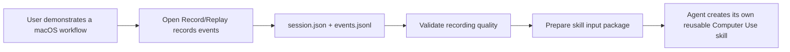

# open-record-replay

[返回分类](../../views/categories/SOFTWARE-DELIVERY.md) · [返回首页](../../../README.md)

源码版本：[8eff3fa](https://github.com/humblebanana/open-record-replay/tree/8eff3fa6217810a809b4f1e32ff5273416d36d63)

<!-- BEGIN META -->
[](https://github.com/humblebanana/open-record-replay) [](https://www.npmjs.com/package/open-record-replay) [](https://www.npmjs.com/package/open-record-replay)
<!-- END META -->

> **功能**：在 macOS 记录桌面操作并为 Agent 技能创建整理证据包。

> **亮点**：[Q01](#research-q01) 将桌面操作留下结构化证据，便于宿主技能工具读取。

> **主要限制**：[Q02](#research-q02) 打包复制原始证据，质量校验与隐私预览需要另做。

**本文目录**

- [1 插件分析](#detail-section-1)
  - [1.1 用途与适用场景](#detail-section-2)
  - [1.2 能力、流程与成本](#detail-section-3)
  - [1.3 工程亮点](#detail-section-4)
  - [1.4 主要限制](#detail-section-5)
  - [1.5 使用建议](#detail-section-6)
  - [1.6 核查说明与分析版本](#detail-section-7)
- [2 未来设计假设（未验证）](#detail-section-8)
- [3 辅助信息](#detail-section-9)
- [4 研究问题与完整回答](#detail-section-10)
  - [Q01 · 一次桌面示范能交付哪些可用证据？](#detail-section-11)
  - [Q02 · 录制、质量检查和隐私预览如何区分？](#detail-section-12)
  - [Q03 · 怎样验收可交接证据，并减少敏感内容流入技能？](#detail-section-13)

<a id="detail-section-1"></a>

## 1 插件分析

<a id="detail-section-2"></a>

### 1.1 用途与适用场景

> **用途**：桌面流程包含菜单、拖拽或多个应用，文字难以交代步骤。

用截图、视频和手工步骤说明交接流程。

<a id="detail-section-3"></a>

### 1.2 能力、流程与成本

#### 能力

| 能力 | 主要用途 | 使用条件与边界 |
| --- | --- | --- |
| 桌面录制 | 生成会话和结构化动作证据 | 需 macOS 权限及本地审阅 |
| 证据包 | 交给宿主生成技能 | 复制原件，不自动脱敏 |

#### 启动与依赖

| 依赖或条件 | 是否必需 | 用途 | 缺失或不满足时 |
| --- | --- | --- | --- |
| macOS、Node 及原生录制器 | 必需 | 启动录制 | 权限或构建缺失时失败 |
| 宿主技能创建入口 | 交接后必需 | 形成最终技能 | 证据包仍可审阅 |

#### 启动步骤

| 步骤 | 执行者与动作 | 成功判据或失败处理 |
| --- | --- | --- |
| 准备 | 用户选择合成桌面流程 | 权限和披露范围明确 |
| 演示 | 用户录制、验证并审阅事件 | 检查目标、顺序与敏感内容 |
| 交接 | 用户只提供审阅后的证据 | 用独立任务验收最终技能 |

#### 成本

| 阶段 | 现金与资源成本 | 人工与时间投入 | 已知条件与未知项 |
| --- | --- | --- | --- |
| 首次 | 资源未知 | 准备录制器与权限 | 限 macOS |
| 持续 | 录制及存储未知 | 人工审阅事件和交付 | 原始包不自动脱敏 |
| 失败 | 复录开销未知 | 修正权限或改手工步骤 | 勿转交不完整内容 |

#### 效果

| 效果项 | 当前证据支持 | 尚不能确定 |
| --- | --- | --- |
| 证据交接 | 导出会话及事件供技能创建 | 实际复现率与人力节省 |

> **思考**：[Q02](#research-q02) 打包复制原始证据，质量校验与隐私预览需要另做。

<a id="detail-section-4"></a>

### 1.3 工程亮点

> **亮点**：[Q01](#research-q01) 将桌面操作留下结构化证据，便于宿主技能工具读取。

[Q02](#research-q02) 录制验证与证据复制独立，预览仅提示敏感候选。

<a id="detail-section-5"></a>

### 1.4 主要限制

[Q02](#research-q02) 打包复制原始证据，质量校验与隐私预览需要另做。

<a id="detail-section-6"></a>

### 1.5 使用建议

[Q03](#research-q03) 用合成流程录制，单独验证并检查证据后再交接。

<a id="detail-section-7"></a>

### 1.6 核查说明与分析版本

**核查状态**：已检查源码。

固定源码确认 CLI、证据与移交边界，真实录制和复现未验收。

- 已检查：作者 README、包清单、源码路径 README.md、package.json、packages/cli/src/index.mjs、packages/core-engine/src/skillPackage.mjs、packages/core-engine/src/store.mjs、packages/privacy/src/index.mjs 及固定范围 inventory；组件：仓库根。抽读不冒充完整审计，来源和原文嵌入正式快照时保留。
- 未执行：插件安装、目标代码与测试、真实宿主及模型任务。源码存在不等于运行通过。
- 边界：固定 CLI、录制启动与证据包源码。未运行原生录制、宿主或测试。
- 下一步：检查权限、停止、缺事件、脱敏及下游复现。

**分析版本**

- **仓库**：[humblebanana/open-record-replay](https://github.com/humblebanana/open-record-replay)
- **版本号**：0.1.0（[固定提交 8eff3fa](https://github.com/humblebanana/open-record-replay/tree/8eff3fa6217810a809b4f1e32ff5273416d36d63)）
- **版本日期**：2026-06-22（固定提交日期，北京时间；不是包发布日期）

<a id="detail-section-8"></a>

## 2 未来设计假设（未验证）

<a id="innovation"></a>

[Q03](#research-q03) 分离受控原件与人工确认的分享副本，比较泄露和复现。

检查权限、停止、缺事件、脱敏及下游复现。

<a id="detail-section-9"></a>

## 3 辅助信息

<details>
<summary>工程统计</summary>

仅统计 Markdown 和指定的 JavaScript／TypeScript 扩展名；Python 等其他语言不纳入，表格不代表全语言代码规模。

| 扩展名 | 范围 | 文件数 | 总行 | 代码行 | 注释行 | 字数 |
|---|---|---:|---:|---:|---:|---:|
| .js | source | 1 | 16 | 15 | 0 | — |
| .md | source | 11 | 1182 | — | — | 5654 |
| .mjs | source | 7 | 860 | 768 | 1 | — |
| .mjs | test | 5 | 199 | 181 | 0 | — |

</details>

**活跃度**

Issue 活跃度数据暂未获取（查询日期：2026-11-05），可前往 [GitHub Issues](https://github.com/humblebanana/open-record-replay/issues) 查看。

<a id="detail-section-10"></a>

## 4 研究问题与完整回答

**插件研究总目标**：用户能否把难以描述的桌面流程记录为可复核、可安全交接的证据？

<a id="research-q01"></a>

<a id="detail-section-11"></a>

### Q01 · 一次桌面示范能交付哪些可用证据？

**研究主题**：场景与需求、贡献与相对优势

#### 完整回答

对菜单、拖拽和跨应用步骤难用提示词描述的任务，用户可记录一轮动作并产出会话和 JSONL，随后交给宿主技能创建流程。相较只写操作说明，证据包含动作顺序和 UI 线索。根包是 macOS CLI，不是 DSH Host 插件。CLI 注册录制、检查、质量比较和证据包，不直接生成或安装最终技能；重放效果仍由下游技能和宿主决定。

#### 证据与依据

**依据 1 · 作者声明**：[README.md:24-49](https://github.com/humblebanana/open-record-replay/blob/8eff3fa6217810a809b4f1e32ff5273416d36d63/README.md#L24-L49)

作者的演示到技能流程。

<details>
<summary>查看原文（26行）</summary>

````text
</p>

Open Record/Replay is a local-first macOS recorder for workflows that are easier to show than to write down. It captures a user's real desktop actions into structured artifacts such as `session.json` and `events.jsonl`, validates the recording quality, and packages the evidence for an agent's skill creation flow.

The goal is simple: if a user can demonstrate a desktop workflow once, an agent should have enough evidence to learn it.



## Why This Exists

Some workflows are hard to describe as prompts:

- They depend on visible desktop UI.
- They involve file pickers, menus, modals, or drag-and-drop.
- They span multiple apps.
- They depend on personal workspace layout or team-specific conventions.
- They are easier to learn from a demonstration than from a written runbook.

Open Record/Replay gives agents a concrete evidence stream instead of asking them to infer the workflow from a vague description.
````

</details>

**依据 2 · 源码核查**：[package.json:7-20](https://github.com/humblebanana/open-record-replay/blob/8eff3fa6217810a809b4f1e32ff5273416d36d63/package.json#L7-L20)

平台和 CLI 入口。

<details>
<summary>查看原文（14行）</summary>

```text
  "engines": {
    "node": ">=18"
  },
  "os": [
    "darwin"
  ],
  "bin": {
    "orr": "./bin/orr.js"
  },
  "scripts": {
    "build:native": "swift build --package-path packages/platform-macos",
    "check": "npm test && npm run build:native",
    "test": "node --test tests/*.test.mjs",
    "orr": "node ./bin/orr.js"
```

</details>

**依据 3 · 源码核查**：[packages/cli/src/index.mjs:16-33](https://github.com/humblebanana/open-record-replay/blob/8eff3fa6217810a809b4f1e32ff5273416d36d63/packages/cli/src/index.mjs#L16-L33)

实际命令。

<details>
<summary>查看原文（18行）</summary>

```text
export async function main(argv) {
  const [area, command, ...rest] = argv;
  if (!area || area === "help" || area === "--help" || area === "-h") return printHelp();

  if (area === "permissions" && command === "check") return print(await permissionsCheck());
  if (area === "permissions" && command === "request") return print(await permissionsRequest());
  if (area === "record" && command === "start") return print(await recordStart(rest));
  if (area === "record" && command === "stop") return print(await recordStop(rest));
  if (area === "session" && command === "list") return print(await sessionList(rest));
  if (area === "session" && command === "inspect") return print(await sessionInspect(rest));
  if (area === "session" && command === "events") return print(await sessionEvents(rest));
  if (area === "session" && command === "validate-recording") return print(await sessionValidateRecording(rest));
  if (area === "redaction" && command === "preview") return print(await redaction(rest));
  if (area === "quality" && command === "sources") return print(await qualitySources(rest));
  if (area === "quality" && command === "compare") return print(await qualityCompare(rest));
  if (area === "skill" && command === "prepare") return print(await skillPrepare(rest));

  throw new Error(`Unknown command: ${argv.join(" ")}`);
```

</details>

**依据 4 · 源码核查**：[packages/core-engine/src/skillPackage.mjs:76-95](https://github.com/humblebanana/open-record-replay/blob/8eff3fa6217810a809b4f1e32ff5273416d36d63/packages/core-engine/src/skillPackage.mjs#L76-L95)

证据移交结果。

<details>
<summary>查看原文（20行）</summary>

```text
  return {
    session_id: session.id,
    package_dir: packageDir,
    files: {
      session_json: targetSessionPath,
      events_jsonl: targetEventsPath,
      readme: targetReadmePath
    },
    source: {
      session_json: existsSync(sourceSessionPath) ? sourceSessionPath : null,
      events_jsonl: eventsPath
    },
    handoff: {
      next_step: "invoke_host_native_skill_creator",
      must_use_host_native_skill_creator: true,
      fallback_requires_user_approval: true,
      evidence_package_dir: packageDir,
      instruction: "Pass this package directory to the current host agent's native skill creator. Do not manually write or install the final skill unless the host has no native skill creator and the user explicitly approves that fallback."
    },
    session: await readJson(targetSessionPath)
```

</details>

#### 缺口

- 未比较下游技能效果
  **影响**：无法确定示范比文字描述更易复现
  **进一步探讨**：同一任务比较人工说明和录制包的重做结果

<a id="research-q02"></a>

<a id="detail-section-12"></a>

### Q02 · 录制、质量检查和隐私预览如何区分？

**研究主题**：功能与机制、缺陷与关键质疑、工程质量与复用

#### 完整回答

录制默认先检查原生 macOS 权限，创建会话状态和开始事件，再启动 detached recorder。录制校验、质量比较与生成证据包是独立命令。prepare 只要求事件文件存在，直接复制 session 和 events，未调用质量验证或脱敏。redactionPreview 只是对输入文本匹配少量秘密模式并返回候选建议，不会改写录制包，不能保护未命中样式的私人内容。准备前需人工检查原始证据。

#### 证据与依据

**依据 1 · 源码核查**：[packages/core-engine/src/store.mjs:52-70](https://github.com/humblebanana/open-record-replay/blob/8eff3fa6217810a809b4f1e32ff5273416d36d63/packages/core-engine/src/store.mjs#L52-L70)

权限和会话目录。

<details>
<summary>查看原文（19行）</summary>

```text
export async function createSession({
  name = "screen-activity",
  out = "runs",
  recorder = true,
  preflight = true,
  requestPermissions = false
} = {}) {
  if (recorder && preflight) {
    const permissions = await checkNativeMacOSPermissions({ request: requestPermissions });
    if (!permissions.recorderReady) throw new RecorderPermissionError(permissions);
  }

  const runRoot = resolveRunRoot(out);
  const id = randomUUID().toUpperCase();
  const dir = sessionDir(runRoot, id);
  const eventsPath = path.join(dir, "events.jsonl");
  const recordingManifestPath = path.join(dir, "recording_manifest.json");
  const startedAt = new Date().toISOString();
  const metadata = {
```

</details>

**依据 2 · 源码核查**：[packages/core-engine/src/store.mjs:94-121](https://github.com/humblebanana/open-record-replay/blob/8eff3fa6217810a809b4f1e32ff5273416d36d63/packages/core-engine/src/store.mjs#L94-L121)

状态文件及原生录制进程。

<details>
<summary>查看原文（28行）</summary>

```text
    demo: null,
    artifacts: {
      events_path: eventsPath,
      recording_manifest_path: recordingManifestPath
    },
    recorder: null
  };
  await writeJson(sessionMetadataPath(dir), metadata);
  await writeJson(sessionStatePath(dir), session);
  await appendEvent(eventsPath, {
    id: 1,
    kind: "session.started",
    timestamp: startedAt
  });
  if (!recorder) return session;

  const invocation = await recorderInvocation({
    sessionState: sessionStatePath(dir),
    eventsPath,
    manifestPath: recordingManifestPath
  });

  const recorderProcess = spawn(invocation.command, invocation.args, {
    cwd: process.cwd(),
    detached: true,
    stdio: "ignore"
  });
  recorderProcess.unref();
```

</details>

**依据 3 · 源码核查**：[packages/cli/src/index.mjs:79-116](https://github.com/humblebanana/open-record-replay/blob/8eff3fa6217810a809b4f1e32ff5273416d36d63/packages/cli/src/index.mjs#L79-L116)

独立的验证、比较、打包与预览。

<details>
<summary>查看原文（38行）</summary>

```text
async function sessionValidateRecording(args) {
  const options = parseOptions(args);
  const session = await getSession(options._[0] ?? "latest", options.out ?? "runs");
  return {
    session_id: session.id,
    events_path: session.artifacts.events_path,
    official_record_replay_contract: await validateOfficialRecordingContract({ session })
  };
}

async function qualitySources() {
  return { sources: await listQualitySources() };
}

async function qualityCompare(args) {
  const options = parseOptions(args);
  const sourceId = options.source ?? "feishu-file-send";
  let eventsPath = options.events;
  if (!eventsPath) {
    const session = await getSession(options._[0] ?? "latest", options.out ?? "runs");
    eventsPath = session.artifacts.events_path;
  }
  return await compareRecordingToSource({ eventsPath, sourceId });
}

async function skillPrepare(args) {
  const options = parseOptions(args);
  return await prepareSkillEvidencePackage({
    sessionId: options._[0] ?? "latest",
    runs: options.runs ?? "runs",
    out: options.out ?? "skill-inputs"
  });
}

async function redaction(args) {
  const options = parseOptions(args);
  const input = options._.length ? options._.join(" ") : await readStdin();
  return redactionPreview(input);
```

</details>

**依据 4 · 源码核查**：[packages/core-engine/src/skillPackage.mjs:53-74](https://github.com/humblebanana/open-record-replay/blob/8eff3fa6217810a809b4f1e32ff5273416d36d63/packages/core-engine/src/skillPackage.mjs#L53-L74)

直接复制原件。

<details>
<summary>查看原文（22行）</summary>

```text
export async function prepareSkillEvidencePackage({ sessionId = "latest", runs = "runs", out = "skill-inputs" } = {}) {
  const session = await getSession(sessionId, runs);
  const eventsPath = session.artifacts?.events_path;
  if (!eventsPath || !existsSync(eventsPath)) {
    throw new Error(`events.jsonl not found for session: ${session.id}`);
  }

  const packageDir = path.resolve(process.cwd(), out, session.id);
  await ensureDir(packageDir);

  const sourceSessionPath = path.join(path.dirname(eventsPath), "session.json");
  const targetSessionPath = path.join(packageDir, "session.json");
  const targetEventsPath = path.join(packageDir, "events.jsonl");
  const targetReadmePath = path.join(packageDir, "README.md");

  if (existsSync(sourceSessionPath)) {
    await copyFile(sourceSessionPath, targetSessionPath);
  } else {
    await writeJson(targetSessionPath, session);
  }
  await copyFile(eventsPath, targetEventsPath);
  await writeFile(targetReadmePath, README, "utf8");
```

</details>

**依据 5 · 源码核查**：[packages/privacy/src/index.mjs:1-24](https://github.com/humblebanana/open-record-replay/blob/8eff3fa6217810a809b4f1e32ff5273416d36d63/packages/privacy/src/index.mjs#L1-L24)

启发式预览。

<details>
<summary>查看原文（24行）</summary>

```text
const SECRET_PATTERNS = [
  { name: "password", pattern: /password|passwd|pwd/i },
  { name: "api_key", pattern: /\b(?:sk-[A-Za-z0-9_-]{12,}|api[_-]?key)\b/i },
  { name: "token", pattern: /\b(?:token|bearer\s+[A-Za-z0-9._-]+)\b/i },
  { name: "otp", pattern: /\b\d{6}\b/ }
];

export function redactionPreview(value) {
  const text = typeof value === "string" ? value : JSON.stringify(value);
  const candidates = [];
  for (const rule of SECRET_PATTERNS) {
    if (rule.pattern.test(text)) {
      candidates.push({
        kind: rule.name,
        reason: `Matched ${rule.name} pattern`,
        replacement: `{{${rule.name.toUpperCase()}}}`
      });
    }
  }
  return {
    sensitive: candidates.length > 0,
    candidates
  };
}
```

</details>

#### 缺口

- 未运行原生录制与各权限组合
  **影响**：实际事件覆盖和隐私范围未知
  **进一步探讨**：录制只含合成文本和文件名的多应用过程，人工检查每项原始事件

<a id="research-q03"></a>

<a id="detail-section-13"></a>

### Q03 · 怎样验收可交接证据，并减少敏感内容流入技能？

**研究主题**：依赖、兼容与流程、效果与总成本、采用判断、新假设与验证

#### 完整回答

在隔离 macOS 和非敏感应用中检查录制权限，开始与停止后读 session、events，再独立运行验证并仅交接核对过的证据。若记录缺步或含敏感内容，保留原件在受控目录，改用手工说明。可对照生成另一个经过人工确认的分享副本并附录制质量摘要，用秘密样本测泄露率、任务重做率和人工时间。若漏脱敏或过度删减使任务不可复现则放弃。

#### 证据与依据

**依据 1 · 源码核查**：[packages/cli/src/index.mjs:36-54](https://github.com/humblebanana/open-record-replay/blob/8eff3fa6217810a809b4f1e32ff5273416d36d63/packages/cli/src/index.mjs#L36-L54)

录制与权限选择。

<details>
<summary>查看原文（19行）</summary>

```text
async function recordStart(args) {
  const options = parseOptions(args);
  const session = await createSession({
    name: options.name ?? "screen-activity",
    out: options.out ?? "runs",
    recorder: !options["no-recorder"],
    recorderKind: options.recorder ?? "native-macos",
    preflight: !options["skip-permission-check"],
    requestPermissions: Boolean(options["request-permissions"])
  });
  return { session_id: session.id, session };
}

async function permissionsCheck() {
  return { permissions: await checkNativeMacOSPermissions({ request: false }) };
}

async function permissionsRequest() {
  return { permissions: await checkNativeMacOSPermissions({ request: true }) };
```

</details>

**依据 2 · 源码核查**：[packages/core-engine/src/skillPackage.mjs:53-95](https://github.com/humblebanana/open-record-replay/blob/8eff3fa6217810a809b4f1e32ff5273416d36d63/packages/core-engine/src/skillPackage.mjs#L53-L95)

文件复制和下游交接。

<details>
<summary>查看原文（43行）</summary>

```text
export async function prepareSkillEvidencePackage({ sessionId = "latest", runs = "runs", out = "skill-inputs" } = {}) {
  const session = await getSession(sessionId, runs);
  const eventsPath = session.artifacts?.events_path;
  if (!eventsPath || !existsSync(eventsPath)) {
    throw new Error(`events.jsonl not found for session: ${session.id}`);
  }

  const packageDir = path.resolve(process.cwd(), out, session.id);
  await ensureDir(packageDir);

  const sourceSessionPath = path.join(path.dirname(eventsPath), "session.json");
  const targetSessionPath = path.join(packageDir, "session.json");
  const targetEventsPath = path.join(packageDir, "events.jsonl");
  const targetReadmePath = path.join(packageDir, "README.md");

  if (existsSync(sourceSessionPath)) {
    await copyFile(sourceSessionPath, targetSessionPath);
  } else {
    await writeJson(targetSessionPath, session);
  }
  await copyFile(eventsPath, targetEventsPath);
  await writeFile(targetReadmePath, README, "utf8");

  return {
    session_id: session.id,
    package_dir: packageDir,
    files: {
      session_json: targetSessionPath,
      events_jsonl: targetEventsPath,
      readme: targetReadmePath
    },
    source: {
      session_json: existsSync(sourceSessionPath) ? sourceSessionPath : null,
      events_jsonl: eventsPath
    },
    handoff: {
      next_step: "invoke_host_native_skill_creator",
      must_use_host_native_skill_creator: true,
      fallback_requires_user_approval: true,
      evidence_package_dir: packageDir,
      instruction: "Pass this package directory to the current host agent's native skill creator. Do not manually write or install the final skill unless the host has no native skill creator and the user explicitly approves that fallback."
    },
    session: await readJson(targetSessionPath)
```

</details>

**依据 3 · 源码核查**：[packages/privacy/src/index.mjs:1-24](https://github.com/humblebanana/open-record-replay/blob/8eff3fa6217810a809b4f1e32ff5273416d36d63/packages/privacy/src/index.mjs#L1-L24)

现有预览基线。

<details>
<summary>查看原文（24行）</summary>

```text
const SECRET_PATTERNS = [
  { name: "password", pattern: /password|passwd|pwd/i },
  { name: "api_key", pattern: /\b(?:sk-[A-Za-z0-9_-]{12,}|api[_-]?key)\b/i },
  { name: "token", pattern: /\b(?:token|bearer\s+[A-Za-z0-9._-]+)\b/i },
  { name: "otp", pattern: /\b\d{6}\b/ }
];

export function redactionPreview(value) {
  const text = typeof value === "string" ? value : JSON.stringify(value);
  const candidates = [];
  for (const rule of SECRET_PATTERNS) {
    if (rule.pattern.test(text)) {
      candidates.push({
        kind: rule.name,
        reason: `Matched ${rule.name} pattern`,
        replacement: `{{${rule.name.toUpperCase()}}}`
      });
    }
  }
  return {
    sensitive: candidates.length > 0,
    candidates
  };
}
```

</details>

#### 缺口

- 未测真实 TCC 权限、原生记录及技能复用
  **影响**：成本、结果质量和改法收益未知
  **进一步探讨**：用合成流程测缺权限、证据缺步和人工审查时间

[返回分类](../../views/categories/SOFTWARE-DELIVERY.md) · [返回首页](../../../README.md)
